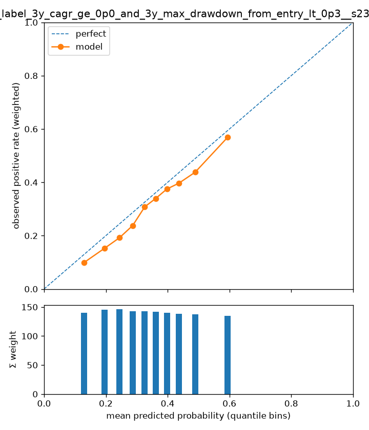

# Experiment report — forest_fallen50_cellC_seeds_3y__label_3y_cagr_ge_0p0_and_3y_max_drawdown_from_entry_lt_0p3__s232

- run id: `0cb0ea8c1a5c`
- dataset version: `1.4.1` (pinned, immutable)
- dataset sha256: `be2b664c6739b93d5b5a7df1d085c09f09575071dd02d1f1426ed1586e052085` (dataset.parquet, from the manifest's provenance block)
- config hash: `38ad64165da7bb89`
- git SHA: `f24b95eda15ff2283e1ea10025a00b1f1aac57b0`
- seed: 232
- model: `random_forest` params `{"bootstrap": true, "class_weight": 1.0, "criterion": "entropy", "max_depth": 4, "max_features": 0.205191, "max_samples": 0.663781, "min_samples_leaf": 72, "n_estimators": 490, "n_jobs": 8}`
- label: `fwd_3y_cagr >= 0.0 & fwd_3y_max_drawdown_from_entry < 0.3` — horizon 3y, scheme `walkforward`
- derived label `fwd_3y_cagr >= 0.0 & fwd_3y_max_drawdown_from_entry < 0.3`: evaluated on the fly from the manifest's continuous outcome columns (harness.derived_labels); NULL wherever a referenced column is NULL
- **universe: `dist_5y_high <= -0.5 & dollar_volume_3m >= 100000`** — train and test rows outside it are left out (a row with a NULL in a filter column is outside). Every number below describes this universe: base rates, baselines and picks are not comparable with a run over all rows, and the run is counted in the universe's own ledger cell. The filter reads feature columns as of the snapshot; it builds no split (upstream tags decide train and test, the purge and embargo hold for the rows that remain) and derives no column. `sample_weight` is the upstream uniqueness weight, not recomputed for the rows left out.
- **configurations tried against this cell (dataset, scheme, horizon, label, universe): 34** (from the append-only results store; failed runs count); **68 against this label in any universe**
- saved model bundle: `experiments/models/forest_fallen50_cellC_seeds_3y__label_3y_cagr_ge_0p0_and_3y_max_drawdown_from_entry_lt_0p3__s232_0cb0ea8c1a5c` (re-evaluate with `vml-eval`, no refitting)

## Era-sliced metrics (one row per test year)

Sliced on the calendar year of each test row's `snapshot_date` (one walk-forward fold per year); crash eras are tagged inline. `conf_at_K` is the mean score of the top-K picks; `base_rate_brier` is the no-skill Brier the model must beat. \*The pooled row picks per year — per-fold model scores are not comparable, so a global top-K would just take the hottest-scoring fold's picks; it is context for the era rows, never a stand-alone result. ROC-AUC and recall@K are logged in the results store, not shown here.

| era          | n_test | base_rate | mean_score | precision_at_20 | precision_at_50 | precision_at_thr_0.5 | precision_at_thr_0.6 | precision_at_thr_0.7 | conf_at_20 | conf_at_50 | n_at_prec_0.75 | n_at_prec_0.9 | recall_at_prec_0.75 | recall_at_prec_0.9 | recall_at_thr_0.5 | recall_at_thr_0.6 | recall_at_thr_0.7 | n_at_thr_0.5 | n_at_thr_0.6 | n_at_thr_0.7 | brier  | base_rate_brier | pr_auc |
| ------------ | ------ | --------- | ---------- | --------------- | --------------- | -------------------- | -------------------- | -------------------- | ---------- | ---------- | -------------- | ------------- | ------------------- | ------------------ | ----------------- | ----------------- | ----------------- | ------------ | ------------ | ------------ | ------ | --------------- | ------ |
| 2006         | 2961   | 0.1942    | 0.2834     | 0.3000          | 0.2600          | —                    | —                    | —                    | 0.4582     | 0.4496     | 0              | 0             | 0                   | 0                  | 0                 | 0                 | 0                 | 0            | 0            | 0            | 0.1635 | 0.1565          | 0.2351 |
| 2007         | 2494   | 0.1053    | 0.3753     | 0.0500          | 0.1200          | 0.1007               | 0                    | —                    | 0.6062     | 0.5897     | 0              | 0             | 0                   | 0                  | 0.1582            | 0                 | 0                 | 278          | 12           | 0            | 0.1711 | 0.0942          | 0.1297 |
| 2008 (GFC)   | 4367   | 0.1753    | 0.4427     | 0.7000          | 0.6400          | 0.2690               | 0.3519               | 0.7000               | 0.7117     | 0.7052     | 25             | 0             | 0.0271              | 0                  | 0.6248            | 0.3238            | 0.0399            | 1628         | 645          | 40           | 0.2142 | 0.1446          | 0.3250 |
| 2009 (GFC)   | 5398   | 0.5808    | 0.4712     | 0.9000          | 0.9600          | 0.7211               | 0.7678               | 0.9000               | 0.7033     | 0.6991     | 1858           | 82            | 0.4479              | 0.0238             | 0.5559            | 0.2709            | 0.0058            | 2399         | 1098         | 20           | 0.2291 | 0.2435          | 0.7356 |
| 2010         | 4133   | 0.4384    | 0.3915     | 0.7500          | 0.7600          | 0.6045               | 0.7500               | —                    | 0.6501     | 0.6395     | 128            | 2             | 0.0549              | 0.0011             | 0.2743            | 0.0549            | 0                 | 794          | 128          | 0            | 0.2243 | 0.2462          | 0.5930 |
| 2011         | 3551   | 0.3728    | 0.3356     | 0.7000          | 0.7600          | 0.6070               | 0.7273               | —                    | 0.6184     | 0.6013     | 49             | 0             | 0.0298              | 0                  | 0.1489            | 0.0125            | 0                 | 313          | 22           | 0            | 0.2105 | 0.2338          | 0.5485 |
| 2012         | 3143   | 0.5050    | 0.2974     | 0.9000          | 0.8600          | 0.8810               | —                    | —                    | 0.5384     | 0.5207     | 548            | 29            | 0.2661              | 0.0174             | 0.0239            | 0                 | 0                 | 42           | 0            | 0            | 0.2650 | 0.2500          | 0.7083 |
| 2013         | 1949   | 0.3327    | 0.2799     | 0.7500          | 0.6000          | 0.6364               | —                    | —                    | 0.5092     | 0.4826     | 26             | 5             | 0.0334              | 0.0084             | 0.0117            | 0                 | 0                 | 11           | 0            | 0            | 0.2094 | 0.2220          | 0.4750 |
| 2014         | 1821   | 0.1736    | 0.2504     | 0.3500          | 0.2800          | —                    | —                    | —                    | 0.4528     | 0.4364     | 1              | 1             | 0.0033              | 0.0033             | 0                 | 0                 | 0                 | 0            | 0            | 0            | 0.1387 | 0.1434          | 0.3269 |
| 2015         | 2321   | 0.1713    | 0.2783     | 0.4500          | 0.4400          | 0                    | —                    | —                    | 0.4927     | 0.4761     | 0              | 0             | 0                   | 0                  | 0                 | 0                 | 0                 | 4            | 0            | 0            | 0.1460 | 0.1420          | 0.3091 |
| 2016         | 2723   | 0.3952    | 0.3201     | 0.6000          | 0.6200          | 0.6344               | —                    | —                    | 0.5562     | 0.5424     | 0              | 0             | 0                   | 0                  | 0.0591            | 0                 | 0                 | 93           | 0            | 0            | 0.2219 | 0.2390          | 0.5673 |
| 2017         | 2466   | 0.1975    | 0.2970     | 0.5000          | 0.4800          | 0.4167               | —                    | —                    | 0.5183     | 0.5017     | 1              | 1             | 0.0023              | 0.0023             | 0.0234            | 0                 | 0                 | 24           | 0            | 0            | 0.1676 | 0.1585          | 0.2900 |
| 2018         | 2733   | 0.1462    | 0.2880     | 0.3500          | 0.2200          | 0.2812               | —                    | —                    | 0.5201     | 0.5076     | 0              | 0             | 0                   | 0                  | 0.0269            | 0                 | 0                 | 32           | 0            | 0            | 0.1468 | 0.1248          | 0.2013 |
| 2019         | 3068   | 0.1289    | 0.2997     | 0.2000          | 0.2000          | 0.1324               | —                    | —                    | 0.5699     | 0.5509     | 0              | 0             | 0                   | 0                  | 0.0541            | 0                 | 0                 | 136          | 0            | 0            | 0.1504 | 0.1123          | 0.1496 |
| 2020 (COVID) | 3885   | 0.3573    | 0.3209     | 0.7500          | 0.6600          | 0.5896               | 0.7419               | —                    | 0.6188     | 0.6069     | 32             | 2             | 0.0175              | 0.0015             | 0.1823            | 0.0168            | 0                 | 424          | 31           | 0            | 0.1986 | 0.2296          | 0.5615 |
| pooled*      | 47013  | 0.3085    | 0.3439     | 0.5500          | 0.5240          | 0.5270               | 0.6224               | 0.7667               | 0.5683     | 0.5540     | 2668           | 122           | 0.1460              | 0.0082             | 0.2370            | 0.0877            | 0.0033            | 6178         | 1936         | 60           | 0.1962 | 0.2133          | 0.4729 |

## High-confidence picks (pooled)

How many high-confidence calls the model made, how confident it was, and how precise they were — no pre-chosen score threshold needed. `top N/yr` rows pick per test year; `score >= p` rows (probabilistic models) count every name at or above that probability, pooled.

| selection    | n_picks | picks_per_year | mean_score | precision | hits |
| ------------ | ------- | -------------- | ---------- | --------- | ---- |
| top 5/yr     | 75      | 5              | 0.5830     | 0.5200    | 39   |
| top 10/yr    | 150     | 10             | 0.5765     | 0.5267    | 79   |
| top 20/yr    | 300     | 20             | 0.5683     | 0.5500    | 165  |
| top 50/yr    | 750     | 50             | 0.5540     | 0.5240    | 393  |
| score >= 0.9 | 0       | 0              | —          | —         | 0    |
| score >= 0.8 | 0       | 0              | —          | —         | 0    |
| score >= 0.7 | 60      | 4              | 0.7057     | 0.7667    | 46   |
| score >= 0.6 | 1936    | 129.1000       | 0.6452     | 0.6224    | 1205 |
| score >= 0.5 | 6178    | 411.9000       | 0.5751     | 0.5270    | 3256 |

## Pick outcomes (what the picks went on to do)

Report-only outcomes of the top-K picks of each test year (`pick_outcomes`: `label_3y_beat_spy`, `fwd_3y_excess_cagr`, `fwd_3y_cagr`, `fwd_3y_max_drawdown_from_entry`, `fwd_3y_cagr < 0.0`, `fwd_3y_cagr < -0.1`, `fwd_3y_max_drawdown_from_entry >= 0.4`, `fwd_3y_cagr >= 0.15`, `fwd_3y_cagr >= 0.26`, `fwd_3y_excess_cagr >= 0.05`, `fwd_3y_excess_cagr >= 0.1`), from the manifest's label columns; none is a model input or the training target, and the run is counted in its own label's cell. For a binary outcome the picks' hit rate, for a continuous one their mean and median, each beside the same statistic over **all** test rows of the era (unweighted, like the picks: one row, one pick). `stocks` is the number of distinct `permaticker`s among the picks (a stock has up to four test rows a year); in the pooled row it is the mean per year and the statistics run over every year's picks. NULL outcomes are left out, not counted as misses. This is a no-cost, equal-weight reading of the picks, a screen for `vml-backtest` and not a substitute.

### Top 20 per test year: `label_3y_beat_spy`

| era          | picks | stocks  | picks hit rate | all rows |
| ------------ | ----- | ------- | -------------- | -------- |
| 2006         | 20    | 14      | 0.6500         | 0.3347   |
| 2007         | 20    | 17      | 0.6000         | 0.3452   |
| 2008 (GFC)   | 20    | 20      | 0.8500         | 0.5054   |
| 2009 (GFC)   | 20    | 20      | 0.8000         | 0.5057   |
| 2010         | 20    | 17      | 0.6000         | 0.3639   |
| 2011         | 20    | 17      | 0.4500         | 0.3402   |
| 2012         | 20    | 12      | 0.4500         | 0.3668   |
| 2013         | 20    | 15      | 0.2000         | 0.2432   |
| 2014         | 20    | 15      | 0.2000         | 0.1889   |
| 2015         | 20    | 13      | 0.1000         | 0.2456   |
| 2016         | 20    | 17      | 0.2500         | 0.2751   |
| 2017         | 20    | 13      | 0.3000         | 0.1740   |
| 2018         | 20    | 18      | 0.1500         | 0.2181   |
| 2019         | 20    | 16      | 0.3500         | 0.2731   |
| 2020 (COVID) | 20    | 20      | 0.4500         | 0.3871   |
| pooled*      | 300   | 16.2667 | 0.4267         | 0.3437   |

### Top 20 per test year: `fwd_3y_excess_cagr`

| era          | picks | stocks  | picks mean | picks median | all rows mean | all rows median |
| ------------ | ----- | ------- | ---------- | ------------ | ------------- | --------------- |
| 2006         | 20    | 14      | 0.0632     | 0.0678       | -0.1485       | -0.1293         |
| 2007         | 20    | 17      | -0.0041    | 0.0416       | -0.1619       | -0.1185         |
| 2008 (GFC)   | 20    | 20      | 0.0797     | 0.0620       | -0.0202       | 0.0033          |
| 2009 (GFC)   | 20    | 20      | 0.0951     | 0.1100       | -0.0092       | 0.0031          |
| 2010         | 20    | 17      | 0.0233     | 0.0582       | -0.1113       | -0.0706         |
| 2011         | 20    | 17      | -0.0237    | -0.0381      | -0.1309       | -0.0948         |
| 2012         | 20    | 12      | 0.0112     | -0.0317      | -0.1179       | -0.0859         |
| 2013         | 20    | 15      | -0.0820    | -0.0576      | -0.2513       | -0.2115         |
| 2014         | 20    | 15      | -0.0911    | -0.0824      | -0.3169       | -0.2999         |
| 2015         | 20    | 13      | -0.1656    | -0.1268      | -0.2539       | -0.2026         |
| 2016         | 20    | 17      | -0.1167    | -0.1213      | -0.2113       | -0.1602         |
| 2017         | 20    | 13      | -0.0658    | -0.1386      | -0.3118       | -0.3109         |
| 2018         | 20    | 18      | -0.1822    | -0.1545      | -0.2592       | -0.2360         |
| 2019         | 20    | 16      | -0.0417    | -0.0600      | -0.2021       | -0.1901         |
| 2020 (COVID) | 20    | 20      | -0.0204    | -0.0332      | -0.1228       | -0.1038         |
| pooled*      | 300   | 16.2667 | -0.0347    | -0.0376      | -0.1506       | -0.1156         |

### Top 20 per test year: `fwd_3y_cagr`

| era          | picks | stocks  | picks mean | picks median | all rows mean | all rows median |
| ------------ | ----- | ------- | ---------- | ------------ | ------------- | --------------- |
| 2006         | 20    | 14      | -0.0364    | -0.0349      | -0.2366       | -0.2145         |
| 2007         | 20    | 17      | -0.0572    | -0.0252      | -0.2233       | -0.1797         |
| 2008 (GFC)   | 20    | 20      | 0.2047     | 0.1949       | 0.0370        | 0.0575          |
| 2009 (GFC)   | 20    | 20      | 0.2900     | 0.3046       | 0.1510        | 0.1606          |
| 2010         | 20    | 17      | 0.1758     | 0.2010       | 0.0376        | 0.0752          |
| 2011         | 20    | 17      | 0.1799     | 0.1650       | 0.0444        | 0.0786          |
| 2012         | 20    | 12      | 0.1895     | 0.1471       | 0.0506        | 0.0815          |
| 2013         | 20    | 15      | 0.0249     | 0.0482       | -0.1460       | -0.1060         |
| 2014         | 20    | 15      | 0.0122     | 0.0186       | -0.2148       | -0.1965         |
| 2015         | 20    | 13      | -0.0433    | -0.0080      | -0.1316       | -0.0802         |
| 2016         | 20    | 17      | 0.0187     | 0.0107       | -0.0773       | -0.0283         |
| 2017         | 20    | 13      | 0.0497     | -0.0218      | -0.1981       | -0.1986         |
| 2018         | 20    | 18      | 0.0088     | 0.0314       | -0.0843       | -0.0613         |
| 2019         | 20    | 16      | 0.0811     | 0.0867       | -0.0573       | -0.0441         |
| 2020 (COVID) | 20    | 20      | 0.1269     | 0.1207       | -0.0117       | 0.0049          |
| pooled*      | 300   | 16.2667 | 0.0817     | 0.0792       | -0.0413       | -0.0019         |

### Top 20 per test year: `fwd_3y_max_drawdown_from_entry`

| era          | picks | stocks  | picks mean | picks median | all rows mean | all rows median |
| ------------ | ----- | ------- | ---------- | ------------ | ------------- | --------------- |
| 2006         | 20    | 14      | 0.3757     | 0.3325       | 0.6696        | 0.7577          |
| 2007         | 20    | 17      | 0.6448     | 0.6130       | 0.7457        | 0.8301          |
| 2008 (GFC)   | 20    | 20      | 0.2750     | 0.2353       | 0.5984        | 0.6207          |
| 2009 (GFC)   | 20    | 20      | 0.2109     | 0.2179       | 0.3045        | 0.2247          |
| 2010         | 20    | 17      | 0.1543     | 0.1001       | 0.4040        | 0.3473          |
| 2011         | 20    | 17      | 0.1903     | 0.1179       | 0.4411        | 0.4006          |
| 2012         | 20    | 12      | 0.1258     | 0.1132       | 0.3666        | 0.2727          |
| 2013         | 20    | 15      | 0.2352     | 0.1490       | 0.5275        | 0.5447          |
| 2014         | 20    | 15      | 0.4727     | 0.4266       | 0.6500        | 0.7275          |
| 2015         | 20    | 13      | 0.3515     | 0.3171       | 0.6072        | 0.6345          |
| 2016         | 20    | 17      | 0.2697     | 0.1772       | 0.4741        | 0.4362          |
| 2017         | 20    | 13      | 0.3412     | 0.2548       | 0.6446        | 0.7257          |
| 2018         | 20    | 18      | 0.4606     | 0.3550       | 0.6806        | 0.7545          |
| 2019         | 20    | 16      | 0.5493     | 0.5991       | 0.6412        | 0.6815          |
| 2020 (COVID) | 20    | 20      | 0.2041     | 0.1748       | 0.4887        | 0.4635          |
| pooled*      | 300   | 16.2667 | 0.3241     | 0.2479       | 0.5257        | 0.5313          |

### Top 20 per test year: `label_3y_cagr_lt_0p0`

| era          | picks | stocks  | picks hit rate | all rows |
| ------------ | ----- | ------- | -------------- | -------- |
| 2006         | 20    | 14      | 0.6500         | 0.7592   |
| 2007         | 20    | 17      | 0.5500         | 0.7346   |
| 2008 (GFC)   | 20    | 20      | 0.0500         | 0.4069   |
| 2009 (GFC)   | 20    | 20      | 0.0500         | 0.2708   |
| 2010         | 20    | 17      | 0.2500         | 0.3791   |
| 2011         | 20    | 17      | 0.1000         | 0.3807   |
| 2012         | 20    | 12      | 0.1000         | 0.3767   |
| 2013         | 20    | 15      | 0.2500         | 0.6157   |
| 2014         | 20    | 15      | 0.4500         | 0.6925   |
| 2015         | 20    | 13      | 0.5000         | 0.5980   |
| 2016         | 20    | 17      | 0.4000         | 0.5347   |
| 2017         | 20    | 13      | 0.5000         | 0.7145   |
| 2018         | 20    | 18      | 0.3500         | 0.5686   |
| 2019         | 20    | 16      | 0.3000         | 0.5583   |
| 2020 (COVID) | 20    | 20      | 0.2500         | 0.4911   |
| pooled*      | 300   | 16.2667 | 0.3167         | 0.5034   |

### Top 20 per test year: `label_3y_cagr_lt_m0p1`

| era          | picks | stocks  | picks hit rate | all rows |
| ------------ | ----- | ------- | -------------- | -------- |
| 2006         | 20    | 14      | 0.3000         | 0.6417   |
| 2007         | 20    | 17      | 0.2500         | 0.6047   |
| 2008 (GFC)   | 20    | 20      | 0              | 0.2860   |
| 2009 (GFC)   | 20    | 20      | 0              | 0.1728   |
| 2010         | 20    | 17      | 0              | 0.2584   |
| 2011         | 20    | 17      | 0.0500         | 0.2684   |
| 2012         | 20    | 12      | 0              | 0.2889   |
| 2013         | 20    | 15      | 0.2000         | 0.5023   |
| 2014         | 20    | 15      | 0.1000         | 0.5859   |
| 2015         | 20    | 13      | 0.2500         | 0.4800   |
| 2016         | 20    | 17      | 0.2500         | 0.4297   |
| 2017         | 20    | 13      | 0.2500         | 0.5925   |
| 2018         | 20    | 18      | 0.2500         | 0.4592   |
| 2019         | 20    | 16      | 0.0500         | 0.4361   |
| 2020 (COVID) | 20    | 20      | 0.1500         | 0.4010   |
| pooled*      | 300   | 16.2667 | 0.1400         | 0.3927   |

### Top 20 per test year: `label_3y_max_drawdown_from_entry_ge_0p4`

| era          | picks | stocks  | picks hit rate | all rows |
| ------------ | ----- | ------- | -------------- | -------- |
| 2006         | 20    | 14      | 0.4500         | 0.7808   |
| 2007         | 20    | 17      | 0.8500         | 0.8797   |
| 2008 (GFC)   | 20    | 20      | 0.2000         | 0.7380   |
| 2009 (GFC)   | 20    | 20      | 0              | 0.2747   |
| 2010         | 20    | 17      | 0.0500         | 0.4391   |
| 2011         | 20    | 17      | 0.1000         | 0.5010   |
| 2012         | 20    | 12      | 0.0500         | 0.3780   |
| 2013         | 20    | 15      | 0.2500         | 0.6024   |
| 2014         | 20    | 15      | 0.5000         | 0.7595   |
| 2015         | 20    | 13      | 0.3000         | 0.7264   |
| 2016         | 20    | 17      | 0.4000         | 0.5277   |
| 2017         | 20    | 13      | 0.4500         | 0.7474   |
| 2018         | 20    | 18      | 0.4000         | 0.8156   |
| 2019         | 20    | 16      | 0.7500         | 0.8054   |
| 2020 (COVID) | 20    | 20      | 0.1500         | 0.5477   |
| pooled*      | 300   | 16.2667 | 0.3267         | 0.6029   |

### Top 20 per test year: `label_3y_cagr_ge_0p15`

| era          | picks | stocks  | picks hit rate | all rows |
| ------------ | ----- | ------- | -------------- | -------- |
| 2006         | 20    | 14      | 0              | 0.0861   |
| 2007         | 20    | 17      | 0              | 0.0906   |
| 2008 (GFC)   | 20    | 20      | 0.6500         | 0.3623   |
| 2009 (GFC)   | 20    | 20      | 0.8500         | 0.5135   |
| 2010         | 20    | 17      | 0.6000         | 0.3632   |
| 2011         | 20    | 17      | 0.5500         | 0.3864   |
| 2012         | 20    | 12      | 0.5000         | 0.3983   |
| 2013         | 20    | 15      | 0.1500         | 0.1883   |
| 2014         | 20    | 15      | 0.1500         | 0.1439   |
| 2015         | 20    | 13      | 0.1000         | 0.2167   |
| 2016         | 20    | 17      | 0.2000         | 0.2556   |
| 2017         | 20    | 13      | 0.2500         | 0.1492   |
| 2018         | 20    | 18      | 0.1500         | 0.2462   |
| 2019         | 20    | 16      | 0.2000         | 0.2614   |
| 2020 (COVID) | 20    | 20      | 0.4000         | 0.3526   |
| pooled*      | 300   | 16.2667 | 0.3167         | 0.2978   |

### Top 20 per test year: `label_3y_cagr_ge_0p26`

| era          | picks | stocks  | picks hit rate | all rows |
| ------------ | ----- | ------- | -------------- | -------- |
| 2006         | 20    | 14      | 0              | 0.0375   |
| 2007         | 20    | 17      | 0              | 0.0373   |
| 2008 (GFC)   | 20    | 20      | 0.2500         | 0.2285   |
| 2009 (GFC)   | 20    | 20      | 0.6500         | 0.3453   |
| 2010         | 20    | 17      | 0.4000         | 0.2006   |
| 2011         | 20    | 17      | 0.4000         | 0.2295   |
| 2012         | 20    | 12      | 0.4000         | 0.2437   |
| 2013         | 20    | 15      | 0.1000         | 0.1113   |
| 2014         | 20    | 15      | 0.0500         | 0.0758   |
| 2015         | 20    | 13      | 0              | 0.1163   |
| 2016         | 20    | 17      | 0.0500         | 0.1502   |
| 2017         | 20    | 13      | 0.2500         | 0.0872   |
| 2018         | 20    | 18      | 0.1000         | 0.1573   |
| 2019         | 20    | 16      | 0.0500         | 0.1796   |
| 2020 (COVID) | 20    | 20      | 0.2500         | 0.2463   |
| pooled*      | 300   | 16.2667 | 0.1967         | 0.1843   |

### Top 20 per test year: `label_3y_excess_cagr_ge_0p05`

| era          | picks | stocks  | picks hit rate | all rows |
| ------------ | ----- | ------- | -------------- | -------- |
| 2006         | 20    | 14      | 0.5500         | 0.2844   |
| 2007         | 20    | 17      | 0.5000         | 0.2795   |
| 2008 (GFC)   | 20    | 20      | 0.6500         | 0.4248   |
| 2009 (GFC)   | 20    | 20      | 0.7500         | 0.4205   |
| 2010         | 20    | 17      | 0.5500         | 0.2853   |
| 2011         | 20    | 17      | 0.4000         | 0.2709   |
| 2012         | 20    | 12      | 0.4000         | 0.2911   |
| 2013         | 20    | 15      | 0.1500         | 0.1832   |
| 2014         | 20    | 15      | 0.1500         | 0.1411   |
| 2015         | 20    | 13      | 0.1000         | 0.1922   |
| 2016         | 20    | 17      | 0.1000         | 0.2152   |
| 2017         | 20    | 13      | 0.2500         | 0.1354   |
| 2018         | 20    | 18      | 0.1500         | 0.1775   |
| 2019         | 20    | 16      | 0.2000         | 0.2288   |
| 2020 (COVID) | 20    | 20      | 0.4000         | 0.3387   |
| pooled*      | 300   | 16.2667 | 0.3533         | 0.2808   |

### Top 20 per test year: `label_3y_excess_cagr_ge_0p1`

| era          | picks | stocks  | picks hit rate | all rows |
| ------------ | ----- | ------- | -------------- | -------- |
| 2006         | 20    | 14      | 0.3500         | 0.2168   |
| 2007         | 20    | 17      | 0.1500         | 0.1993   |
| 2008 (GFC)   | 20    | 20      | 0.3000         | 0.3455   |
| 2009 (GFC)   | 20    | 20      | 0.5500         | 0.3444   |
| 2010         | 20    | 17      | 0.3500         | 0.2141   |
| 2011         | 20    | 17      | 0.2500         | 0.2025   |
| 2012         | 20    | 12      | 0.3000         | 0.2361   |
| 2013         | 20    | 15      | 0.1000         | 0.1498   |
| 2014         | 20    | 15      | 0.1000         | 0.1060   |
| 2015         | 20    | 13      | 0              | 0.1448   |
| 2016         | 20    | 17      | 0.0500         | 0.1693   |
| 2017         | 20    | 13      | 0.2500         | 0.1050   |
| 2018         | 20    | 18      | 0.1000         | 0.1449   |
| 2019         | 20    | 16      | 0.1500         | 0.1887   |
| 2020 (COVID) | 20    | 20      | 0.2500         | 0.2860   |
| pooled*      | 300   | 16.2667 | 0.2167         | 0.2229   |

### Top 50 per test year: `label_3y_beat_spy`

| era          | picks | stocks  | picks hit rate | all rows |
| ------------ | ----- | ------- | -------------- | -------- |
| 2006         | 50    | 33      | 0.5400         | 0.3347   |
| 2007         | 50    | 39      | 0.6000         | 0.3452   |
| 2008 (GFC)   | 50    | 50      | 0.5800         | 0.5054   |
| 2009 (GFC)   | 50    | 46      | 0.7200         | 0.5057   |
| 2010         | 50    | 38      | 0.5000         | 0.3639   |
| 2011         | 50    | 39      | 0.5000         | 0.3402   |
| 2012         | 50    | 31      | 0.5400         | 0.3668   |
| 2013         | 50    | 35      | 0.2200         | 0.2432   |
| 2014         | 50    | 33      | 0.2000         | 0.1889   |
| 2015         | 50    | 35      | 0.3600         | 0.2456   |
| 2016         | 50    | 40      | 0.3200         | 0.2751   |
| 2017         | 50    | 31      | 0.3200         | 0.1740   |
| 2018         | 50    | 39      | 0.1800         | 0.2181   |
| 2019         | 50    | 33      | 0.3200         | 0.2731   |
| 2020 (COVID) | 50    | 46      | 0.4400         | 0.3871   |
| pooled*      | 750   | 37.8667 | 0.4227         | 0.3437   |

### Top 50 per test year: `fwd_3y_excess_cagr`

| era          | picks | stocks  | picks mean | picks median | all rows mean | all rows median |
| ------------ | ----- | ------- | ---------- | ------------ | ------------- | --------------- |
| 2006         | 50    | 33      | -0.0074    | 0.0040       | -0.1485       | -0.1293         |
| 2007         | 50    | 39      | -0.0070    | 0.0360       | -0.1619       | -0.1185         |
| 2008 (GFC)   | 50    | 50      | 0.0490     | 0.0460       | -0.0202       | 0.0033          |
| 2009 (GFC)   | 50    | 46      | 0.0707     | 0.0889       | -0.0092       | 0.0031          |
| 2010         | 50    | 38      | 0.0113     | -0.0001      | -0.1113       | -0.0706         |
| 2011         | 50    | 39      | -0.0171    | -0.0003      | -0.1309       | -0.0948         |
| 2012         | 50    | 31      | 0.0104     | 0.0079       | -0.1179       | -0.0859         |
| 2013         | 50    | 35      | -0.1384    | -0.0719      | -0.2513       | -0.2115         |
| 2014         | 50    | 33      | -0.1582    | -0.1037      | -0.3169       | -0.2999         |
| 2015         | 50    | 35      | -0.0892    | -0.0682      | -0.2539       | -0.2026         |
| 2016         | 50    | 40      | -0.0832    | -0.0776      | -0.2113       | -0.1602         |
| 2017         | 50    | 31      | -0.0998    | -0.1336      | -0.3118       | -0.3109         |
| 2018         | 50    | 39      | -0.1632    | -0.1644      | -0.2592       | -0.2360         |
| 2019         | 50    | 33      | -0.0581    | -0.0642      | -0.2021       | -0.1901         |
| 2020 (COVID) | 50    | 46      | -0.0424    | -0.0340      | -0.1228       | -0.1038         |
| pooled*      | 750   | 37.8667 | -0.0482    | -0.0333      | -0.1506       | -0.1156         |

### Top 50 per test year: `fwd_3y_cagr`

| era          | picks | stocks  | picks mean | picks median | all rows mean | all rows median |
| ------------ | ----- | ------- | ---------- | ------------ | ------------- | --------------- |
| 2006         | 50    | 33      | -0.1049    | -0.0886      | -0.2366       | -0.2145         |
| 2007         | 50    | 39      | -0.0641    | -0.0228      | -0.2233       | -0.1797         |
| 2008 (GFC)   | 50    | 50      | 0.1763     | 0.1551       | 0.0370        | 0.0575          |
| 2009 (GFC)   | 50    | 46      | 0.2610     | 0.2569       | 0.1510        | 0.1606          |
| 2010         | 50    | 38      | 0.1655     | 0.1557       | 0.0376        | 0.0752          |
| 2011         | 50    | 39      | 0.1827     | 0.1956       | 0.0444        | 0.0786          |
| 2012         | 50    | 31      | 0.1835     | 0.1700       | 0.0506        | 0.0815          |
| 2013         | 50    | 35      | -0.0311    | 0.0338       | -0.1460       | -0.1060         |
| 2014         | 50    | 33      | -0.0561    | -0.0106      | -0.2148       | -0.1965         |
| 2015         | 50    | 35      | 0.0326     | 0.0572       | -0.1316       | -0.0802         |
| 2016         | 50    | 40      | 0.0496     | 0.0450       | -0.0773       | -0.0283         |
| 2017         | 50    | 31      | 0.0155     | -0.0029      | -0.1981       | -0.1986         |
| 2018         | 50    | 39      | 0.0270     | 0.0096       | -0.0843       | -0.0613         |
| 2019         | 50    | 33      | 0.0694     | 0.0622       | -0.0573       | -0.0441         |
| 2020 (COVID) | 50    | 46      | 0.0970     | 0.1081       | -0.0117       | 0.0049          |
| pooled*      | 750   | 37.8667 | 0.0669     | 0.0780       | -0.0413       | -0.0019         |

### Top 50 per test year: `fwd_3y_max_drawdown_from_entry`

| era          | picks | stocks  | picks mean | picks median | all rows mean | all rows median |
| ------------ | ----- | ------- | ---------- | ------------ | ------------- | --------------- |
| 2006         | 50    | 33      | 0.4550     | 0.4881       | 0.6696        | 0.7577          |
| 2007         | 50    | 39      | 0.6264     | 0.5925       | 0.7457        | 0.8301          |
| 2008 (GFC)   | 50    | 50      | 0.2893     | 0.2641       | 0.5984        | 0.6207          |
| 2009 (GFC)   | 50    | 46      | 0.1758     | 0.1851       | 0.3045        | 0.2247          |
| 2010         | 50    | 38      | 0.1696     | 0.1360       | 0.4040        | 0.3473          |
| 2011         | 50    | 39      | 0.1693     | 0.1212       | 0.4411        | 0.4006          |
| 2012         | 50    | 31      | 0.1333     | 0.0913       | 0.3666        | 0.2727          |
| 2013         | 50    | 35      | 0.3178     | 0.1741       | 0.5275        | 0.5447          |
| 2014         | 50    | 33      | 0.4957     | 0.4303       | 0.6500        | 0.7275          |
| 2015         | 50    | 35      | 0.3535     | 0.2953       | 0.6072        | 0.6345          |
| 2016         | 50    | 40      | 0.2421     | 0.1582       | 0.4741        | 0.4362          |
| 2017         | 50    | 31      | 0.3513     | 0.2591       | 0.6446        | 0.7257          |
| 2018         | 50    | 39      | 0.5668     | 0.6172       | 0.6806        | 0.7545          |
| 2019         | 50    | 33      | 0.5244     | 0.5632       | 0.6412        | 0.6815          |
| 2020 (COVID) | 50    | 46      | 0.2385     | 0.1749       | 0.4887        | 0.4635          |
| pooled*      | 750   | 37.8667 | 0.3406     | 0.2518       | 0.5257        | 0.5313          |

### Top 50 per test year: `label_3y_cagr_lt_0p0`

| era          | picks | stocks  | picks hit rate | all rows |
| ------------ | ----- | ------- | -------------- | -------- |
| 2006         | 50    | 33      | 0.7000         | 0.7592   |
| 2007         | 50    | 39      | 0.5400         | 0.7346   |
| 2008 (GFC)   | 50    | 50      | 0.1000         | 0.4069   |
| 2009 (GFC)   | 50    | 46      | 0.0200         | 0.2708   |
| 2010         | 50    | 38      | 0.1600         | 0.3791   |
| 2011         | 50    | 39      | 0.1000         | 0.3807   |
| 2012         | 50    | 31      | 0.1400         | 0.3767   |
| 2013         | 50    | 35      | 0.4000         | 0.6157   |
| 2014         | 50    | 33      | 0.5400         | 0.6925   |
| 2015         | 50    | 35      | 0.3600         | 0.5980   |
| 2016         | 50    | 40      | 0.3600         | 0.5347   |
| 2017         | 50    | 31      | 0.5200         | 0.7145   |
| 2018         | 50    | 39      | 0.4000         | 0.5686   |
| 2019         | 50    | 33      | 0.3800         | 0.5583   |
| 2020 (COVID) | 50    | 46      | 0.3200         | 0.4911   |
| pooled*      | 750   | 37.8667 | 0.3360         | 0.5034   |

### Top 50 per test year: `label_3y_cagr_lt_m0p1`

| era          | picks | stocks  | picks hit rate | all rows |
| ------------ | ----- | ------- | -------------- | -------- |
| 2006         | 50    | 33      | 0.4400         | 0.6417   |
| 2007         | 50    | 39      | 0.3200         | 0.6047   |
| 2008 (GFC)   | 50    | 50      | 0.0200         | 0.2860   |
| 2009 (GFC)   | 50    | 46      | 0              | 0.1728   |
| 2010         | 50    | 38      | 0              | 0.2584   |
| 2011         | 50    | 39      | 0.0400         | 0.2684   |
| 2012         | 50    | 31      | 0.0400         | 0.2889   |
| 2013         | 50    | 35      | 0.3000         | 0.5023   |
| 2014         | 50    | 33      | 0.3000         | 0.5859   |
| 2015         | 50    | 35      | 0.1800         | 0.4800   |
| 2016         | 50    | 40      | 0.1800         | 0.4297   |
| 2017         | 50    | 31      | 0.3000         | 0.5925   |
| 2018         | 50    | 39      | 0.2600         | 0.4592   |
| 2019         | 50    | 33      | 0.1200         | 0.4361   |
| 2020 (COVID) | 50    | 46      | 0.2000         | 0.4010   |
| pooled*      | 750   | 37.8667 | 0.1800         | 0.3927   |

### Top 50 per test year: `label_3y_max_drawdown_from_entry_ge_0p4`

| era          | picks | stocks  | picks hit rate | all rows |
| ------------ | ----- | ------- | -------------- | -------- |
| 2006         | 50    | 33      | 0.5400         | 0.7808   |
| 2007         | 50    | 39      | 0.8000         | 0.8797   |
| 2008 (GFC)   | 50    | 50      | 0.1800         | 0.7380   |
| 2009 (GFC)   | 50    | 46      | 0              | 0.2747   |
| 2010         | 50    | 38      | 0.0400         | 0.4391   |
| 2011         | 50    | 39      | 0.0600         | 0.5010   |
| 2012         | 50    | 31      | 0.0600         | 0.3780   |
| 2013         | 50    | 35      | 0.3200         | 0.6024   |
| 2014         | 50    | 33      | 0.5000         | 0.7595   |
| 2015         | 50    | 35      | 0.3000         | 0.7264   |
| 2016         | 50    | 40      | 0.2400         | 0.5277   |
| 2017         | 50    | 31      | 0.3800         | 0.7474   |
| 2018         | 50    | 39      | 0.6000         | 0.8156   |
| 2019         | 50    | 33      | 0.7000         | 0.8054   |
| 2020 (COVID) | 50    | 46      | 0.2200         | 0.5477   |
| pooled*      | 750   | 37.8667 | 0.3293         | 0.6029   |

### Top 50 per test year: `label_3y_cagr_ge_0p15`

| era          | picks | stocks  | picks hit rate | all rows |
| ------------ | ----- | ------- | -------------- | -------- |
| 2006         | 50    | 33      | 0.0600         | 0.0861   |
| 2007         | 50    | 39      | 0.0400         | 0.0906   |
| 2008 (GFC)   | 50    | 50      | 0.5200         | 0.3623   |
| 2009 (GFC)   | 50    | 46      | 0.8600         | 0.5135   |
| 2010         | 50    | 38      | 0.5200         | 0.3632   |
| 2011         | 50    | 39      | 0.7000         | 0.3864   |
| 2012         | 50    | 31      | 0.6200         | 0.3983   |
| 2013         | 50    | 35      | 0.1400         | 0.1883   |
| 2014         | 50    | 33      | 0.1400         | 0.1439   |
| 2015         | 50    | 35      | 0.2800         | 0.2167   |
| 2016         | 50    | 40      | 0.3000         | 0.2556   |
| 2017         | 50    | 31      | 0.2800         | 0.1492   |
| 2018         | 50    | 39      | 0.1800         | 0.2462   |
| 2019         | 50    | 33      | 0.2000         | 0.2614   |
| 2020 (COVID) | 50    | 46      | 0.4000         | 0.3526   |
| pooled*      | 750   | 37.8667 | 0.3493         | 0.2978   |

### Top 50 per test year: `label_3y_cagr_ge_0p26`

| era          | picks | stocks  | picks hit rate | all rows |
| ------------ | ----- | ------- | -------------- | -------- |
| 2006         | 50    | 33      | 0              | 0.0375   |
| 2007         | 50    | 39      | 0.0400         | 0.0373   |
| 2008 (GFC)   | 50    | 50      | 0.2200         | 0.2285   |
| 2009 (GFC)   | 50    | 46      | 0.5000         | 0.3453   |
| 2010         | 50    | 38      | 0.3200         | 0.2006   |
| 2011         | 50    | 39      | 0.2400         | 0.2295   |
| 2012         | 50    | 31      | 0.3400         | 0.2437   |
| 2013         | 50    | 35      | 0.0800         | 0.1113   |
| 2014         | 50    | 33      | 0.0800         | 0.0758   |
| 2015         | 50    | 35      | 0.1000         | 0.1163   |
| 2016         | 50    | 40      | 0.1000         | 0.1502   |
| 2017         | 50    | 31      | 0.1800         | 0.0872   |
| 2018         | 50    | 39      | 0.1400         | 0.1573   |
| 2019         | 50    | 33      | 0.1000         | 0.1796   |
| 2020 (COVID) | 50    | 46      | 0.2400         | 0.2463   |
| pooled*      | 750   | 37.8667 | 0.1787         | 0.1843   |

### Top 50 per test year: `label_3y_excess_cagr_ge_0p05`

| era          | picks | stocks  | picks hit rate | all rows |
| ------------ | ----- | ------- | -------------- | -------- |
| 2006         | 50    | 33      | 0.4200         | 0.2844   |
| 2007         | 50    | 39      | 0.4800         | 0.2795   |
| 2008 (GFC)   | 50    | 50      | 0.5000         | 0.4248   |
| 2009 (GFC)   | 50    | 46      | 0.6000         | 0.4205   |
| 2010         | 50    | 38      | 0.4600         | 0.2853   |
| 2011         | 50    | 39      | 0.2800         | 0.2709   |
| 2012         | 50    | 31      | 0.3800         | 0.2911   |
| 2013         | 50    | 35      | 0.1400         | 0.1832   |
| 2014         | 50    | 33      | 0.1400         | 0.1411   |
| 2015         | 50    | 35      | 0.2400         | 0.1922   |
| 2016         | 50    | 40      | 0.2000         | 0.2152   |
| 2017         | 50    | 31      | 0.2400         | 0.1354   |
| 2018         | 50    | 39      | 0.1600         | 0.1775   |
| 2019         | 50    | 33      | 0.1800         | 0.2288   |
| 2020 (COVID) | 50    | 46      | 0.4000         | 0.3387   |
| pooled*      | 750   | 37.8667 | 0.3213         | 0.2808   |

### Top 50 per test year: `label_3y_excess_cagr_ge_0p1`

| era          | picks | stocks  | picks hit rate | all rows |
| ------------ | ----- | ------- | -------------- | -------- |
| 2006         | 50    | 33      | 0.2800         | 0.2168   |
| 2007         | 50    | 39      | 0.2600         | 0.1993   |
| 2008 (GFC)   | 50    | 50      | 0.3000         | 0.3455   |
| 2009 (GFC)   | 50    | 46      | 0.4400         | 0.3444   |
| 2010         | 50    | 38      | 0.3200         | 0.2141   |
| 2011         | 50    | 39      | 0.1400         | 0.2025   |
| 2012         | 50    | 31      | 0.3000         | 0.2361   |
| 2013         | 50    | 35      | 0.1000         | 0.1498   |
| 2014         | 50    | 33      | 0.1000         | 0.1060   |
| 2015         | 50    | 35      | 0.1400         | 0.1448   |
| 2016         | 50    | 40      | 0.1600         | 0.1693   |
| 2017         | 50    | 31      | 0.1800         | 0.1050   |
| 2018         | 50    | 39      | 0.1400         | 0.1449   |
| 2019         | 50    | 33      | 0.1600         | 0.1887   |
| 2020 (COVID) | 50    | 46      | 0.2600         | 0.2860   |
| pooled*      | 750   | 37.8667 | 0.2187         | 0.2229   |

## Portfolio screen (capped, periodic picks)

`[pick_screen]`: top 10 per test quarter, at most 2 per `sector`; peers: the test rows of the same quarter in the same of 20 bands of `log_marketcap_rank`. The backtest template's selection rule applied to the test rows (a backtest buys from the latest completed quarter's median snapshots, which are these rows), read on the run's label (`precision`) and on the pick outcomes. Equal weights, no costs, entry at the snapshot, held to the horizon: closer to a portfolio than the top-K-per-year tables, and still a screen for `vml-backtest`, not a substitute. Report-only. The `peers` columns give the same statistic for the picks' peers: the test rows of the same quarter in the same band of `log_marketcap_rank` (20 bands), averaged over the picks. **Read a selection against its peers**: against a capitalization-weighted benchmark small stocks trail by a wide margin in every period, so the all-rows reference of the pick-outcome tables flatters any ranking that prefers large companies.

| era          | picks | stocks | largest group          | its share | precision | precision peers | label_3y_beat_spy hit rate | label_3y_beat_spy peers | fwd_3y_excess_cagr mean | fwd_3y_excess_cagr peers | fwd_3y_excess_cagr median | fwd_3y_cagr mean | fwd_3y_cagr peers | fwd_3y_cagr median | fwd_3y_max_drawdown_from_entry mean | fwd_3y_max_drawdown_from_entry peers | fwd_3y_max_drawdown_from_entry median | label_3y_cagr_lt_0p0 hit rate | label_3y_cagr_lt_0p0 peers | label_3y_cagr_lt_m0p1 hit rate | label_3y_cagr_lt_m0p1 peers | label_3y_max_drawdown_from_entry_ge_0p4 hit rate | label_3y_max_drawdown_from_entry_ge_0p4 peers | label_3y_cagr_ge_0p15 hit rate | label_3y_cagr_ge_0p15 peers | label_3y_cagr_ge_0p26 hit rate | label_3y_cagr_ge_0p26 peers | label_3y_excess_cagr_ge_0p05 hit rate | label_3y_excess_cagr_ge_0p05 peers | label_3y_excess_cagr_ge_0p1 hit rate | label_3y_excess_cagr_ge_0p1 peers |
| ------------ | ----- | ------ | ---------------------- | --------- | --------- | --------------- | -------------------------- | ----------------------- | ----------------------- | ------------------------ | ------------------------- | ---------------- | ----------------- | ------------------ | ----------------------------------- | ------------------------------------ | ------------------------------------- | ----------------------------- | -------------------------- | ------------------------------ | --------------------------- | ------------------------------------------------ | --------------------------------------------- | ------------------------------ | --------------------------- | ------------------------------ | --------------------------- | ------------------------------------- | ---------------------------------- | ------------------------------------ | --------------------------------- |
| 2006         | 40    | 28     | Technology             | 0.2000    | 0.2000    | 0.1824          | 0.4000                     | 0.3980                  | -0.0579                 | -0.0835                  | -0.0207                   | -0.1471          | -0.1704           | -0.1043            | 0.5629                              | 0.6024                               | 0.5933                                | 0.7250                        | 0.7235                     | 0.5000                         | 0.5783                      | 0.6500                                           | 0.7171                                        | 0.0500                         | 0.0812                      | 0.0250                         | 0.0208                      | 0.3750                                | 0.3450                             | 0.2500                               | 0.2465                            |
| 2007         | 40    | 33     | Communication Services | 0.2000    | 0.0750    | 0.0717          | 0.5000                     | 0.3879                  | -0.0467                 | -0.1234                  | -0.0022                   | -0.1074          | -0.1850           | -0.0694            | 0.6476                              | 0.7232                               | 0.6245                                | 0.6250                        | 0.7252                     | 0.4000                         | 0.5430                      | 0.8000                                           | 0.8752                                        | 0.0250                         | 0.0692                      | 0                              | 0.0252                      | 0.4000                                | 0.2908                             | 0.2250                               | 0.1893                            |
| 2008 (GFC)   | 40    | 35     | Technology             | 0.2000    | 0.2500    | 0.1700          | 0.6500                     | 0.5430                  | 0.0292                  | 0.0141                   | 0.0407                    | 0.0697           | 0.0562            | 0.0607             | 0.5158                              | 0.5699                               | 0.5322                                | 0.2750                        | 0.3659                     | 0.1000                         | 0.1960                      | 0.7250                                           | 0.7235                                        | 0.3000                         | 0.3510                      | 0.1000                         | 0.1745                      | 0.4250                                | 0.4510                             | 0.2000                               | 0.3569                            |
| 2009 (GFC)   | 40    | 33     | Industrials            | 0.2000    | 0.8000    | 0.7210          | 0.6500                     | 0.5479                  | 0.0291                  | 0.0073                   | 0.0594                    | 0.1820           | 0.1624            | 0.2150             | 0.1840                              | 0.2124                               | 0.1608                                | 0.1750                        | 0.2023                     | 0.0250                         | 0.1003                      | 0.0500                                           | 0.1513                                        | 0.6500                         | 0.5506                      | 0.3500                         | 0.3112                      | 0.5250                                | 0.4230                             | 0.3750                               | 0.3185                            |
| 2010         | 40    | 29     | Technology             | 0.1750    | 0.6750    | 0.5315          | 0.5250                     | 0.3873                  | 0.0118                  | -0.0619                  | 0.0236                    | 0.1595           | 0.0872            | 0.1680             | 0.1742                              | 0.3031                               | 0.1509                                | 0.2250                        | 0.2706                     | 0                              | 0.1489                      | 0.0500                                           | 0.2877                                        | 0.5250                         | 0.3810                      | 0.3250                         | 0.1853                      | 0.4500                                | 0.2911                             | 0.3250                               | 0.1974                            |
| 2011         | 40    | 29     | Technology             | 0.2000    | 0.5000    | 0.4055          | 0.4750                     | 0.3950                  | -0.0271                 | -0.0670                  | -0.0118                   | 0.1451           | 0.1063            | 0.1732             | 0.2568                              | 0.3488                               | 0.2479                                | 0.2250                        | 0.2948                     | 0.0750                         | 0.1381                      | 0.1500                                           | 0.3802                                        | 0.5500                         | 0.4725                      | 0.3000                         | 0.2027                      | 0.3750                                | 0.2745                             | 0.2500                               | 0.1904                            |
| 2012         | 40    | 22     | Technology             | 0.2000    | 0.8250    | 0.6190          | 0.5000                     | 0.3812                  | 0.0069                  | -0.0814                  | -0.0089                   | 0.1739           | 0.0857            | 0.1525             | 0.1269                              | 0.2743                               | 0.0983                                | 0.1750                        | 0.2982                     | 0.0250                         | 0.1975                      | 0.0500                                           | 0.2453                                        | 0.5250                         | 0.4307                      | 0.3500                         | 0.2263                      | 0.4000                                | 0.2642                             | 0.3250                               | 0.2207                            |
| 2013         | 40    | 32     | Industrials            | 0.1500    | 0.7000    | 0.4015          | 0.2500                     | 0.2573                  | -0.0913                 | -0.1953                  | -0.0594                   | 0.0133           | -0.0909           | 0.0482             | 0.2746                              | 0.4447                               | 0.1490                                | 0.3000                        | 0.5243                     | 0.2500                         | 0.4440                      | 0.3000                                           | 0.5203                                        | 0.1750                         | 0.1662                      | 0.1250                         | 0.1065                      | 0.1750                                | 0.1551                             | 0.1250                               | 0.1238                            |
| 2014         | 40    | 26     | Technology             | 0.2000    | 0.2000    | 0.2478          | 0.0750                     | 0.2327                  | -0.2388                 | -0.2436                  | -0.1815                   | -0.1372          | -0.1427           | -0.0744            | 0.6004                              | 0.5844                               | 0.7552                                | 0.7000                        | 0.5819                     | 0.4500                         | 0.4846                      | 0.7000                                           | 0.6409                                        | 0.0500                         | 0.1663                      | 0.0250                         | 0.0786                      | 0.0500                                | 0.1644                             | 0.0500                               | 0.1222                            |
| 2015         | 40    | 29     | Technology             | 0.2000    | 0.3250    | 0.1991          | 0.2250                     | 0.2845                  | -0.1132                 | -0.1590                  | -0.1268                   | 0.0074           | -0.0374           | -0.0024            | 0.4227                              | 0.5427                               | 0.3569                                | 0.5000                        | 0.4828                     | 0.1750                         | 0.3496                      | 0.4250                                           | 0.6695                                        | 0.2000                         | 0.2581                      | 0.0750                         | 0.1113                      | 0.2000                                | 0.2231                             | 0.0750                               | 0.1546                            |
| 2016         | 40    | 29     | Consumer Cyclical      | 0.2000    | 0.6500    | 0.4384          | 0.2000                     | 0.2579                  | -0.1075                 | -0.1636                  | -0.1010                   | 0.0287           | -0.0294           | 0.0374             | 0.2587                              | 0.3956                               | 0.1462                                | 0.3500                        | 0.4908                     | 0.1750                         | 0.3540                      | 0.3250                                           | 0.4549                                        | 0.2000                         | 0.2408                      | 0.0750                         | 0.1181                      | 0.1000                                | 0.1987                             | 0.0750                               | 0.1384                            |
| 2017         | 40    | 27     | Consumer Defensive     | 0.2000    | 0.5250    | 0.1982          | 0.3000                     | 0.1337                  | -0.0908                 | -0.2921                  | -0.1187                   | 0.0240           | -0.1774           | 0.0058             | 0.3404                              | 0.5989                               | 0.1926                                | 0.4750                        | 0.7438                     | 0.2750                         | 0.5607                      | 0.3750                                           | 0.7342                                        | 0.2500                         | 0.1044                      | 0.2000                         | 0.0557                      | 0.2250                                | 0.0946                             | 0.2000                               | 0.0637                            |
| 2018         | 40    | 28     | Consumer Cyclical      | 0.2000    | 0.2250    | 0.1560          | 0.2000                     | 0.1629                  | -0.1496                 | -0.2324                  | -0.1297                   | 0.0239           | -0.0572           | 0.0511             | 0.4957                              | 0.6150                               | 0.4392                                | 0.3250                        | 0.5055                     | 0.2500                         | 0.3616                      | 0.5250                                           | 0.7243                                        | 0.2000                         | 0.1976                      | 0.1250                         | 0.1074                      | 0.2000                                | 0.1312                             | 0.1000                               | 0.0976                            |
| 2019         | 40    | 28     | Energy                 | 0.2000    | 0.2000    | 0.1161          | 0.2500                     | 0.3132                  | -0.0773                 | -0.1045                  | -0.0974                   | 0.0636           | 0.0400            | 0.0645             | 0.5245                              | 0.5839                               | 0.5632                                | 0.3750                        | 0.4171                     | 0.1000                         | 0.2380                      | 0.7250                                           | 0.7854                                        | 0.1500                         | 0.2793                      | 0.1000                         | 0.1890                      | 0.1250                                | 0.2324                             | 0.1250                               | 0.2074                            |
| 2020 (COVID) | 40    | 37     | Industrials            | 0.1500    | 0.5000    | 0.4620          | 0.4500                     | 0.4968                  | -0.0674                 | -0.0089                  | -0.0310                   | 0.0415           | 0.0987            | 0.0978             | 0.3545                              | 0.3744                               | 0.2448                                | 0.3500                        | 0.3412                     | 0.2500                         | 0.2264                      | 0.4250                                           | 0.3997                                        | 0.3500                         | 0.4491                      | 0.1500                         | 0.2806                      | 0.3500                                | 0.4222                             | 0.3000                               | 0.3619                            |
| pooled       | 600   | 322    | Technology             | 0.1633    | 0.4433    | 0.3280          | 0.3767                     | 0.3453                  | -0.0660                 | -0.1197                  | -0.0478                   | 0.0361           | -0.0169           | 0.0485             | 0.3826                              | 0.4782                               | 0.3150                                | 0.3867                        | 0.4645                     | 0.2033                         | 0.3280                      | 0.4183                                           | 0.5540                                        | 0.2800                         | 0.2799                      | 0.1550                         | 0.1462                      | 0.2917                                | 0.2641                             | 0.2000                               | 0.1993                            |

What the screen picked, by `sector` (pooled over test years):

| group                  | share of picks | share of test rows |
| ---------------------- | -------------- | ------------------ |
| Technology             | 0.1633         | 0.1898             |
| Consumer Cyclical      | 0.1450         | 0.1279             |
| Industrials            | 0.1267         | 0.1253             |
| Communication Services | 0.1183         | 0.0606             |
| Consumer Defensive     | 0.1017         | 0.0393             |
| Healthcare             | 0.1000         | 0.2389             |
| Energy                 | 0.0983         | 0.1188             |
| Basic Materials        | 0.0700         | 0.0486             |
| Real Estate            | 0.0350         | 0.0216             |
| Utilities              | 0.0217         | 0.0093             |
| Financial Services     | 0.0200         | 0.0197             |
| unknown                | 0              | 0.0003             |

## Selection by score (every row at or above a threshold)

What every row with `score >= t` went on to do, per test year and pooled, with how many rows and distinct stocks that is. A year with no row at the bar is a year in cash and is shown. Scores of different folds come from different fits: read the picks per year before the pooled row, and read a threshold as a probability only on a calibrated run. Report-only, like the pick outcomes.

### `score >= 0.5`

| era          | picks | of rows | stocks | precision | label_3y_beat_spy hit rate | fwd_3y_excess_cagr mean | fwd_3y_excess_cagr median | fwd_3y_cagr mean | fwd_3y_cagr median | fwd_3y_max_drawdown_from_entry mean | fwd_3y_max_drawdown_from_entry median | label_3y_cagr_lt_0p0 hit rate | label_3y_cagr_lt_m0p1 hit rate | label_3y_max_drawdown_from_entry_ge_0p4 hit rate | label_3y_cagr_ge_0p15 hit rate | label_3y_cagr_ge_0p26 hit rate | label_3y_excess_cagr_ge_0p05 hit rate | label_3y_excess_cagr_ge_0p1 hit rate |
| ------------ | ----- | ------- | ------ | --------- | -------------------------- | ----------------------- | ------------------------- | ---------------- | ------------------ | ----------------------------------- | ------------------------------------- | ----------------------------- | ------------------------------ | ------------------------------------------------ | ------------------------------ | ------------------------------ | ------------------------------------- | ------------------------------------ |
| 2006         | 0     | 2961    | 0      | —         | —                          | —                       | —                         | —                | —                  | —                                   | —                                     | —                             | —                              | —                                                | —                              | —                              | —                                     | —                                    |
| 2007         | 278   | 2494    | 179    | 0.1007    | 0.4928                     | -0.0595                 | -0.0050                   | -0.1193          | -0.0682            | 0.6701                              | 0.7097                                | 0.6367                        | 0.4604                         | 0.8273                                           | 0.0899                         | 0.0288                         | 0.3813                                | 0.2554                               |
| 2008 (GFC)   | 1628  | 4367    | 1053   | 0.2690    | 0.6155                     | 0.0547                  | 0.0527                    | 0.1327           | 0.1284             | 0.4750                              | 0.4559                                | 0.2500                        | 0.1339                         | 0.5694                                           | 0.4576                         | 0.2672                         | 0.5111                                | 0.4005                               |
| 2009 (GFC)   | 2399  | 5398    | 1066   | 0.7211    | 0.5590                     | 0.0289                  | 0.0282                    | 0.1956           | 0.1935             | 0.2106                              | 0.1667                                | 0.1713                        | 0.0721                         | 0.1326                                           | 0.5807                         | 0.3652                         | 0.4502                                | 0.3506                               |
| 2010         | 794   | 4133    | 385    | 0.6045    | 0.4295                     | -0.0349                 | -0.0270                   | 0.1151           | 0.1245             | 0.2569                              | 0.2054                                | 0.2305                        | 0.1045                         | 0.2267                                           | 0.4244                         | 0.2128                         | 0.3073                                | 0.2229                               |
| 2011         | 313   | 3551    | 190    | 0.6070    | 0.4153                     | -0.0668                 | -0.0320                   | 0.1193           | 0.1532             | 0.2678                              | 0.1984                                | 0.2364                        | 0.1022                         | 0.2173                                           | 0.5208                         | 0.2045                         | 0.2556                                | 0.1534                               |
| 2012         | 42    | 3143    | 27     | 0.8810    | 0.5238                     | 0.0187                  | 0.0060                    | 0.1931           | 0.1700             | 0.1276                              | 0.0913                                | 0.1190                        | 0.0238                         | 0.0476                                           | 0.5952                         | 0.3810                         | 0.4286                                | 0.3333                               |
| 2013         | 11    | 1949    | 9      | 0.6364    | 0.1818                     | -0.1349                 | -0.0691                   | -0.0286          | 0.0299             | 0.3046                              | 0.1370                                | 0.3636                        | 0.3636                         | 0.3636                                           | 0.0909                         | 0.0909                         | 0.0909                                | 0.0909                               |
| 2014         | 0     | 1821    | 0      | —         | —                          | —                       | —                         | —                | —                  | —                                   | —                                     | —                             | —                              | —                                                | —                              | —                              | —                                     | —                                    |
| 2015         | 4     | 2321    | 3      | 0         | 0                          | -0.2767                 | -0.2176                   | -0.1592          | -0.0982            | 0.4920                              | 0.3951                                | 1                             | 0.5000                         | 0.5000                                           | 0                              | 0                              | 0                                     | 0                                    |
| 2016         | 93    | 2723    | 73     | 0.6344    | 0.3118                     | -0.0867                 | -0.0563                   | 0.0466           | 0.0743             | 0.2509                              | 0.1739                                | 0.3226                        | 0.1828                         | 0.2473                                           | 0.2903                         | 0.1075                         | 0.1935                                | 0.1398                               |
| 2017         | 24    | 2466    | 15     | 0.4167    | 0.2500                     | -0.1031                 | -0.1499                   | 0.0113           | -0.0454            | 0.3863                              | 0.3800                                | 0.5833                        | 0.2917                         | 0.4583                                           | 0.2083                         | 0.2083                         | 0.2083                                | 0.2083                               |
| 2018         | 32    | 2733    | 25     | 0.2812    | 0.1250                     | -0.1923                 | -0.1545                   | -0.0007          | 0.0302             | 0.5060                              | 0.3868                                | 0.4062                        | 0.2812                         | 0.4688                                           | 0.1250                         | 0.0938                         | 0.1250                                | 0.0938                               |
| 2019         | 136   | 3068    | 85     | 0.1324    | 0.3162                     | -0.0990                 | -0.1034                   | 0.0302           | 0.0365             | 0.5551                              | 0.5801                                | 0.4191                        | 0.2206                         | 0.7353                                           | 0.2426                         | 0.1103                         | 0.2059                                | 0.1618                               |
| 2020 (COVID) | 424   | 3885    | 277    | 0.5896    | 0.5118                     | -0.0013                 | 0.0060                    | 0.1211           | 0.1354             | 0.2762                              | 0.1974                                | 0.2854                        | 0.1651                         | 0.2783                                           | 0.4693                         | 0.2665                         | 0.4175                                | 0.3184                               |
| pooled       | 6178  | 47013   | 1651   | 0.5270    | 0.5299                     | 0.0098                  | 0.0125                    | 0.1373           | 0.1403             | 0.3245                              | 0.2605                                | 0.2428                        | 0.1253                         | 0.3234                                           | 0.4786                         | 0.2776                         | 0.4197                                | 0.3208                               |

### `score >= 0.6`

| era          | picks | of rows | stocks | precision | label_3y_beat_spy hit rate | fwd_3y_excess_cagr mean | fwd_3y_excess_cagr median | fwd_3y_cagr mean | fwd_3y_cagr median | fwd_3y_max_drawdown_from_entry mean | fwd_3y_max_drawdown_from_entry median | label_3y_cagr_lt_0p0 hit rate | label_3y_cagr_lt_m0p1 hit rate | label_3y_max_drawdown_from_entry_ge_0p4 hit rate | label_3y_cagr_ge_0p15 hit rate | label_3y_cagr_ge_0p26 hit rate | label_3y_excess_cagr_ge_0p05 hit rate | label_3y_excess_cagr_ge_0p1 hit rate |
| ------------ | ----- | ------- | ------ | --------- | -------------------------- | ----------------------- | ------------------------- | ---------------- | ------------------ | ----------------------------------- | ------------------------------------- | ----------------------------- | ------------------------------ | ------------------------------------------------ | ------------------------------ | ------------------------------ | ------------------------------------- | ------------------------------------ |
| 2006         | 0     | 2961    | 0      | —         | —                          | —                       | —                         | —                | —                  | —                                   | —                                     | —                             | —                              | —                                                | —                              | —                              | —                                     | —                                    |
| 2007         | 12    | 2494    | 10     | 0         | 0.6667                     | -0.0043                 | 0.0416                    | -0.0547          | -0.0252            | 0.6397                              | 0.5906                                | 0.5833                        | 0.2500                         | 0.9167                                           | 0                              | 0                              | 0.5000                                | 0.0833                               |
| 2008 (GFC)   | 645   | 4367    | 517    | 0.3519    | 0.6372                     | 0.0653                  | 0.0524                    | 0.1605           | 0.1449             | 0.4146                              | 0.3758                                | 0.1876                        | 0.0899                         | 0.4589                                           | 0.4915                         | 0.2729                         | 0.5116                                | 0.3891                               |
| 2009 (GFC)   | 1098  | 5398    | 577    | 0.7678    | 0.5874                     | 0.0370                  | 0.0376                    | 0.2086           | 0.2103             | 0.1938                              | 0.1597                                | 0.1412                        | 0.0528                         | 0.1011                                           | 0.6284                         | 0.3761                         | 0.4654                                | 0.3543                               |
| 2010         | 128   | 4133    | 82     | 0.7500    | 0.5156                     | 0.0065                  | 0.0049                    | 0.1591           | 0.1587             | 0.1865                              | 0.1396                                | 0.1484                        | 0.0391                         | 0.0781                                           | 0.5156                         | 0.2891                         | 0.4219                                | 0.3047                               |
| 2011         | 22    | 3551    | 18     | 0.7273    | 0.4545                     | -0.0228                 | -0.0305                   | 0.1816           | 0.1767             | 0.1781                              | 0.0993                                | 0.0909                        | 0.0455                         | 0.0909                                           | 0.5909                         | 0.3636                         | 0.3636                                | 0.2273                               |
| 2012         | 0     | 3143    | 0      | —         | —                          | —                       | —                         | —                | —                  | —                                   | —                                     | —                             | —                              | —                                                | —                              | —                              | —                                     | —                                    |
| 2013         | 0     | 1949    | 0      | —         | —                          | —                       | —                         | —                | —                  | —                                   | —                                     | —                             | —                              | —                                                | —                              | —                              | —                                     | —                                    |
| 2014         | 0     | 1821    | 0      | —         | —                          | —                       | —                         | —                | —                  | —                                   | —                                     | —                             | —                              | —                                                | —                              | —                              | —                                     | —                                    |
| 2015         | 0     | 2321    | 0      | —         | —                          | —                       | —                         | —                | —                  | —                                   | —                                     | —                             | —                              | —                                                | —                              | —                              | —                                     | —                                    |
| 2016         | 0     | 2723    | 0      | —         | —                          | —                       | —                         | —                | —                  | —                                   | —                                     | —                             | —                              | —                                                | —                              | —                              | —                                     | —                                    |
| 2017         | 0     | 2466    | 0      | —         | —                          | —                       | —                         | —                | —                  | —                                   | —                                     | —                             | —                              | —                                                | —                              | —                              | —                                     | —                                    |
| 2018         | 0     | 2733    | 0      | —         | —                          | —                       | —                         | —                | —                  | —                                   | —                                     | —                             | —                              | —                                                | —                              | —                              | —                                     | —                                    |
| 2019         | 0     | 3068    | 0      | —         | —                          | —                       | —                         | —                | —                  | —                                   | —                                     | —                             | —                              | —                                                | —                              | —                              | —                                     | —                                    |
| 2020 (COVID) | 31    | 3885    | 30     | 0.7419    | 0.5161                     | -0.0032                 | 0.0019                    | 0.1418           | 0.1367             | 0.2133                              | 0.1746                                | 0.2581                        | 0.1290                         | 0.1613                                           | 0.4516                         | 0.2903                         | 0.4516                                | 0.2903                               |
| pooled       | 1936  | 47013   | 765    | 0.6224    | 0.5971                     | 0.0428                  | 0.0415                    | 0.1863           | 0.1849             | 0.2698                              | 0.2178                                | 0.1612                        | 0.0666                         | 0.2247                                           | 0.5682                         | 0.3321                         | 0.4768                                | 0.3585                               |

### `score >= 0.7`

| era          | picks | of rows | stocks | precision | label_3y_beat_spy hit rate | fwd_3y_excess_cagr mean | fwd_3y_excess_cagr median | fwd_3y_cagr mean | fwd_3y_cagr median | fwd_3y_max_drawdown_from_entry mean | fwd_3y_max_drawdown_from_entry median | label_3y_cagr_lt_0p0 hit rate | label_3y_cagr_lt_m0p1 hit rate | label_3y_max_drawdown_from_entry_ge_0p4 hit rate | label_3y_cagr_ge_0p15 hit rate | label_3y_cagr_ge_0p26 hit rate | label_3y_excess_cagr_ge_0p05 hit rate | label_3y_excess_cagr_ge_0p1 hit rate |
| ------------ | ----- | ------- | ------ | --------- | -------------------------- | ----------------------- | ------------------------- | ---------------- | ------------------ | ----------------------------------- | ------------------------------------- | ----------------------------- | ------------------------------ | ------------------------------------------------ | ------------------------------ | ------------------------------ | ------------------------------------- | ------------------------------------ |
| 2006         | 0     | 2961    | 0      | —         | —                          | —                       | —                         | —                | —                  | —                                   | —                                     | —                             | —                              | —                                                | —                              | —                              | —                                     | —                                    |
| 2007         | 0     | 2494    | 0      | —         | —                          | —                       | —                         | —                | —                  | —                                   | —                                     | —                             | —                              | —                                                | —                              | —                              | —                                     | —                                    |
| 2008 (GFC)   | 40    | 4367    | 40     | 0.7000    | 0.7000                     | 0.0769                  | 0.0628                    | 0.2059           | 0.1900             | 0.2871                              | 0.2550                                | 0.0750                        | 0.0250                         | 0.2000                                           | 0.6250                         | 0.2750                         | 0.6000                                | 0.3500                               |
| 2009 (GFC)   | 20    | 5398    | 20     | 0.9000    | 0.8000                     | 0.0951                  | 0.1100                    | 0.2900           | 0.3046             | 0.2109                              | 0.2179                                | 0.0500                        | 0                              | 0                                                | 0.8500                         | 0.6500                         | 0.7500                                | 0.5500                               |
| 2010         | 0     | 4133    | 0      | —         | —                          | —                       | —                         | —                | —                  | —                                   | —                                     | —                             | —                              | —                                                | —                              | —                              | —                                     | —                                    |
| 2011         | 0     | 3551    | 0      | —         | —                          | —                       | —                         | —                | —                  | —                                   | —                                     | —                             | —                              | —                                                | —                              | —                              | —                                     | —                                    |
| 2012         | 0     | 3143    | 0      | —         | —                          | —                       | —                         | —                | —                  | —                                   | —                                     | —                             | —                              | —                                                | —                              | —                              | —                                     | —                                    |
| 2013         | 0     | 1949    | 0      | —         | —                          | —                       | —                         | —                | —                  | —                                   | —                                     | —                             | —                              | —                                                | —                              | —                              | —                                     | —                                    |
| 2014         | 0     | 1821    | 0      | —         | —                          | —                       | —                         | —                | —                  | —                                   | —                                     | —                             | —                              | —                                                | —                              | —                              | —                                     | —                                    |
| 2015         | 0     | 2321    | 0      | —         | —                          | —                       | —                         | —                | —                  | —                                   | —                                     | —                             | —                              | —                                                | —                              | —                              | —                                     | —                                    |
| 2016         | 0     | 2723    | 0      | —         | —                          | —                       | —                         | —                | —                  | —                                   | —                                     | —                             | —                              | —                                                | —                              | —                              | —                                     | —                                    |
| 2017         | 0     | 2466    | 0      | —         | —                          | —                       | —                         | —                | —                  | —                                   | —                                     | —                             | —                              | —                                                | —                              | —                              | —                                     | —                                    |
| 2018         | 0     | 2733    | 0      | —         | —                          | —                       | —                         | —                | —                  | —                                   | —                                     | —                             | —                              | —                                                | —                              | —                              | —                                     | —                                    |
| 2019         | 0     | 3068    | 0      | —         | —                          | —                       | —                         | —                | —                  | —                                   | —                                     | —                             | —                              | —                                                | —                              | —                              | —                                     | —                                    |
| 2020 (COVID) | 0     | 3885    | 0      | —         | —                          | —                       | —                         | —                | —                  | —                                   | —                                     | —                             | —                              | —                                                | —                              | —                              | —                                     | —                                    |
| pooled       | 60    | 47013   | 53     | 0.7667    | 0.7333                     | 0.0830                  | 0.0785                    | 0.2339           | 0.2320             | 0.2617                              | 0.2438                                | 0.0667                        | 0.0167                         | 0.1333                                           | 0.7000                         | 0.4000                         | 0.6500                                | 0.4167                               |

## Calibration

Reliability curve on pooled test predictions (each fold's model is refit on its own expanding window). Downstream ranking trusts these probabilities; single trees are expected to calibrate poorly (known Phase-1 limitation, PLAN §2).

## Baseline comparison

Latest completed baseline runs against this same cell (dataset, scheme, horizon, label), metrics averaged across folds. A model that does not clear these is a negative result, reported as such.

| experiment                                                                                          | model       | folds | all_mean_fwd_3y_cagr | all_mean_fwd_3y_excess_cagr | all_mean_fwd_3y_max_drawdown_from_entry | all_mean_label_3y_beat_spy | all_mean_label_3y_cagr_ge_0p15 | all_mean_label_3y_cagr_ge_0p26 | all_mean_label_3y_cagr_lt_0p0 | all_mean_label_3y_cagr_lt_m0p1 | all_mean_label_3y_excess_cagr_ge_0p05 | all_mean_label_3y_excess_cagr_ge_0p1 | all_mean_label_3y_max_drawdown_from_entry_ge_0p4 | all_median_fwd_3y_cagr | all_median_fwd_3y_excess_cagr | all_median_fwd_3y_max_drawdown_from_entry | base_rate | base_rate_brier | brier | mean_score | n_at_prec_0.75 | n_at_prec_0.9 | n_stocks_at_20 | n_stocks_at_50 | n_test    | pick_mean_fwd_3y_cagr_at_20 | pick_mean_fwd_3y_cagr_at_50 | pick_mean_fwd_3y_excess_cagr_at_20 | pick_mean_fwd_3y_excess_cagr_at_50 | pick_mean_fwd_3y_max_drawdown_from_entry_at_20 | pick_mean_fwd_3y_max_drawdown_from_entry_at_50 | pick_mean_label_3y_beat_spy_at_20 | pick_mean_label_3y_beat_spy_at_50 | pick_mean_label_3y_cagr_ge_0p15_at_20 | pick_mean_label_3y_cagr_ge_0p15_at_50 | pick_mean_label_3y_cagr_ge_0p26_at_20 | pick_mean_label_3y_cagr_ge_0p26_at_50 | pick_mean_label_3y_cagr_lt_0p0_at_20 | pick_mean_label_3y_cagr_lt_0p0_at_50 | pick_mean_label_3y_cagr_lt_m0p1_at_20 | pick_mean_label_3y_cagr_lt_m0p1_at_50 | pick_mean_label_3y_excess_cagr_ge_0p05_at_20 | pick_mean_label_3y_excess_cagr_ge_0p05_at_50 | pick_mean_label_3y_excess_cagr_ge_0p1_at_20 | pick_mean_label_3y_excess_cagr_ge_0p1_at_50 | pick_mean_label_3y_max_drawdown_from_entry_ge_0p4_at_20 | pick_mean_label_3y_max_drawdown_from_entry_ge_0p4_at_50 | pick_median_fwd_3y_cagr_at_20 | pick_median_fwd_3y_cagr_at_50 | pick_median_fwd_3y_excess_cagr_at_20 | pick_median_fwd_3y_excess_cagr_at_50 | pick_median_fwd_3y_max_drawdown_from_entry_at_20 | pick_median_fwd_3y_max_drawdown_from_entry_at_50 | pr_auc | precision_at_20 | precision_at_50 | screen_mean_fwd_3y_cagr | screen_mean_fwd_3y_excess_cagr | screen_mean_fwd_3y_max_drawdown_from_entry | screen_mean_label_3y_beat_spy | screen_mean_label_3y_cagr_ge_0p15 | screen_mean_label_3y_cagr_ge_0p26 | screen_mean_label_3y_cagr_lt_0p0 | screen_mean_label_3y_cagr_lt_m0p1 | screen_mean_label_3y_excess_cagr_ge_0p05 | screen_mean_label_3y_excess_cagr_ge_0p1 | screen_mean_label_3y_max_drawdown_from_entry_ge_0p4 | screen_median_fwd_3y_cagr | screen_median_fwd_3y_excess_cagr | screen_median_fwd_3y_max_drawdown_from_entry | screen_n | screen_n_stocks | screen_peer_mean_fwd_3y_cagr | screen_peer_mean_fwd_3y_excess_cagr | screen_peer_mean_fwd_3y_max_drawdown_from_entry | screen_peer_mean_label_3y_beat_spy | screen_peer_mean_label_3y_cagr_ge_0p15 | screen_peer_mean_label_3y_cagr_ge_0p26 | screen_peer_mean_label_3y_cagr_lt_0p0 | screen_peer_mean_label_3y_cagr_lt_m0p1 | screen_peer_mean_label_3y_excess_cagr_ge_0p05 | screen_peer_mean_label_3y_excess_cagr_ge_0p1 | screen_peer_mean_label_3y_max_drawdown_from_entry_ge_0p4 | screen_peer_precision | screen_precision | screen_top_group_share |
| --------------------------------------------------------------------------------------------------- | ----------- | ----- | -------------------- | --------------------------- | --------------------------------------- | -------------------------- | ------------------------------ | ------------------------------ | ----------------------------- | ------------------------------ | ------------------------------------- | ------------------------------------ | ------------------------------------------------ | ---------------------- | ----------------------------- | ----------------------------------------- | --------- | --------------- | ----- | ---------- | -------------- | ------------- | -------------- | -------------- | --------- | --------------------------- | --------------------------- | ---------------------------------- | ---------------------------------- | ---------------------------------------------- | ---------------------------------------------- | --------------------------------- | --------------------------------- | ------------------------------------- | ------------------------------------- | ------------------------------------- | ------------------------------------- | ------------------------------------ | ------------------------------------ | ------------------------------------- | ------------------------------------- | -------------------------------------------- | -------------------------------------------- | ------------------------------------------- | ------------------------------------------- | ------------------------------------------------------- | ------------------------------------------------------- | ----------------------------- | ----------------------------- | ------------------------------------ | ------------------------------------ | ------------------------------------------------ | ------------------------------------------------ | ------ | --------------- | --------------- | ----------------------- | ------------------------------ | ------------------------------------------ | ----------------------------- | --------------------------------- | --------------------------------- | -------------------------------- | --------------------------------- | ---------------------------------------- | --------------------------------------- | --------------------------------------------------- | ------------------------- | -------------------------------- | -------------------------------------------- | -------- | --------------- | ---------------------------- | ----------------------------------- | ----------------------------------------------- | ---------------------------------- | -------------------------------------- | -------------------------------------- | ------------------------------------- | -------------------------------------- | --------------------------------------------- | -------------------------------------------- | -------------------------------------------------------- | --------------------- | ---------------- | ---------------------- |
| baseline_factors_fallen50_3y_f06__label_3y_cagr_ge_0p0_and_3y_max_drawdown_from_entry_lt_0p3__set0  | rank_factor | 15    | -0.0707              | -0.1753                     | 0.5496                                  | 0.3178                     | 0.2676                         | 0.1631                         | 0.5388                        | 0.4272                         | 0.2579                                | 0.2035                               | 0.6349                                           | -0.0434                | -0.1472                       | 0.5614                                    | 0.2850    | —               | —     | —          | 81.2000        | 4.5333        | 17.2000        | 38.8000        | 3134.2000 | 0.0317                      | 0.0236                      | -0.0798                            | -0.0859                            | 0.3822                                         | 0.4062                                         | 0.3333                            | 0.3520                            | 0.2800                                | 0.2893                                | 0.1367                                | 0.1373                                | 0.4033                               | 0.4173                               | 0.2300                                | 0.2680                                | 0.2567                                       | 0.2627                                       | 0.1667                                      | 0.1827                                      | 0.3967                                                  | 0.4453                                                  | 0.0463                        | 0.0349                        | -0.0626                              | -0.0730                              | 0.3549                                           | 0.3768                                           | 0.3694 | 0.4267          | 0.4173          | 0.0179                  | -0.0845                        | 0.4121                                     | 0.3500                        | 0.2717                            | 0.1400                            | 0.4167                           | 0.2600                            | 0.2783                                   | 0.1933                                  | 0.4650                                              | 0.0417                    | -0.0669                          | 0.3832                                       | 40       | 32.3333         | -0.0307                      | -0.1336                             | 0.5048                                          | 0.3405                             | 0.2817                                 | 0.1592                                 | 0.4868                                | 0.3594                                 | 0.2686                                        | 0.2090                                       | 0.5845                                                   | 0.3042                | 0.4017           | 0.1967                 |
| baseline_factors_fallen50_3y_f06__label_3y_cagr_ge_0p0_and_3y_max_drawdown_from_entry_lt_0p3__set1  | rank_factor | 15    | -0.0707              | -0.1753                     | 0.5496                                  | 0.3178                     | 0.2676                         | 0.1631                         | 0.5388                        | 0.4272                         | 0.2579                                | 0.2035                               | 0.6349                                           | -0.0434                | -0.1472                       | 0.5614                                    | 0.2850    | —               | —     | —          | 135.6667       | 4.2667        | 12.6667        | 30.8000        | 3134.2000 | 0.0173                      | 0.0291                      | -0.0945                            | -0.0818                            | 0.3878                                         | 0.3844                                         | 0.3333                            | 0.3560                            | 0.2967                                | 0.2987                                | 0.1133                                | 0.1267                                | 0.3867                               | 0.3653                               | 0.2600                                | 0.2293                                | 0.2233                                       | 0.2520                                       | 0.1333                                      | 0.1653                                      | 0.4233                                                  | 0.4080                                                  | 0.0333                        | 0.0499                        | -0.0800                              | -0.0629                              | 0.3733                                           | 0.3610                                           | 0.3868 | 0.4667          | 0.4747          | 0.0266                  | -0.0762                        | 0.3853                                     | 0.3600                        | 0.2450                            | 0.1083                            | 0.3783                           | 0.2133                            | 0.2500                                   | 0.1700                                  | 0.4317                                              | 0.0547                    | -0.0493                          | 0.3489                                       | 40       | 25.2667         | -0.0220                      | -0.1248                             | 0.4852                                          | 0.3449                             | 0.2719                                 | 0.1479                                 | 0.4726                                | 0.3394                                 | 0.2601                                        | 0.1975                                       | 0.5602                                                   | 0.3184                | 0.4433           | 0.1933                 |
| baseline_factors_fallen50_3y_f06__label_3y_cagr_ge_0p0_and_3y_max_drawdown_from_entry_lt_0p3__set10 | rank_factor | 15    | -0.0707              | -0.1753                     | 0.5496                                  | 0.3178                     | 0.2676                         | 0.1631                         | 0.5388                        | 0.4272                         | 0.2579                                | 0.2035                               | 0.6349                                           | -0.0434                | -0.1472                       | 0.5614                                    | 0.2850    | —               | —     | —          | 61.8667        | 6.0667        | 10.6000        | 24.0667        | 3134.2000 | 0.0275                      | 0.0168                      | -0.0803                            | -0.0920                            | 0.3830                                         | 0.4072                                         | 0.3500                            | 0.3560                            | 0.2600                                | 0.2973                                | 0.0867                                | 0.1227                                | 0.3900                               | 0.4253                               | 0.2100                                | 0.2747                                | 0.2100                                       | 0.2493                                       | 0.1233                                      | 0.1640                                      | 0.4300                                                  | 0.4453                                                  | 0.0302                        | 0.0320                        | -0.0777                              | -0.0816                              | 0.3702                                           | 0.4062                                           | 0.3502 | 0.3867          | 0.3840          | 0.0172                  | -0.0857                        | 0.4057                                     | 0.3267                        | 0.2650                            | 0.0967                            | 0.4367                           | 0.2667                            | 0.2117                                   | 0.1383                                  | 0.4667                                              | 0.0268                    | -0.0807                          | 0.3982                                       | 40       | 21              | 0.0008                       | -0.1021                             | 0.4306                                          | 0.3197                             | 0.2470                                 | 0.1033                                 | 0.4661                                | 0.3002                                 | 0.2160                                        | 0.1487                                       | 0.4979                                                   | 0.3357                | 0.3650           | 0.2000                 |
| baseline_factors_fallen50_3y_f06__label_3y_cagr_ge_0p0_and_3y_max_drawdown_from_entry_lt_0p3__set11 | rank_factor | 15    | -0.0707              | -0.1753                     | 0.5496                                  | 0.3178                     | 0.2676                         | 0.1631                         | 0.5388                        | 0.4272                         | 0.2579                                | 0.2035                               | 0.6349                                           | -0.0434                | -0.1472                       | 0.5614                                    | 0.2850    | —               | —     | —          | 0.2667         | 0             | 17.6000        | 42.2667        | 3134.2000 | -0.1970                     | -0.1370                     | -0.2976                            | -0.2368                            | 0.6594                                         | 0.6061                                         | 0.2033                            | 0.2347                            | 0.1800                                | 0.2000                                | 0.1200                                | 0.1280                                | 0.6967                               | 0.6373                               | 0.6067                                | 0.5413                                | 0.1700                                       | 0.1920                                       | 0.1500                                      | 0.1547                                      | 0.7800                                                  | 0.7253                                                  | -0.2178                       | -0.1423                       | -0.3260                              | -0.2491                              | 0.7125                                           | 0.6638                                           | 0.3244 | 0.1633          | 0.2093          | -0.1414                 | -0.2430                        | 0.6017                                     | 0.2350                        | 0.1933                            | 0.1233                            | 0.6317                           | 0.5417                            | 0.1833                                   | 0.1550                                  | 0.7133                                              | -0.1377                   | -0.2387                          | 0.6466                                       | 40       | 34.8000         | -0.0981                      | -0.2008                             | 0.5761                                          | 0.2976                             | 0.2459                                 | 0.1539                                 | 0.5714                                | 0.4649                                 | 0.2406                                        | 0.1938                                       | 0.6668                                                   | 0.2407                | 0.2217           | 0.2000                 |
| baseline_factors_fallen50_3y_f06__label_3y_cagr_ge_0p0_and_3y_max_drawdown_from_entry_lt_0p3__set2  | rank_factor | 15    | -0.0707              | -0.1753                     | 0.5496                                  | 0.3178                     | 0.2676                         | 0.1631                         | 0.5388                        | 0.4272                         | 0.2579                                | 0.2035                               | 0.6349                                           | -0.0434                | -0.1472                       | 0.5614                                    | 0.2850    | —               | —     | —          | 1.8667         | 0.2667        | 12.5333        | 27.9333        | 3134.2000 | -0.0644                     | -0.0449                     | -0.1697                            | -0.1503                            | 0.5566                                         | 0.5259                                         | 0.3433                            | 0.3427                            | 0.2767                                | 0.2813                                | 0.1767                                | 0.1560                                | 0.5400                               | 0.5173                               | 0.4067                                | 0.3693                                | 0.2767                                       | 0.2680                                       | 0.2300                                      | 0.2107                                      | 0.6400                                                  | 0.6080                                                  | -0.0414                       | -0.0070                       | -0.1388                              | -0.1157                              | 0.5449                                           | 0.5206                                           | 0.3284 | 0.2633          | 0.2760          | -0.0545                 | -0.1581                        | 0.5435                                     | 0.3350                        | 0.2783                            | 0.1567                            | 0.5233                           | 0.3883                            | 0.2650                                   | 0.2217                                  | 0.6300                                              | -0.0231                   | -0.1283                          | 0.5432                                       | 40       | 24.4000         | -0.0638                      | -0.1667                             | 0.5397                                          | 0.3227                             | 0.2694                                 | 0.1619                                 | 0.5292                                | 0.4141                                 | 0.2628                                        | 0.2075                                       | 0.6219                                                   | 0.2779                | 0.2583           | 0.1983                 |
| baseline_factors_fallen50_3y_f06__label_3y_cagr_ge_0p0_and_3y_max_drawdown_from_entry_lt_0p3__set3  | rank_factor | 15    | -0.0707              | -0.1753                     | 0.5496                                  | 0.3178                     | 0.2676                         | 0.1631                         | 0.5388                        | 0.4272                         | 0.2579                                | 0.2035                               | 0.6349                                           | -0.0434                | -0.1472                       | 0.5614                                    | 0.2850    | —               | —     | —          | 0              | 0             | 15.9333        | 38.6667        | 3134.2000 | -0.1923                     | -0.1564                     | -0.2946                            | -0.2605                            | 0.6753                                         | 0.6330                                         | 0.1767                            | 0.2053                            | 0.1567                                | 0.1773                                | 0.1133                                | 0.1200                                | 0.7167                               | 0.6720                               | 0.6267                                | 0.5787                                | 0.1667                                       | 0.1867                                       | 0.1500                                      | 0.1533                                      | 0.7967                                                  | 0.7667                                                  | -0.2168                       | -0.1651                       | -0.3130                              | -0.2705                              | 0.7393                                           | 0.6953                                           | 0.3013 | 0.1367          | 0.1627          | -0.1834                 | -0.2855                        | 0.6430                                     | 0.1733                        | 0.1383                            | 0.0917                            | 0.6783                           | 0.5917                            | 0.1483                                   | 0.1267                                  | 0.7667                                              | -0.1711                   | -0.2758                          | 0.7033                                       | 40       | 31.1333         | -0.0969                      | -0.1996                             | 0.5769                                          | 0.3005                             | 0.2468                                 | 0.1549                                 | 0.5714                                | 0.4645                                 | 0.2436                                        | 0.1966                                       | 0.6707                                                   | 0.2356                | 0.1583           | 0.1967                 |
| baseline_factors_fallen50_3y_f06__label_3y_cagr_ge_0p0_and_3y_max_drawdown_from_entry_lt_0p3__set4  | rank_factor | 15    | -0.0707              | -0.1753                     | 0.5496                                  | 0.3178                     | 0.2676                         | 0.1631                         | 0.5388                        | 0.4272                         | 0.2579                                | 0.2035                               | 0.6349                                           | -0.0434                | -0.1472                       | 0.5614                                    | 0.2850    | —               | —     | —          | 1.0667         | 1.0667        | 12.2667        | 30.3333        | 3134.2000 | -0.1176                     | -0.1174                     | -0.2217                            | -0.2204                            | 0.5823                                         | 0.6008                                         | 0.3033                            | 0.2853                            | 0.2733                                | 0.2547                                | 0.1833                                | 0.1707                                | 0.5767                               | 0.6053                               | 0.4700                                | 0.4880                                | 0.2633                                       | 0.2333                                       | 0.2200                                      | 0.1947                                      | 0.6533                                                  | 0.7053                                                  | -0.0601                       | -0.0920                       | -0.1711                              | -0.1935                              | 0.5722                                           | 0.6028                                           | 0.3251 | 0.2233          | 0.1893          | -0.1067                 | -0.2096                        | 0.5824                                     | 0.2883                        | 0.2517                            | 0.1700                            | 0.5917                           | 0.4633                            | 0.2350                                   | 0.1967                                  | 0.6783                                              | -0.0802                   | -0.1791                          | 0.5824                                       | 40       | 25.2000         | -0.1103                      | -0.2131                             | 0.5899                                          | 0.2866                             | 0.2365                                 | 0.1498                                 | 0.5918                                | 0.4803                                 | 0.2346                                        | 0.1886                                       | 0.6872                                                   | 0.2225                | 0.2050           | 0.1917                 |
| baseline_factors_fallen50_3y_f06__label_3y_cagr_ge_0p0_and_3y_max_drawdown_from_entry_lt_0p3__set5  | rank_factor | 15    | -0.0707              | -0.1753                     | 0.5496                                  | 0.3178                     | 0.2676                         | 0.1631                         | 0.5388                        | 0.4272                         | 0.2579                                | 0.2035                               | 0.6349                                           | -0.0434                | -0.1472                       | 0.5614                                    | 0.2850    | —               | —     | —          | 1.7333         | 0.4667        | 14.4667        | 32.6000        | 3134.2000 | -0.0205                     | -0.0223                     | -0.1286                            | -0.1274                            | 0.5093                                         | 0.5146                                         | 0.3667                            | 0.3547                            | 0.3067                                | 0.2987                                | 0.1900                                | 0.1907                                | 0.5333                               | 0.4973                               | 0.3667                                | 0.3760                                | 0.2867                                       | 0.2907                                       | 0.2033                                      | 0.2333                                      | 0.6000                                                  | 0.5987                                                  | -0.0148                       | -0.0044                       | -0.1250                              | -0.1056                              | 0.5040                                           | 0.5106                                           | 0.3215 | 0.2833          | 0.2947          | -0.0301                 | -0.1330                        | 0.5071                                     | 0.3517                        | 0.2950                            | 0.1933                            | 0.5050                           | 0.3783                            | 0.2917                                   | 0.2317                                  | 0.6033                                              | -0.0200                   | -0.1227                          | 0.5133                                       | 40       | 27              | -0.0627                      | -0.1655                             | 0.5443                                          | 0.3231                             | 0.2658                                 | 0.1617                                 | 0.5288                                | 0.4125                                 | 0.2592                                        | 0.2040                                       | 0.6309                                                   | 0.2704                | 0.2883           | 0.1967                 |
| baseline_factors_fallen50_3y_f06__label_3y_cagr_ge_0p0_and_3y_max_drawdown_from_entry_lt_0p3__set6  | rank_factor | 15    | -0.0707              | -0.1753                     | 0.5496                                  | 0.3178                     | 0.2676                         | 0.1631                         | 0.5388                        | 0.4272                         | 0.2579                                | 0.2035                               | 0.6349                                           | -0.0434                | -0.1472                       | 0.5614                                    | 0.2850    | —               | —     | —          | 0.7333         | 0.2667        | 11.2667        | 26.8000        | 3134.2000 | -0.0743                     | -0.0679                     | -0.1751                            | -0.1707                            | 0.5615                                         | 0.5297                                         | 0.2733                            | 0.2707                            | 0.2267                                | 0.2107                                | 0.0967                                | 0.1040                                | 0.6233                               | 0.6000                               | 0.4700                                | 0.4533                                | 0.2067                                       | 0.1907                                       | 0.1533                                      | 0.1493                                      | 0.7200                                                  | 0.6520                                                  | -0.0638                       | -0.0641                       | -0.1677                              | -0.1667                              | 0.5799                                           | 0.5312                                           | 0.3233 | 0.1900          | 0.2320          | -0.0661                 | -0.1684                        | 0.5263                                     | 0.2700                        | 0.2200                            | 0.0967                            | 0.5833                           | 0.4317                            | 0.1883                                   | 0.1400                                  | 0.6617                                              | -0.0632                   | -0.1635                          | 0.5378                                       | 40       | 22.4667         | -0.0830                      | -0.1857                             | 0.5641                                          | 0.3072                             | 0.2543                                 | 0.1579                                 | 0.5591                                | 0.4459                                 | 0.2502                                        | 0.1988                                       | 0.6581                                                   | 0.2472                | 0.2433           | 0.2000                 |
| baseline_factors_fallen50_3y_f06__label_3y_cagr_ge_0p0_and_3y_max_drawdown_from_entry_lt_0p3__set7  | rank_factor | 15    | -0.0707              | -0.1753                     | 0.5496                                  | 0.3178                     | 0.2676                         | 0.1631                         | 0.5388                        | 0.4272                         | 0.2579                                | 0.2035                               | 0.6349                                           | -0.0434                | -0.1472                       | 0.5614                                    | 0.2850    | —               | —     | —          | 0              | 0             | 13.1333        | 28.7333        | 3134.2000 | -0.2474                     | -0.2191                     | -0.3521                            | -0.3237                            | 0.7136                                         | 0.7088                                         | 0.2033                            | 0.2413                            | 0.1767                                | 0.2133                                | 0.1533                                | 0.1680                                | 0.7600                               | 0.6987                               | 0.6867                                | 0.6213                                | 0.1800                                       | 0.2067                                       | 0.1633                                      | 0.1827                                      | 0.8033                                                  | 0.7867                                                  | -0.2852                       | -0.2939                       | -0.3879                              | -0.3990                              | 0.7544                                           | 0.7783                                           | 0.2998 | 0.1067          | 0.1373          | -0.2041                 | -0.3071                        | 0.6785                                     | 0.2633                        | 0.2317                            | 0.1733                            | 0.6667                           | 0.5933                            | 0.2250                                   | 0.1900                                  | 0.7533                                              | -0.2593                   | -0.3597                          | 0.7499                                       | 40       | 24.4667         | -0.1644                      | -0.2674                             | 0.6363                                          | 0.2414                             | 0.2009                                 | 0.1325                                 | 0.6532                                | 0.5576                                 | 0.2009                                        | 0.1628                                       | 0.7425                                                   | 0.1797                | 0.1733           | 0.1967                 |
| baseline_factors_fallen50_3y_f06__label_3y_cagr_ge_0p0_and_3y_max_drawdown_from_entry_lt_0p3__set8  | rank_factor | 15    | -0.0707              | -0.1753                     | 0.5496                                  | 0.3178                     | 0.2676                         | 0.1631                         | 0.5388                        | 0.4272                         | 0.2579                                | 0.2035                               | 0.6349                                           | -0.0434                | -0.1472                       | 0.5614                                    | 0.2850    | —               | —     | —          | 72             | 1.9333        | 20             | 49.6000        | 3134.2000 | 0.0525                      | 0.0488                      | -0.0702                            | -0.0713                            | 0.3782                                         | 0.3995                                         | 0.4100                            | 0.3960                            | 0.3700                                | 0.3493                                | 0.2033                                | 0.2013                                | 0.3667                               | 0.3853                               | 0.2300                                | 0.2507                                | 0.3133                                       | 0.3067                                       | 0.2200                                      | 0.2147                                      | 0.4033                                                  | 0.4480                                                  | 0.0755                        | 0.0679                        | -0.0463                              | -0.0515                              | 0.3284                                           | 0.3681                                           | 0.3873 | 0.4833          | 0.4507          | 0.0150                  | -0.0882                        | 0.4410                                     | 0.3700                        | 0.2933                            | 0.1583                            | 0.4233                           | 0.3033                            | 0.2867                                   | 0.2083                                  | 0.5000                                              | 0.0349                    | -0.0706                          | 0.4283                                       | 40       | 38.8667         | -0.0387                      | -0.1414                             | 0.5128                                          | 0.3416                             | 0.2777                                 | 0.1624                                 | 0.4968                                | 0.3726                                 | 0.2715                                        | 0.2111                                       | 0.5916                                                   | 0.2988                | 0.3833           | 0.1833                 |
| baseline_factors_fallen50_3y_f06__label_3y_cagr_ge_0p0_and_3y_max_drawdown_from_entry_lt_0p3__set9  | rank_factor | 15    | -0.0707              | -0.1753                     | 0.5496                                  | 0.3178                     | 0.2676                         | 0.1631                         | 0.5388                        | 0.4272                         | 0.2579                                | 0.2035                               | 0.6349                                           | -0.0434                | -0.1472                       | 0.5614                                    | 0.2850    | —               | —     | —          | 0.4000         | 0.1333        | 11.2667        | 26.5333        | 3134.2000 | -0.5035                     | -0.4685                     | -0.6064                            | -0.5712                            | 0.8169                                         | 0.8191                                         | 0.0600                            | 0.0840                            | 0.0500                                | 0.0640                                | 0.0300                                | 0.0467                                | 0.9100                               | 0.8800                               | 0.8767                                | 0.8347                                | 0.0533                                       | 0.0733                                       | 0.0433                                      | 0.0613                                      | 0.8833                                                  | 0.9027                                                  | -0.5504                       | -0.5528                       | -0.6550                              | -0.6509                              | 0.9102                                           | 0.9110                                           | 0.2214 | 0.0500          | 0.0507          | -0.4352                 | -0.5377                        | 0.8015                                     | 0.1050                        | 0.0817                            | 0.0567                            | 0.8483                           | 0.7883                            | 0.0883                                   | 0.0717                                  | 0.8867                                              | -0.5208                   | -0.6220                          | 0.9005                                       | 40       | 22.4667         | -0.2898                      | -0.3929                             | 0.7183                                          | 0.1678                             | 0.1358                                 | 0.0907                                 | 0.7615                                | 0.6905                                 | 0.1415                                        | 0.1138                                       | 0.8220                                                   | 0.1163                | 0.0567           | 0.1983                 |

## Interpretability artifacts

- per-fold feature importances: [forest_fallen50_cellC_seeds_3y__label_3y_cagr_ge_0p0_and_3y_max_drawdown_from_entry_lt_0p3__s232_importances.csv](forest_fallen50_cellC_seeds_3y__label_3y_cagr_ge_0p0_and_3y_max_drawdown_from_entry_lt_0p3__s232_importances.csv) — impurity/gain-based, so a triage list for feature subsets (which count as configurations tried), not an explanation; the top of the ranking:

| feature                     | mean_importance |
| --------------------------- | --------------- |
| dist_5y_high_rank           | 0.0943          |
| vol_12m_rank                | 0.0770          |
| vol_36m_rank                | 0.0662          |
| price_vs_5y_avg_rank        | 0.0367          |
| cfo_to_assets_rank          | 0.0347          |
| ffo_to_liabilities_rank     | 0.0333          |
| ocf_yield_vs_5y_median_rank | 0.0321          |
| ocf_yield_rank              | 0.0287          |
| dist_52w_high_rank          | 0.0273          |
| ocf_trend_4q_rank           | 0.0235          |

## Appendix — provenance & accounting

The material every report must carry (honest-evaluation checklist), kept out of the reading path.

### Configuration as run

[forest_fallen50_cellC_seeds_3y__label_3y_cagr_ge_0p0_and_3y_max_drawdown_from_entry_lt_0p3__s232_config.json](forest_fallen50_cellC_seeds_3y__label_3y_cagr_ge_0p0_and_3y_max_drawdown_from_entry_lt_0p3__s232_config.json) is this run's own copy of its full config and of the feature columns the feature spec resolved to on this dataset version. Compare two runs on those columns, not on their feature specs: one spec selects different columns on different dataset versions.

### Fold definition (cited from `split_folds.parquet`)

Frozen fold manifest for the folds evaluated above — boundaries and role counts as built upstream; this report is invalid if the folds are redefined.

| fold | test_start | test_end   | embargo_days | n_train | n_test | n_purged | n_embargoed |
| ---- | ---------- | ---------- | ------------ | ------- | ------ | -------- | ----------- |
| 2006 | 2006-01-01 | 2007-01-01 | 30           | 360980  | 18339  | 169209   | 3682        |
| 2007 | 2007-01-01 | 2008-01-01 | 30           | 417589  | 18005  | 167154   | 4145        |
| 2008 | 2008-01-01 | 2009-01-01 | 30           | 473780  | 17376  | 164907   | 4216        |
| 2009 | 2009-01-01 | 2010-01-01 | 30           | 530064  | 16478  | 161160   | 3807        |
| 2010 | 2010-01-01 | 2011-01-01 | 30           | 585132  | 15940  | 155577   | 3756        |
| 2011 | 2011-01-01 | 2012-01-01 | 30           | 638907  | 15396  | 149382   | 3996        |
| 2012 | 2012-01-01 | 2013-01-01 | 30           | 692282  | 15043  | 143442   | 2749        |
| 2013 | 2013-01-01 | 2014-01-01 | 30           | 740964  | 14934  | 139137   | 3501        |
| 2014 | 2014-01-01 | 2015-01-01 | 30           | 788749  | 15282  | 136119   | 3536        |
| 2015 | 2015-01-01 | 2016-01-01 | 30           | 835554  | 15429  | 135777   | 2919        |
| 2016 | 2016-01-01 | 2017-01-01 | 30           | 880493  | 15025  | 136935   | 3109        |
| 2017 | 2017-01-01 | 2018-01-01 | 30           | 924955  | 14804  | 137208   | 3449        |
| 2018 | 2018-01-01 | 2019-01-01 | 30           | 970564  | 14785  | 135774   | 3686        |
| 2019 | 2019-01-01 | 2020-01-01 | 30           | 1017074 | 14692  | 133842   | 3463        |
| 2020 | 2020-01-01 | 2021-01-01 | 30           | 1062360 | 14889  | 132843   | 3252        |

### Effective sample size

Σ `sample_weight_{H}y` over the rows actually fitted — the honest sample size under overlapping label windows; raw row counts are shown only for reconciliation.

| fold | train_rows | effective_train_size | test_rows | train_rows_before_universe | test_rows_before_universe |
| ---- | ---------- | -------------------- | --------- | -------------------------- | ------------------------- |
| 2006 | 11936      | 351.1442             | 2961      | 360980                     | 18339                     |
| 2007 | 24811      | 729.2910             | 2494      | 417589                     | 18005                     |
| 2008 | 38203      | 1125.6026            | 4367      | 473780                     | 17376                     |
| 2009 | 50113      | 1485.4164            | 5398      | 530064                     | 16478                     |
| 2010 | 59238      | 1762.4526            | 4133      | 585132                     | 15940                     |
| 2011 | 66548      | 1984.6897            | 3551      | 638907                     | 15396                     |
| 2012 | 79382      | 2363.6896            | 3143      | 692282                     | 15043                     |
| 2013 | 95565      | 2836.7333            | 1949      | 740964                     | 14934                     |
| 2014 | 108198     | 3212.3211            | 1821      | 788749                     | 15282                     |
| 2015 | 119004     | 3536.2529            | 2321      | 835554                     | 15429                     |
| 2016 | 128580     | 3820.4344            | 2723      | 880493                     | 15025                     |
| 2017 | 134599     | 4000.6087            | 2466      | 924955                     | 14804                     |
| 2018 | 139934     | 4160.2552            | 2733      | 970564                     | 14785                     |
| 2019 | 146813     | 4370.5951            | 3068      | 1017074                    | 14692                     |
| 2020 | 155184     | 4626.2197            | 3885      | 1062360                    | 14889                     |

Cross-check: `manifest.json["effective_rows"]` for 3y = 48281.0 (whole dataset; every per-fold effective size above must be ≤ this).

### Crash-era metrics (with intervals)

Drawdown eras broken out with uncertainty — the same years are tagged in the era table above. Intervals are Wilson 95% on precision@K treating the K picks as independent; they are not — same-year picks share sectors, factor bets and overlapping windows, so true uncertainty is wider than shown.

| era         | n_test | effective_n | base_rate | pr_auc | roc_auc | brier  | base_rate_brier | mean_score | year_calib_corr | year_calib_mae | precision_at_20 | conf_at_20 | recall_at_20 | precision_at_50 | conf_at_50 | recall_at_50 | precision_at_thr_0.5 | recall_at_thr_0.5 | n_at_thr_0.5 | precision_at_thr_0.6 | recall_at_thr_0.6 | n_at_thr_0.6 | precision_at_thr_0.7 | recall_at_thr_0.7 | n_at_thr_0.7 | recall_at_prec_0.75 | n_at_prec_0.75 | recall_at_prec_0.9 | n_at_prec_0.9 | precision_at_20_ci95 | precision_at_50_ci95 |
| ----------- | ------ | ----------- | --------- | ------ | ------- | ------ | --------------- | ---------- | --------------- | -------------- | --------------- | ---------- | ------------ | --------------- | ---------- | ------------ | -------------------- | ----------------- | ------------ | -------------------- | ----------------- | ------------ | -------------------- | ----------------- | ------------ | ------------------- | -------------- | ------------------ | ------------- | -------------------- | -------------------- |
| GFC 2008-09 | 9765   | 286.1944    | 0.3986    | 0.5639 | 0.6740  | 0.2224 | 0.2397          | 0.4584     | —               | —              | 0.8000          | 0.7075     | 0.0084       | 0.8000          | 0.7022     | 0.0210       | 0.5384               | 0.5686            | 4027         | 0.6139               | 0.2806            | 1743         | 0.7667               | 0.0121            | 60           | 0.3706              | 1883           | 0.0194             | 82            | [0.65, 0.90]         | [0.71, 0.87]         |
| COVID 2020  | 3885   | 116.8000    | 0.3573    | 0.5615 | 0.7401  | 0.1986 | 0.2296          | 0.3209     | —               | —              | 0.7500          | 0.6188     | 0.0109       | 0.6600          | 0.6069     | 0.0241       | 0.5896               | 0.1823            | 424          | 0.7419               | 0.0168            | 31           | —                    | 0                 | 0            | 0.0175              | 32             | 0.0015             | 2             | [0.53, 0.89]         | [0.52, 0.78]         |
