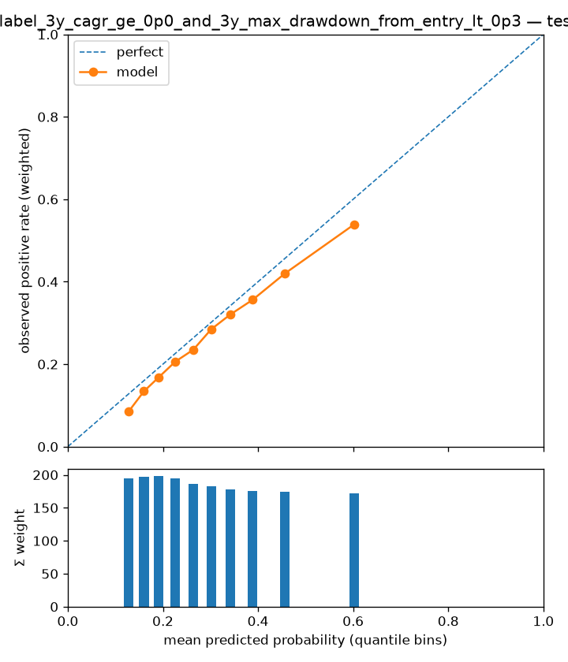

# Experiment report — forest_fresh30_cells_3y__label_3y_cagr_ge_0p0_and_3y_max_drawdown_from_entry_lt_0p3

- run id: `b0edc2b3f4b1`
- dataset version: `1.4.1` (pinned, immutable)
- dataset sha256: `be2b664c6739b93d5b5a7df1d085c09f09575071dd02d1f1426ed1586e052085` (dataset.parquet, from the manifest's provenance block)
- config hash: `5344934b5b14329c`
- git SHA: `f24b95eda15ff2283e1ea10025a00b1f1aac57b0`
- seed: 23
- model: `random_forest` params `{"bootstrap": true, "class_weight": 1.0, "criterion": "entropy", "max_depth": 4, "max_features": 0.205191, "max_samples": 0.663781, "min_samples_leaf": 72, "n_estimators": 490, "n_jobs": 8}`
- label: `fwd_3y_cagr >= 0.0 & fwd_3y_max_drawdown_from_entry < 0.3` — horizon 3y, scheme `walkforward`
- derived label `fwd_3y_cagr >= 0.0 & fwd_3y_max_drawdown_from_entry < 0.3`: evaluated on the fly from the manifest's continuous outcome columns (harness.derived_labels); NULL wherever a referenced column is NULL
- **universe: `dist_52w_high <= -0.3 & dollar_volume_3m >= 100000`** — train and test rows outside it are left out (a row with a NULL in a filter column is outside). Every number below describes this universe: base rates, baselines and picks are not comparable with a run over all rows, and the run is counted in the universe's own ledger cell. The filter reads feature columns as of the snapshot; it builds no split (upstream tags decide train and test, the purge and embargo hold for the rows that remain) and derives no column. `sample_weight` is the upstream uniqueness weight, not recomputed for the rows left out.
- **configurations tried against this cell (dataset, scheme, horizon, label, universe): 1** (from the append-only results store; failed runs count); **65 against this label in any universe**
- saved model bundle: `experiments/models/forest_fresh30_cells_3y__label_3y_cagr_ge_0p0_and_3y_max_drawdown_from_entry_lt_0p3_b0edc2b3f4b1` (re-evaluate with `vml-eval`, no refitting)

## Era-sliced metrics (one row per test year)

Sliced on the calendar year of each test row's `snapshot_date` (one walk-forward fold per year); crash eras are tagged inline. `conf_at_K` is the mean score of the top-K picks; `base_rate_brier` is the no-skill Brier the model must beat. \*The pooled row picks per year — per-fold model scores are not comparable, so a global top-K would just take the hottest-scoring fold's picks; it is context for the era rows, never a stand-alone result. ROC-AUC and recall@K are logged in the results store, not shown here.

| era          | n_test | base_rate | mean_score | precision_at_20 | precision_at_50 | precision_at_thr_0.5 | precision_at_thr_0.6 | precision_at_thr_0.7 | conf_at_20 | conf_at_50 | n_at_prec_0.75 | n_at_prec_0.9 | recall_at_prec_0.75 | recall_at_prec_0.9 | recall_at_thr_0.5 | recall_at_thr_0.6 | recall_at_thr_0.7 | n_at_thr_0.5 | n_at_thr_0.6 | n_at_thr_0.7 | brier  | base_rate_brier | pr_auc |
| ------------ | ------ | --------- | ---------- | --------------- | --------------- | -------------------- | -------------------- | -------------------- | ---------- | ---------- | -------------- | ------------- | ------------------- | ------------------ | ----------------- | ----------------- | ----------------- | ------------ | ------------ | ------------ | ------ | --------------- | ------ |
| 2005         | 3438   | 0.2804    | 0.2097     | 0.3000          | 0.3200          | 0.1429               | —                    | —                    | 0.4973     | 0.4675     | 0              | 0             | 0                   | 0                  | 0.0011            | 0                 | 0                 | 7            | 0            | 0            | 0.2000 | 0.2018          | 0.3613 |
| 2006         | 3181   | 0.1455    | 0.2309     | 0.1500          | 0.2200          | 0.1250               | —                    | —                    | 0.5019     | 0.4807     | 0              | 0             | 0                   | 0                  | 0.0027            | 0                 | 0                 | 8            | 0            | 0            | 0.1286 | 0.1243          | 0.2108 |
| 2007         | 3353   | 0.0693    | 0.3056     | 0.0500          | 0.0200          | 0.0539               | 0.0213               | —                    | 0.6472     | 0.6242     | 0              | 0             | 0                   | 0                  | 0.0751            | 0.0058            | 0                 | 241          | 47           | 0            | 0.1297 | 0.0645          | 0.0831 |
| 2008 (GFC)   | 7230   | 0.1608    | 0.4128     | 0.7000          | 0.7400          | 0.2611               | 0.3222               | 0.4985               | 0.7494     | 0.7447     | 72             | 0             | 0.0486              | 0                  | 0.5698            | 0.3636            | 0.1494            | 2424         | 1254         | 333          | 0.1978 | 0.1349          | 0.3230 |
| 2009 (GFC)   | 5916   | 0.6107    | 0.4500     | 1               | 0.9600          | 0.7947               | 0.8325               | 0.8904               | 0.7439     | 0.7405     | 3356           | 202           | 0.6968              | 0.0504             | 0.5166            | 0.3095            | 0.0900            | 2348         | 1343         | 365          | 0.2292 | 0.2378          | 0.7912 |
| 2010         | 2355   | 0.2845    | 0.2830     | 0.8000          | 0.8000          | 0.7241               | 0.5000               | —                    | 0.5663     | 0.5411     | 53             | 1             | 0.0616              | 0.0015             | 0.0631            | 0.0015            | 0                 | 58           | 2            | 0            | 0.1833 | 0.2036          | 0.4893 |
| 2011         | 3265   | 0.3510    | 0.2805     | 0.9500          | 0.8400          | 0.7953               | 1                    | —                    | 0.5977     | 0.5763     | 241            | 41            | 0.1583              | 0.0322             | 0.0878            | 0.0061            | 0                 | 127          | 7            | 0            | 0.2019 | 0.2278          | 0.6119 |
| 2012         | 2932   | 0.3944    | 0.2417     | 0.9000          | 0.6800          | —                    | —                    | —                    | 0.4396     | 0.4255     | 44             | 21            | 0.0288              | 0.0166             | 0                 | 0                 | 0                 | 0            | 0            | 0            | 0.2464 | 0.2388          | 0.5437 |
| 2013         | 1634   | 0.2372    | 0.2255     | 0.4500          | 0.4800          | —                    | —                    | —                    | 0.4096     | 0.3926     | 1              | 1             | 0.0026              | 0.0026             | 0                 | 0                 | 0                 | 0            | 0            | 0            | 0.1714 | 0.1810          | 0.3728 |
| 2014         | 2694   | 0.1750    | 0.2235     | 0.3000          | 0.3200          | —                    | —                    | —                    | 0.4590     | 0.4356     | 0              | 0             | 0                   | 0                  | 0                 | 0                 | 0                 | 0            | 0            | 0            | 0.1399 | 0.1444          | 0.2848 |
| 2015         | 3879   | 0.1752    | 0.2626     | 0.5000          | 0.5400          | 0.5556               | —                    | —                    | 0.5353     | 0.5165     | 7              | 4             | 0.0092              | 0.0062             | 0.0308            | 0                 | 0                 | 36           | 0            | 0            | 0.1425 | 0.1445          | 0.3328 |
| 2016         | 4170   | 0.4069    | 0.2860     | 0.8000          | 0.7600          | 0.7114               | 0.8889               | —                    | 0.5998     | 0.5835     | 52             | 5             | 0.0242              | 0.0030             | 0.0865            | 0.0048            | 0                 | 201          | 9            | 0            | 0.2281 | 0.2413          | 0.6060 |
| 2017         | 2843   | 0.1701    | 0.2475     | 0.5500          | 0.4000          | 0.3333               | —                    | —                    | 0.4876     | 0.4724     | 1              | 1             | 0.0022              | 0.0022             | 0.0022            | 0                 | 0                 | 3            | 0            | 0            | 0.1495 | 0.1412          | 0.2246 |
| 2018         | 3442   | 0.1440    | 0.2542     | 0.5000          | 0.4800          | 0.4737               | —                    | —                    | 0.5441     | 0.5253     | 6              | 3             | 0.0108              | 0.0065             | 0.0581            | 0                 | 0                 | 57           | 0            | 0            | 0.1322 | 0.1232          | 0.2553 |
| 2019         | 4522   | 0.1377    | 0.2771     | 0.2500          | 0.2400          | 0.2590               | —                    | —                    | 0.5674     | 0.5516     | 0              | 0             | 0                   | 0                  | 0.0646            | 0                 | 0                 | 139          | 0            | 0            | 0.1426 | 0.1187          | 0.1898 |
| 2020 (COVID) | 5398   | 0.3802    | 0.3099     | 0.9000          | 0.8400          | 0.7530               | 0.7521               | —                    | 0.6661     | 0.6532     | 588            | 24            | 0.2137              | 0.0106             | 0.2108            | 0.0440            | 0                 | 579          | 121          | 0            | 0.1971 | 0.2356          | 0.6568 |
| pooled*      | 60252  | 0.2685    | 0.2992     | 0.5687          | 0.5400          | 0.5331               | 0.5857               | 0.7034               | 0.5632     | 0.5457     | 4421           | 303           | 0.2098              | 0.0174             | 0.2097            | 0.1029            | 0.0310            | 6228         | 2783         | 698          | 0.1800 | 0.1964          | 0.4442 |

## High-confidence picks (pooled)

How many high-confidence calls the model made, how confident it was, and how precise they were — no pre-chosen score threshold needed. `top N/yr` rows pick per test year; `score >= p` rows (probabilistic models) count every name at or above that probability, pooled.

| selection    | n_picks | picks_per_year | mean_score | precision | hits |
| ------------ | ------- | -------------- | ---------- | --------- | ---- |
| top 5/yr     | 80      | 5              | 0.5821     | 0.5750    | 46   |
| top 10/yr    | 160     | 10             | 0.5733     | 0.5687    | 91   |
| top 20/yr    | 320     | 20             | 0.5632     | 0.5687    | 182  |
| top 50/yr    | 800     | 50             | 0.5457     | 0.5400    | 432  |
| score >= 0.9 | 0       | 0              | —          | —         | 0    |
| score >= 0.8 | 0       | 0              | —          | —         | 0    |
| score >= 0.7 | 698     | 43.6000        | 0.7212     | 0.7034    | 491  |
| score >= 0.6 | 2783    | 173.9000       | 0.6661     | 0.5857    | 1630 |
| score >= 0.5 | 6228    | 389.2000       | 0.5993     | 0.5331    | 3320 |

## Pick outcomes (what the picks went on to do)

Report-only outcomes of the top-K picks of each test year (`pick_outcomes`: `label_3y_beat_spy`, `fwd_3y_excess_cagr`, `fwd_3y_cagr`, `fwd_3y_max_drawdown_from_entry`, `fwd_3y_cagr < 0.0`, `fwd_3y_cagr < -0.1`, `fwd_3y_max_drawdown_from_entry >= 0.4`, `fwd_3y_cagr >= 0.15`, `fwd_3y_cagr >= 0.26`, `fwd_3y_excess_cagr >= 0.05`, `fwd_3y_excess_cagr >= 0.1`), from the manifest's label columns; none is a model input or the training target, and the run is counted in its own label's cell. For a binary outcome the picks' hit rate, for a continuous one their mean and median, each beside the same statistic over **all** test rows of the era (unweighted, like the picks: one row, one pick). `stocks` is the number of distinct `permaticker`s among the picks (a stock has up to four test rows a year); in the pooled row it is the mean per year and the statistics run over every year's picks. NULL outcomes are left out, not counted as misses. This is a no-cost, equal-weight reading of the picks, a screen for `vml-backtest` and not a substitute.

### Top 20 per test year: `label_3y_beat_spy`

| era          | picks | stocks  | picks hit rate | all rows |
| ------------ | ----- | ------- | -------------- | -------- |
| 2005         | 20    | 17      | 0.2500         | 0.2958   |
| 2006         | 20    | 19      | 0.4000         | 0.3024   |
| 2007         | 20    | 20      | 0.6000         | 0.3170   |
| 2008 (GFC)   | 20    | 20      | 0.7000         | 0.5083   |
| 2009 (GFC)   | 20    | 17      | 0.7500         | 0.5286   |
| 2010         | 20    | 19      | 0.5000         | 0.2773   |
| 2011         | 20    | 18      | 0.4000         | 0.3075   |
| 2012         | 20    | 19      | 0.4000         | 0.2977   |
| 2013         | 20    | 15      | 0.3000         | 0.2160   |
| 2014         | 20    | 17      | 0.2500         | 0.1956   |
| 2015         | 20    | 20      | 0.5000         | 0.2501   |
| 2016         | 20    | 20      | 0.3500         | 0.3070   |
| 2017         | 20    | 17      | 0.3500         | 0.1808   |
| 2018         | 20    | 20      | 0.4000         | 0.2429   |
| 2019         | 20    | 17      | 0.2000         | 0.2607   |
| 2020 (COVID) | 20    | 20      | 0.4000         | 0.3931   |
| pooled*      | 320   | 18.4375 | 0.4219         | 0.3345   |

### Top 20 per test year: `fwd_3y_excess_cagr`

| era          | picks | stocks  | picks mean | picks median | all rows mean | all rows median |
| ------------ | ----- | ------- | ---------- | ------------ | ------------- | --------------- |
| 2005         | 20    | 17      | -0.1432    | -0.1360      | -0.1703       | -0.1520         |
| 2006         | 20    | 19      | -0.1039    | -0.1090      | -0.1780       | -0.1536         |
| 2007         | 20    | 20      | 0.0508     | 0.0300       | -0.1710       | -0.1316         |
| 2008 (GFC)   | 20    | 20      | 0.0447     | 0.0268       | -0.0177       | 0.0052          |
| 2009 (GFC)   | 20    | 17      | 0.0722     | 0.0892       | 0.0025        | 0.0174          |
| 2010         | 20    | 19      | 0.0022     | -0.0011      | -0.2138       | -0.1819         |
| 2011         | 20    | 18      | -0.0399    | -0.0739      | -0.1754       | -0.1327         |
| 2012         | 20    | 19      | -0.0259    | -0.0323      | -0.1786       | -0.1422         |
| 2013         | 20    | 15      | -0.1699    | -0.1289      | -0.2905       | -0.2607         |
| 2014         | 20    | 17      | -0.1087    | -0.0860      | -0.2959       | -0.2599         |
| 2015         | 20    | 20      | -0.0643    | -0.0498      | -0.2359       | -0.1786         |
| 2016         | 20    | 20      | -0.0132    | -0.0345      | -0.1833       | -0.1312         |
| 2017         | 20    | 17      | -0.0865    | -0.0851      | -0.3144       | -0.3270         |
| 2018         | 20    | 20      | -0.0575    | -0.0654      | -0.2388       | -0.2127         |
| 2019         | 20    | 17      | -0.0783    | -0.0818      | -0.2100       | -0.1947         |
| 2020 (COVID) | 20    | 20      | 0.0113     | -0.0150      | -0.1264       | -0.0909         |
| pooled*      | 320   | 18.4375 | -0.0444    | -0.0256      | -0.1616       | -0.1248         |

### Top 20 per test year: `fwd_3y_cagr`

| era          | picks | stocks  | picks mean | picks median | all rows mean | all rows median |
| ------------ | ----- | ------- | ---------- | ------------ | ------------- | --------------- |
| 2005         | 20    | 17      | -0.1321    | -0.1015      | -0.1389       | -0.1188         |
| 2006         | 20    | 19      | -0.1937    | -0.1963      | -0.2620       | -0.2369         |
| 2007         | 20    | 20      | -0.0017    | -0.0245      | -0.2319       | -0.1939         |
| 2008 (GFC)   | 20    | 20      | 0.1688     | 0.1430       | 0.0350        | 0.0562          |
| 2009 (GFC)   | 20    | 17      | 0.2641     | 0.2803       | 0.1730        | 0.1879          |
| 2010         | 20    | 19      | 0.1699     | 0.1818       | -0.0602       | -0.0264         |
| 2011         | 20    | 18      | 0.1648     | 0.1369       | 0.0096        | 0.0551          |
| 2012         | 20    | 19      | 0.1502     | 0.1526       | -0.0086       | 0.0304          |
| 2013         | 20    | 15      | -0.0650    | -0.0264      | -0.1858       | -0.1556         |
| 2014         | 20    | 17      | -0.0031    | 0.0144       | -0.1935       | -0.1579         |
| 2015         | 20    | 20      | 0.0604     | 0.0695       | -0.1132       | -0.0572         |
| 2016         | 20    | 20      | 0.1227     | 0.1039       | -0.0496       | 0.0021          |
| 2017         | 20    | 17      | 0.0297     | 0.0353       | -0.2008       | -0.2145         |
| 2018         | 20    | 20      | 0.1478     | 0.1482       | -0.0602       | -0.0332         |
| 2019         | 20    | 17      | 0.0695     | 0.0786       | -0.0631       | -0.0477         |
| 2020 (COVID) | 20    | 20      | 0.1524     | 0.1279       | -0.0134       | 0.0201          |
| pooled*      | 320   | 18.4375 | 0.0690     | 0.0886       | -0.0590       | -0.0249         |

### Top 20 per test year: `fwd_3y_max_drawdown_from_entry`

| era          | picks | stocks  | picks mean | picks median | all rows mean | all rows median |
| ------------ | ----- | ------- | ---------- | ------------ | ------------- | --------------- |
| 2005         | 20    | 17      | 0.4561     | 0.4075       | 0.5230        | 0.5253          |
| 2006         | 20    | 19      | 0.5978     | 0.6770       | 0.7034        | 0.7931          |
| 2007         | 20    | 20      | 0.6147     | 0.6211       | 0.7655        | 0.8380          |
| 2008 (GFC)   | 20    | 20      | 0.2638     | 0.2819       | 0.6001        | 0.6244          |
| 2009 (GFC)   | 20    | 17      | 0.1362     | 0.1041       | 0.2943        | 0.2066          |
| 2010         | 20    | 19      | 0.1828     | 0.1189       | 0.5274        | 0.5271          |
| 2011         | 20    | 18      | 0.1105     | 0.0817       | 0.4692        | 0.4298          |
| 2012         | 20    | 19      | 0.1510     | 0.1224       | 0.4380        | 0.3744          |
| 2013         | 20    | 15      | 0.3823     | 0.2584       | 0.5819        | 0.6178          |
| 2014         | 20    | 17      | 0.3921     | 0.4044       | 0.6282        | 0.6849          |
| 2015         | 20    | 20      | 0.2959     | 0.3133       | 0.5908        | 0.5956          |
| 2016         | 20    | 20      | 0.1276     | 0.0859       | 0.4600        | 0.3940          |
| 2017         | 20    | 17      | 0.3225     | 0.2506       | 0.6682        | 0.7627          |
| 2018         | 20    | 20      | 0.3097     | 0.2585       | 0.6604        | 0.7279          |
| 2019         | 20    | 17      | 0.3785     | 0.3850       | 0.6325        | 0.6693          |
| 2020 (COVID) | 20    | 20      | 0.1302     | 0.1279       | 0.4730        | 0.4367          |
| pooled*      | 320   | 18.4375 | 0.3032     | 0.2401       | 0.5507        | 0.5731          |

### Top 20 per test year: `label_3y_cagr_lt_0p0`

| era          | picks | stocks  | picks hit rate | all rows |
| ------------ | ----- | ------- | -------------- | -------- |
| 2005         | 20    | 17      | 0.7000         | 0.6510   |
| 2006         | 20    | 19      | 0.7000         | 0.7831   |
| 2007         | 20    | 20      | 0.6000         | 0.7569   |
| 2008 (GFC)   | 20    | 20      | 0.0500         | 0.4122   |
| 2009 (GFC)   | 20    | 17      | 0              | 0.2446   |
| 2010         | 20    | 19      | 0.0500         | 0.5355   |
| 2011         | 20    | 18      | 0.0500         | 0.4343   |
| 2012         | 20    | 19      | 0.1000         | 0.4615   |
| 2013         | 20    | 15      | 0.5500         | 0.6799   |
| 2014         | 20    | 17      | 0.4000         | 0.6745   |
| 2015         | 20    | 20      | 0.4000         | 0.5821   |
| 2016         | 20    | 20      | 0.2000         | 0.4942   |
| 2017         | 20    | 17      | 0.3500         | 0.7081   |
| 2018         | 20    | 20      | 0.3000         | 0.5349   |
| 2019         | 20    | 17      | 0.2000         | 0.5610   |
| 2020 (COVID) | 20    | 20      | 0.0500         | 0.4746   |
| pooled*      | 320   | 18.4375 | 0.2938         | 0.5299   |

### Top 20 per test year: `label_3y_cagr_lt_m0p1`

| era          | picks | stocks  | picks hit rate | all rows |
| ------------ | ----- | ------- | -------------- | -------- |
| 2005         | 20    | 17      | 0.5500         | 0.5233   |
| 2006         | 20    | 19      | 0.6000         | 0.6699   |
| 2007         | 20    | 20      | 0.3000         | 0.6290   |
| 2008 (GFC)   | 20    | 20      | 0              | 0.2834   |
| 2009 (GFC)   | 20    | 17      | 0              | 0.1651   |
| 2010         | 20    | 19      | 0.0500         | 0.4174   |
| 2011         | 20    | 18      | 0.0500         | 0.3271   |
| 2012         | 20    | 19      | 0.0500         | 0.3585   |
| 2013         | 20    | 15      | 0.3500         | 0.5575   |
| 2014         | 20    | 17      | 0.2000         | 0.5575   |
| 2015         | 20    | 20      | 0.1500         | 0.4468   |
| 2016         | 20    | 20      | 0              | 0.3935   |
| 2017         | 20    | 17      | 0.2000         | 0.5987   |
| 2018         | 20    | 20      | 0.0500         | 0.4358   |
| 2019         | 20    | 17      | 0.1000         | 0.4356   |
| 2020 (COVID) | 20    | 20      | 0              | 0.3922   |
| pooled*      | 320   | 18.4375 | 0.1656         | 0.4190   |

### Top 20 per test year: `label_3y_max_drawdown_from_entry_ge_0p4`

| era          | picks | stocks  | picks hit rate | all rows |
| ------------ | ----- | ------- | -------------- | -------- |
| 2005         | 20    | 17      | 0.5000         | 0.6050   |
| 2006         | 20    | 19      | 0.6500         | 0.8158   |
| 2007         | 20    | 20      | 0.9500         | 0.9096   |
| 2008 (GFC)   | 20    | 20      | 0.0500         | 0.7465   |
| 2009 (GFC)   | 20    | 17      | 0              | 0.2576   |
| 2010         | 20    | 19      | 0.1500         | 0.6076   |
| 2011         | 20    | 18      | 0.0500         | 0.5280   |
| 2012         | 20    | 19      | 0.0500         | 0.4761   |
| 2013         | 20    | 15      | 0.4000         | 0.6726   |
| 2014         | 20    | 17      | 0.5000         | 0.7428   |
| 2015         | 20    | 20      | 0.3000         | 0.7069   |
| 2016         | 20    | 20      | 0              | 0.4969   |
| 2017         | 20    | 17      | 0.3000         | 0.7752   |
| 2018         | 20    | 20      | 0.3500         | 0.7899   |
| 2019         | 20    | 17      | 0.5000         | 0.7941   |
| 2020 (COVID) | 20    | 20      | 0              | 0.5228   |
| pooled*      | 320   | 18.4375 | 0.2969         | 0.6381   |

### Top 20 per test year: `label_3y_cagr_ge_0p15`

| era          | picks | stocks  | picks hit rate | all rows |
| ------------ | ----- | ------- | -------------- | -------- |
| 2005         | 20    | 17      | 0              | 0.1751   |
| 2006         | 20    | 19      | 0.0500         | 0.0789   |
| 2007         | 20    | 20      | 0.1000         | 0.0862   |
| 2008 (GFC)   | 20    | 20      | 0.4500         | 0.3477   |
| 2009 (GFC)   | 20    | 17      | 0.8500         | 0.5609   |
| 2010         | 20    | 19      | 0.6000         | 0.2892   |
| 2011         | 20    | 18      | 0.5000         | 0.3648   |
| 2012         | 20    | 19      | 0.5000         | 0.3240   |
| 2013         | 20    | 15      | 0.2500         | 0.1689   |
| 2014         | 20    | 17      | 0.1000         | 0.1440   |
| 2015         | 20    | 20      | 0.3500         | 0.2168   |
| 2016         | 20    | 20      | 0.3000         | 0.2825   |
| 2017         | 20    | 17      | 0.2500         | 0.1551   |
| 2018         | 20    | 20      | 0.5000         | 0.2769   |
| 2019         | 20    | 17      | 0.2000         | 0.2543   |
| 2020 (COVID) | 20    | 20      | 0.3000         | 0.3535   |
| pooled*      | 320   | 18.4375 | 0.3312         | 0.2810   |

### Top 20 per test year: `label_3y_cagr_ge_0p26`

| era          | picks | stocks  | picks hit rate | all rows |
| ------------ | ----- | ------- | -------------- | -------- |
| 2005         | 20    | 17      | 0              | 0.0974   |
| 2006         | 20    | 19      | 0              | 0.0299   |
| 2007         | 20    | 20      | 0.0500         | 0.0349   |
| 2008 (GFC)   | 20    | 20      | 0.1500         | 0.2073   |
| 2009 (GFC)   | 20    | 17      | 0.6000         | 0.3781   |
| 2010         | 20    | 19      | 0.2500         | 0.1788   |
| 2011         | 20    | 18      | 0.2000         | 0.2291   |
| 2012         | 20    | 19      | 0.1500         | 0.2046   |
| 2013         | 20    | 15      | 0.0500         | 0.1034   |
| 2014         | 20    | 17      | 0              | 0.0713   |
| 2015         | 20    | 20      | 0.1500         | 0.1116   |
| 2016         | 20    | 20      | 0.2500         | 0.1688   |
| 2017         | 20    | 17      | 0.1000         | 0.0957   |
| 2018         | 20    | 20      | 0.2500         | 0.1732   |
| 2019         | 20    | 17      | 0              | 0.1661   |
| 2020 (COVID) | 20    | 20      | 0.2000         | 0.2340   |
| pooled*      | 320   | 18.4375 | 0.1500         | 0.1731   |

### Top 20 per test year: `label_3y_excess_cagr_ge_0p05`

| era          | picks | stocks  | picks hit rate | all rows |
| ------------ | ----- | ------- | -------------- | -------- |
| 2005         | 20    | 17      | 0.1500         | 0.2368   |
| 2006         | 20    | 19      | 0.3500         | 0.2461   |
| 2007         | 20    | 20      | 0.4000         | 0.2562   |
| 2008 (GFC)   | 20    | 20      | 0.4500         | 0.4220   |
| 2009 (GFC)   | 20    | 17      | 0.7000         | 0.4412   |
| 2010         | 20    | 19      | 0.3000         | 0.2289   |
| 2011         | 20    | 18      | 0.2000         | 0.2493   |
| 2012         | 20    | 19      | 0.1500         | 0.2381   |
| 2013         | 20    | 15      | 0.2000         | 0.1665   |
| 2014         | 20    | 17      | 0.1000         | 0.1425   |
| 2015         | 20    | 20      | 0.3000         | 0.1864   |
| 2016         | 20    | 20      | 0.2500         | 0.2420   |
| 2017         | 20    | 17      | 0.1500         | 0.1432   |
| 2018         | 20    | 20      | 0.3000         | 0.1949   |
| 2019         | 20    | 17      | 0.0500         | 0.2163   |
| 2020 (COVID) | 20    | 20      | 0.3000         | 0.3344   |
| pooled*      | 320   | 18.4375 | 0.2719         | 0.2725   |

### Top 20 per test year: `label_3y_excess_cagr_ge_0p1`

| era          | picks | stocks  | picks hit rate | all rows |
| ------------ | ----- | ------- | -------------- | -------- |
| 2005         | 20    | 17      | 0.0500         | 0.1873   |
| 2006         | 20    | 19      | 0.3000         | 0.1943   |
| 2007         | 20    | 20      | 0.3000         | 0.1945   |
| 2008 (GFC)   | 20    | 20      | 0.2500         | 0.3362   |
| 2009 (GFC)   | 20    | 17      | 0.4500         | 0.3619   |
| 2010         | 20    | 19      | 0.2500         | 0.1813   |
| 2011         | 20    | 18      | 0.1000         | 0.1926   |
| 2012         | 20    | 19      | 0.1500         | 0.1975   |
| 2013         | 20    | 15      | 0.0500         | 0.1310   |
| 2014         | 20    | 17      | 0.0500         | 0.1021   |
| 2015         | 20    | 20      | 0.3000         | 0.1397   |
| 2016         | 20    | 20      | 0.2500         | 0.1933   |
| 2017         | 20    | 17      | 0.1500         | 0.1147   |
| 2018         | 20    | 20      | 0.2500         | 0.1580   |
| 2019         | 20    | 17      | 0              | 0.1751   |
| 2020 (COVID) | 20    | 20      | 0.2500         | 0.2773   |
| pooled*      | 320   | 18.4375 | 0.1969         | 0.2177   |

### Top 50 per test year: `label_3y_beat_spy`

| era          | picks | stocks  | picks hit rate | all rows |
| ------------ | ----- | ------- | -------------- | -------- |
| 2005         | 50    | 40      | 0.3000         | 0.2958   |
| 2006         | 50    | 38      | 0.4600         | 0.3024   |
| 2007         | 50    | 49      | 0.6400         | 0.3170   |
| 2008 (GFC)   | 50    | 50      | 0.7000         | 0.5083   |
| 2009 (GFC)   | 50    | 42      | 0.7000         | 0.5286   |
| 2010         | 50    | 44      | 0.4400         | 0.2773   |
| 2011         | 50    | 42      | 0.4000         | 0.3075   |
| 2012         | 50    | 44      | 0.3400         | 0.2977   |
| 2013         | 50    | 40      | 0.3600         | 0.2160   |
| 2014         | 50    | 40      | 0.2800         | 0.1956   |
| 2015         | 50    | 44      | 0.4600         | 0.2501   |
| 2016         | 50    | 48      | 0.3200         | 0.3070   |
| 2017         | 50    | 40      | 0.2600         | 0.1808   |
| 2018         | 50    | 50      | 0.3400         | 0.2429   |
| 2019         | 50    | 39      | 0.1800         | 0.2607   |
| 2020 (COVID) | 50    | 50      | 0.5000         | 0.3931   |
| pooled*      | 800   | 43.7500 | 0.4175         | 0.3345   |

### Top 50 per test year: `fwd_3y_excess_cagr`

| era          | picks | stocks  | picks mean | picks median | all rows mean | all rows median |
| ------------ | ----- | ------- | ---------- | ------------ | ------------- | --------------- |
| 2005         | 50    | 40      | -0.0822    | -0.0644      | -0.1703       | -0.1520         |
| 2006         | 50    | 38      | -0.0636    | -0.0133      | -0.1780       | -0.1536         |
| 2007         | 50    | 49      | 0.0207     | 0.0432       | -0.1710       | -0.1316         |
| 2008 (GFC)   | 50    | 50      | 0.0588     | 0.0413       | -0.0177       | 0.0052          |
| 2009 (GFC)   | 50    | 42      | 0.0506     | 0.0536       | 0.0025        | 0.0174          |
| 2010         | 50    | 44      | -0.0328    | -0.0213      | -0.2138       | -0.1819         |
| 2011         | 50    | 42      | -0.0559    | -0.0813      | -0.1754       | -0.1327         |
| 2012         | 50    | 44      | -0.0689    | -0.0539      | -0.1786       | -0.1422         |
| 2013         | 50    | 40      | -0.1337    | -0.1043      | -0.2905       | -0.2607         |
| 2014         | 50    | 40      | -0.1061    | -0.0923      | -0.2959       | -0.2599         |
| 2015         | 50    | 44      | -0.0367    | -0.0534      | -0.2359       | -0.1786         |
| 2016         | 50    | 48      | -0.0290    | -0.0302      | -0.1833       | -0.1312         |
| 2017         | 50    | 40      | -0.1555    | -0.1467      | -0.3144       | -0.3270         |
| 2018         | 50    | 50      | -0.0638    | -0.0844      | -0.2388       | -0.2127         |
| 2019         | 50    | 39      | -0.0869    | -0.0818      | -0.2100       | -0.1947         |
| 2020 (COVID) | 50    | 50      | 0.0086     | 0.0020       | -0.1264       | -0.0909         |
| pooled*      | 800   | 43.7500 | -0.0485    | -0.0286      | -0.1616       | -0.1248         |

### Top 50 per test year: `fwd_3y_cagr`

| era          | picks | stocks  | picks mean | picks median | all rows mean | all rows median |
| ------------ | ----- | ------- | ---------- | ------------ | ------------- | --------------- |
| 2005         | 50    | 40      | -0.0709    | -0.0379      | -0.1389       | -0.1188         |
| 2006         | 50    | 38      | -0.1507    | -0.1084      | -0.2620       | -0.2369         |
| 2007         | 50    | 49      | -0.0302    | -0.0166      | -0.2319       | -0.1939         |
| 2008 (GFC)   | 50    | 50      | 0.1837     | 0.1749       | 0.0350        | 0.0562          |
| 2009 (GFC)   | 50    | 42      | 0.2404     | 0.2554       | 0.1730        | 0.1879          |
| 2010         | 50    | 44      | 0.1338     | 0.1700       | -0.0602       | -0.0264         |
| 2011         | 50    | 42      | 0.1456     | 0.1184       | 0.0096        | 0.0551          |
| 2012         | 50    | 44      | 0.1062     | 0.1086       | -0.0086       | 0.0304          |
| 2013         | 50    | 40      | -0.0270    | 0.0120       | -0.1858       | -0.1556         |
| 2014         | 50    | 40      | 0.0008     | 0.0109       | -0.1935       | -0.1579         |
| 2015         | 50    | 44      | 0.0921     | 0.1004       | -0.1132       | -0.0572         |
| 2016         | 50    | 48      | 0.1016     | 0.0887       | -0.0496       | 0.0021          |
| 2017         | 50    | 40      | -0.0376    | -0.0289      | -0.2008       | -0.2145         |
| 2018         | 50    | 50      | 0.1436     | 0.1270       | -0.0602       | -0.0332         |
| 2019         | 50    | 39      | 0.0668     | 0.0668       | -0.0631       | -0.0477         |
| 2020 (COVID) | 50    | 50      | 0.1494     | 0.1416       | -0.0134       | 0.0201          |
| pooled*      | 800   | 43.7500 | 0.0655     | 0.0875       | -0.0590       | -0.0249         |

### Top 50 per test year: `fwd_3y_max_drawdown_from_entry`

| era          | picks | stocks  | picks mean | picks median | all rows mean | all rows median |
| ------------ | ----- | ------- | ---------- | ------------ | ------------- | --------------- |
| 2005         | 50    | 40      | 0.3856     | 0.3319       | 0.5230        | 0.5253          |
| 2006         | 50    | 38      | 0.5435     | 0.5702       | 0.7034        | 0.7931          |
| 2007         | 50    | 49      | 0.6403     | 0.6359       | 0.7655        | 0.8380          |
| 2008 (GFC)   | 50    | 50      | 0.2552     | 0.2534       | 0.6001        | 0.6244          |
| 2009 (GFC)   | 50    | 42      | 0.1518     | 0.1589       | 0.2943        | 0.2066          |
| 2010         | 50    | 44      | 0.2181     | 0.1516       | 0.5274        | 0.5271          |
| 2011         | 50    | 42      | 0.1641     | 0.1359       | 0.4692        | 0.4298          |
| 2012         | 50    | 44      | 0.2182     | 0.1667       | 0.4380        | 0.3744          |
| 2013         | 50    | 40      | 0.3426     | 0.2129       | 0.5819        | 0.6178          |
| 2014         | 50    | 40      | 0.4079     | 0.4159       | 0.6282        | 0.6849          |
| 2015         | 50    | 44      | 0.2825     | 0.2710       | 0.5908        | 0.5956          |
| 2016         | 50    | 48      | 0.1629     | 0.1093       | 0.4600        | 0.3940          |
| 2017         | 50    | 40      | 0.4342     | 0.4773       | 0.6682        | 0.7627          |
| 2018         | 50    | 50      | 0.3452     | 0.2898       | 0.6604        | 0.7279          |
| 2019         | 50    | 39      | 0.4124     | 0.4152       | 0.6325        | 0.6693          |
| 2020 (COVID) | 50    | 50      | 0.1494     | 0.1206       | 0.4730        | 0.4367          |
| pooled*      | 800   | 43.7500 | 0.3196     | 0.2547       | 0.5507        | 0.5731          |

### Top 50 per test year: `label_3y_cagr_lt_0p0`

| era          | picks | stocks  | picks hit rate | all rows |
| ------------ | ----- | ------- | -------------- | -------- |
| 2005         | 50    | 40      | 0.6600         | 0.6510   |
| 2006         | 50    | 38      | 0.6400         | 0.7831   |
| 2007         | 50    | 49      | 0.5600         | 0.7569   |
| 2008 (GFC)   | 50    | 50      | 0.0600         | 0.4122   |
| 2009 (GFC)   | 50    | 42      | 0              | 0.2446   |
| 2010         | 50    | 44      | 0.1200         | 0.5355   |
| 2011         | 50    | 42      | 0.1600         | 0.4343   |
| 2012         | 50    | 44      | 0.2400         | 0.4615   |
| 2013         | 50    | 40      | 0.4800         | 0.6799   |
| 2014         | 50    | 40      | 0.4400         | 0.6745   |
| 2015         | 50    | 44      | 0.3000         | 0.5821   |
| 2016         | 50    | 48      | 0.2400         | 0.4942   |
| 2017         | 50    | 40      | 0.5600         | 0.7081   |
| 2018         | 50    | 50      | 0.2800         | 0.5349   |
| 2019         | 50    | 39      | 0.2600         | 0.5610   |
| 2020 (COVID) | 50    | 50      | 0.1000         | 0.4746   |
| pooled*      | 800   | 43.7500 | 0.3187         | 0.5299   |

### Top 50 per test year: `label_3y_cagr_lt_m0p1`

| era          | picks | stocks  | picks hit rate | all rows |
| ------------ | ----- | ------- | -------------- | -------- |
| 2005         | 50    | 40      | 0.3600         | 0.5233   |
| 2006         | 50    | 38      | 0.5200         | 0.6699   |
| 2007         | 50    | 49      | 0.2600         | 0.6290   |
| 2008 (GFC)   | 50    | 50      | 0.0200         | 0.2834   |
| 2009 (GFC)   | 50    | 42      | 0              | 0.1651   |
| 2010         | 50    | 44      | 0.1000         | 0.4174   |
| 2011         | 50    | 42      | 0.0400         | 0.3271   |
| 2012         | 50    | 44      | 0.1000         | 0.3585   |
| 2013         | 50    | 40      | 0.3200         | 0.5575   |
| 2014         | 50    | 40      | 0.2200         | 0.5575   |
| 2015         | 50    | 44      | 0.1200         | 0.4468   |
| 2016         | 50    | 48      | 0.0400         | 0.3935   |
| 2017         | 50    | 40      | 0.3800         | 0.5987   |
| 2018         | 50    | 50      | 0.0200         | 0.4358   |
| 2019         | 50    | 39      | 0.1000         | 0.4356   |
| 2020 (COVID) | 50    | 50      | 0.0600         | 0.3922   |
| pooled*      | 800   | 43.7500 | 0.1663         | 0.4190   |

### Top 50 per test year: `label_3y_max_drawdown_from_entry_ge_0p4`

| era          | picks | stocks  | picks hit rate | all rows |
| ------------ | ----- | ------- | -------------- | -------- |
| 2005         | 50    | 40      | 0.3600         | 0.6050   |
| 2006         | 50    | 38      | 0.6000         | 0.8158   |
| 2007         | 50    | 49      | 0.9400         | 0.9096   |
| 2008 (GFC)   | 50    | 50      | 0.0800         | 0.7465   |
| 2009 (GFC)   | 50    | 42      | 0              | 0.2576   |
| 2010         | 50    | 44      | 0.1800         | 0.6076   |
| 2011         | 50    | 42      | 0.0600         | 0.5280   |
| 2012         | 50    | 44      | 0.0800         | 0.4761   |
| 2013         | 50    | 40      | 0.3800         | 0.6726   |
| 2014         | 50    | 40      | 0.5400         | 0.7428   |
| 2015         | 50    | 44      | 0.2400         | 0.7069   |
| 2016         | 50    | 48      | 0.0600         | 0.4969   |
| 2017         | 50    | 40      | 0.5400         | 0.7752   |
| 2018         | 50    | 50      | 0.4200         | 0.7899   |
| 2019         | 50    | 39      | 0.5800         | 0.7941   |
| 2020 (COVID) | 50    | 50      | 0.0400         | 0.5228   |
| pooled*      | 800   | 43.7500 | 0.3187         | 0.6381   |

### Top 50 per test year: `label_3y_cagr_ge_0p15`

| era          | picks | stocks  | picks hit rate | all rows |
| ------------ | ----- | ------- | -------------- | -------- |
| 2005         | 50    | 40      | 0.1000         | 0.1751   |
| 2006         | 50    | 38      | 0.0800         | 0.0789   |
| 2007         | 50    | 49      | 0.0600         | 0.0862   |
| 2008 (GFC)   | 50    | 50      | 0.5600         | 0.3477   |
| 2009 (GFC)   | 50    | 42      | 0.7800         | 0.5609   |
| 2010         | 50    | 44      | 0.5400         | 0.2892   |
| 2011         | 50    | 42      | 0.4800         | 0.3648   |
| 2012         | 50    | 44      | 0.4000         | 0.3240   |
| 2013         | 50    | 40      | 0.2800         | 0.1689   |
| 2014         | 50    | 40      | 0.1400         | 0.1440   |
| 2015         | 50    | 44      | 0.3400         | 0.2168   |
| 2016         | 50    | 48      | 0.3000         | 0.2825   |
| 2017         | 50    | 40      | 0.2000         | 0.1551   |
| 2018         | 50    | 50      | 0.4600         | 0.2769   |
| 2019         | 50    | 39      | 0.1800         | 0.2543   |
| 2020 (COVID) | 50    | 50      | 0.4400         | 0.3535   |
| pooled*      | 800   | 43.7500 | 0.3337         | 0.2810   |

### Top 50 per test year: `label_3y_cagr_ge_0p26`

| era          | picks | stocks  | picks hit rate | all rows |
| ------------ | ----- | ------- | -------------- | -------- |
| 2005         | 50    | 40      | 0.0200         | 0.0974   |
| 2006         | 50    | 38      | 0              | 0.0299   |
| 2007         | 50    | 49      | 0.0200         | 0.0349   |
| 2008 (GFC)   | 50    | 50      | 0.1800         | 0.2073   |
| 2009 (GFC)   | 50    | 42      | 0.4600         | 0.3781   |
| 2010         | 50    | 44      | 0.2600         | 0.1788   |
| 2011         | 50    | 42      | 0.2600         | 0.2291   |
| 2012         | 50    | 44      | 0.1600         | 0.2046   |
| 2013         | 50    | 40      | 0.0800         | 0.1034   |
| 2014         | 50    | 40      | 0.0400         | 0.0713   |
| 2015         | 50    | 44      | 0.2000         | 0.1116   |
| 2016         | 50    | 48      | 0.1800         | 0.1688   |
| 2017         | 50    | 40      | 0.1200         | 0.0957   |
| 2018         | 50    | 50      | 0.2000         | 0.1732   |
| 2019         | 50    | 39      | 0.0400         | 0.1661   |
| 2020 (COVID) | 50    | 50      | 0.1800         | 0.2340   |
| pooled*      | 800   | 43.7500 | 0.1500         | 0.1731   |

### Top 50 per test year: `label_3y_excess_cagr_ge_0p05`

| era          | picks | stocks  | picks hit rate | all rows |
| ------------ | ----- | ------- | -------------- | -------- |
| 2005         | 50    | 40      | 0.2000         | 0.2368   |
| 2006         | 50    | 38      | 0.4000         | 0.2461   |
| 2007         | 50    | 49      | 0.4400         | 0.2562   |
| 2008 (GFC)   | 50    | 50      | 0.4800         | 0.4220   |
| 2009 (GFC)   | 50    | 42      | 0.5000         | 0.4412   |
| 2010         | 50    | 44      | 0.3200         | 0.2289   |
| 2011         | 50    | 42      | 0.2600         | 0.2493   |
| 2012         | 50    | 44      | 0.2000         | 0.2381   |
| 2013         | 50    | 40      | 0.2600         | 0.1665   |
| 2014         | 50    | 40      | 0.1400         | 0.1425   |
| 2015         | 50    | 44      | 0.3000         | 0.1864   |
| 2016         | 50    | 48      | 0.2800         | 0.2420   |
| 2017         | 50    | 40      | 0.1600         | 0.1432   |
| 2018         | 50    | 50      | 0.2200         | 0.1949   |
| 2019         | 50    | 39      | 0.0800         | 0.2163   |
| 2020 (COVID) | 50    | 50      | 0.4000         | 0.3344   |
| pooled*      | 800   | 43.7500 | 0.2900         | 0.2725   |

### Top 50 per test year: `label_3y_excess_cagr_ge_0p1`

| era          | picks | stocks  | picks hit rate | all rows |
| ------------ | ----- | ------- | -------------- | -------- |
| 2005         | 50    | 40      | 0.1400         | 0.1873   |
| 2006         | 50    | 38      | 0.3400         | 0.1943   |
| 2007         | 50    | 49      | 0.2200         | 0.1945   |
| 2008 (GFC)   | 50    | 50      | 0.2600         | 0.3362   |
| 2009 (GFC)   | 50    | 42      | 0.3600         | 0.3619   |
| 2010         | 50    | 44      | 0.2600         | 0.1813   |
| 2011         | 50    | 42      | 0.1200         | 0.1926   |
| 2012         | 50    | 44      | 0.1600         | 0.1975   |
| 2013         | 50    | 40      | 0.1400         | 0.1310   |
| 2014         | 50    | 40      | 0.1000         | 0.1021   |
| 2015         | 50    | 44      | 0.2800         | 0.1397   |
| 2016         | 50    | 48      | 0.2200         | 0.1933   |
| 2017         | 50    | 40      | 0.1400         | 0.1147   |
| 2018         | 50    | 50      | 0.1800         | 0.1580   |
| 2019         | 50    | 39      | 0.0400         | 0.1751   |
| 2020 (COVID) | 50    | 50      | 0.2800         | 0.2773   |
| pooled*      | 800   | 43.7500 | 0.2025         | 0.2177   |

## Portfolio screen (capped, periodic picks)

`[pick_screen]`: top 10 per test quarter, at most 2 per `sector`; peers: the test rows of the same quarter in the same of 20 bands of `log_marketcap_rank`. The backtest template's selection rule applied to the test rows (a backtest buys from the latest completed quarter's median snapshots, which are these rows), read on the run's label (`precision`) and on the pick outcomes. Equal weights, no costs, entry at the snapshot, held to the horizon: closer to a portfolio than the top-K-per-year tables, and still a screen for `vml-backtest`, not a substitute. Report-only. The `peers` columns give the same statistic for the picks' peers: the test rows of the same quarter in the same band of `log_marketcap_rank` (20 bands), averaged over the picks. **Read a selection against its peers**: against a capitalization-weighted benchmark small stocks trail by a wide margin in every period, so the all-rows reference of the pick-outcome tables flatters any ranking that prefers large companies.

| era          | picks | stocks | largest group          | its share | precision | precision peers | label_3y_beat_spy hit rate | label_3y_beat_spy peers | fwd_3y_excess_cagr mean | fwd_3y_excess_cagr peers | fwd_3y_excess_cagr median | fwd_3y_cagr mean | fwd_3y_cagr peers | fwd_3y_cagr median | fwd_3y_max_drawdown_from_entry mean | fwd_3y_max_drawdown_from_entry peers | fwd_3y_max_drawdown_from_entry median | label_3y_cagr_lt_0p0 hit rate | label_3y_cagr_lt_0p0 peers | label_3y_cagr_lt_m0p1 hit rate | label_3y_cagr_lt_m0p1 peers | label_3y_max_drawdown_from_entry_ge_0p4 hit rate | label_3y_max_drawdown_from_entry_ge_0p4 peers | label_3y_cagr_ge_0p15 hit rate | label_3y_cagr_ge_0p15 peers | label_3y_cagr_ge_0p26 hit rate | label_3y_cagr_ge_0p26 peers | label_3y_excess_cagr_ge_0p05 hit rate | label_3y_excess_cagr_ge_0p05 peers | label_3y_excess_cagr_ge_0p1 hit rate | label_3y_excess_cagr_ge_0p1 peers |
| ------------ | ----- | ------ | ---------------------- | --------- | --------- | --------------- | -------------------------- | ----------------------- | ----------------------- | ------------------------ | ------------------------- | ---------------- | ----------------- | ------------------ | ----------------------------------- | ------------------------------------ | ------------------------------------- | ----------------------------- | -------------------------- | ------------------------------ | --------------------------- | ------------------------------------------------ | --------------------------------------------- | ------------------------------ | --------------------------- | ------------------------------ | --------------------------- | ------------------------------------- | ---------------------------------- | ------------------------------------ | --------------------------------- |
| 2005         | 40    | 35     | Consumer Cyclical      | 0.2000    | 0.3500    | 0.3165          | 0.3500                     | 0.3258                  | -0.1028                 | -0.0962                  | -0.0726                   | -0.0788          | -0.0691           | -0.0562            | 0.3846                              | 0.4264                               | 0.3233                                | 0.6250                        | 0.6133                     | 0.4000                         | 0.4492                      | 0.3750                                           | 0.4981                                        | 0.1000                         | 0.1711                      | 0                              | 0.0921                      | 0.2250                                | 0.2490                             | 0.1500                               | 0.1958                            |
| 2006         | 40    | 36     | Communication Services | 0.1750    | 0.1000    | 0.1547          | 0.4250                     | 0.4116                  | -0.0811                 | -0.0846                  | -0.0266                   | -0.1688          | -0.1713           | -0.1341            | 0.5874                              | 0.6071                               | 0.5975                                | 0.7500                        | 0.7365                     | 0.5500                         | 0.5570                      | 0.6250                                           | 0.7217                                        | 0.0250                         | 0.0772                      | 0                              | 0.0220                      | 0.3500                                | 0.3303                             | 0.2500                               | 0.2595                            |
| 2007         | 40    | 34     | Consumer Cyclical      | 0.2000    | 0.0750    | 0.0606          | 0.4250                     | 0.3829                  | -0.0485                 | -0.0897                  | -0.0222                   | -0.1118          | -0.1517           | -0.0912            | 0.6397                              | 0.7110                               | 0.6801                                | 0.8250                        | 0.7453                     | 0.4750                         | 0.5473                      | 0.8750                                           | 0.8919                                        | 0.0250                         | 0.0822                      | 0                              | 0.0399                      | 0.2250                                | 0.3087                             | 0.1500                               | 0.2141                            |
| 2008 (GFC)   | 40    | 35     | Consumer Cyclical      | 0.2000    | 0.2250    | 0.1750          | 0.9000                     | 0.5801                  | 0.0529                  | 0.0214                   | 0.0547                    | 0.0947           | 0.0631            | 0.1034             | 0.4201                              | 0.5540                               | 0.4339                                | 0.1000                        | 0.3411                     | 0.0500                         | 0.1846                      | 0.5500                                           | 0.7171                                        | 0.2500                         | 0.3142                      | 0.0500                         | 0.1520                      | 0.5000                                | 0.4630                             | 0.3000                               | 0.3282                            |
| 2009 (GFC)   | 40    | 34     | Industrials            | 0.2000    | 0.9000    | 0.6897          | 0.5750                     | 0.4765                  | 0.0252                  | -0.0290                  | 0.0415                    | 0.1822           | 0.1275            | 0.1925             | 0.1467                              | 0.2387                               | 0.1002                                | 0.0750                        | 0.2265                     | 0.0250                         | 0.1377                      | 0.0500                                           | 0.1910                                        | 0.6250                         | 0.5017                      | 0.3250                         | 0.2819                      | 0.4750                                | 0.3626                             | 0.2750                               | 0.2737                            |
| 2010         | 40    | 36     | Technology             | 0.2000    | 0.7000    | 0.4065          | 0.3500                     | 0.3534                  | -0.0321                 | -0.1127                  | -0.0448                   | 0.1161           | 0.0361            | 0.0858             | 0.2685                              | 0.4152                               | 0.1842                                | 0.1500                        | 0.3936                     | 0.0750                         | 0.2617                      | 0.2250                                           | 0.4525                                        | 0.4000                         | 0.3570                      | 0.2000                         | 0.2213                      | 0.2250                                | 0.2832                             | 0.2250                               | 0.2137                            |
| 2011         | 40    | 36     | Consumer Cyclical      | 0.2000    | 0.6250    | 0.4266          | 0.3000                     | 0.3169                  | -0.1204                 | -0.1344                  | -0.0940                   | 0.0521           | 0.0385            | 0.0949             | 0.3060                              | 0.4196                               | 0.2234                                | 0.3000                        | 0.3986                     | 0.1750                         | 0.2474                      | 0.3250                                           | 0.4679                                        | 0.3250                         | 0.3514                      | 0.1750                         | 0.1962                      | 0.2000                                | 0.2278                             | 0.0750                               | 0.1641                            |
| 2012         | 40    | 34     | Technology             | 0.2000    | 0.7000    | 0.4547          | 0.3000                     | 0.2881                  | -0.0747                 | -0.1616                  | -0.0651                   | 0.0949           | 0.0074            | 0.0955             | 0.2103                              | 0.3854                               | 0.1365                                | 0.2250                        | 0.4322                     | 0.1250                         | 0.3269                      | 0.1750                                           | 0.4058                                        | 0.3500                         | 0.3375                      | 0.1250                         | 0.1622                      | 0.1750                                | 0.2049                             | 0.1250                               | 0.1553                            |
| 2013         | 40    | 28     | Technology             | 0.1750    | 0.3750    | 0.3680          | 0.3250                     | 0.3181                  | -0.2014                 | -0.1931                  | -0.1897                   | -0.0988          | -0.0896           | -0.0806            | 0.4488                              | 0.4449                               | 0.4628                                | 0.6000                        | 0.5521                     | 0.4750                         | 0.4181                      | 0.5500                                           | 0.5262                                        | 0.2500                         | 0.2391                      | 0.0500                         | 0.1012                      | 0.2500                                | 0.2349                             | 0.1000                               | 0.1354                            |
| 2014         | 40    | 35     | Consumer Cyclical      | 0.2000    | 0.4250    | 0.2462          | 0.2500                     | 0.2241                  | -0.0866                 | -0.2003                  | -0.0736                   | 0.0140           | -0.0991           | 0.0336             | 0.3501                              | 0.5273                               | 0.3629                                | 0.4000                        | 0.5756                     | 0.2250                         | 0.4437                      | 0.4250                                           | 0.6322                                        | 0.1500                         | 0.1385                      | 0.0750                         | 0.0539                      | 0.1500                                | 0.1393                             | 0.1500                               | 0.0896                            |
| 2015         | 40    | 34     | Consumer Cyclical      | 0.2000    | 0.4000    | 0.2035          | 0.4000                     | 0.2490                  | -0.1000                 | -0.1656                  | -0.1095                   | 0.0220           | -0.0439           | 0.0081             | 0.3531                              | 0.5178                               | 0.3462                                | 0.4750                        | 0.5131                     | 0.2500                         | 0.3507                      | 0.4000                                           | 0.6383                                        | 0.3000                         | 0.1983                      | 0.1250                         | 0.0715                      | 0.2750                                | 0.1752                             | 0.1750                               | 0.1199                            |
| 2016         | 40    | 31     | Consumer Cyclical      | 0.2000    | 0.7500    | 0.4901          | 0.2500                     | 0.2994                  | -0.0624                 | -0.1254                  | -0.0377                   | 0.0717           | 0.0085            | 0.0940             | 0.1931                              | 0.3579                               | 0.1310                                | 0.2250                        | 0.4257                     | 0.0500                         | 0.2821                      | 0.0750                                           | 0.3561                                        | 0.2250                         | 0.2788                      | 0.1000                         | 0.1520                      | 0.1500                                | 0.2277                             | 0.1250                               | 0.1752                            |
| 2017         | 40    | 33     | Consumer Cyclical      | 0.2000    | 0.3500    | 0.2132          | 0.1750                     | 0.1889                  | -0.1910                 | -0.2627                  | -0.1852                   | -0.0748          | -0.1471           | -0.0658            | 0.4406                              | 0.5974                               | 0.5083                                | 0.6000                        | 0.6813                     | 0.4250                         | 0.5728                      | 0.5500                                           | 0.7162                                        | 0.1250                         | 0.1626                      | 0.0250                         | 0.0888                      | 0.0750                                | 0.1449                             | 0.0750                               | 0.1177                            |
| 2018         | 40    | 34     | Industrials            | 0.2000    | 0.2750    | 0.2167          | 0.3000                     | 0.2590                  | -0.0682                 | -0.1315                  | -0.0829                   | 0.1066           | 0.0435            | 0.0896             | 0.4192                              | 0.5300                               | 0.4130                                | 0.2000                        | 0.3449                     | 0.0500                         | 0.2117                      | 0.5000                                           | 0.6468                                        | 0.3250                         | 0.3011                      | 0.1000                         | 0.1436                      | 0.1750                                | 0.1875                             | 0.1000                               | 0.1324                            |
| 2019         | 40    | 33     | Industrials            | 0.2000    | 0.2500    | 0.1706          | 0.2500                     | 0.3201                  | -0.0741                 | -0.1076                  | -0.0791                   | 0.0702           | 0.0360            | 0.0764             | 0.3943                              | 0.5537                               | 0.4084                                | 0.2500                        | 0.4164                     | 0.1250                         | 0.2717                      | 0.5500                                           | 0.7184                                        | 0.2500                         | 0.3127                      | 0.0500                         | 0.1705                      | 0.1250                                | 0.2491                             | 0.1000                               | 0.1915                            |
| 2020 (COVID) | 40    | 39     | Industrials            | 0.1750    | 0.7000    | 0.5305          | 0.4500                     | 0.5134                  | -0.0107                 | -0.0137                  | -0.0204                   | 0.0977           | 0.0930            | 0.0959             | 0.2119                              | 0.3394                               | 0.1331                                | 0.2000                        | 0.3143                     | 0.1000                         | 0.2041                      | 0.1750                                           | 0.3536                                        | 0.3500                         | 0.4419                      | 0.1500                         | 0.2721                      | 0.3500                                | 0.4184                             | 0.2750                               | 0.3411                            |
| pooled       | 640   | 435    | Consumer Cyclical      | 0.1844    | 0.4500    | 0.3202          | 0.3766                     | 0.3442                  | -0.0735                 | -0.1179                  | -0.0539                   | 0.0243           | -0.0199           | 0.0538             | 0.3609                              | 0.4766                               | 0.3072                                | 0.3750                        | 0.4819                     | 0.2234                         | 0.3417                      | 0.4016                                           | 0.5584                                        | 0.2547                         | 0.2666                      | 0.0969                         | 0.1388                      | 0.2453                                | 0.2629                             | 0.1656                               | 0.1942                            |

What the screen picked, by `sector` (pooled over test years):

| group                  | share of picks | share of test rows |
| ---------------------- | -------------- | ------------------ |
| Consumer Cyclical      | 0.1844         | 0.1243             |
| Industrials            | 0.1688         | 0.1245             |
| Technology             | 0.1578         | 0.1846             |
| Healthcare             | 0.1031         | 0.2626             |
| Consumer Defensive     | 0.1031         | 0.0393             |
| Basic Materials        | 0.0859         | 0.0499             |
| Communication Services | 0.0750         | 0.0581             |
| Energy                 | 0.0531         | 0.1068             |
| Real Estate            | 0.0375         | 0.0225             |
| Financial Services     | 0.0250         | 0.0179             |
| Utilities              | 0.0063         | 0.0092             |
| unknown                | 0              | 0.0004             |

## Selection by score (every row at or above a threshold)

What every row with `score >= t` went on to do, per test year and pooled, with how many rows and distinct stocks that is. A year with no row at the bar is a year in cash and is shown. Scores of different folds come from different fits: read the picks per year before the pooled row, and read a threshold as a probability only on a calibrated run. Report-only, like the pick outcomes.

### `score >= 0.5`

| era          | picks | of rows | stocks | precision | label_3y_beat_spy hit rate | fwd_3y_excess_cagr mean | fwd_3y_excess_cagr median | fwd_3y_cagr mean | fwd_3y_cagr median | fwd_3y_max_drawdown_from_entry mean | fwd_3y_max_drawdown_from_entry median | label_3y_cagr_lt_0p0 hit rate | label_3y_cagr_lt_m0p1 hit rate | label_3y_max_drawdown_from_entry_ge_0p4 hit rate | label_3y_cagr_ge_0p15 hit rate | label_3y_cagr_ge_0p26 hit rate | label_3y_excess_cagr_ge_0p05 hit rate | label_3y_excess_cagr_ge_0p1 hit rate |
| ------------ | ----- | ------- | ------ | --------- | -------------------------- | ----------------------- | ------------------------- | ---------------- | ------------------ | ----------------------------------- | ------------------------------------- | ----------------------------- | ------------------------------ | ------------------------------------------------ | ------------------------------ | ------------------------------ | ------------------------------------- | ------------------------------------ |
| 2005         | 7     | 3438    | 7      | 0.1429    | 0.1429                     | -0.2185                 | -0.2313                   | -0.2465          | -0.2200            | 0.6328                              | 0.6711                                | 0.8571                        | 0.8571                         | 0.8571                                           | 0                              | 0                              | 0.1429                                | 0.1429                               |
| 2006         | 8     | 3181    | 8      | 0.1250    | 0.3750                     | -0.0630                 | -0.1164                   | -0.1445          | -0.2213            | 0.6045                              | 0.7108                                | 0.6250                        | 0.6250                         | 0.6250                                           | 0.1250                         | 0                              | 0.3750                                | 0.3750                               |
| 2007         | 241   | 3353    | 200    | 0.0539    | 0.5436                     | 0.0062                  | 0.0232                    | -0.0498          | -0.0363            | 0.6433                              | 0.6519                                | 0.6183                        | 0.3444                         | 0.8797                                           | 0.0913                         | 0.0415                         | 0.4149                                | 0.2822                               |
| 2008 (GFC)   | 2424  | 7230    | 1410   | 0.2611    | 0.5974                     | 0.0444                  | 0.0429                    | 0.1129           | 0.1065             | 0.4745                              | 0.4560                                | 0.2719                        | 0.1209                         | 0.5780                                           | 0.4035                         | 0.2046                         | 0.4831                                | 0.3560                               |
| 2009 (GFC)   | 2348  | 5916    | 1209   | 0.7947    | 0.5792                     | 0.0328                  | 0.0304                    | 0.2108           | 0.2079             | 0.1789                              | 0.1434                                | 0.1231                        | 0.0409                         | 0.0801                                           | 0.6367                         | 0.3727                         | 0.4502                                | 0.3369                               |
| 2010         | 58    | 2355    | 51     | 0.7241    | 0.4138                     | -0.0433                 | -0.0243                   | 0.1209           | 0.1628             | 0.2450                              | 0.1589                                | 0.1552                        | 0.1034                         | 0.2241                                           | 0.5172                         | 0.2414                         | 0.2931                                | 0.2414                               |
| 2011         | 127   | 3265    | 102    | 0.7953    | 0.3701                     | -0.0606                 | -0.0764                   | 0.1416           | 0.1387             | 0.1943                              | 0.1640                                | 0.1732                        | 0.0394                         | 0.0945                                           | 0.4724                         | 0.2047                         | 0.2205                                | 0.1181                               |
| 2012         | 0     | 2932    | 0      | —         | —                          | —                       | —                         | —                | —                  | —                                   | —                                     | —                             | —                              | —                                                | —                              | —                              | —                                     | —                                    |
| 2013         | 0     | 1634    | 0      | —         | —                          | —                       | —                         | —                | —                  | —                                   | —                                     | —                             | —                              | —                                                | —                              | —                              | —                                     | —                                    |
| 2014         | 0     | 2694    | 0      | —         | —                          | —                       | —                         | —                | —                  | —                                   | —                                     | —                             | —                              | —                                                | —                              | —                              | —                                     | —                                    |
| 2015         | 36    | 3879    | 34     | 0.5556    | 0.4722                     | -0.0353                 | -0.0435                   | 0.0916           | 0.1052             | 0.2790                              | 0.2456                                | 0.3333                        | 0.1111                         | 0.2500                                           | 0.3889                         | 0.1944                         | 0.3333                                | 0.3056                               |
| 2016         | 201   | 4170    | 178    | 0.7114    | 0.3582                     | -0.0309                 | -0.0335                   | 0.1003           | 0.0943             | 0.1990                              | 0.1394                                | 0.2438                        | 0.1144                         | 0.1493                                           | 0.3134                         | 0.1791                         | 0.2687                                | 0.2139                               |
| 2017         | 3     | 2843    | 3      | 0.3333    | 0.3333                     | -0.1450                 | -0.1757                   | -0.0230          | -0.0545            | 0.3616                              | 0.4211                                | 0.6667                        | 0.3333                         | 0.6667                                           | 0.3333                         | 0                              | 0                                     | 0                                    |
| 2018         | 57    | 3442    | 57     | 0.4737    | 0.3509                     | -0.0599                 | -0.0744                   | 0.1460           | 0.1326             | 0.3452                              | 0.2925                                | 0.2632                        | 0.0175                         | 0.4386                                           | 0.4737                         | 0.1930                         | 0.2281                                | 0.1754                               |
| 2019         | 139   | 4522    | 109    | 0.2590    | 0.2878                     | -0.0644                 | -0.0689                   | 0.0897           | 0.0864             | 0.4283                              | 0.4352                                | 0.2590                        | 0.1079                         | 0.5827                                           | 0.2662                         | 0.1079                         | 0.1799                                | 0.1079                               |
| 2020 (COVID) | 579   | 5398    | 423    | 0.7530    | 0.5423                     | 0.0105                  | 0.0152                    | 0.1388           | 0.1444             | 0.1879                              | 0.1278                                | 0.1900                        | 0.1002                         | 0.1364                                           | 0.4836                         | 0.2349                         | 0.4197                                | 0.2971                               |
| pooled       | 6228  | 60252   | 1893   | 0.5331    | 0.5584                     | 0.0256                  | 0.0226                    | 0.1450           | 0.1430             | 0.3232                              | 0.2543                                | 0.2189                        | 0.0957                         | 0.3312                                           | 0.4830                         | 0.2611                         | 0.4374                                | 0.3221                               |

### `score >= 0.6`

| era          | picks | of rows | stocks | precision | label_3y_beat_spy hit rate | fwd_3y_excess_cagr mean | fwd_3y_excess_cagr median | fwd_3y_cagr mean | fwd_3y_cagr median | fwd_3y_max_drawdown_from_entry mean | fwd_3y_max_drawdown_from_entry median | label_3y_cagr_lt_0p0 hit rate | label_3y_cagr_lt_m0p1 hit rate | label_3y_max_drawdown_from_entry_ge_0p4 hit rate | label_3y_cagr_ge_0p15 hit rate | label_3y_cagr_ge_0p26 hit rate | label_3y_excess_cagr_ge_0p05 hit rate | label_3y_excess_cagr_ge_0p1 hit rate |
| ------------ | ----- | ------- | ------ | --------- | -------------------------- | ----------------------- | ------------------------- | ---------------- | ------------------ | ----------------------------------- | ------------------------------------- | ----------------------------- | ------------------------------ | ------------------------------------------------ | ------------------------------ | ------------------------------ | ------------------------------------- | ------------------------------------ |
| 2005         | 0     | 3438    | 0      | —         | —                          | —                       | —                         | —                | —                  | —                                   | —                                     | —                             | —                              | —                                                | —                              | —                              | —                                     | —                                    |
| 2006         | 0     | 3181    | 0      | —         | —                          | —                       | —                         | —                | —                  | —                                   | —                                     | —                             | —                              | —                                                | —                              | —                              | —                                     | —                                    |
| 2007         | 47    | 3353    | 46     | 0.0213    | 0.6383                     | 0.0224                  | 0.0425                    | -0.0286          | -0.0244            | 0.6332                              | 0.6287                                | 0.5745                        | 0.2553                         | 0.9362                                           | 0.0638                         | 0.0213                         | 0.4255                                | 0.2128                               |
| 2008 (GFC)   | 1254  | 7230    | 856    | 0.3222    | 0.6124                     | 0.0426                  | 0.0414                    | 0.1224           | 0.1181             | 0.4205                              | 0.3966                                | 0.2217                        | 0.0837                         | 0.4928                                           | 0.4131                         | 0.1786                         | 0.4785                                | 0.3309                               |
| 2009 (GFC)   | 1343  | 5916    | 775    | 0.8325    | 0.5890                     | 0.0349                  | 0.0307                    | 0.2159           | 0.2151             | 0.1651                              | 0.1352                                | 0.0953                        | 0.0223                         | 0.0514                                           | 0.6642                         | 0.3641                         | 0.4468                                | 0.3217                               |
| 2010         | 2     | 2355    | 2      | 0.5000    | 0.5000                     | 0.0364                  | 0.0364                    | 0.2066           | 0.2066             | 0.2957                              | 0.2957                                | 0                             | 0                              | 0.5000                                           | 0.5000                         | 0.5000                         | 0.5000                                | 0.5000                               |
| 2011         | 7     | 3265    | 6      | 1         | 0.4286                     | -0.0326                 | -0.0845                   | 0.1689           | 0.1209             | 0.0956                              | 0.0883                                | 0                             | 0                              | 0                                                | 0.4286                         | 0.1429                         | 0.1429                                | 0                                    |
| 2012         | 0     | 2932    | 0      | —         | —                          | —                       | —                         | —                | —                  | —                                   | —                                     | —                             | —                              | —                                                | —                              | —                              | —                                     | —                                    |
| 2013         | 0     | 1634    | 0      | —         | —                          | —                       | —                         | —                | —                  | —                                   | —                                     | —                             | —                              | —                                                | —                              | —                              | —                                     | —                                    |
| 2014         | 0     | 2694    | 0      | —         | —                          | —                       | —                         | —                | —                  | —                                   | —                                     | —                             | —                              | —                                                | —                              | —                              | —                                     | —                                    |
| 2015         | 0     | 3879    | 0      | —         | —                          | —                       | —                         | —                | —                  | —                                   | —                                     | —                             | —                              | —                                                | —                              | —                              | —                                     | —                                    |
| 2016         | 9     | 4170    | 9      | 0.8889    | 0.2222                     | -0.0139                 | -0.0575                   | 0.1165           | 0.0871             | 0.1126                              | 0.0953                                | 0.1111                        | 0                              | 0                                                | 0.2222                         | 0.2222                         | 0.2222                                | 0.2222                               |
| 2017         | 0     | 2843    | 0      | —         | —                          | —                       | —                         | —                | —                  | —                                   | —                                     | —                             | —                              | —                                                | —                              | —                              | —                                     | —                                    |
| 2018         | 0     | 3442    | 0      | —         | —                          | —                       | —                         | —                | —                  | —                                   | —                                     | —                             | —                              | —                                                | —                              | —                              | —                                     | —                                    |
| 2019         | 0     | 4522    | 0      | —         | —                          | —                       | —                         | —                | —                  | —                                   | —                                     | —                             | —                              | —                                                | —                              | —                              | —                                     | —                                    |
| 2020 (COVID) | 121   | 5398    | 113    | 0.7521    | 0.4711                     | -0.0136                 | -0.0046                   | 0.1260           | 0.1372             | 0.1727                              | 0.1204                                | 0.1901                        | 0.0992                         | 0.0992                                           | 0.4298                         | 0.1901                         | 0.3636                                | 0.2397                               |
| pooled       | 2783  | 60252   | 1081   | 0.5857    | 0.5936                     | 0.0357                  | 0.0334                    | 0.1653           | 0.1618             | 0.2882                              | 0.2317                                | 0.1642                        | 0.0571                         | 0.2673                                           | 0.5286                         | 0.2663                         | 0.4556                                | 0.3194                               |

### `score >= 0.7`

| era          | picks | of rows | stocks | precision | label_3y_beat_spy hit rate | fwd_3y_excess_cagr mean | fwd_3y_excess_cagr median | fwd_3y_cagr mean | fwd_3y_cagr median | fwd_3y_max_drawdown_from_entry mean | fwd_3y_max_drawdown_from_entry median | label_3y_cagr_lt_0p0 hit rate | label_3y_cagr_lt_m0p1 hit rate | label_3y_max_drawdown_from_entry_ge_0p4 hit rate | label_3y_cagr_ge_0p15 hit rate | label_3y_cagr_ge_0p26 hit rate | label_3y_excess_cagr_ge_0p05 hit rate | label_3y_excess_cagr_ge_0p1 hit rate |
| ------------ | ----- | ------- | ------ | --------- | -------------------------- | ----------------------- | ------------------------- | ---------------- | ------------------ | ----------------------------------- | ------------------------------------- | ----------------------------- | ------------------------------ | ------------------------------------------------ | ------------------------------ | ------------------------------ | ------------------------------------- | ------------------------------------ |
| 2005         | 0     | 3438    | 0      | —         | —                          | —                       | —                         | —                | —                  | —                                   | —                                     | —                             | —                              | —                                                | —                              | —                              | —                                     | —                                    |
| 2006         | 0     | 3181    | 0      | —         | —                          | —                       | —                         | —                | —                  | —                                   | —                                     | —                             | —                              | —                                                | —                              | —                              | —                                     | —                                    |
| 2007         | 0     | 3353    | 0      | —         | —                          | —                       | —                         | —                | —                  | —                                   | —                                     | —                             | —                              | —                                                | —                              | —                              | —                                     | —                                    |
| 2008 (GFC)   | 333   | 7230    | 289    | 0.4985    | 0.6396                     | 0.0441                  | 0.0334                    | 0.1509           | 0.1427             | 0.3240                              | 0.2889                                | 0.1171                        | 0.0330                         | 0.2943                                           | 0.4685                         | 0.1592                         | 0.4565                                | 0.2943                               |
| 2009 (GFC)   | 365   | 5916    | 257    | 0.8904    | 0.6000                     | 0.0329                  | 0.0282                    | 0.2204           | 0.2188             | 0.1524                              | 0.1367                                | 0.0603                        | 0.0110                         | 0.0247                                           | 0.7068                         | 0.3342                         | 0.4301                                | 0.2712                               |
| 2010         | 0     | 2355    | 0      | —         | —                          | —                       | —                         | —                | —                  | —                                   | —                                     | —                             | —                              | —                                                | —                              | —                              | —                                     | —                                    |
| 2011         | 0     | 3265    | 0      | —         | —                          | —                       | —                         | —                | —                  | —                                   | —                                     | —                             | —                              | —                                                | —                              | —                              | —                                     | —                                    |
| 2012         | 0     | 2932    | 0      | —         | —                          | —                       | —                         | —                | —                  | —                                   | —                                     | —                             | —                              | —                                                | —                              | —                              | —                                     | —                                    |
| 2013         | 0     | 1634    | 0      | —         | —                          | —                       | —                         | —                | —                  | —                                   | —                                     | —                             | —                              | —                                                | —                              | —                              | —                                     | —                                    |
| 2014         | 0     | 2694    | 0      | —         | —                          | —                       | —                         | —                | —                  | —                                   | —                                     | —                             | —                              | —                                                | —                              | —                              | —                                     | —                                    |
| 2015         | 0     | 3879    | 0      | —         | —                          | —                       | —                         | —                | —                  | —                                   | —                                     | —                             | —                              | —                                                | —                              | —                              | —                                     | —                                    |
| 2016         | 0     | 4170    | 0      | —         | —                          | —                       | —                         | —                | —                  | —                                   | —                                     | —                             | —                              | —                                                | —                              | —                              | —                                     | —                                    |
| 2017         | 0     | 2843    | 0      | —         | —                          | —                       | —                         | —                | —                  | —                                   | —                                     | —                             | —                              | —                                                | —                              | —                              | —                                     | —                                    |
| 2018         | 0     | 3442    | 0      | —         | —                          | —                       | —                         | —                | —                  | —                                   | —                                     | —                             | —                              | —                                                | —                              | —                              | —                                     | —                                    |
| 2019         | 0     | 4522    | 0      | —         | —                          | —                       | —                         | —                | —                  | —                                   | —                                     | —                             | —                              | —                                                | —                              | —                              | —                                     | —                                    |
| 2020 (COVID) | 0     | 5398    | 0      | —         | —                          | —                       | —                         | —                | —                  | —                                   | —                                     | —                             | —                              | —                                                | —                              | —                              | —                                     | —                                    |
| pooled       | 698   | 60252   | 346    | 0.7034    | 0.6189                     | 0.0383                  | 0.0321                    | 0.1872           | 0.1857             | 0.2343                              | 0.2054                                | 0.0874                        | 0.0215                         | 0.1533                                           | 0.5931                         | 0.2507                         | 0.4427                                | 0.2822                               |

## Calibration

Reliability curve on pooled test predictions (each fold's model is refit on its own expanding window). Downstream ranking trusts these probabilities; single trees are expected to calibrate poorly (known Phase-1 limitation, PLAN §2).

## Baseline comparison

**No baseline runs recorded for this cell.** Run `scripts/run_baselines.py` first; a result without its baselines is not reportable.

## Interpretability artifacts

- per-fold feature importances: [forest_fresh30_cells_3y__label_3y_cagr_ge_0p0_and_3y_max_drawdown_from_entry_lt_0p3_importances.csv](forest_fresh30_cells_3y__label_3y_cagr_ge_0p0_and_3y_max_drawdown_from_entry_lt_0p3_importances.csv) — impurity/gain-based, so a triage list for feature subsets (which count as configurations tried), not an explanation; the top of the ranking:

| feature                 | mean_importance |
| ----------------------- | --------------- |
| dist_52w_high_rank      | 0.1196          |
| vol_12m_rank            | 0.1122          |
| ret_6m_rank             | 0.0485          |
| ocf_trend_4q_rank       | 0.0430          |
| vol_36m_rank            | 0.0394          |
| ffo_to_liabilities_rank | 0.0351          |
| ocf_consistency_4q_rank | 0.0301          |
| ocf_yield_rank          | 0.0288          |
| dist_5y_high_rank       | 0.0285          |
| tangibles_trend_4q_rank | 0.0281          |

## Appendix — provenance & accounting

The material every report must carry (honest-evaluation checklist), kept out of the reading path.

### Configuration as run

[forest_fresh30_cells_3y__label_3y_cagr_ge_0p0_and_3y_max_drawdown_from_entry_lt_0p3_config.json](forest_fresh30_cells_3y__label_3y_cagr_ge_0p0_and_3y_max_drawdown_from_entry_lt_0p3_config.json) is this run's own copy of its full config and of the feature columns the feature spec resolved to on this dataset version. Compare two runs on those columns, not on their feature specs: one spec selects different columns on different dataset versions.

### Fold definition (cited from `split_folds.parquet`)

Frozen fold manifest for the folds evaluated above — boundaries and role counts as built upstream; this report is invalid if the folds are redefined.

| fold | test_start | test_end   | embargo_days | n_train | n_test | n_purged | n_embargoed |
| ---- | ---------- | ---------- | ------------ | ------- | ------ | -------- | ----------- |
| 2005 | 2005-01-01 | 2006-01-01 | 30           | 299923  | 18625  | 173637   | 4436        |
| 2006 | 2006-01-01 | 2007-01-01 | 30           | 360980  | 18339  | 169209   | 3682        |
| 2007 | 2007-01-01 | 2008-01-01 | 30           | 417589  | 18005  | 167154   | 4145        |
| 2008 | 2008-01-01 | 2009-01-01 | 30           | 473780  | 17376  | 164907   | 4216        |
| 2009 | 2009-01-01 | 2010-01-01 | 30           | 530064  | 16478  | 161160   | 3807        |
| 2010 | 2010-01-01 | 2011-01-01 | 30           | 585132  | 15940  | 155577   | 3756        |
| 2011 | 2011-01-01 | 2012-01-01 | 30           | 638907  | 15396  | 149382   | 3996        |
| 2012 | 2012-01-01 | 2013-01-01 | 30           | 692282  | 15043  | 143442   | 2749        |
| 2013 | 2013-01-01 | 2014-01-01 | 30           | 740964  | 14934  | 139137   | 3501        |
| 2014 | 2014-01-01 | 2015-01-01 | 30           | 788749  | 15282  | 136119   | 3536        |
| 2015 | 2015-01-01 | 2016-01-01 | 30           | 835554  | 15429  | 135777   | 2919        |
| 2016 | 2016-01-01 | 2017-01-01 | 30           | 880493  | 15025  | 136935   | 3109        |
| 2017 | 2017-01-01 | 2018-01-01 | 30           | 924955  | 14804  | 137208   | 3449        |
| 2018 | 2018-01-01 | 2019-01-01 | 30           | 970564  | 14785  | 135774   | 3686        |
| 2019 | 2019-01-01 | 2020-01-01 | 30           | 1017074 | 14692  | 133842   | 3463        |
| 2020 | 2020-01-01 | 2021-01-01 | 30           | 1062360 | 14889  | 132843   | 3252        |

### Effective sample size

Σ `sample_weight_{H}y` over the rows actually fitted — the honest sample size under overlapping label windows; raw row counts are shown only for reconciliation.

| fold | train_rows | effective_train_size | test_rows | train_rows_before_universe | test_rows_before_universe |
| ---- | ---------- | -------------------- | --------- | -------------------------- | ------------------------- |
| 2005 | 80227      | 3000.1606            | 3438      | 299923                     | 18625                     |
| 2006 | 96997      | 3513.0411            | 3181      | 360980                     | 18339                     |
| 2007 | 107675     | 3830.5220            | 3353      | 417589                     | 18005                     |
| 2008 | 117497     | 4129.8647            | 7230      | 473780                     | 17376                     |
| 2009 | 128078     | 4454.9427            | 5916      | 530064                     | 16478                     |
| 2010 | 138470     | 4773.7381            | 2355      | 585132                     | 15940                     |
| 2011 | 148158     | 5073.0534            | 3265      | 638907                     | 15396                     |
| 2012 | 169498     | 5716.3051            | 2932      | 692282                     | 15043                     |
| 2013 | 188262     | 6267.8151            | 1634      | 740964                     | 14934                     |
| 2014 | 196230     | 6511.0260            | 2694      | 788749                     | 15282                     |
| 2015 | 206118     | 6813.7374            | 3879      | 835554                     | 15429                     |
| 2016 | 215485     | 7098.6651            | 4170      | 880493                     | 15025                     |
| 2017 | 220750     | 7261.0568            | 2843      | 924955                     | 14804                     |
| 2018 | 228744     | 7517.1700            | 3442      | 970564                     | 14785                     |
| 2019 | 240466     | 7893.3002            | 4522      | 1017074                    | 14692                     |
| 2020 | 253852     | 8315.5231            | 5398      | 1062360                    | 14889                     |

Cross-check: `manifest.json["effective_rows"]` for 3y = 48281.0 (whole dataset; every per-fold effective size above must be ≤ this).

### Crash-era metrics (with intervals)

Drawdown eras broken out with uncertainty — the same years are tagged in the era table above. Intervals are Wilson 95% on precision@K treating the K picks as independent; they are not — same-year picks share sectors, factor bets and overlapping windows, so true uncertainty is wider than shown.

| era         | n_test | effective_n | base_rate | pr_auc | roc_auc | brier  | base_rate_brier | mean_score | year_calib_corr | year_calib_mae | precision_at_20 | conf_at_20 | recall_at_20 | precision_at_50 | conf_at_50 | recall_at_50 | precision_at_thr_0.5 | recall_at_thr_0.5 | n_at_thr_0.5 | precision_at_thr_0.6 | recall_at_thr_0.6 | n_at_thr_0.6 | precision_at_thr_0.7 | recall_at_thr_0.7 | n_at_thr_0.7 | recall_at_prec_0.75 | n_at_prec_0.75 | recall_at_prec_0.9 | n_at_prec_0.9 | precision_at_20_ci95 | precision_at_50_ci95 |
| ----------- | ------ | ----------- | --------- | ------ | ------- | ------ | --------------- | ---------- | --------------- | -------------- | --------------- | ---------- | ------------ | --------------- | ---------- | ------------ | -------------------- | ----------------- | ------------ | -------------------- | ----------------- | ------------ | -------------------- | ----------------- | ------------ | ------------------- | -------------- | ------------------ | ------------- | -------------------- | -------------------- |
| GFC 2008-09 | 13146  | 390.9376    | 0.3607    | 0.5481 | 0.6910  | 0.2118 | 0.2306          | 0.4293     | —               | —              | 0.8500          | 0.7466     | 0.0072       | 0.8500          | 0.7426     | 0.0180       | 0.5237               | 0.5291            | 4772         | 0.5861               | 0.3223            | 2597         | 0.7034               | 0.1040            | 698          | 0.5444              | 3428           | 0.0385             | 202           | [0.71, 0.93]         | [0.77, 0.91]         |
| COVID 2020  | 5398   | 165.1728    | 0.3802    | 0.6568 | 0.7871  | 0.1971 | 0.2356          | 0.3099     | —               | —              | 0.9000          | 0.6661     | 0.0087       | 0.8400          | 0.6532     | 0.0203       | 0.7530               | 0.2108            | 579          | 0.7521               | 0.0440            | 121          | —                    | 0                 | 0            | 0.2137              | 588            | 0.0106             | 24            | [0.70, 0.97]         | [0.71, 0.92]         |
