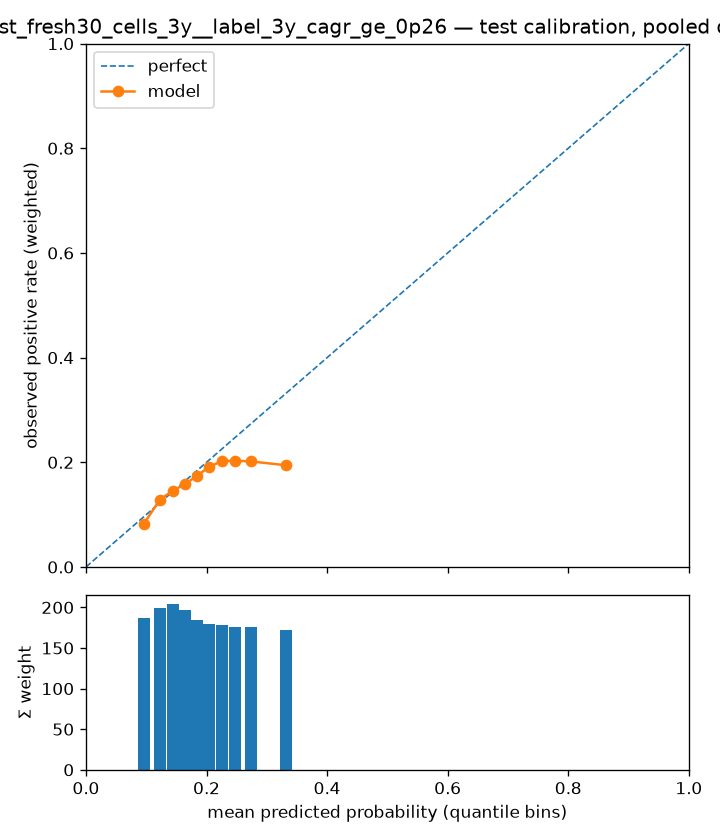

# Experiment report — forest_fresh30_cells_3y__label_3y_cagr_ge_0p26

- run id: `4dcc85c98278`
- dataset version: `1.4.1` (pinned, immutable)
- dataset sha256: `be2b664c6739b93d5b5a7df1d085c09f09575071dd02d1f1426ed1586e052085` (dataset.parquet, from the manifest's provenance block)
- config hash: `1649366821601277`
- git SHA: `f24b95eda15ff2283e1ea10025a00b1f1aac57b0`
- seed: 23
- model: `random_forest` params `{"bootstrap": true, "class_weight": 1.0, "criterion": "entropy", "max_depth": 4, "max_features": 0.205191, "max_samples": 0.663781, "min_samples_leaf": 72, "n_estimators": 490, "n_jobs": 8}`
- label: `fwd_3y_cagr >= 0.26` — horizon 3y, scheme `walkforward`
- derived label `fwd_3y_cagr >= 0.26`: evaluated on the fly from the manifest's continuous outcome columns (harness.derived_labels); NULL wherever a referenced column is NULL
- **universe: `dist_52w_high <= -0.3 & dollar_volume_3m >= 100000`** — train and test rows outside it are left out (a row with a NULL in a filter column is outside). Every number below describes this universe: base rates, baselines and picks are not comparable with a run over all rows, and the run is counted in the universe's own ledger cell. The filter reads feature columns as of the snapshot; it builds no split (upstream tags decide train and test, the purge and embargo hold for the rows that remain) and derives no column. `sample_weight` is the upstream uniqueness weight, not recomputed for the rows left out.
- **configurations tried against this cell (dataset, scheme, horizon, label, universe): 1** (from the append-only results store; failed runs count); **54 against this label in any universe**
- saved model bundle: `experiments/models/forest_fresh30_cells_3y__label_3y_cagr_ge_0p26_4dcc85c98278` (re-evaluate with `vml-eval`, no refitting)

## Era-sliced metrics (one row per test year)

Sliced on the calendar year of each test row's `snapshot_date` (one walk-forward fold per year); crash eras are tagged inline. `conf_at_K` is the mean score of the top-K picks; `base_rate_brier` is the no-skill Brier the model must beat. \*The pooled row picks per year — per-fold model scores are not comparable, so a global top-K would just take the hottest-scoring fold's picks; it is context for the era rows, never a stand-alone result. ROC-AUC and recall@K are logged in the results store, not shown here.

| era          | n_test | base_rate | mean_score | precision_at_20 | precision_at_50 | precision_at_thr_0.5 | precision_at_thr_0.6 | precision_at_thr_0.7 | conf_at_20 | conf_at_50 | n_at_prec_0.75 | n_at_prec_0.9 | recall_at_prec_0.75 | recall_at_prec_0.9 | recall_at_thr_0.5 | recall_at_thr_0.6 | recall_at_thr_0.7 | n_at_thr_0.5 | n_at_thr_0.6 | n_at_thr_0.7 | brier  | base_rate_brier | pr_auc |
| ------------ | ------ | --------- | ---------- | --------------- | --------------- | -------------------- | -------------------- | -------------------- | ---------- | ---------- | -------------- | ------------- | ------------------- | ------------------ | ----------------- | ----------------- | ----------------- | ------------ | ------------ | ------------ | ------ | --------------- | ------ |
| 2005         | 3438   | 0.0948    | 0.1578     | 0.1500          | 0.1000          | —                    | —                    | —                    | 0.2601     | 0.2534     | 0              | 0             | 0                   | 0                  | 0                 | 0                 | 0                 | 0            | 0            | 0            | 0.0909 | 0.0859          | 0.0986 |
| 2006         | 3181   | 0.0299    | 0.2107     | 0               | 0               | —                    | —                    | —                    | 0.3439     | 0.3375     | 0              | 0             | 0                   | 0                  | 0                 | 0                 | 0                 | 0            | 0            | 0            | 0.0654 | 0.0290          | 0.0303 |
| 2007         | 3353   | 0.0356    | 0.2522     | 0               | 0.0200          | —                    | —                    | —                    | 0.4256     | 0.4198     | 0              | 0             | 0                   | 0                  | 0                 | 0                 | 0                 | 0            | 0            | 0            | 0.0889 | 0.0343          | 0.0362 |
| 2008 (GFC)   | 7230   | 0.2046    | 0.2527     | 0.2000          | 0.1200          | —                    | —                    | —                    | 0.3991     | 0.3950     | 1              | 1             | 0.0007              | 0.0007             | 0                 | 0                 | 0                 | 0            | 0            | 0            | 0.1709 | 0.1627          | 0.2047 |
| 2009 (GFC)   | 5916   | 0.3704    | 0.2412     | 0.3500          | 0.4600          | —                    | —                    | —                    | 0.3621     | 0.3574     | 0              | 0             | 0                   | 0                  | 0                 | 0                 | 0                 | 0            | 0            | 0            | 0.2475 | 0.2332          | 0.4004 |
| 2010         | 2355   | 0.1707    | 0.1732     | 0.2500          | 0.2600          | —                    | —                    | —                    | 0.2780     | 0.2697     | 0              | 0             | 0                   | 0                  | 0                 | 0                 | 0                 | 0            | 0            | 0            | 0.1373 | 0.1416          | 0.2404 |
| 2011         | 3265   | 0.2195    | 0.1640     | 0.4500          | 0.3600          | —                    | —                    | —                    | 0.2731     | 0.2651     | 5              | 0             | 0.0053              | 0                  | 0                 | 0                 | 0                 | 0            | 0            | 0            | 0.1713 | 0.1713          | 0.2713 |
| 2012         | 2932   | 0.1977    | 0.1612     | 0.3500          | 0.3400          | —                    | —                    | —                    | 0.2323     | 0.2282     | 1              | 1             | 0.0017              | 0.0017             | 0                 | 0                 | 0                 | 0            | 0            | 0            | 0.1592 | 0.1586          | 0.2300 |
| 2013         | 1634   | 0.1013    | 0.1640     | 0.1000          | 0.0400          | —                    | —                    | —                    | 0.2723     | 0.2654     | 0              | 0             | 0                   | 0                  | 0                 | 0                 | 0                 | 0            | 0            | 0            | 0.0968 | 0.0911          | 0.1057 |
| 2014         | 2694   | 0.0705    | 0.1616     | 0.1000          | 0.0600          | —                    | —                    | —                    | 0.2832     | 0.2774     | 0              | 0             | 0                   | 0                  | 0                 | 0                 | 0                 | 0            | 0            | 0            | 0.0764 | 0.0655          | 0.0743 |
| 2015         | 3879   | 0.1079    | 0.1852     | 0.2000          | 0.1200          | —                    | —                    | —                    | 0.3078     | 0.3030     | 0              | 0             | 0                   | 0                  | 0                 | 0                 | 0                 | 0            | 0            | 0            | 0.1050 | 0.0963          | 0.1120 |
| 2016         | 4170   | 0.1650    | 0.1923     | 0               | 0.0400          | —                    | —                    | —                    | 0.3183     | 0.3141     | 0              | 0             | 0                   | 0                  | 0                 | 0                 | 0                 | 0            | 0            | 0            | 0.1424 | 0.1378          | 0.1629 |
| 2017         | 2843   | 0.0925    | 0.1747     | 0               | 0.0400          | —                    | —                    | —                    | 0.2955     | 0.2902     | 0              | 0             | 0                   | 0                  | 0                 | 0                 | 0                 | 0            | 0            | 0            | 0.0972 | 0.0839          | 0.0726 |
| 2018         | 3442   | 0.1646    | 0.1721     | 0.2000          | 0.1800          | —                    | —                    | —                    | 0.2991     | 0.2928     | 0              | 0             | 0                   | 0                  | 0                 | 0                 | 0                 | 0            | 0            | 0            | 0.1403 | 0.1375          | 0.1677 |
| 2019         | 4522   | 0.1587    | 0.1789     | 0.0500          | 0.1000          | —                    | —                    | —                    | 0.2986     | 0.2918     | 0              | 0             | 0                   | 0                  | 0                 | 0                 | 0                 | 0            | 0            | 0            | 0.1335 | 0.1335          | 0.1779 |
| 2020 (COVID) | 5398   | 0.2254    | 0.1877     | 0.3500          | 0.3400          | —                    | —                    | —                    | 0.3237     | 0.3180     | 1              | 1             | 0.0008              | 0.0008             | 0                 | 0                 | 0                 | 0            | 0            | 0            | 0.1683 | 0.1746          | 0.3004 |
| pooled*      | 60252  | 0.1668    | 0.1964     | 0.1719          | 0.1613          | —                    | —                    | —                    | 0.3108     | 0.3049     | 8              | 3             | 0.0007              | 0.0003             | 0                 | 0                 | 0                 | 0            | 0            | 0            | 0.1403 | 0.1390          | 0.1904 |

## High-confidence picks (pooled)

How many high-confidence calls the model made, how confident it was, and how precise they were — no pre-chosen score threshold needed. `top N/yr` rows pick per test year; `score >= p` rows (probabilistic models) count every name at or above that probability, pooled.

| selection    | n_picks | picks_per_year | mean_score | precision | hits |
| ------------ | ------- | -------------- | ---------- | --------- | ---- |
| top 5/yr     | 80      | 5              | 0.3172     | 0.2125    | 17   |
| top 10/yr    | 160     | 10             | 0.3143     | 0.1625    | 26   |
| top 20/yr    | 320     | 20             | 0.3108     | 0.1719    | 55   |
| top 50/yr    | 800     | 50             | 0.3049     | 0.1613    | 129  |
| score >= 0.9 | 0       | 0              | —          | —         | 0    |
| score >= 0.8 | 0       | 0              | —          | —         | 0    |
| score >= 0.7 | 0       | 0              | —          | —         | 0    |
| score >= 0.6 | 0       | 0              | —          | —         | 0    |
| score >= 0.5 | 0       | 0              | —          | —         | 0    |

## Pick outcomes (what the picks went on to do)

Report-only outcomes of the top-K picks of each test year (`pick_outcomes`: `label_3y_beat_spy`, `fwd_3y_excess_cagr`, `fwd_3y_cagr`, `fwd_3y_max_drawdown_from_entry`, `fwd_3y_cagr < 0.0`, `fwd_3y_cagr < -0.1`, `fwd_3y_max_drawdown_from_entry >= 0.4`, `fwd_3y_cagr >= 0.15`, `fwd_3y_cagr >= 0.26`, `fwd_3y_excess_cagr >= 0.05`, `fwd_3y_excess_cagr >= 0.1`), from the manifest's label columns; none is a model input or the training target, and the run is counted in its own label's cell. For a binary outcome the picks' hit rate, for a continuous one their mean and median, each beside the same statistic over **all** test rows of the era (unweighted, like the picks: one row, one pick). `stocks` is the number of distinct `permaticker`s among the picks (a stock has up to four test rows a year); in the pooled row it is the mean per year and the statistics run over every year's picks. NULL outcomes are left out, not counted as misses. This is a no-cost, equal-weight reading of the picks, a screen for `vml-backtest` and not a substitute.

### Top 20 per test year: `label_3y_beat_spy`

| era          | picks | stocks  | picks hit rate | all rows |
| ------------ | ----- | ------- | -------------- | -------- |
| 2005         | 20    | 19      | 0.4000         | 0.2958   |
| 2006         | 20    | 17      | 0.2500         | 0.3024   |
| 2007         | 20    | 18      | 0.4500         | 0.3170   |
| 2008 (GFC)   | 20    | 15      | 0.6500         | 0.5083   |
| 2009 (GFC)   | 20    | 16      | 0.6000         | 0.5286   |
| 2010         | 20    | 20      | 0.5500         | 0.2773   |
| 2011         | 20    | 18      | 0.6000         | 0.3075   |
| 2012         | 20    | 18      | 0.6500         | 0.2977   |
| 2013         | 20    | 20      | 0.2000         | 0.2160   |
| 2014         | 20    | 17      | 0.3500         | 0.1956   |
| 2015         | 20    | 17      | 0.5000         | 0.2501   |
| 2016         | 20    | 19      | 0.2500         | 0.3070   |
| 2017         | 20    | 12      | 0.1500         | 0.1808   |
| 2018         | 20    | 18      | 0.4000         | 0.2429   |
| 2019         | 20    | 18      | 0.3000         | 0.2607   |
| 2020 (COVID) | 20    | 20      | 0.6500         | 0.3931   |
| pooled*      | 320   | 17.6250 | 0.4344         | 0.3345   |

### Top 20 per test year: `fwd_3y_excess_cagr`

| era          | picks | stocks  | picks mean | picks median | all rows mean | all rows median |
| ------------ | ----- | ------- | ---------- | ------------ | ------------- | --------------- |
| 2005         | 20    | 19      | -0.0833    | -0.0736      | -0.1703       | -0.1520         |
| 2006         | 20    | 17      | -0.2339    | -0.2507      | -0.1780       | -0.1536         |
| 2007         | 20    | 18      | -0.1449    | -0.0384      | -0.1710       | -0.1316         |
| 2008 (GFC)   | 20    | 15      | 0.0782     | 0.0825       | -0.0177       | 0.0052          |
| 2009 (GFC)   | 20    | 16      | 0.0414     | 0.0448       | 0.0025        | 0.0174          |
| 2010         | 20    | 20      | 0.0088     | 0.0330       | -0.2138       | -0.1819         |
| 2011         | 20    | 18      | 0.0234     | 0.0388       | -0.1754       | -0.1327         |
| 2012         | 20    | 18      | 0.0775     | 0.0498       | -0.1786       | -0.1422         |
| 2013         | 20    | 20      | -0.2817    | -0.2060      | -0.2905       | -0.2607         |
| 2014         | 20    | 17      | -0.1141    | -0.0278      | -0.2959       | -0.2599         |
| 2015         | 20    | 17      | -0.0779    | -0.0026      | -0.2359       | -0.1786         |
| 2016         | 20    | 19      | -0.0850    | -0.0973      | -0.1833       | -0.1312         |
| 2017         | 20    | 12      | -0.3469    | -0.3928      | -0.3144       | -0.3270         |
| 2018         | 20    | 18      | -0.0794    | -0.0584      | -0.2388       | -0.2127         |
| 2019         | 20    | 18      | -0.1278    | -0.1313      | -0.2100       | -0.1947         |
| 2020 (COVID) | 20    | 20      | 0.0704     | 0.1042       | -0.1264       | -0.0909         |
| pooled*      | 320   | 17.6250 | -0.0797    | -0.0326      | -0.1616       | -0.1248         |

### Top 20 per test year: `fwd_3y_cagr`

| era          | picks | stocks  | picks mean | picks median | all rows mean | all rows median |
| ------------ | ----- | ------- | ---------- | ------------ | ------------- | --------------- |
| 2005         | 20    | 19      | -0.0655    | -0.0227      | -0.1389       | -0.1188         |
| 2006         | 20    | 17      | -0.3257    | -0.3582      | -0.2620       | -0.2369         |
| 2007         | 20    | 18      | -0.2006    | -0.0919      | -0.2319       | -0.1939         |
| 2008 (GFC)   | 20    | 15      | 0.1280     | 0.1329       | 0.0350        | 0.0562          |
| 2009 (GFC)   | 20    | 16      | 0.2203     | 0.2212       | 0.1730        | 0.1879          |
| 2010         | 20    | 20      | 0.1661     | 0.2078       | -0.0602       | -0.0264         |
| 2011         | 20    | 18      | 0.2254     | 0.2401       | 0.0096        | 0.0551          |
| 2012         | 20    | 18      | 0.2501     | 0.2245       | -0.0086       | 0.0304          |
| 2013         | 20    | 20      | -0.1685    | -0.0930      | -0.1858       | -0.1556         |
| 2014         | 20    | 17      | -0.0100    | 0.0668       | -0.1935       | -0.1579         |
| 2015         | 20    | 17      | 0.0451     | 0.1074       | -0.1132       | -0.0572         |
| 2016         | 20    | 19      | 0.0472     | 0.0436       | -0.0496       | 0.0021          |
| 2017         | 20    | 12      | -0.2334    | -0.2577      | -0.2008       | -0.2145         |
| 2018         | 20    | 18      | 0.1215     | 0.1560       | -0.0602       | -0.0332         |
| 2019         | 20    | 18      | 0.0301     | 0.0718       | -0.0631       | -0.0477         |
| 2020 (COVID) | 20    | 20      | 0.2110     | 0.2368       | -0.0134       | 0.0201          |
| pooled*      | 320   | 17.6250 | 0.0276     | 0.0795       | -0.0590       | -0.0249         |

### Top 20 per test year: `fwd_3y_max_drawdown_from_entry`

| era          | picks | stocks  | picks mean | picks median | all rows mean | all rows median |
| ------------ | ----- | ------- | ---------- | ------------ | ------------- | --------------- |
| 2005         | 20    | 19      | 0.4327     | 0.3576       | 0.5230        | 0.5253          |
| 2006         | 20    | 17      | 0.7684     | 0.8525       | 0.7034        | 0.7931          |
| 2007         | 20    | 18      | 0.8470     | 0.8869       | 0.7655        | 0.8380          |
| 2008 (GFC)   | 20    | 15      | 0.6076     | 0.6785       | 0.6001        | 0.6244          |
| 2009 (GFC)   | 20    | 16      | 0.1782     | 0.1455       | 0.2943        | 0.2066          |
| 2010         | 20    | 20      | 0.2303     | 0.1783       | 0.5274        | 0.5271          |
| 2011         | 20    | 18      | 0.1370     | 0.1070       | 0.4692        | 0.4298          |
| 2012         | 20    | 18      | 0.1638     | 0.1592       | 0.4380        | 0.3744          |
| 2013         | 20    | 20      | 0.5421     | 0.5653       | 0.5819        | 0.6178          |
| 2014         | 20    | 17      | 0.5316     | 0.5942       | 0.6282        | 0.6849          |
| 2015         | 20    | 17      | 0.4189     | 0.4192       | 0.5908        | 0.5956          |
| 2016         | 20    | 19      | 0.1869     | 0.1333       | 0.4600        | 0.3940          |
| 2017         | 20    | 12      | 0.7068     | 0.7466       | 0.6682        | 0.7627          |
| 2018         | 20    | 18      | 0.5383     | 0.5407       | 0.6604        | 0.7279          |
| 2019         | 20    | 18      | 0.5213     | 0.5119       | 0.6325        | 0.6693          |
| 2020 (COVID) | 20    | 20      | 0.0894     | 0.0764       | 0.4730        | 0.4367          |
| pooled*      | 320   | 17.6250 | 0.4313     | 0.3623       | 0.5507        | 0.5731          |

### Top 20 per test year: `label_3y_cagr_lt_0p0`

| era          | picks | stocks  | picks hit rate | all rows |
| ------------ | ----- | ------- | -------------- | -------- |
| 2005         | 20    | 19      | 0.5000         | 0.6510   |
| 2006         | 20    | 17      | 0.8500         | 0.7831   |
| 2007         | 20    | 18      | 0.8000         | 0.7569   |
| 2008 (GFC)   | 20    | 15      | 0.3000         | 0.4122   |
| 2009 (GFC)   | 20    | 16      | 0              | 0.2446   |
| 2010         | 20    | 20      | 0.2000         | 0.5355   |
| 2011         | 20    | 18      | 0.1000         | 0.4343   |
| 2012         | 20    | 18      | 0.0500         | 0.4615   |
| 2013         | 20    | 20      | 0.6500         | 0.6799   |
| 2014         | 20    | 17      | 0.4000         | 0.6745   |
| 2015         | 20    | 17      | 0.4000         | 0.5821   |
| 2016         | 20    | 19      | 0.2500         | 0.4942   |
| 2017         | 20    | 12      | 0.7500         | 0.7081   |
| 2018         | 20    | 18      | 0.3000         | 0.5349   |
| 2019         | 20    | 18      | 0.4000         | 0.5610   |
| 2020 (COVID) | 20    | 20      | 0.0500         | 0.4746   |
| pooled*      | 320   | 17.6250 | 0.3750         | 0.5299   |

### Top 20 per test year: `label_3y_cagr_lt_m0p1`

| era          | picks | stocks  | picks hit rate | all rows |
| ------------ | ----- | ------- | -------------- | -------- |
| 2005         | 20    | 19      | 0.4500         | 0.5233   |
| 2006         | 20    | 17      | 0.7000         | 0.6699   |
| 2007         | 20    | 18      | 0.5000         | 0.6290   |
| 2008 (GFC)   | 20    | 15      | 0.2000         | 0.2834   |
| 2009 (GFC)   | 20    | 16      | 0              | 0.1651   |
| 2010         | 20    | 20      | 0.0500         | 0.4174   |
| 2011         | 20    | 18      | 0.0500         | 0.3271   |
| 2012         | 20    | 18      | 0              | 0.3585   |
| 2013         | 20    | 20      | 0.4500         | 0.5575   |
| 2014         | 20    | 17      | 0.2500         | 0.5575   |
| 2015         | 20    | 17      | 0.1500         | 0.4468   |
| 2016         | 20    | 19      | 0.0500         | 0.3935   |
| 2017         | 20    | 12      | 0.6000         | 0.5987   |
| 2018         | 20    | 18      | 0.1000         | 0.4358   |
| 2019         | 20    | 18      | 0.2500         | 0.4356   |
| 2020 (COVID) | 20    | 20      | 0.0500         | 0.3922   |
| pooled*      | 320   | 17.6250 | 0.2406         | 0.4190   |

### Top 20 per test year: `label_3y_max_drawdown_from_entry_ge_0p4`

| era          | picks | stocks  | picks hit rate | all rows |
| ------------ | ----- | ------- | -------------- | -------- |
| 2005         | 20    | 19      | 0.4500         | 0.6050   |
| 2006         | 20    | 17      | 0.9500         | 0.8158   |
| 2007         | 20    | 18      | 1              | 0.9096   |
| 2008 (GFC)   | 20    | 15      | 0.7000         | 0.7465   |
| 2009 (GFC)   | 20    | 16      | 0              | 0.2576   |
| 2010         | 20    | 20      | 0.2000         | 0.6076   |
| 2011         | 20    | 18      | 0.0500         | 0.5280   |
| 2012         | 20    | 18      | 0              | 0.4761   |
| 2013         | 20    | 20      | 0.6000         | 0.6726   |
| 2014         | 20    | 17      | 0.6000         | 0.7428   |
| 2015         | 20    | 17      | 0.5500         | 0.7069   |
| 2016         | 20    | 19      | 0.1500         | 0.4969   |
| 2017         | 20    | 12      | 0.8500         | 0.7752   |
| 2018         | 20    | 18      | 0.8000         | 0.7899   |
| 2019         | 20    | 18      | 0.6500         | 0.7941   |
| 2020 (COVID) | 20    | 20      | 0              | 0.5228   |
| pooled*      | 320   | 17.6250 | 0.4719         | 0.6381   |

### Top 20 per test year: `label_3y_cagr_ge_0p15`

| era          | picks | stocks  | picks hit rate | all rows |
| ------------ | ----- | ------- | -------------- | -------- |
| 2005         | 20    | 19      | 0.2000         | 0.1751   |
| 2006         | 20    | 17      | 0              | 0.0789   |
| 2007         | 20    | 18      | 0              | 0.0862   |
| 2008 (GFC)   | 20    | 15      | 0.5000         | 0.3477   |
| 2009 (GFC)   | 20    | 16      | 0.7000         | 0.5609   |
| 2010         | 20    | 20      | 0.6500         | 0.2892   |
| 2011         | 20    | 18      | 0.6500         | 0.3648   |
| 2012         | 20    | 18      | 0.7000         | 0.3240   |
| 2013         | 20    | 20      | 0.1500         | 0.1689   |
| 2014         | 20    | 17      | 0.2000         | 0.1440   |
| 2015         | 20    | 17      | 0.4000         | 0.2168   |
| 2016         | 20    | 19      | 0.2000         | 0.2825   |
| 2017         | 20    | 12      | 0.1500         | 0.1551   |
| 2018         | 20    | 18      | 0.5500         | 0.2769   |
| 2019         | 20    | 18      | 0.3000         | 0.2543   |
| 2020 (COVID) | 20    | 20      | 0.6000         | 0.3535   |
| pooled*      | 320   | 17.6250 | 0.3719         | 0.2810   |

### Top 20 per test year: `label_3y_cagr_ge_0p26`

| era          | picks | stocks  | picks hit rate | all rows |
| ------------ | ----- | ------- | -------------- | -------- |
| 2005         | 20    | 19      | 0.1500         | 0.0974   |
| 2006         | 20    | 17      | 0              | 0.0299   |
| 2007         | 20    | 18      | 0              | 0.0349   |
| 2008 (GFC)   | 20    | 15      | 0.2000         | 0.2073   |
| 2009 (GFC)   | 20    | 16      | 0.3500         | 0.3781   |
| 2010         | 20    | 20      | 0.2500         | 0.1788   |
| 2011         | 20    | 18      | 0.4500         | 0.2291   |
| 2012         | 20    | 18      | 0.3500         | 0.2046   |
| 2013         | 20    | 20      | 0.1000         | 0.1034   |
| 2014         | 20    | 17      | 0.1000         | 0.0713   |
| 2015         | 20    | 17      | 0.2000         | 0.1116   |
| 2016         | 20    | 19      | 0              | 0.1688   |
| 2017         | 20    | 12      | 0              | 0.0957   |
| 2018         | 20    | 18      | 0.2000         | 0.1732   |
| 2019         | 20    | 18      | 0.0500         | 0.1661   |
| 2020 (COVID) | 20    | 20      | 0.3500         | 0.2340   |
| pooled*      | 320   | 17.6250 | 0.1719         | 0.1731   |

### Top 20 per test year: `label_3y_excess_cagr_ge_0p05`

| era          | picks | stocks  | picks hit rate | all rows |
| ------------ | ----- | ------- | -------------- | -------- |
| 2005         | 20    | 19      | 0.2500         | 0.2368   |
| 2006         | 20    | 17      | 0.2000         | 0.2461   |
| 2007         | 20    | 18      | 0.2500         | 0.2562   |
| 2008 (GFC)   | 20    | 15      | 0.5500         | 0.4220   |
| 2009 (GFC)   | 20    | 16      | 0.4500         | 0.4412   |
| 2010         | 20    | 20      | 0.4000         | 0.2289   |
| 2011         | 20    | 18      | 0.4500         | 0.2493   |
| 2012         | 20    | 18      | 0.5000         | 0.2381   |
| 2013         | 20    | 20      | 0.1000         | 0.1665   |
| 2014         | 20    | 17      | 0.2000         | 0.1425   |
| 2015         | 20    | 17      | 0.3000         | 0.1864   |
| 2016         | 20    | 19      | 0.1000         | 0.2420   |
| 2017         | 20    | 12      | 0.1000         | 0.1432   |
| 2018         | 20    | 18      | 0.3000         | 0.1949   |
| 2019         | 20    | 18      | 0.1500         | 0.2163   |
| 2020 (COVID) | 20    | 20      | 0.5500         | 0.3344   |
| pooled*      | 320   | 17.6250 | 0.3031         | 0.2725   |

### Top 20 per test year: `label_3y_excess_cagr_ge_0p1`

| era          | picks | stocks  | picks hit rate | all rows |
| ------------ | ----- | ------- | -------------- | -------- |
| 2005         | 20    | 19      | 0.2000         | 0.1873   |
| 2006         | 20    | 17      | 0.1500         | 0.1943   |
| 2007         | 20    | 18      | 0              | 0.1945   |
| 2008 (GFC)   | 20    | 15      | 0.4500         | 0.3362   |
| 2009 (GFC)   | 20    | 16      | 0.3000         | 0.3619   |
| 2010         | 20    | 20      | 0.3000         | 0.1813   |
| 2011         | 20    | 18      | 0.3000         | 0.1926   |
| 2012         | 20    | 18      | 0.3500         | 0.1975   |
| 2013         | 20    | 20      | 0.1000         | 0.1310   |
| 2014         | 20    | 17      | 0.1000         | 0.1021   |
| 2015         | 20    | 17      | 0.2000         | 0.1397   |
| 2016         | 20    | 19      | 0.0500         | 0.1933   |
| 2017         | 20    | 12      | 0.0500         | 0.1147   |
| 2018         | 20    | 18      | 0.1500         | 0.1580   |
| 2019         | 20    | 18      | 0.1000         | 0.1751   |
| 2020 (COVID) | 20    | 20      | 0.5500         | 0.2773   |
| pooled*      | 320   | 17.6250 | 0.2094         | 0.2177   |

### Top 50 per test year: `label_3y_beat_spy`

| era          | picks | stocks  | picks hit rate | all rows |
| ------------ | ----- | ------- | -------------- | -------- |
| 2005         | 50    | 40      | 0.4600         | 0.2958   |
| 2006         | 50    | 38      | 0.2600         | 0.3024   |
| 2007         | 50    | 45      | 0.4800         | 0.3170   |
| 2008 (GFC)   | 50    | 35      | 0.5600         | 0.5083   |
| 2009 (GFC)   | 50    | 37      | 0.6400         | 0.5286   |
| 2010         | 50    | 45      | 0.4800         | 0.2773   |
| 2011         | 50    | 43      | 0.5000         | 0.3075   |
| 2012         | 50    | 45      | 0.5800         | 0.2977   |
| 2013         | 50    | 42      | 0.1800         | 0.2160   |
| 2014         | 50    | 39      | 0.2400         | 0.1956   |
| 2015         | 50    | 38      | 0.4400         | 0.2501   |
| 2016         | 50    | 44      | 0.3000         | 0.3070   |
| 2017         | 50    | 35      | 0.1600         | 0.1808   |
| 2018         | 50    | 44      | 0.3200         | 0.2429   |
| 2019         | 50    | 42      | 0.3200         | 0.2607   |
| 2020 (COVID) | 50    | 50      | 0.6000         | 0.3931   |
| pooled*      | 800   | 41.3750 | 0.4075         | 0.3345   |

### Top 50 per test year: `fwd_3y_excess_cagr`

| era          | picks | stocks  | picks mean | picks median | all rows mean | all rows median |
| ------------ | ----- | ------- | ---------- | ------------ | ------------- | --------------- |
| 2005         | 50    | 40      | -0.0779    | -0.0359      | -0.1703       | -0.1520         |
| 2006         | 50    | 38      | -0.2259    | -0.1816      | -0.1780       | -0.1536         |
| 2007         | 50    | 45      | -0.1083    | -0.0103      | -0.1710       | -0.1316         |
| 2008 (GFC)   | 50    | 35      | 0.0222     | 0.0428       | -0.0177       | 0.0052          |
| 2009 (GFC)   | 50    | 37      | 0.0648     | 0.0604       | 0.0025        | 0.0174          |
| 2010         | 50    | 45      | -0.0087    | -0.0071      | -0.2138       | -0.1819         |
| 2011         | 50    | 43      | -0.0142    | 0.0069       | -0.1754       | -0.1327         |
| 2012         | 50    | 45      | 0.0419     | 0.0289       | -0.1786       | -0.1422         |
| 2013         | 50    | 42      | -0.3711    | -0.3224      | -0.2905       | -0.2607         |
| 2014         | 50    | 39      | -0.2116    | -0.1663      | -0.2959       | -0.2599         |
| 2015         | 50    | 38      | -0.0631    | -0.0206      | -0.2359       | -0.1786         |
| 2016         | 50    | 44      | -0.0859    | -0.0622      | -0.1833       | -0.1312         |
| 2017         | 50    | 35      | -0.3102    | -0.3224      | -0.3144       | -0.3270         |
| 2018         | 50    | 44      | -0.1106    | -0.1129      | -0.2388       | -0.2127         |
| 2019         | 50    | 42      | -0.1058    | -0.0789      | -0.2100       | -0.1947         |
| 2020 (COVID) | 50    | 50      | 0.0354     | 0.0466       | -0.1264       | -0.0909         |
| pooled*      | 800   | 41.3750 | -0.0956    | -0.0461      | -0.1616       | -0.1248         |

### Top 50 per test year: `fwd_3y_cagr`

| era          | picks | stocks  | picks mean | picks median | all rows mean | all rows median |
| ------------ | ----- | ------- | ---------- | ------------ | ------------- | --------------- |
| 2005         | 50    | 40      | -0.0667    | -0.0217      | -0.1389       | -0.1188         |
| 2006         | 50    | 38      | -0.3186    | -0.2711      | -0.2620       | -0.2369         |
| 2007         | 50    | 45      | -0.1654    | -0.0642      | -0.2319       | -0.1939         |
| 2008 (GFC)   | 50    | 35      | 0.0594     | 0.0732       | 0.0350        | 0.0562          |
| 2009 (GFC)   | 50    | 37      | 0.2412     | 0.2275       | 0.1730        | 0.1879          |
| 2010         | 50    | 45      | 0.1504     | 0.1621       | -0.0602       | -0.0264         |
| 2011         | 50    | 43      | 0.1898     | 0.2123       | 0.0096        | 0.0551          |
| 2012         | 50    | 45      | 0.2147     | 0.2011       | -0.0086       | 0.0304          |
| 2013         | 50    | 42      | -0.2629    | -0.2268      | -0.1858       | -0.1556         |
| 2014         | 50    | 39      | -0.1076    | -0.0510      | -0.1935       | -0.1579         |
| 2015         | 50    | 38      | 0.0597     | 0.0939       | -0.1132       | -0.0572         |
| 2016         | 50    | 44      | 0.0454     | 0.0662       | -0.0496       | 0.0021          |
| 2017         | 50    | 35      | -0.1952    | -0.2073      | -0.2008       | -0.2145         |
| 2018         | 50    | 44      | 0.0869     | 0.0856       | -0.0602       | -0.0332         |
| 2019         | 50    | 42      | 0.0545     | 0.0856       | -0.0631       | -0.0477         |
| 2020 (COVID) | 50    | 50      | 0.1757     | 0.1953       | -0.0134       | 0.0201          |
| pooled*      | 800   | 41.3750 | 0.0101     | 0.0668       | -0.0590       | -0.0249         |

### Top 50 per test year: `fwd_3y_max_drawdown_from_entry`

| era          | picks | stocks  | picks mean | picks median | all rows mean | all rows median |
| ------------ | ----- | ------- | ---------- | ------------ | ------------- | --------------- |
| 2005         | 50    | 40      | 0.3994     | 0.3576       | 0.5230        | 0.5253          |
| 2006         | 50    | 38      | 0.7270     | 0.8181       | 0.7034        | 0.7931          |
| 2007         | 50    | 45      | 0.7930     | 0.8567       | 0.7655        | 0.8380          |
| 2008 (GFC)   | 50    | 35      | 0.6195     | 0.6471       | 0.6001        | 0.6244          |
| 2009 (GFC)   | 50    | 37      | 0.1968     | 0.1662       | 0.2943        | 0.2066          |
| 2010         | 50    | 45      | 0.2568     | 0.1919       | 0.5274        | 0.5271          |
| 2011         | 50    | 43      | 0.1820     | 0.1378       | 0.4692        | 0.4298          |
| 2012         | 50    | 45      | 0.2008     | 0.1275       | 0.4380        | 0.3744          |
| 2013         | 50    | 42      | 0.6144     | 0.6722       | 0.5819        | 0.6178          |
| 2014         | 50    | 39      | 0.5898     | 0.6366       | 0.6282        | 0.6849          |
| 2015         | 50    | 38      | 0.3987     | 0.3845       | 0.5908        | 0.5956          |
| 2016         | 50    | 44      | 0.2317     | 0.1728       | 0.4600        | 0.3940          |
| 2017         | 50    | 35      | 0.6384     | 0.7127       | 0.6682        | 0.7627          |
| 2018         | 50    | 44      | 0.5659     | 0.5602       | 0.6604        | 0.7279          |
| 2019         | 50    | 42      | 0.5253     | 0.5326       | 0.6325        | 0.6693          |
| 2020 (COVID) | 50    | 50      | 0.1329     | 0.0917       | 0.4730        | 0.4367          |
| pooled*      | 800   | 41.3750 | 0.4420     | 0.3825       | 0.5507        | 0.5731          |

### Top 50 per test year: `label_3y_cagr_lt_0p0`

| era          | picks | stocks  | picks hit rate | all rows |
| ------------ | ----- | ------- | -------------- | -------- |
| 2005         | 50    | 40      | 0.5800         | 0.6510   |
| 2006         | 50    | 38      | 0.8800         | 0.7831   |
| 2007         | 50    | 45      | 0.7400         | 0.7569   |
| 2008 (GFC)   | 50    | 35      | 0.3400         | 0.4122   |
| 2009 (GFC)   | 50    | 37      | 0.0400         | 0.2446   |
| 2010         | 50    | 45      | 0.1600         | 0.5355   |
| 2011         | 50    | 43      | 0.1200         | 0.4343   |
| 2012         | 50    | 45      | 0.1000         | 0.4615   |
| 2013         | 50    | 42      | 0.7200         | 0.6799   |
| 2014         | 50    | 39      | 0.5400         | 0.6745   |
| 2015         | 50    | 38      | 0.3200         | 0.5821   |
| 2016         | 50    | 44      | 0.3200         | 0.4942   |
| 2017         | 50    | 35      | 0.7200         | 0.7081   |
| 2018         | 50    | 44      | 0.3400         | 0.5349   |
| 2019         | 50    | 42      | 0.3200         | 0.5610   |
| 2020 (COVID) | 50    | 50      | 0.1400         | 0.4746   |
| pooled*      | 800   | 41.3750 | 0.3987         | 0.5299   |

### Top 50 per test year: `label_3y_cagr_lt_m0p1`

| era          | picks | stocks  | picks hit rate | all rows |
| ------------ | ----- | ------- | -------------- | -------- |
| 2005         | 50    | 40      | 0.4200         | 0.5233   |
| 2006         | 50    | 38      | 0.7000         | 0.6699   |
| 2007         | 50    | 45      | 0.4400         | 0.6290   |
| 2008 (GFC)   | 50    | 35      | 0.2000         | 0.2834   |
| 2009 (GFC)   | 50    | 37      | 0.0200         | 0.1651   |
| 2010         | 50    | 45      | 0.0800         | 0.4174   |
| 2011         | 50    | 43      | 0.0600         | 0.3271   |
| 2012         | 50    | 45      | 0.0600         | 0.3585   |
| 2013         | 50    | 42      | 0.6400         | 0.5575   |
| 2014         | 50    | 39      | 0.4400         | 0.5575   |
| 2015         | 50    | 38      | 0.1200         | 0.4468   |
| 2016         | 50    | 44      | 0.1400         | 0.3935   |
| 2017         | 50    | 35      | 0.5800         | 0.5987   |
| 2018         | 50    | 44      | 0.1400         | 0.4358   |
| 2019         | 50    | 42      | 0.1800         | 0.4356   |
| 2020 (COVID) | 50    | 50      | 0.1000         | 0.3922   |
| pooled*      | 800   | 41.3750 | 0.2700         | 0.4190   |

### Top 50 per test year: `label_3y_max_drawdown_from_entry_ge_0p4`

| era          | picks | stocks  | picks hit rate | all rows |
| ------------ | ----- | ------- | -------------- | -------- |
| 2005         | 50    | 40      | 0.4000         | 0.6050   |
| 2006         | 50    | 38      | 0.8800         | 0.8158   |
| 2007         | 50    | 45      | 0.9600         | 0.9096   |
| 2008 (GFC)   | 50    | 35      | 0.7600         | 0.7465   |
| 2009 (GFC)   | 50    | 37      | 0.0600         | 0.2576   |
| 2010         | 50    | 45      | 0.1800         | 0.6076   |
| 2011         | 50    | 43      | 0.0800         | 0.5280   |
| 2012         | 50    | 45      | 0.1000         | 0.4761   |
| 2013         | 50    | 42      | 0.7000         | 0.6726   |
| 2014         | 50    | 39      | 0.7000         | 0.7428   |
| 2015         | 50    | 38      | 0.5000         | 0.7069   |
| 2016         | 50    | 44      | 0.1800         | 0.4969   |
| 2017         | 50    | 35      | 0.7200         | 0.7752   |
| 2018         | 50    | 44      | 0.7600         | 0.7899   |
| 2019         | 50    | 42      | 0.7000         | 0.7941   |
| 2020 (COVID) | 50    | 50      | 0.0800         | 0.5228   |
| pooled*      | 800   | 41.3750 | 0.4850         | 0.6381   |

### Top 50 per test year: `label_3y_cagr_ge_0p15`

| era          | picks | stocks  | picks hit rate | all rows |
| ------------ | ----- | ------- | -------------- | -------- |
| 2005         | 50    | 40      | 0.1800         | 0.1751   |
| 2006         | 50    | 38      | 0.0200         | 0.0789   |
| 2007         | 50    | 45      | 0.0400         | 0.0862   |
| 2008 (GFC)   | 50    | 35      | 0.2800         | 0.3477   |
| 2009 (GFC)   | 50    | 37      | 0.7000         | 0.5609   |
| 2010         | 50    | 45      | 0.5600         | 0.2892   |
| 2011         | 50    | 43      | 0.6200         | 0.3648   |
| 2012         | 50    | 45      | 0.7200         | 0.3240   |
| 2013         | 50    | 42      | 0.1200         | 0.1689   |
| 2014         | 50    | 39      | 0.1800         | 0.1440   |
| 2015         | 50    | 38      | 0.3400         | 0.2168   |
| 2016         | 50    | 44      | 0.2200         | 0.2825   |
| 2017         | 50    | 35      | 0.1600         | 0.1551   |
| 2018         | 50    | 44      | 0.3800         | 0.2769   |
| 2019         | 50    | 42      | 0.3000         | 0.2543   |
| 2020 (COVID) | 50    | 50      | 0.5600         | 0.3535   |
| pooled*      | 800   | 41.3750 | 0.3362         | 0.2810   |

### Top 50 per test year: `label_3y_cagr_ge_0p26`

| era          | picks | stocks  | picks hit rate | all rows |
| ------------ | ----- | ------- | -------------- | -------- |
| 2005         | 50    | 40      | 0.1000         | 0.0974   |
| 2006         | 50    | 38      | 0              | 0.0299   |
| 2007         | 50    | 45      | 0.0200         | 0.0349   |
| 2008 (GFC)   | 50    | 35      | 0.1200         | 0.2073   |
| 2009 (GFC)   | 50    | 37      | 0.4600         | 0.3781   |
| 2010         | 50    | 45      | 0.2600         | 0.1788   |
| 2011         | 50    | 43      | 0.3600         | 0.2291   |
| 2012         | 50    | 45      | 0.3400         | 0.2046   |
| 2013         | 50    | 42      | 0.0400         | 0.1034   |
| 2014         | 50    | 39      | 0.0600         | 0.0713   |
| 2015         | 50    | 38      | 0.1200         | 0.1116   |
| 2016         | 50    | 44      | 0.0400         | 0.1688   |
| 2017         | 50    | 35      | 0.0400         | 0.0957   |
| 2018         | 50    | 44      | 0.1800         | 0.1732   |
| 2019         | 50    | 42      | 0.1000         | 0.1661   |
| 2020 (COVID) | 50    | 50      | 0.3400         | 0.2340   |
| pooled*      | 800   | 41.3750 | 0.1613         | 0.1731   |

### Top 50 per test year: `label_3y_excess_cagr_ge_0p05`

| era          | picks | stocks  | picks hit rate | all rows |
| ------------ | ----- | ------- | -------------- | -------- |
| 2005         | 50    | 40      | 0.3200         | 0.2368   |
| 2006         | 50    | 38      | 0.1800         | 0.2461   |
| 2007         | 50    | 45      | 0.3400         | 0.2562   |
| 2008 (GFC)   | 50    | 35      | 0.4600         | 0.4220   |
| 2009 (GFC)   | 50    | 37      | 0.5000         | 0.4412   |
| 2010         | 50    | 45      | 0.3800         | 0.2289   |
| 2011         | 50    | 43      | 0.3800         | 0.2493   |
| 2012         | 50    | 45      | 0.4600         | 0.2381   |
| 2013         | 50    | 42      | 0.1000         | 0.1665   |
| 2014         | 50    | 39      | 0.1800         | 0.1425   |
| 2015         | 50    | 38      | 0.2800         | 0.1864   |
| 2016         | 50    | 44      | 0.1600         | 0.2420   |
| 2017         | 50    | 35      | 0.1400         | 0.1432   |
| 2018         | 50    | 44      | 0.2400         | 0.1949   |
| 2019         | 50    | 42      | 0.2000         | 0.2163   |
| 2020 (COVID) | 50    | 50      | 0.5000         | 0.3344   |
| pooled*      | 800   | 41.3750 | 0.3013         | 0.2725   |

### Top 50 per test year: `label_3y_excess_cagr_ge_0p1`

| era          | picks | stocks  | picks hit rate | all rows |
| ------------ | ----- | ------- | -------------- | -------- |
| 2005         | 50    | 40      | 0.2000         | 0.1873   |
| 2006         | 50    | 38      | 0.1000         | 0.1943   |
| 2007         | 50    | 45      | 0.1400         | 0.1945   |
| 2008 (GFC)   | 50    | 35      | 0.3000         | 0.3362   |
| 2009 (GFC)   | 50    | 37      | 0.4200         | 0.3619   |
| 2010         | 50    | 45      | 0.2800         | 0.1813   |
| 2011         | 50    | 43      | 0.2000         | 0.1926   |
| 2012         | 50    | 45      | 0.3600         | 0.1975   |
| 2013         | 50    | 42      | 0.0800         | 0.1310   |
| 2014         | 50    | 39      | 0.1200         | 0.1021   |
| 2015         | 50    | 38      | 0.1400         | 0.1397   |
| 2016         | 50    | 44      | 0.1000         | 0.1933   |
| 2017         | 50    | 35      | 0.0600         | 0.1147   |
| 2018         | 50    | 44      | 0.1600         | 0.1580   |
| 2019         | 50    | 42      | 0.1200         | 0.1751   |
| 2020 (COVID) | 50    | 50      | 0.4400         | 0.2773   |
| pooled*      | 800   | 41.3750 | 0.2013         | 0.2177   |

## Portfolio screen (capped, periodic picks)

`[pick_screen]`: top 10 per test quarter, at most 2 per `sector`; peers: the test rows of the same quarter in the same of 20 bands of `log_marketcap_rank`. The backtest template's selection rule applied to the test rows (a backtest buys from the latest completed quarter's median snapshots, which are these rows), read on the run's label (`precision`) and on the pick outcomes. Equal weights, no costs, entry at the snapshot, held to the horizon: closer to a portfolio than the top-K-per-year tables, and still a screen for `vml-backtest`, not a substitute. Report-only. The `peers` columns give the same statistic for the picks' peers: the test rows of the same quarter in the same band of `log_marketcap_rank` (20 bands), averaged over the picks. **Read a selection against its peers**: against a capitalization-weighted benchmark small stocks trail by a wide margin in every period, so the all-rows reference of the pick-outcome tables flatters any ranking that prefers large companies.

| era          | picks | stocks | largest group     | its share | precision | precision peers | label_3y_beat_spy hit rate | label_3y_beat_spy peers | fwd_3y_excess_cagr mean | fwd_3y_excess_cagr peers | fwd_3y_excess_cagr median | fwd_3y_cagr mean | fwd_3y_cagr peers | fwd_3y_cagr median | fwd_3y_max_drawdown_from_entry mean | fwd_3y_max_drawdown_from_entry peers | fwd_3y_max_drawdown_from_entry median | label_3y_cagr_lt_0p0 hit rate | label_3y_cagr_lt_0p0 peers | label_3y_cagr_lt_m0p1 hit rate | label_3y_cagr_lt_m0p1 peers | label_3y_max_drawdown_from_entry_ge_0p4 hit rate | label_3y_max_drawdown_from_entry_ge_0p4 peers | label_3y_cagr_ge_0p15 hit rate | label_3y_cagr_ge_0p15 peers | label_3y_cagr_ge_0p26 hit rate | label_3y_cagr_ge_0p26 peers | label_3y_excess_cagr_ge_0p05 hit rate | label_3y_excess_cagr_ge_0p05 peers | label_3y_excess_cagr_ge_0p1 hit rate | label_3y_excess_cagr_ge_0p1 peers |
| ------------ | ----- | ------ | ----------------- | --------- | --------- | --------------- | -------------------------- | ----------------------- | ----------------------- | ------------------------ | ------------------------- | ---------------- | ----------------- | ------------------ | ----------------------------------- | ------------------------------------ | ------------------------------------- | ----------------------------- | -------------------------- | ------------------------------ | --------------------------- | ------------------------------------------------ | --------------------------------------------- | ------------------------------ | --------------------------- | ------------------------------ | --------------------------- | ------------------------------------- | ---------------------------------- | ------------------------------------ | --------------------------------- |
| 2005         | 40    | 33     | Consumer Cyclical | 0.2000    | 0.1750    | 0.0899          | 0.4750                     | 0.3037                  | -0.0478                 | -0.1581                  | -0.0645                   | -0.0167          | -0.1304           | 0.0077             | 0.3923                              | 0.5198                               | 0.3576                                | 0.4750                        | 0.6596                     | 0.4000                         | 0.5167                      | 0.4250                                           | 0.6024                                        | 0.3500                         | 0.1774                      | 0.1750                         | 0.0899                      | 0.4000                                | 0.2403                             | 0.3500                               | 0.1917                            |
| 2006         | 40    | 31     | Industrials       | 0.2000    | 0         | 0.0217          | 0.2750                     | 0.3455                  | -0.2271                 | -0.1554                  | -0.2060                   | -0.3181          | -0.2421           | -0.3112            | 0.7562                              | 0.6748                               | 0.8532                                | 0.8500                        | 0.7699                     | 0.7000                         | 0.6260                      | 0.9000                                           | 0.7868                                        | 0                              | 0.0665                      | 0                              | 0.0217                      | 0.1750                                | 0.2749                             | 0.1250                               | 0.2120                            |
| 2007         | 40    | 36     | Basic Materials   | 0.2000    | 0.0250    | 0.0351          | 0.3250                     | 0.3305                  | -0.1462                 | -0.1520                  | -0.1004                   | -0.2070          | -0.2132           | -0.1597            | 0.8066                              | 0.7585                               | 0.8735                                | 0.8000                        | 0.7378                     | 0.5750                         | 0.6017                      | 0.9500                                           | 0.8979                                        | 0.0250                         | 0.0811                      | 0.0250                         | 0.0351                      | 0.2000                                | 0.2708                             | 0.1250                               | 0.2069                            |
| 2008 (GFC)   | 40    | 28     | Industrials       | 0.2000    | 0.1500    | 0.1869          | 0.6250                     | 0.5293                  | 0.0510                  | -0.0046                  | 0.0519                    | 0.0933           | 0.0370            | 0.1057             | 0.6002                              | 0.6066                               | 0.5993                                | 0.2750                        | 0.4044                     | 0.1750                         | 0.2634                      | 0.7750                                           | 0.7633                                        | 0.3750                         | 0.3368                      | 0.1500                         | 0.1869                      | 0.5000                                | 0.4355                             | 0.3500                               | 0.3389                            |
| 2009 (GFC)   | 40    | 32     | Industrials       | 0.2000    | 0.1500    | 0.3347          | 0.4000                     | 0.5066                  | -0.0402                 | -0.0198                  | -0.0146                   | 0.1122           | 0.1364            | 0.1195             | 0.2487                              | 0.2871                               | 0.2026                                | 0.1500                        | 0.2598                     | 0.0500                         | 0.1792                      | 0.1500                                           | 0.2531                                        | 0.4250                         | 0.5149                      | 0.1500                         | 0.3347                      | 0.2500                                | 0.4133                             | 0.1750                               | 0.3302                            |
| 2010         | 40    | 38     | Consumer Cyclical | 0.2000    | 0.2000    | 0.1811          | 0.5000                     | 0.3137                  | -0.0019                 | -0.1507                  | -0.0028                   | 0.1451           | -0.0009           | 0.1554             | 0.2610                              | 0.4564                               | 0.2228                                | 0.1750                        | 0.4737                     | 0.0500                         | 0.3202                      | 0.2000                                           | 0.5169                                        | 0.5250                         | 0.3266                      | 0.2000                         | 0.1811                      | 0.3000                                | 0.2559                             | 0.2250                               | 0.1924                            |
| 2011         | 40    | 34     | Technology        | 0.2000    | 0.3000    | 0.2152          | 0.5500                     | 0.3295                  | -0.0111                 | -0.1394                  | 0.0134                    | 0.1616           | 0.0334            | 0.1682             | 0.2701                              | 0.4383                               | 0.1809                                | 0.1500                        | 0.3778                     | 0.0750                         | 0.2705                      | 0.2750                                           | 0.4900                                        | 0.5750                         | 0.3764                      | 0.3000                         | 0.2152                      | 0.3500                                | 0.2514                             | 0.2250                               | 0.1865                            |
| 2012         | 40    | 35     | Consumer Cyclical | 0.2000    | 0.2250    | 0.1805          | 0.5500                     | 0.3022                  | -0.0034                 | -0.1648                  | 0.0125                    | 0.1590           | 0.0035            | 0.1827             | 0.2448                              | 0.3992                               | 0.1630                                | 0.1250                        | 0.4315                     | 0.1000                         | 0.3268                      | 0.1750                                           | 0.4198                                        | 0.5750                         | 0.3255                      | 0.2250                         | 0.1805                      | 0.4250                                | 0.2271                             | 0.2500                               | 0.1771                            |
| 2013         | 40    | 31     | Energy            | 0.2000    | 0.0500    | 0.0812          | 0.2750                     | 0.2512                  | -0.2937                 | -0.2642                  | -0.2216                   | -0.1861          | -0.1585           | -0.1087            | 0.5516                              | 0.5276                               | 0.5419                                | 0.5750                        | 0.6056                     | 0.5000                         | 0.4708                      | 0.6250                                           | 0.5979                                        | 0.1500                         | 0.1840                      | 0.0500                         | 0.0812                      | 0.1250                                | 0.1791                             | 0.1000                               | 0.1430                            |
| 2014         | 40    | 31     | Industrials       | 0.2000    | 0.0500    | 0.0765          | 0.2500                     | 0.2247                  | -0.2329                 | -0.2338                  | -0.1389                   | -0.1306          | -0.1323           | -0.0403            | 0.6087                              | 0.5722                               | 0.6086                                | 0.5500                        | 0.6111                     | 0.4000                         | 0.4852                      | 0.7500                                           | 0.6827                                        | 0.1500                         | 0.1593                      | 0.0500                         | 0.0765                      | 0.1750                                | 0.1613                             | 0.1000                               | 0.1232                            |
| 2015         | 40    | 32     | Industrials       | 0.2000    | 0.1000    | 0.0829          | 0.4000                     | 0.2499                  | -0.0930                 | -0.1759                  | -0.0264                   | 0.0261           | -0.0543           | 0.0874             | 0.4826                              | 0.5508                               | 0.4431                                | 0.3750                        | 0.5388                     | 0.2000                         | 0.3894                      | 0.6750                                           | 0.7050                                        | 0.3250                         | 0.2007                      | 0.1000                         | 0.0829                      | 0.2500                                | 0.1645                             | 0.1000                               | 0.1096                            |
| 2016         | 40    | 31     | Consumer Cyclical | 0.2000    | 0.1500    | 0.1601          | 0.3250                     | 0.3252                  | -0.1190                 | -0.1280                  | -0.1133                   | 0.0159           | 0.0062            | 0.0253             | 0.3222                              | 0.3882                               | 0.2036                                | 0.4250                        | 0.4514                     | 0.1500                         | 0.3161                      | 0.3250                                           | 0.4052                                        | 0.3000                         | 0.3015                      | 0.1500                         | 0.1601                      | 0.2500                                | 0.2523                             | 0.2000                               | 0.1894                            |
| 2017         | 40    | 29     | Real Estate       | 0.1750    | 0.0250    | 0.0675          | 0.1250                     | 0.1679                  | -0.3240                 | -0.2900                  | -0.3395                   | -0.2053          | -0.1750           | -0.2367            | 0.6667                              | 0.6233                               | 0.7127                                | 0.7500                        | 0.6977                     | 0.5750                         | 0.5588                      | 0.8000                                           | 0.7296                                        | 0.1250                         | 0.1311                      | 0.0250                         | 0.0675                      | 0.1000                                | 0.1186                             | 0.0500                               | 0.0878                            |
| 2018         | 40    | 37     | Industrials       | 0.1750    | 0.1000    | 0.1742          | 0.2500                     | 0.2736                  | -0.1688                 | -0.1616                  | -0.1758                   | 0.0043           | 0.0127            | -0.0060            | 0.6390                              | 0.5994                               | 0.6513                                | 0.5250                        | 0.4082                     | 0.2250                         | 0.2946                      | 0.8250                                           | 0.7319                                        | 0.2750                         | 0.3207                      | 0.1000                         | 0.1742                      | 0.1750                                | 0.2113                             | 0.0750                               | 0.1608                            |
| 2019         | 40    | 36     | Basic Materials   | 0.2000    | 0.1250    | 0.1872          | 0.3250                     | 0.3091                  | -0.1262                 | -0.1323                  | -0.0988                   | 0.0206           | 0.0124            | 0.0610             | 0.5576                              | 0.5856                               | 0.5672                                | 0.4250                        | 0.4555                     | 0.2750                         | 0.3142                      | 0.7000                                           | 0.7491                                        | 0.3000                         | 0.3009                      | 0.1250                         | 0.1872                      | 0.2000                                | 0.2430                             | 0.1750                               | 0.1933                            |
| 2020 (COVID) | 40    | 39     | Real Estate       | 0.2000    | 0.2250    | 0.2633          | 0.5750                     | 0.4974                  | 0.0204                  | -0.0316                  | 0.0170                    | 0.1289           | 0.0754            | 0.1421             | 0.2541                              | 0.3645                               | 0.1180                                | 0.1750                        | 0.3386                     | 0.1000                         | 0.2406                      | 0.2500                                           | 0.3901                                        | 0.4750                         | 0.4217                      | 0.2250                         | 0.2633                      | 0.4750                                | 0.4019                             | 0.4000                               | 0.3209                            |
| pooled       | 640   | 380    | Consumer Cyclical | 0.1797    | 0.1281    | 0.1461          | 0.3891                     | 0.3288                  | -0.1103                 | -0.1476                  | -0.0605                   | -0.0123          | -0.0494           | 0.0444             | 0.4789                              | 0.5220                               | 0.4501                                | 0.4250                        | 0.5138                     | 0.2844                         | 0.3859                      | 0.5500                                           | 0.6076                                        | 0.3094                         | 0.2641                      | 0.1281                         | 0.1461                      | 0.2719                                | 0.2563                             | 0.1891                               | 0.1977                            |

What the screen picked, by `sector` (pooled over test years):

| group                  | share of picks | share of test rows |
| ---------------------- | -------------- | ------------------ |
| Industrials            | 0.1797         | 0.1245             |
| Consumer Cyclical      | 0.1797         | 0.1243             |
| Technology             | 0.1172         | 0.1846             |
| Basic Materials        | 0.1141         | 0.0499             |
| Communication Services | 0.0953         | 0.0581             |
| Consumer Defensive     | 0.0891         | 0.0393             |
| Healthcare             | 0.0734         | 0.2626             |
| Energy                 | 0.0625         | 0.1068             |
| Real Estate            | 0.0484         | 0.0225             |
| Utilities              | 0.0250         | 0.0092             |
| Financial Services     | 0.0156         | 0.0179             |
| unknown                | 0              | 0.0004             |

## Selection by score (every row at or above a threshold)

What every row with `score >= t` went on to do, per test year and pooled, with how many rows and distinct stocks that is. A year with no row at the bar is a year in cash and is shown. Scores of different folds come from different fits: read the picks per year before the pooled row, and read a threshold as a probability only on a calibrated run. Report-only, like the pick outcomes.

### `score >= 0.5`

| era          | picks | of rows | stocks | precision | label_3y_beat_spy hit rate | fwd_3y_excess_cagr mean | fwd_3y_excess_cagr median | fwd_3y_cagr mean | fwd_3y_cagr median | fwd_3y_max_drawdown_from_entry mean | fwd_3y_max_drawdown_from_entry median | label_3y_cagr_lt_0p0 hit rate | label_3y_cagr_lt_m0p1 hit rate | label_3y_max_drawdown_from_entry_ge_0p4 hit rate | label_3y_cagr_ge_0p15 hit rate | label_3y_cagr_ge_0p26 hit rate | label_3y_excess_cagr_ge_0p05 hit rate | label_3y_excess_cagr_ge_0p1 hit rate |
| ------------ | ----- | ------- | ------ | --------- | -------------------------- | ----------------------- | ------------------------- | ---------------- | ------------------ | ----------------------------------- | ------------------------------------- | ----------------------------- | ------------------------------ | ------------------------------------------------ | ------------------------------ | ------------------------------ | ------------------------------------- | ------------------------------------ |
| 2005         | 0     | 3438    | 0      | —         | —                          | —                       | —                         | —                | —                  | —                                   | —                                     | —                             | —                              | —                                                | —                              | —                              | —                                     | —                                    |
| 2006         | 0     | 3181    | 0      | —         | —                          | —                       | —                         | —                | —                  | —                                   | —                                     | —                             | —                              | —                                                | —                              | —                              | —                                     | —                                    |
| 2007         | 0     | 3353    | 0      | —         | —                          | —                       | —                         | —                | —                  | —                                   | —                                     | —                             | —                              | —                                                | —                              | —                              | —                                     | —                                    |
| 2008 (GFC)   | 0     | 7230    | 0      | —         | —                          | —                       | —                         | —                | —                  | —                                   | —                                     | —                             | —                              | —                                                | —                              | —                              | —                                     | —                                    |
| 2009 (GFC)   | 0     | 5916    | 0      | —         | —                          | —                       | —                         | —                | —                  | —                                   | —                                     | —                             | —                              | —                                                | —                              | —                              | —                                     | —                                    |
| 2010         | 0     | 2355    | 0      | —         | —                          | —                       | —                         | —                | —                  | —                                   | —                                     | —                             | —                              | —                                                | —                              | —                              | —                                     | —                                    |
| 2011         | 0     | 3265    | 0      | —         | —                          | —                       | —                         | —                | —                  | —                                   | —                                     | —                             | —                              | —                                                | —                              | —                              | —                                     | —                                    |
| 2012         | 0     | 2932    | 0      | —         | —                          | —                       | —                         | —                | —                  | —                                   | —                                     | —                             | —                              | —                                                | —                              | —                              | —                                     | —                                    |
| 2013         | 0     | 1634    | 0      | —         | —                          | —                       | —                         | —                | —                  | —                                   | —                                     | —                             | —                              | —                                                | —                              | —                              | —                                     | —                                    |
| 2014         | 0     | 2694    | 0      | —         | —                          | —                       | —                         | —                | —                  | —                                   | —                                     | —                             | —                              | —                                                | —                              | —                              | —                                     | —                                    |
| 2015         | 0     | 3879    | 0      | —         | —                          | —                       | —                         | —                | —                  | —                                   | —                                     | —                             | —                              | —                                                | —                              | —                              | —                                     | —                                    |
| 2016         | 0     | 4170    | 0      | —         | —                          | —                       | —                         | —                | —                  | —                                   | —                                     | —                             | —                              | —                                                | —                              | —                              | —                                     | —                                    |
| 2017         | 0     | 2843    | 0      | —         | —                          | —                       | —                         | —                | —                  | —                                   | —                                     | —                             | —                              | —                                                | —                              | —                              | —                                     | —                                    |
| 2018         | 0     | 3442    | 0      | —         | —                          | —                       | —                         | —                | —                  | —                                   | —                                     | —                             | —                              | —                                                | —                              | —                              | —                                     | —                                    |
| 2019         | 0     | 4522    | 0      | —         | —                          | —                       | —                         | —                | —                  | —                                   | —                                     | —                             | —                              | —                                                | —                              | —                              | —                                     | —                                    |
| 2020 (COVID) | 0     | 5398    | 0      | —         | —                          | —                       | —                         | —                | —                  | —                                   | —                                     | —                             | —                              | —                                                | —                              | —                              | —                                     | —                                    |
| pooled       | 0     | 60252   | 0      | —         | —                          | —                       | —                         | —                | —                  | —                                   | —                                     | —                             | —                              | —                                                | —                              | —                              | —                                     | —                                    |

### `score >= 0.6`

| era          | picks | of rows | stocks | precision | label_3y_beat_spy hit rate | fwd_3y_excess_cagr mean | fwd_3y_excess_cagr median | fwd_3y_cagr mean | fwd_3y_cagr median | fwd_3y_max_drawdown_from_entry mean | fwd_3y_max_drawdown_from_entry median | label_3y_cagr_lt_0p0 hit rate | label_3y_cagr_lt_m0p1 hit rate | label_3y_max_drawdown_from_entry_ge_0p4 hit rate | label_3y_cagr_ge_0p15 hit rate | label_3y_cagr_ge_0p26 hit rate | label_3y_excess_cagr_ge_0p05 hit rate | label_3y_excess_cagr_ge_0p1 hit rate |
| ------------ | ----- | ------- | ------ | --------- | -------------------------- | ----------------------- | ------------------------- | ---------------- | ------------------ | ----------------------------------- | ------------------------------------- | ----------------------------- | ------------------------------ | ------------------------------------------------ | ------------------------------ | ------------------------------ | ------------------------------------- | ------------------------------------ |
| 2005         | 0     | 3438    | 0      | —         | —                          | —                       | —                         | —                | —                  | —                                   | —                                     | —                             | —                              | —                                                | —                              | —                              | —                                     | —                                    |
| 2006         | 0     | 3181    | 0      | —         | —                          | —                       | —                         | —                | —                  | —                                   | —                                     | —                             | —                              | —                                                | —                              | —                              | —                                     | —                                    |
| 2007         | 0     | 3353    | 0      | —         | —                          | —                       | —                         | —                | —                  | —                                   | —                                     | —                             | —                              | —                                                | —                              | —                              | —                                     | —                                    |
| 2008 (GFC)   | 0     | 7230    | 0      | —         | —                          | —                       | —                         | —                | —                  | —                                   | —                                     | —                             | —                              | —                                                | —                              | —                              | —                                     | —                                    |
| 2009 (GFC)   | 0     | 5916    | 0      | —         | —                          | —                       | —                         | —                | —                  | —                                   | —                                     | —                             | —                              | —                                                | —                              | —                              | —                                     | —                                    |
| 2010         | 0     | 2355    | 0      | —         | —                          | —                       | —                         | —                | —                  | —                                   | —                                     | —                             | —                              | —                                                | —                              | —                              | —                                     | —                                    |
| 2011         | 0     | 3265    | 0      | —         | —                          | —                       | —                         | —                | —                  | —                                   | —                                     | —                             | —                              | —                                                | —                              | —                              | —                                     | —                                    |
| 2012         | 0     | 2932    | 0      | —         | —                          | —                       | —                         | —                | —                  | —                                   | —                                     | —                             | —                              | —                                                | —                              | —                              | —                                     | —                                    |
| 2013         | 0     | 1634    | 0      | —         | —                          | —                       | —                         | —                | —                  | —                                   | —                                     | —                             | —                              | —                                                | —                              | —                              | —                                     | —                                    |
| 2014         | 0     | 2694    | 0      | —         | —                          | —                       | —                         | —                | —                  | —                                   | —                                     | —                             | —                              | —                                                | —                              | —                              | —                                     | —                                    |
| 2015         | 0     | 3879    | 0      | —         | —                          | —                       | —                         | —                | —                  | —                                   | —                                     | —                             | —                              | —                                                | —                              | —                              | —                                     | —                                    |
| 2016         | 0     | 4170    | 0      | —         | —                          | —                       | —                         | —                | —                  | —                                   | —                                     | —                             | —                              | —                                                | —                              | —                              | —                                     | —                                    |
| 2017         | 0     | 2843    | 0      | —         | —                          | —                       | —                         | —                | —                  | —                                   | —                                     | —                             | —                              | —                                                | —                              | —                              | —                                     | —                                    |
| 2018         | 0     | 3442    | 0      | —         | —                          | —                       | —                         | —                | —                  | —                                   | —                                     | —                             | —                              | —                                                | —                              | —                              | —                                     | —                                    |
| 2019         | 0     | 4522    | 0      | —         | —                          | —                       | —                         | —                | —                  | —                                   | —                                     | —                             | —                              | —                                                | —                              | —                              | —                                     | —                                    |
| 2020 (COVID) | 0     | 5398    | 0      | —         | —                          | —                       | —                         | —                | —                  | —                                   | —                                     | —                             | —                              | —                                                | —                              | —                              | —                                     | —                                    |
| pooled       | 0     | 60252   | 0      | —         | —                          | —                       | —                         | —                | —                  | —                                   | —                                     | —                             | —                              | —                                                | —                              | —                              | —                                     | —                                    |

### `score >= 0.7`

| era          | picks | of rows | stocks | precision | label_3y_beat_spy hit rate | fwd_3y_excess_cagr mean | fwd_3y_excess_cagr median | fwd_3y_cagr mean | fwd_3y_cagr median | fwd_3y_max_drawdown_from_entry mean | fwd_3y_max_drawdown_from_entry median | label_3y_cagr_lt_0p0 hit rate | label_3y_cagr_lt_m0p1 hit rate | label_3y_max_drawdown_from_entry_ge_0p4 hit rate | label_3y_cagr_ge_0p15 hit rate | label_3y_cagr_ge_0p26 hit rate | label_3y_excess_cagr_ge_0p05 hit rate | label_3y_excess_cagr_ge_0p1 hit rate |
| ------------ | ----- | ------- | ------ | --------- | -------------------------- | ----------------------- | ------------------------- | ---------------- | ------------------ | ----------------------------------- | ------------------------------------- | ----------------------------- | ------------------------------ | ------------------------------------------------ | ------------------------------ | ------------------------------ | ------------------------------------- | ------------------------------------ |
| 2005         | 0     | 3438    | 0      | —         | —                          | —                       | —                         | —                | —                  | —                                   | —                                     | —                             | —                              | —                                                | —                              | —                              | —                                     | —                                    |
| 2006         | 0     | 3181    | 0      | —         | —                          | —                       | —                         | —                | —                  | —                                   | —                                     | —                             | —                              | —                                                | —                              | —                              | —                                     | —                                    |
| 2007         | 0     | 3353    | 0      | —         | —                          | —                       | —                         | —                | —                  | —                                   | —                                     | —                             | —                              | —                                                | —                              | —                              | —                                     | —                                    |
| 2008 (GFC)   | 0     | 7230    | 0      | —         | —                          | —                       | —                         | —                | —                  | —                                   | —                                     | —                             | —                              | —                                                | —                              | —                              | —                                     | —                                    |
| 2009 (GFC)   | 0     | 5916    | 0      | —         | —                          | —                       | —                         | —                | —                  | —                                   | —                                     | —                             | —                              | —                                                | —                              | —                              | —                                     | —                                    |
| 2010         | 0     | 2355    | 0      | —         | —                          | —                       | —                         | —                | —                  | —                                   | —                                     | —                             | —                              | —                                                | —                              | —                              | —                                     | —                                    |
| 2011         | 0     | 3265    | 0      | —         | —                          | —                       | —                         | —                | —                  | —                                   | —                                     | —                             | —                              | —                                                | —                              | —                              | —                                     | —                                    |
| 2012         | 0     | 2932    | 0      | —         | —                          | —                       | —                         | —                | —                  | —                                   | —                                     | —                             | —                              | —                                                | —                              | —                              | —                                     | —                                    |
| 2013         | 0     | 1634    | 0      | —         | —                          | —                       | —                         | —                | —                  | —                                   | —                                     | —                             | —                              | —                                                | —                              | —                              | —                                     | —                                    |
| 2014         | 0     | 2694    | 0      | —         | —                          | —                       | —                         | —                | —                  | —                                   | —                                     | —                             | —                              | —                                                | —                              | —                              | —                                     | —                                    |
| 2015         | 0     | 3879    | 0      | —         | —                          | —                       | —                         | —                | —                  | —                                   | —                                     | —                             | —                              | —                                                | —                              | —                              | —                                     | —                                    |
| 2016         | 0     | 4170    | 0      | —         | —                          | —                       | —                         | —                | —                  | —                                   | —                                     | —                             | —                              | —                                                | —                              | —                              | —                                     | —                                    |
| 2017         | 0     | 2843    | 0      | —         | —                          | —                       | —                         | —                | —                  | —                                   | —                                     | —                             | —                              | —                                                | —                              | —                              | —                                     | —                                    |
| 2018         | 0     | 3442    | 0      | —         | —                          | —                       | —                         | —                | —                  | —                                   | —                                     | —                             | —                              | —                                                | —                              | —                              | —                                     | —                                    |
| 2019         | 0     | 4522    | 0      | —         | —                          | —                       | —                         | —                | —                  | —                                   | —                                     | —                             | —                              | —                                                | —                              | —                              | —                                     | —                                    |
| 2020 (COVID) | 0     | 5398    | 0      | —         | —                          | —                       | —                         | —                | —                  | —                                   | —                                     | —                             | —                              | —                                                | —                              | —                              | —                                     | —                                    |
| pooled       | 0     | 60252   | 0      | —         | —                          | —                       | —                         | —                | —                  | —                                   | —                                     | —                             | —                              | —                                                | —                              | —                              | —                                     | —                                    |

## Calibration

Reliability curve on pooled test predictions (each fold's model is refit on its own expanding window). Downstream ranking trusts these probabilities; single trees are expected to calibrate poorly (known Phase-1 limitation, PLAN §2).

## Baseline comparison

**No baseline runs recorded for this cell.** Run `scripts/run_baselines.py` first; a result without its baselines is not reportable.

## Interpretability artifacts

- per-fold feature importances: [forest_fresh30_cells_3y__label_3y_cagr_ge_0p26_importances.csv](forest_fresh30_cells_3y__label_3y_cagr_ge_0p26_importances.csv) — impurity/gain-based, so a triage list for feature subsets (which count as configurations tried), not an explanation; the top of the ranking:

| feature                      | mean_importance |
| ---------------------------- | --------------- |
| log_assets_rank              | 0.0351          |
| dist_52w_high_rank           | 0.0346          |
| ocf_yield_rank               | 0.0341          |
| vol_36m_rank                 | 0.0327          |
| dist_5y_high_rank            | 0.0304          |
| ocf_yield_vs_5y_median_rank  | 0.0295          |
| tangible_book_to_market_rank | 0.0287          |
| tangibles_trend_4q_rank      | 0.0277          |
| vol_12m_rank                 | 0.0259          |
| sales_yield_rank             | 0.0244          |

## Appendix — provenance & accounting

The material every report must carry (honest-evaluation checklist), kept out of the reading path.

### Configuration as run

[forest_fresh30_cells_3y__label_3y_cagr_ge_0p26_config.json](forest_fresh30_cells_3y__label_3y_cagr_ge_0p26_config.json) is this run's own copy of its full config and of the feature columns the feature spec resolved to on this dataset version. Compare two runs on those columns, not on their feature specs: one spec selects different columns on different dataset versions.

### Fold definition (cited from `split_folds.parquet`)

Frozen fold manifest for the folds evaluated above — boundaries and role counts as built upstream; this report is invalid if the folds are redefined.

| fold | test_start | test_end   | embargo_days | n_train | n_test | n_purged | n_embargoed |
| ---- | ---------- | ---------- | ------------ | ------- | ------ | -------- | ----------- |
| 2005 | 2005-01-01 | 2006-01-01 | 30           | 299923  | 18625  | 173637   | 4436        |
| 2006 | 2006-01-01 | 2007-01-01 | 30           | 360980  | 18339  | 169209   | 3682        |
| 2007 | 2007-01-01 | 2008-01-01 | 30           | 417589  | 18005  | 167154   | 4145        |
| 2008 | 2008-01-01 | 2009-01-01 | 30           | 473780  | 17376  | 164907   | 4216        |
| 2009 | 2009-01-01 | 2010-01-01 | 30           | 530064  | 16478  | 161160   | 3807        |
| 2010 | 2010-01-01 | 2011-01-01 | 30           | 585132  | 15940  | 155577   | 3756        |
| 2011 | 2011-01-01 | 2012-01-01 | 30           | 638907  | 15396  | 149382   | 3996        |
| 2012 | 2012-01-01 | 2013-01-01 | 30           | 692282  | 15043  | 143442   | 2749        |
| 2013 | 2013-01-01 | 2014-01-01 | 30           | 740964  | 14934  | 139137   | 3501        |
| 2014 | 2014-01-01 | 2015-01-01 | 30           | 788749  | 15282  | 136119   | 3536        |
| 2015 | 2015-01-01 | 2016-01-01 | 30           | 835554  | 15429  | 135777   | 2919        |
| 2016 | 2016-01-01 | 2017-01-01 | 30           | 880493  | 15025  | 136935   | 3109        |
| 2017 | 2017-01-01 | 2018-01-01 | 30           | 924955  | 14804  | 137208   | 3449        |
| 2018 | 2018-01-01 | 2019-01-01 | 30           | 970564  | 14785  | 135774   | 3686        |
| 2019 | 2019-01-01 | 2020-01-01 | 30           | 1017074 | 14692  | 133842   | 3463        |
| 2020 | 2020-01-01 | 2021-01-01 | 30           | 1062360 | 14889  | 132843   | 3252        |

### Effective sample size

Σ `sample_weight_{H}y` over the rows actually fitted — the honest sample size under overlapping label windows; raw row counts are shown only for reconciliation.

| fold | train_rows | effective_train_size | test_rows | train_rows_before_universe | test_rows_before_universe |
| ---- | ---------- | -------------------- | --------- | -------------------------- | ------------------------- |
| 2005 | 80227      | 3000.1606            | 3438      | 299923                     | 18625                     |
| 2006 | 96997      | 3513.0411            | 3181      | 360980                     | 18339                     |
| 2007 | 107675     | 3830.5220            | 3353      | 417589                     | 18005                     |
| 2008 | 117497     | 4129.8647            | 7230      | 473780                     | 17376                     |
| 2009 | 128078     | 4454.9427            | 5916      | 530064                     | 16478                     |
| 2010 | 138470     | 4773.7381            | 2355      | 585132                     | 15940                     |
| 2011 | 148158     | 5073.0534            | 3265      | 638907                     | 15396                     |
| 2012 | 169498     | 5716.3051            | 2932      | 692282                     | 15043                     |
| 2013 | 188262     | 6267.8151            | 1634      | 740964                     | 14934                     |
| 2014 | 196230     | 6511.0260            | 2694      | 788749                     | 15282                     |
| 2015 | 206118     | 6813.7374            | 3879      | 835554                     | 15429                     |
| 2016 | 215485     | 7098.6651            | 4170      | 880493                     | 15025                     |
| 2017 | 220750     | 7261.0568            | 2843      | 924955                     | 14804                     |
| 2018 | 228744     | 7517.1700            | 3442      | 970564                     | 14785                     |
| 2019 | 240466     | 7893.3002            | 4522      | 1017074                    | 14692                     |
| 2020 | 253852     | 8315.5231            | 5398      | 1062360                    | 14889                     |

Cross-check: `manifest.json["effective_rows"]` for 3y = 48281.0 (whole dataset; every per-fold effective size above must be ≤ this).

### Crash-era metrics (with intervals)

Drawdown eras broken out with uncertainty — the same years are tagged in the era table above. Intervals are Wilson 95% on precision@K treating the K picks as independent; they are not — same-year picks share sectors, factor bets and overlapping windows, so true uncertainty is wider than shown.

| era         | n_test | effective_n | base_rate | pr_auc | roc_auc | brier  | base_rate_brier | mean_score | year_calib_corr | year_calib_mae | precision_at_20 | conf_at_20 | recall_at_20 | precision_at_50 | conf_at_50 | recall_at_50 | precision_at_thr_0.5 | recall_at_thr_0.5 | n_at_thr_0.5 | precision_at_thr_0.6 | recall_at_thr_0.6 | n_at_thr_0.6 | precision_at_thr_0.7 | recall_at_thr_0.7 | n_at_thr_0.7 | recall_at_prec_0.75 | n_at_prec_0.75 | recall_at_prec_0.9 | n_at_prec_0.9 | precision_at_20_ci95 | precision_at_50_ci95 |
| ----------- | ------ | ----------- | --------- | ------ | ------- | ------ | --------------- | ---------- | --------------- | -------------- | --------------- | ---------- | ------------ | --------------- | ---------- | ------------ | -------------------- | ----------------- | ------------ | -------------------- | ----------------- | ------------ | -------------------- | ----------------- | ------------ | ------------------- | -------------- | ------------------ | ------------- | -------------------- | -------------------- |
| GFC 2008-09 | 13146  | 390.9376    | 0.2783    | 0.2740 | 0.5169  | 0.2049 | 0.2008          | 0.2476     | —               | —              | 0.2750          | 0.3806     | 0.0029       | 0.2900          | 0.3762     | 0.0078       | —                    | 0                 | 0            | —                    | 0                 | 0            | —                    | 0                 | 0            | 0.0003              | 1              | 0.0003             | 1             | [0.16, 0.43]         | [0.21, 0.39]         |
| COVID 2020  | 5398   | 165.1728    | 0.2254    | 0.3004 | 0.6598  | 0.1683 | 0.1746          | 0.1877     | —               | —              | 0.3500          | 0.3237     | 0.0055       | 0.3400          | 0.3180     | 0.0135       | —                    | 0                 | 0            | —                    | 0                 | 0            | —                    | 0                 | 0            | 0.0008              | 1              | 0.0008             | 1             | [0.18, 0.57]         | [0.22, 0.48]         |
