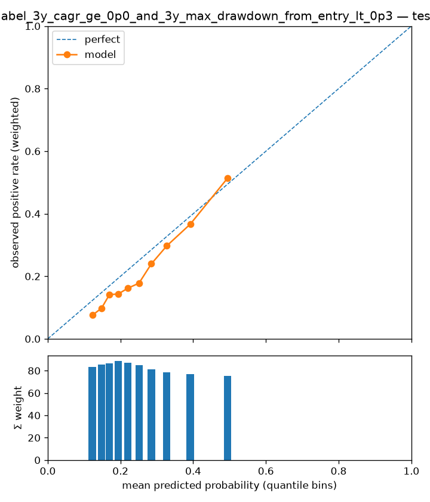

# Experiment report — forest_fresh50_cells_3y__label_3y_cagr_ge_0p0_and_3y_max_drawdown_from_entry_lt_0p3

- run id: `12137a7f9c2a`
- dataset version: `1.4.1` (pinned, immutable)
- dataset sha256: `be2b664c6739b93d5b5a7df1d085c09f09575071dd02d1f1426ed1586e052085` (dataset.parquet, from the manifest's provenance block)
- config hash: `3b5deaae9886851c`
- git SHA: `f24b95eda15ff2283e1ea10025a00b1f1aac57b0`
- seed: 23
- model: `random_forest` params `{"bootstrap": true, "class_weight": 1.0, "criterion": "entropy", "max_depth": 4, "max_features": 0.205191, "max_samples": 0.663781, "min_samples_leaf": 72, "n_estimators": 490, "n_jobs": 8}`
- label: `fwd_3y_cagr >= 0.0 & fwd_3y_max_drawdown_from_entry < 0.3` — horizon 3y, scheme `walkforward`
- derived label `fwd_3y_cagr >= 0.0 & fwd_3y_max_drawdown_from_entry < 0.3`: evaluated on the fly from the manifest's continuous outcome columns (harness.derived_labels); NULL wherever a referenced column is NULL
- **universe: `dist_52w_high <= -0.5 & dollar_volume_3m >= 100000`** — train and test rows outside it are left out (a row with a NULL in a filter column is outside). Every number below describes this universe: base rates, baselines and picks are not comparable with a run over all rows, and the run is counted in the universe's own ledger cell. The filter reads feature columns as of the snapshot; it builds no split (upstream tags decide train and test, the purge and embargo hold for the rows that remain) and derives no column. `sample_weight` is the upstream uniqueness weight, not recomputed for the rows left out.
- **configurations tried against this cell (dataset, scheme, horizon, label, universe): 1** (from the append-only results store; failed runs count); **66 against this label in any universe**
- saved model bundle: `experiments/models/forest_fresh50_cells_3y__label_3y_cagr_ge_0p0_and_3y_max_drawdown_from_entry_lt_0p3_12137a7f9c2a` (re-evaluate with `vml-eval`, no refitting)

## Era-sliced metrics (one row per test year)

Sliced on the calendar year of each test row's `snapshot_date` (one walk-forward fold per year); crash eras are tagged inline. `conf_at_K` is the mean score of the top-K picks; `base_rate_brier` is the no-skill Brier the model must beat. \*The pooled row picks per year — per-fold model scores are not comparable, so a global top-K would just take the hottest-scoring fold's picks; it is context for the era rows, never a stand-alone result. ROC-AUC and recall@K are logged in the results store, not shown here.

| era          | n_test | base_rate | mean_score | precision_at_20 | precision_at_50 | precision_at_thr_0.5 | precision_at_thr_0.6 | precision_at_thr_0.7 | conf_at_20 | conf_at_50 | n_at_prec_0.75 | n_at_prec_0.9 | recall_at_prec_0.75 | recall_at_prec_0.9 | recall_at_thr_0.5 | recall_at_thr_0.6 | recall_at_thr_0.7 | n_at_thr_0.5 | n_at_thr_0.6 | n_at_thr_0.7 | brier  | base_rate_brier | pr_auc |
| ------------ | ------ | --------- | ---------- | --------------- | --------------- | -------------------- | -------------------- | -------------------- | ---------- | ---------- | -------------- | ------------- | ------------------- | ------------------ | ----------------- | ----------------- | ----------------- | ------------ | ------------ | ------------ | ------ | --------------- | ------ |
| 2005         | 1322   | 0.2049    | 0.1754     | 0.2000          | 0.2400          | —                    | —                    | —                    | 0.3246     | 0.3053     | 0              | 0             | 0                   | 0                  | 0                 | 0                 | 0                 | 0            | 0            | 0            | 0.1612 | 0.1629          | 0.2519 |
| 2006         | 1031   | 0.0893    | 0.1908     | 0.1000          | 0.1000          | —                    | —                    | —                    | 0.3582     | 0.3287     | 0              | 0             | 0                   | 0                  | 0                 | 0                 | 0                 | 0            | 0            | 0            | 0.0918 | 0.0813          | 0.1163 |
| 2007         | 1141   | 0.0501    | 0.2537     | 0.2000          | 0.1200          | 0                    | —                    | —                    | 0.4597     | 0.4393     | 0              | 0             | 0                   | 0                  | 0                 | 0                 | 0                 | 1            | 0            | 0            | 0.0935 | 0.0476          | 0.0742 |
| 2008 (GFC)   | 3759   | 0.1444    | 0.3519     | 0.6500          | 0.5400          | 0.3389               | —                    | —                    | 0.5837     | 0.5780     | 8              | 1             | 0.0113              | 0.0019             | 0.3433            | 0                 | 0                 | 540          | 0            | 0            | 0.1629 | 0.1236          | 0.2899 |
| 2009 (GFC)   | 3279   | 0.5423    | 0.3815     | 0.8000          | 0.8400          | 0.7569               | —                    | —                    | 0.5773     | 0.5732     | 609            | 3             | 0.2559              | 0.0017             | 0.2458            | 0                 | 0                 | 580          | 0            | 0            | 0.2479 | 0.2482          | 0.7065 |
| 2010         | 757    | 0.1723    | 0.2257     | 0.3000          | 0.3400          | —                    | —                    | —                    | 0.4097     | 0.3852     | 1              | 1             | 0.0077              | 0.0077             | 0                 | 0                 | 0                 | 0            | 0            | 0            | 0.1363 | 0.1426          | 0.3034 |
| 2011         | 1169   | 0.2038    | 0.2276     | 0.6500          | 0.6000          | 1                    | —                    | —                    | 0.4349     | 0.4102     | 7              | 7             | 0.0288              | 0.0288             | 0.0041            | 0                 | 0                 | 1            | 0            | 0            | 0.1495 | 0.1623          | 0.4104 |
| 2012         | 1130   | 0.2712    | 0.2067     | 0.5000          | 0.4000          | —                    | —                    | —                    | 0.3614     | 0.3403     | 0              | 0             | 0                   | 0                  | 0                 | 0                 | 0                 | 0            | 0            | 0            | 0.1945 | 0.1976          | 0.3717 |
| 2013         | 606    | 0.1686    | 0.1938     | 0.3000          | 0.3200          | —                    | —                    | —                    | 0.3458     | 0.3232     | 1              | 1             | 0.0095              | 0.0095             | 0                 | 0                 | 0                 | 0            | 0            | 0            | 0.1409 | 0.1402          | 0.2374 |
| 2014         | 1012   | 0.1063    | 0.1916     | 0.3500          | 0.2600          | —                    | —                    | —                    | 0.3671     | 0.3484     | 5              | 5             | 0.0455              | 0.0455             | 0                 | 0                 | 0                 | 0            | 0            | 0            | 0.1002 | 0.0950          | 0.2071 |
| 2015         | 1748   | 0.1209    | 0.2241     | 0.6000          | 0.3800          | —                    | —                    | —                    | 0.4180     | 0.4006     | 12             | 2             | 0.0476              | 0.0106             | 0                 | 0                 | 0                 | 0            | 0            | 0            | 0.1154 | 0.1063          | 0.2167 |
| 2016         | 2032   | 0.3012    | 0.2291     | 0.5000          | 0.5600          | 0.5000               | —                    | —                    | 0.4667     | 0.4422     | 1              | 1             | 0.0017              | 0.0017             | 0.0017            | 0                 | 0                 | 2            | 0            | 0            | 0.1995 | 0.2105          | 0.4753 |
| 2017         | 1318   | 0.1365    | 0.2049     | 0.0500          | 0.1600          | —                    | —                    | —                    | 0.3951     | 0.3732     | 0              | 0             | 0                   | 0                  | 0                 | 0                 | 0                 | 0            | 0            | 0            | 0.1244 | 0.1179          | 0.1548 |
| 2018         | 1441   | 0.0934    | 0.1967     | 0.4000          | 0.2800          | —                    | —                    | —                    | 0.4142     | 0.3848     | 3              | 3             | 0.0248              | 0.0248             | 0                 | 0                 | 0                 | 0            | 0            | 0            | 0.0949 | 0.0847          | 0.1687 |
| 2019         | 2187   | 0.0987    | 0.2185     | 0.2500          | 0.2600          | —                    | —                    | —                    | 0.4493     | 0.4311     | 0              | 0             | 0                   | 0                  | 0                 | 0                 | 0                 | 0            | 0            | 0            | 0.1062 | 0.0890          | 0.1353 |
| 2020 (COVID) | 2620   | 0.3125    | 0.2544     | 0.8000          | 0.7000          | 0.7381               | —                    | —                    | 0.5478     | 0.5229     | 117            | 9             | 0.1053              | 0.0108             | 0.0371            | 0                 | 0                 | 42           | 0            | 0            | 0.1825 | 0.2149          | 0.6296 |
| pooled*      | 26552  | 0.2157    | 0.2555     | 0.4156          | 0.3812          | 0.5617               | —                    | —                    | 0.4321     | 0.4117     | 764            | 33            | 0.1018              | 0.0058             | 0.1153            | 0                 | 0                 | 1166         | 0            | 0            | 0.1550 | 0.1692          | 0.4025 |

## High-confidence picks (pooled)

How many high-confidence calls the model made, how confident it was, and how precise they were — no pre-chosen score threshold needed. `top N/yr` rows pick per test year; `score >= p` rows (probabilistic models) count every name at or above that probability, pooled.

| selection    | n_picks | picks_per_year | mean_score | precision | hits |
| ------------ | ------- | -------------- | ---------- | --------- | ---- |
| top 5/yr     | 80      | 5              | 0.4573     | 0.4875    | 39   |
| top 10/yr    | 160     | 10             | 0.4453     | 0.4250    | 68   |
| top 20/yr    | 320     | 20             | 0.4321     | 0.4156    | 133  |
| top 50/yr    | 800     | 50             | 0.4117     | 0.3812    | 305  |
| score >= 0.9 | 0       | 0              | —          | —         | 0    |
| score >= 0.8 | 0       | 0              | —          | —         | 0    |
| score >= 0.7 | 0       | 0              | —          | —         | 0    |
| score >= 0.6 | 0       | 0              | —          | —         | 0    |
| score >= 0.5 | 1166    | 72.9000        | 0.5339     | 0.5617    | 655  |

## Pick outcomes (what the picks went on to do)

Report-only outcomes of the top-K picks of each test year (`pick_outcomes`: `label_3y_beat_spy`, `fwd_3y_excess_cagr`, `fwd_3y_cagr`, `fwd_3y_max_drawdown_from_entry`, `fwd_3y_cagr < 0.0`, `fwd_3y_cagr < -0.1`, `fwd_3y_max_drawdown_from_entry >= 0.4`, `fwd_3y_cagr >= 0.15`, `fwd_3y_cagr >= 0.26`, `fwd_3y_excess_cagr >= 0.05`, `fwd_3y_excess_cagr >= 0.1`), from the manifest's label columns; none is a model input or the training target, and the run is counted in its own label's cell. For a binary outcome the picks' hit rate, for a continuous one their mean and median, each beside the same statistic over **all** test rows of the era (unweighted, like the picks: one row, one pick). `stocks` is the number of distinct `permaticker`s among the picks (a stock has up to four test rows a year); in the pooled row it is the mean per year and the statistics run over every year's picks. NULL outcomes are left out, not counted as misses. This is a no-cost, equal-weight reading of the picks, a screen for `vml-backtest` and not a substitute.

### Top 20 per test year: `label_3y_beat_spy`

| era          | picks | stocks  | picks hit rate | all rows |
| ------------ | ----- | ------- | -------------- | -------- |
| 2005         | 20    | 16      | 0.3500         | 0.2632   |
| 2006         | 20    | 16      | 0.2500         | 0.2182   |
| 2007         | 20    | 20      | 0.4500         | 0.2559   |
| 2008 (GFC)   | 20    | 20      | 0.7000         | 0.5017   |
| 2009 (GFC)   | 20    | 20      | 0.7500         | 0.5618   |
| 2010         | 20    | 16      | 0.5000         | 0.2153   |
| 2011         | 20    | 18      | 0.3500         | 0.2387   |
| 2012         | 20    | 17      | 0.2000         | 0.2504   |
| 2013         | 20    | 17      | 0.2500         | 0.1997   |
| 2014         | 20    | 15      | 0.1500         | 0.1581   |
| 2015         | 20    | 20      | 0.4000         | 0.2077   |
| 2016         | 20    | 19      | 0.2500         | 0.2904   |
| 2017         | 20    | 17      | 0.2500         | 0.1775   |
| 2018         | 20    | 19      | 0.3000         | 0.2124   |
| 2019         | 20    | 18      | 0.4000         | 0.2204   |
| 2020 (COVID) | 20    | 19      | 0.6000         | 0.3660   |
| pooled*      | 320   | 17.9375 | 0.3844         | 0.3214   |

### Top 20 per test year: `fwd_3y_excess_cagr`

| era          | picks | stocks  | picks mean | picks median | all rows mean | all rows median |
| ------------ | ----- | ------- | ---------- | ------------ | ------------- | --------------- |
| 2005         | 20    | 16      | -0.0718    | -0.0726      | -0.2222       | -0.2078         |
| 2006         | 20    | 16      | -0.2770    | -0.2313      | -0.2592       | -0.2647         |
| 2007         | 20    | 20      | -0.0439    | -0.0183      | -0.2435       | -0.2202         |
| 2008 (GFC)   | 20    | 20      | 0.0737     | 0.0475       | -0.0257       | 0.0019          |
| 2009 (GFC)   | 20    | 20      | 0.1073     | 0.1089       | 0.0255        | 0.0477          |
| 2010         | 20    | 16      | -0.1542    | -0.0579      | -0.3192       | -0.3153         |
| 2011         | 20    | 18      | -0.0577    | -0.0458      | -0.2819       | -0.2703         |
| 2012         | 20    | 17      | -0.1469    | -0.1388      | -0.2626       | -0.2311         |
| 2013         | 20    | 17      | -0.2335    | -0.1183      | -0.3427       | -0.3500         |
| 2014         | 20    | 15      | -0.1736    | -0.1546      | -0.3837       | -0.3861         |
| 2015         | 20    | 20      | -0.0167    | -0.0237      | -0.3301       | -0.3017         |
| 2016         | 20    | 19      | -0.0778    | -0.0541      | -0.2425       | -0.2141         |
| 2017         | 20    | 17      | -0.2172    | -0.1923      | -0.3743       | -0.4454         |
| 2018         | 20    | 19      | -0.0179    | -0.0601      | -0.3303       | -0.3542         |
| 2019         | 20    | 18      | -0.0441    | -0.0263      | -0.2922       | -0.3090         |
| 2020 (COVID) | 20    | 19      | 0.0630     | 0.0611       | -0.1541       | -0.1518         |
| pooled*      | 320   | 17.9375 | -0.0805    | -0.0479      | -0.2033       | -0.1814         |

### Top 20 per test year: `fwd_3y_cagr`

| era          | picks | stocks  | picks mean | picks median | all rows mean | all rows median |
| ------------ | ----- | ------- | ---------- | ------------ | ------------- | --------------- |
| 2005         | 20    | 16      | -0.0521    | -0.0348      | -0.1890       | -0.1742         |
| 2006         | 20    | 16      | -0.3504    | -0.3046      | -0.3426       | -0.3411         |
| 2007         | 20    | 20      | -0.0978    | -0.0634      | -0.3034       | -0.2845         |
| 2008 (GFC)   | 20    | 20      | 0.2015     | 0.1577       | 0.0398        | 0.0650          |
| 2009 (GFC)   | 20    | 20      | 0.3127     | 0.3123       | 0.2019        | 0.2223          |
| 2010         | 20    | 16      | 0.0045     | 0.0948       | -0.1661       | -0.1575         |
| 2011         | 20    | 18      | 0.1446     | 0.1533       | -0.0977       | -0.0825         |
| 2012         | 20    | 17      | 0.0313     | 0.0414       | -0.0914       | -0.0668         |
| 2013         | 20    | 17      | -0.1215    | -0.0113      | -0.2373       | -0.2447         |
| 2014         | 20    | 15      | -0.0694    | -0.0411      | -0.2805       | -0.2819         |
| 2015         | 20    | 20      | 0.1099     | 0.1137       | -0.2071       | -0.1836         |
| 2016         | 20    | 19      | 0.0578     | 0.0800       | -0.1088       | -0.0846         |
| 2017         | 20    | 17      | -0.1027    | -0.0695      | -0.2610       | -0.3336         |
| 2018         | 20    | 19      | 0.1937     | 0.1756       | -0.1532       | -0.1691         |
| 2019         | 20    | 18      | 0.0919     | 0.1201       | -0.1475       | -0.1644         |
| 2020 (COVID) | 20    | 19      | 0.2042     | 0.1956       | -0.0403       | -0.0279         |
| pooled*      | 320   | 17.9375 | 0.0349     | 0.0687       | -0.0936       | -0.0807         |

### Top 20 per test year: `fwd_3y_max_drawdown_from_entry`

| era          | picks | stocks  | picks mean | picks median | all rows mean | all rows median |
| ------------ | ----- | ------- | ---------- | ------------ | ------------- | --------------- |
| 2005         | 20    | 16      | 0.4858     | 0.3766       | 0.5930        | 0.6324          |
| 2006         | 20    | 16      | 0.7507     | 0.9360       | 0.7718        | 0.8791          |
| 2007         | 20    | 20      | 0.7049     | 0.8673       | 0.8094        | 0.8901          |
| 2008 (GFC)   | 20    | 20      | 0.3133     | 0.2918       | 0.6213        | 0.6441          |
| 2009 (GFC)   | 20    | 20      | 0.2195     | 0.2290       | 0.3375        | 0.2533          |
| 2010         | 20    | 16      | 0.4297     | 0.4594       | 0.6396        | 0.7038          |
| 2011         | 20    | 18      | 0.2563     | 0.2140       | 0.5874        | 0.6044          |
| 2012         | 20    | 17      | 0.2821     | 0.2230       | 0.5372        | 0.5120          |
| 2013         | 20    | 17      | 0.4694     | 0.3763       | 0.6483        | 0.7420          |
| 2014         | 20    | 15      | 0.5133     | 0.5852       | 0.7096        | 0.8067          |
| 2015         | 20    | 20      | 0.3184     | 0.2814       | 0.6838        | 0.7522          |
| 2016         | 20    | 19      | 0.2776     | 0.2386       | 0.5551        | 0.5691          |
| 2017         | 20    | 17      | 0.5929     | 0.5675       | 0.7284        | 0.8549          |
| 2018         | 20    | 19      | 0.4257     | 0.3839       | 0.7359        | 0.8155          |
| 2019         | 20    | 18      | 0.4933     | 0.5634       | 0.7021        | 0.7690          |
| 2020 (COVID) | 20    | 19      | 0.1816     | 0.1586       | 0.5389        | 0.5451          |
| pooled*      | 320   | 17.9375 | 0.4197     | 0.3416       | 0.6073        | 0.6613          |

### Top 20 per test year: `label_3y_cagr_lt_0p0`

| era          | picks | stocks  | picks hit rate | all rows |
| ------------ | ----- | ------- | -------------- | -------- |
| 2005         | 20    | 16      | 0.5500         | 0.6959   |
| 2006         | 20    | 16      | 0.7500         | 0.8419   |
| 2007         | 20    | 20      | 0.5500         | 0.7958   |
| 2008 (GFC)   | 20    | 20      | 0              | 0.4177   |
| 2009 (GFC)   | 20    | 20      | 0.0500         | 0.2580   |
| 2010         | 20    | 16      | 0.4500         | 0.6671   |
| 2011         | 20    | 18      | 0.2500         | 0.5783   |
| 2012         | 20    | 17      | 0.3000         | 0.5717   |
| 2013         | 20    | 17      | 0.5500         | 0.7112   |
| 2014         | 20    | 15      | 0.5500         | 0.7530   |
| 2015         | 20    | 20      | 0.1000         | 0.6682   |
| 2016         | 20    | 19      | 0.3500         | 0.5714   |
| 2017         | 20    | 17      | 0.6500         | 0.7428   |
| 2018         | 20    | 19      | 0.1500         | 0.6343   |
| 2019         | 20    | 18      | 0.2500         | 0.6598   |
| 2020 (COVID) | 20    | 19      | 0.2000         | 0.5260   |
| pooled*      | 320   | 17.9375 | 0.3563         | 0.5715   |

### Top 20 per test year: `label_3y_cagr_lt_m0p1`

| era          | picks | stocks  | picks hit rate | all rows |
| ------------ | ----- | ------- | -------------- | -------- |
| 2005         | 20    | 16      | 0.4500         | 0.5832   |
| 2006         | 20    | 16      | 0.6500         | 0.7565   |
| 2007         | 20    | 20      | 0.4500         | 0.7099   |
| 2008 (GFC)   | 20    | 20      | 0              | 0.3105   |
| 2009 (GFC)   | 20    | 20      | 0              | 0.1955   |
| 2010         | 20    | 16      | 0.4500         | 0.5535   |
| 2011         | 20    | 18      | 0.1500         | 0.4808   |
| 2012         | 20    | 17      | 0.2000         | 0.4646   |
| 2013         | 20    | 17      | 0.4000         | 0.6106   |
| 2014         | 20    | 15      | 0.4500         | 0.6532   |
| 2015         | 20    | 20      | 0.0500         | 0.5675   |
| 2016         | 20    | 19      | 0.1500         | 0.4857   |
| 2017         | 20    | 17      | 0.4000         | 0.6662   |
| 2018         | 20    | 19      | 0.1500         | 0.5607   |
| 2019         | 20    | 18      | 0.1500         | 0.5638   |
| 2020 (COVID) | 20    | 19      | 0.0500         | 0.4592   |
| pooled*      | 320   | 17.9375 | 0.2594         | 0.4823   |

### Top 20 per test year: `label_3y_max_drawdown_from_entry_ge_0p4`

| era          | picks | stocks  | picks hit rate | all rows |
| ------------ | ----- | ------- | -------------- | -------- |
| 2005         | 20    | 16      | 0.4500         | 0.6838   |
| 2006         | 20    | 16      | 0.9000         | 0.8855   |
| 2007         | 20    | 20      | 0.8000         | 0.9308   |
| 2008 (GFC)   | 20    | 20      | 0.1000         | 0.7611   |
| 2009 (GFC)   | 20    | 20      | 0              | 0.3105   |
| 2010         | 20    | 16      | 0.5500         | 0.7437   |
| 2011         | 20    | 18      | 0.2000         | 0.6878   |
| 2012         | 20    | 17      | 0.2500         | 0.6080   |
| 2013         | 20    | 17      | 0.4500         | 0.7277   |
| 2014         | 20    | 15      | 0.6000         | 0.8202   |
| 2015         | 20    | 20      | 0.3000         | 0.8066   |
| 2016         | 20    | 19      | 0.2500         | 0.6117   |
| 2017         | 20    | 17      | 0.7500         | 0.8209   |
| 2018         | 20    | 19      | 0.5000         | 0.8654   |
| 2019         | 20    | 18      | 0.6000         | 0.8564   |
| 2020 (COVID) | 20    | 19      | 0.1000         | 0.5893   |
| pooled*      | 320   | 17.9375 | 0.4250         | 0.6961   |

### Top 20 per test year: `label_3y_cagr_ge_0p15`

| era          | picks | stocks  | picks hit rate | all rows |
| ------------ | ----- | ------- | -------------- | -------- |
| 2005         | 20    | 16      | 0.2000         | 0.1626   |
| 2006         | 20    | 16      | 0.1000         | 0.0630   |
| 2007         | 20    | 20      | 0.1500         | 0.0859   |
| 2008 (GFC)   | 20    | 20      | 0.6000         | 0.3879   |
| 2009 (GFC)   | 20    | 20      | 0.8500         | 0.5910   |
| 2010         | 20    | 16      | 0.5000         | 0.2219   |
| 2011         | 20    | 18      | 0.5500         | 0.2772   |
| 2012         | 20    | 17      | 0.2000         | 0.2690   |
| 2013         | 20    | 17      | 0.1500         | 0.1716   |
| 2014         | 20    | 15      | 0.0500         | 0.1186   |
| 2015         | 20    | 20      | 0.3000         | 0.1842   |
| 2016         | 20    | 19      | 0.2000         | 0.2697   |
| 2017         | 20    | 17      | 0.2500         | 0.1571   |
| 2018         | 20    | 19      | 0.5500         | 0.2380   |
| 2019         | 20    | 18      | 0.3000         | 0.2108   |
| 2020 (COVID) | 20    | 19      | 0.6000         | 0.3389   |
| pooled*      | 320   | 17.9375 | 0.3469         | 0.2848   |

### Top 20 per test year: `label_3y_cagr_ge_0p26`

| era          | picks | stocks  | picks hit rate | all rows |
| ------------ | ----- | ------- | -------------- | -------- |
| 2005         | 20    | 16      | 0.1000         | 0.1051   |
| 2006         | 20    | 16      | 0              | 0.0291   |
| 2007         | 20    | 20      | 0.0500         | 0.0500   |
| 2008 (GFC)   | 20    | 20      | 0.2000         | 0.2716   |
| 2009 (GFC)   | 20    | 20      | 0.6500         | 0.4553   |
| 2010         | 20    | 16      | 0.1500         | 0.1440   |
| 2011         | 20    | 18      | 0.3000         | 0.1993   |
| 2012         | 20    | 17      | 0.1000         | 0.1894   |
| 2013         | 20    | 17      | 0.0500         | 0.1122   |
| 2014         | 20    | 15      | 0.0500         | 0.0623   |
| 2015         | 20    | 20      | 0.1000         | 0.1024   |
| 2016         | 20    | 19      | 0.1000         | 0.1757   |
| 2017         | 20    | 17      | 0.1000         | 0.1047   |
| 2018         | 20    | 19      | 0.2000         | 0.1596   |
| 2019         | 20    | 18      | 0.1000         | 0.1513   |
| 2020 (COVID) | 20    | 19      | 0.3000         | 0.2531   |
| pooled*      | 320   | 17.9375 | 0.1594         | 0.2005   |

### Top 20 per test year: `label_3y_excess_cagr_ge_0p05`

| era          | picks | stocks  | picks hit rate | all rows |
| ------------ | ----- | ------- | -------------- | -------- |
| 2005         | 20    | 16      | 0.3000         | 0.2156   |
| 2006         | 20    | 16      | 0.2500         | 0.1765   |
| 2007         | 20    | 20      | 0.4500         | 0.2095   |
| 2008 (GFC)   | 20    | 20      | 0.5000         | 0.4344   |
| 2009 (GFC)   | 20    | 20      | 0.6500         | 0.4965   |
| 2010         | 20    | 16      | 0.2500         | 0.1810   |
| 2011         | 20    | 18      | 0.3000         | 0.2087   |
| 2012         | 20    | 17      | 0.1000         | 0.2115   |
| 2013         | 20    | 17      | 0.1500         | 0.1683   |
| 2014         | 20    | 15      | 0.0500         | 0.1196   |
| 2015         | 20    | 20      | 0.2500         | 0.1590   |
| 2016         | 20    | 19      | 0.2000         | 0.2357   |
| 2017         | 20    | 17      | 0.1500         | 0.1464   |
| 2018         | 20    | 19      | 0.2000         | 0.1756   |
| 2019         | 20    | 18      | 0.1500         | 0.1870   |
| 2020 (COVID) | 20    | 19      | 0.5500         | 0.3244   |
| pooled*      | 320   | 17.9375 | 0.2812         | 0.2739   |

### Top 20 per test year: `label_3y_excess_cagr_ge_0p1`

| era          | picks | stocks  | picks hit rate | all rows |
| ------------ | ----- | ------- | -------------- | -------- |
| 2005         | 20    | 16      | 0.2000         | 0.1702   |
| 2006         | 20    | 16      | 0.2000         | 0.1406   |
| 2007         | 20    | 20      | 0.3000         | 0.1691   |
| 2008 (GFC)   | 20    | 20      | 0.2500         | 0.3647   |
| 2009 (GFC)   | 20    | 20      | 0.5000         | 0.4337   |
| 2010         | 20    | 16      | 0.1500         | 0.1493   |
| 2011         | 20    | 18      | 0.2000         | 0.1796   |
| 2012         | 20    | 17      | 0.0500         | 0.1867   |
| 2013         | 20    | 17      | 0.1000         | 0.1436   |
| 2014         | 20    | 15      | 0.0500         | 0.0889   |
| 2015         | 20    | 20      | 0.1500         | 0.1201   |
| 2016         | 20    | 19      | 0.1500         | 0.1959   |
| 2017         | 20    | 17      | 0.1000         | 0.1237   |
| 2018         | 20    | 19      | 0.2000         | 0.1464   |
| 2019         | 20    | 18      | 0.1500         | 0.1587   |
| 2020 (COVID) | 20    | 19      | 0.2500         | 0.2821   |
| pooled*      | 320   | 17.9375 | 0.1875         | 0.2311   |

### Top 50 per test year: `label_3y_beat_spy`

| era          | picks | stocks  | picks hit rate | all rows |
| ------------ | ----- | ------- | -------------- | -------- |
| 2005         | 50    | 40      | 0.3600         | 0.2632   |
| 2006         | 50    | 42      | 0.3000         | 0.2182   |
| 2007         | 50    | 48      | 0.5400         | 0.2559   |
| 2008 (GFC)   | 50    | 49      | 0.6800         | 0.5017   |
| 2009 (GFC)   | 50    | 49      | 0.7400         | 0.5618   |
| 2010         | 50    | 37      | 0.3600         | 0.2153   |
| 2011         | 50    | 44      | 0.4200         | 0.2387   |
| 2012         | 50    | 35      | 0.1800         | 0.2504   |
| 2013         | 50    | 38      | 0.2000         | 0.1997   |
| 2014         | 50    | 39      | 0.2400         | 0.1581   |
| 2015         | 50    | 45      | 0.4200         | 0.2077   |
| 2016         | 50    | 45      | 0.4000         | 0.2904   |
| 2017         | 50    | 37      | 0.1800         | 0.1775   |
| 2018         | 50    | 45      | 0.3800         | 0.2124   |
| 2019         | 50    | 44      | 0.3800         | 0.2204   |
| 2020 (COVID) | 50    | 45      | 0.5400         | 0.3660   |
| pooled*      | 800   | 42.6250 | 0.3950         | 0.3214   |

### Top 50 per test year: `fwd_3y_excess_cagr`

| era          | picks | stocks  | picks mean | picks median | all rows mean | all rows median |
| ------------ | ----- | ------- | ---------- | ------------ | ------------- | --------------- |
| 2005         | 50    | 40      | -0.1042    | -0.0894      | -0.2222       | -0.2078         |
| 2006         | 50    | 42      | -0.2027    | -0.1308      | -0.2592       | -0.2647         |
| 2007         | 50    | 48      | 0.0015     | 0.0385       | -0.2435       | -0.2202         |
| 2008 (GFC)   | 50    | 49      | 0.0831     | 0.0549       | -0.0257       | 0.0019          |
| 2009 (GFC)   | 50    | 49      | 0.0949     | 0.0999       | 0.0255        | 0.0477          |
| 2010         | 50    | 37      | -0.1873    | -0.1621      | -0.3192       | -0.3153         |
| 2011         | 50    | 44      | -0.0561    | -0.0458      | -0.2819       | -0.2703         |
| 2012         | 50    | 35      | -0.1897    | -0.1502      | -0.2626       | -0.2311         |
| 2013         | 50    | 38      | -0.1870    | -0.1159      | -0.3427       | -0.3500         |
| 2014         | 50    | 39      | -0.2032    | -0.1700      | -0.3837       | -0.3861         |
| 2015         | 50    | 45      | -0.0364    | -0.0237      | -0.3301       | -0.3017         |
| 2016         | 50    | 45      | -0.0505    | -0.0341      | -0.2425       | -0.2141         |
| 2017         | 50    | 37      | -0.2885    | -0.2464      | -0.3743       | -0.4454         |
| 2018         | 50    | 45      | -0.0282    | -0.0664      | -0.3303       | -0.3542         |
| 2019         | 50    | 44      | -0.0692    | -0.0496      | -0.2922       | -0.3090         |
| 2020 (COVID) | 50    | 45      | 0.0227     | 0.0131       | -0.1541       | -0.1518         |
| pooled*      | 800   | 42.6250 | -0.0876    | -0.0592      | -0.2033       | -0.1814         |

### Top 50 per test year: `fwd_3y_cagr`

| era          | picks | stocks  | picks mean | picks median | all rows mean | all rows median |
| ------------ | ----- | ------- | ---------- | ------------ | ------------- | --------------- |
| 2005         | 50    | 40      | -0.0766    | -0.0630      | -0.1890       | -0.1742         |
| 2006         | 50    | 42      | -0.2796    | -0.2081      | -0.3426       | -0.3411         |
| 2007         | 50    | 48      | -0.0545    | -0.0219      | -0.3034       | -0.2845         |
| 2008 (GFC)   | 50    | 49      | 0.2107     | 0.1857       | 0.0398        | 0.0650          |
| 2009 (GFC)   | 50    | 49      | 0.2890     | 0.3025       | 0.2019        | 0.2223          |
| 2010         | 50    | 37      | -0.0314    | -0.0053      | -0.1661       | -0.1575         |
| 2011         | 50    | 44      | 0.1422     | 0.1533       | -0.0977       | -0.0825         |
| 2012         | 50    | 35      | -0.0174    | 0.0290       | -0.0914       | -0.0668         |
| 2013         | 50    | 38      | -0.0766    | -0.0124      | -0.2373       | -0.2447         |
| 2014         | 50    | 39      | -0.0983    | -0.0686      | -0.2805       | -0.2819         |
| 2015         | 50    | 45      | 0.0888     | 0.1082       | -0.2071       | -0.1836         |
| 2016         | 50    | 45      | 0.0842     | 0.1005       | -0.1088       | -0.0846         |
| 2017         | 50    | 37      | -0.1751    | -0.1341      | -0.2610       | -0.3336         |
| 2018         | 50    | 45      | 0.1680     | 0.1362       | -0.1532       | -0.1691         |
| 2019         | 50    | 44      | 0.0753     | 0.1025       | -0.1475       | -0.1644         |
| 2020 (COVID) | 50    | 45      | 0.1586     | 0.1506       | -0.0403       | -0.0279         |
| pooled*      | 800   | 42.6250 | 0.0255     | 0.0627       | -0.0936       | -0.0807         |

### Top 50 per test year: `fwd_3y_max_drawdown_from_entry`

| era          | picks | stocks  | picks mean | picks median | all rows mean | all rows median |
| ------------ | ----- | ------- | ---------- | ------------ | ------------- | --------------- |
| 2005         | 50    | 40      | 0.4538     | 0.3599       | 0.5930        | 0.6324          |
| 2006         | 50    | 42      | 0.7330     | 0.8122       | 0.7718        | 0.8791          |
| 2007         | 50    | 48      | 0.6823     | 0.7333       | 0.8094        | 0.8901          |
| 2008 (GFC)   | 50    | 49      | 0.3248     | 0.2912       | 0.6213        | 0.6441          |
| 2009 (GFC)   | 50    | 49      | 0.2013     | 0.2073       | 0.3375        | 0.2533          |
| 2010         | 50    | 37      | 0.4945     | 0.4594       | 0.6396        | 0.7038          |
| 2011         | 50    | 44      | 0.3151     | 0.2391       | 0.5874        | 0.6044          |
| 2012         | 50    | 35      | 0.3707     | 0.3106       | 0.5372        | 0.5120          |
| 2013         | 50    | 38      | 0.4613     | 0.3497       | 0.6483        | 0.7420          |
| 2014         | 50    | 39      | 0.5639     | 0.6070       | 0.7096        | 0.8067          |
| 2015         | 50    | 45      | 0.4174     | 0.3955       | 0.6838        | 0.7522          |
| 2016         | 50    | 45      | 0.2998     | 0.1965       | 0.5551        | 0.5691          |
| 2017         | 50    | 37      | 0.6024     | 0.6473       | 0.7284        | 0.8549          |
| 2018         | 50    | 45      | 0.5088     | 0.5458       | 0.7359        | 0.8155          |
| 2019         | 50    | 44      | 0.5173     | 0.5475       | 0.7021        | 0.7690          |
| 2020 (COVID) | 50    | 45      | 0.2051     | 0.1843       | 0.5389        | 0.5451          |
| pooled*      | 800   | 42.6250 | 0.4470     | 0.3621       | 0.6073        | 0.6613          |

### Top 50 per test year: `label_3y_cagr_lt_0p0`

| era          | picks | stocks  | picks hit rate | all rows |
| ------------ | ----- | ------- | -------------- | -------- |
| 2005         | 50    | 40      | 0.6000         | 0.6959   |
| 2006         | 50    | 42      | 0.7800         | 0.8419   |
| 2007         | 50    | 48      | 0.5400         | 0.7958   |
| 2008 (GFC)   | 50    | 49      | 0.0800         | 0.4177   |
| 2009 (GFC)   | 50    | 49      | 0.0800         | 0.2580   |
| 2010         | 50    | 37      | 0.5000         | 0.6671   |
| 2011         | 50    | 44      | 0.2400         | 0.5783   |
| 2012         | 50    | 35      | 0.4400         | 0.5717   |
| 2013         | 50    | 38      | 0.5800         | 0.7112   |
| 2014         | 50    | 39      | 0.5800         | 0.7530   |
| 2015         | 50    | 45      | 0.2400         | 0.6682   |
| 2016         | 50    | 45      | 0.3200         | 0.5714   |
| 2017         | 50    | 37      | 0.6800         | 0.7428   |
| 2018         | 50    | 45      | 0.2000         | 0.6343   |
| 2019         | 50    | 44      | 0.3000         | 0.6598   |
| 2020 (COVID) | 50    | 45      | 0.2400         | 0.5260   |
| pooled*      | 800   | 42.6250 | 0.4000         | 0.5715   |

### Top 50 per test year: `label_3y_cagr_lt_m0p1`

| era          | picks | stocks  | picks hit rate | all rows |
| ------------ | ----- | ------- | -------------- | -------- |
| 2005         | 50    | 40      | 0.4000         | 0.5832   |
| 2006         | 50    | 42      | 0.6400         | 0.7565   |
| 2007         | 50    | 48      | 0.4000         | 0.7099   |
| 2008 (GFC)   | 50    | 49      | 0              | 0.3105   |
| 2009 (GFC)   | 50    | 49      | 0              | 0.1955   |
| 2010         | 50    | 37      | 0.4800         | 0.5535   |
| 2011         | 50    | 44      | 0.1600         | 0.4808   |
| 2012         | 50    | 35      | 0.3200         | 0.4646   |
| 2013         | 50    | 38      | 0.3200         | 0.6106   |
| 2014         | 50    | 39      | 0.4800         | 0.6532   |
| 2015         | 50    | 45      | 0.2000         | 0.5675   |
| 2016         | 50    | 45      | 0.1800         | 0.4857   |
| 2017         | 50    | 37      | 0.5200         | 0.6662   |
| 2018         | 50    | 45      | 0.1600         | 0.5607   |
| 2019         | 50    | 44      | 0.1800         | 0.5638   |
| 2020 (COVID) | 50    | 45      | 0.0600         | 0.4592   |
| pooled*      | 800   | 42.6250 | 0.2812         | 0.4823   |

### Top 50 per test year: `label_3y_max_drawdown_from_entry_ge_0p4`

| era          | picks | stocks  | picks hit rate | all rows |
| ------------ | ----- | ------- | -------------- | -------- |
| 2005         | 50    | 40      | 0.4400         | 0.6838   |
| 2006         | 50    | 42      | 0.8800         | 0.8855   |
| 2007         | 50    | 48      | 0.8400         | 0.9308   |
| 2008 (GFC)   | 50    | 49      | 0.2200         | 0.7611   |
| 2009 (GFC)   | 50    | 49      | 0              | 0.3105   |
| 2010         | 50    | 37      | 0.5400         | 0.7437   |
| 2011         | 50    | 44      | 0.2600         | 0.6878   |
| 2012         | 50    | 35      | 0.3600         | 0.6080   |
| 2013         | 50    | 38      | 0.4600         | 0.7277   |
| 2014         | 50    | 39      | 0.6600         | 0.8202   |
| 2015         | 50    | 45      | 0.5000         | 0.8066   |
| 2016         | 50    | 45      | 0.2600         | 0.6117   |
| 2017         | 50    | 37      | 0.7000         | 0.8209   |
| 2018         | 50    | 45      | 0.6600         | 0.8654   |
| 2019         | 50    | 44      | 0.6400         | 0.8564   |
| 2020 (COVID) | 50    | 45      | 0.1000         | 0.5893   |
| pooled*      | 800   | 42.6250 | 0.4700         | 0.6961   |

### Top 50 per test year: `label_3y_cagr_ge_0p15`

| era          | picks | stocks  | picks hit rate | all rows |
| ------------ | ----- | ------- | -------------- | -------- |
| 2005         | 50    | 40      | 0.2000         | 0.1626   |
| 2006         | 50    | 42      | 0.0800         | 0.0630   |
| 2007         | 50    | 48      | 0.2200         | 0.0859   |
| 2008 (GFC)   | 50    | 49      | 0.6400         | 0.3879   |
| 2009 (GFC)   | 50    | 49      | 0.8000         | 0.5910   |
| 2010         | 50    | 37      | 0.4200         | 0.2219   |
| 2011         | 50    | 44      | 0.5200         | 0.2772   |
| 2012         | 50    | 35      | 0.2200         | 0.2690   |
| 2013         | 50    | 38      | 0.1600         | 0.1716   |
| 2014         | 50    | 39      | 0.1400         | 0.1186   |
| 2015         | 50    | 45      | 0.3800         | 0.1842   |
| 2016         | 50    | 45      | 0.3800         | 0.2697   |
| 2017         | 50    | 37      | 0.1400         | 0.1571   |
| 2018         | 50    | 45      | 0.4800         | 0.2380   |
| 2019         | 50    | 44      | 0.3600         | 0.2108   |
| 2020 (COVID) | 50    | 45      | 0.5200         | 0.3389   |
| pooled*      | 800   | 42.6250 | 0.3538         | 0.2848   |

### Top 50 per test year: `label_3y_cagr_ge_0p26`

| era          | picks | stocks  | picks hit rate | all rows |
| ------------ | ----- | ------- | -------------- | -------- |
| 2005         | 50    | 40      | 0.1400         | 0.1051   |
| 2006         | 50    | 42      | 0.0200         | 0.0291   |
| 2007         | 50    | 48      | 0.0800         | 0.0500   |
| 2008 (GFC)   | 50    | 49      | 0.2800         | 0.2716   |
| 2009 (GFC)   | 50    | 49      | 0.6000         | 0.4553   |
| 2010         | 50    | 37      | 0.1600         | 0.1440   |
| 2011         | 50    | 44      | 0.3400         | 0.1993   |
| 2012         | 50    | 35      | 0.0800         | 0.1894   |
| 2013         | 50    | 38      | 0.1200         | 0.1122   |
| 2014         | 50    | 39      | 0.1000         | 0.0623   |
| 2015         | 50    | 45      | 0.2200         | 0.1024   |
| 2016         | 50    | 45      | 0.2400         | 0.1757   |
| 2017         | 50    | 37      | 0.0400         | 0.1047   |
| 2018         | 50    | 45      | 0.3200         | 0.1596   |
| 2019         | 50    | 44      | 0.1400         | 0.1513   |
| 2020 (COVID) | 50    | 45      | 0.2000         | 0.2531   |
| pooled*      | 800   | 42.6250 | 0.1925         | 0.2005   |

### Top 50 per test year: `label_3y_excess_cagr_ge_0p05`

| era          | picks | stocks  | picks hit rate | all rows |
| ------------ | ----- | ------- | -------------- | -------- |
| 2005         | 50    | 40      | 0.2800         | 0.2156   |
| 2006         | 50    | 42      | 0.2400         | 0.1765   |
| 2007         | 50    | 48      | 0.4800         | 0.2095   |
| 2008 (GFC)   | 50    | 49      | 0.5600         | 0.4344   |
| 2009 (GFC)   | 50    | 49      | 0.6600         | 0.4965   |
| 2010         | 50    | 37      | 0.2000         | 0.1810   |
| 2011         | 50    | 44      | 0.3400         | 0.2087   |
| 2012         | 50    | 35      | 0.0800         | 0.2115   |
| 2013         | 50    | 38      | 0.1600         | 0.1683   |
| 2014         | 50    | 39      | 0.1400         | 0.1196   |
| 2015         | 50    | 45      | 0.3400         | 0.1590   |
| 2016         | 50    | 45      | 0.3400         | 0.2357   |
| 2017         | 50    | 37      | 0.1000         | 0.1464   |
| 2018         | 50    | 45      | 0.3200         | 0.1756   |
| 2019         | 50    | 44      | 0.2400         | 0.1870   |
| 2020 (COVID) | 50    | 45      | 0.4200         | 0.3244   |
| pooled*      | 800   | 42.6250 | 0.3063         | 0.2739   |

### Top 50 per test year: `label_3y_excess_cagr_ge_0p1`

| era          | picks | stocks  | picks hit rate | all rows |
| ------------ | ----- | ------- | -------------- | -------- |
| 2005         | 50    | 40      | 0.2200         | 0.1702   |
| 2006         | 50    | 42      | 0.1800         | 0.1406   |
| 2007         | 50    | 48      | 0.3600         | 0.1691   |
| 2008 (GFC)   | 50    | 49      | 0.3800         | 0.3647   |
| 2009 (GFC)   | 50    | 49      | 0.5000         | 0.4337   |
| 2010         | 50    | 37      | 0.1600         | 0.1493   |
| 2011         | 50    | 44      | 0.2600         | 0.1796   |
| 2012         | 50    | 35      | 0.0600         | 0.1867   |
| 2013         | 50    | 38      | 0.1400         | 0.1436   |
| 2014         | 50    | 39      | 0.1200         | 0.0889   |
| 2015         | 50    | 45      | 0.2400         | 0.1201   |
| 2016         | 50    | 45      | 0.2600         | 0.1959   |
| 2017         | 50    | 37      | 0.0800         | 0.1237   |
| 2018         | 50    | 45      | 0.2600         | 0.1464   |
| 2019         | 50    | 44      | 0.1400         | 0.1587   |
| 2020 (COVID) | 50    | 45      | 0.2000         | 0.2821   |
| pooled*      | 800   | 42.6250 | 0.2225         | 0.2311   |

## Portfolio screen (capped, periodic picks)

`[pick_screen]`: top 10 per test quarter, at most 2 per `sector`; peers: the test rows of the same quarter in the same of 20 bands of `log_marketcap_rank`. The backtest template's selection rule applied to the test rows (a backtest buys from the latest completed quarter's median snapshots, which are these rows), read on the run's label (`precision`) and on the pick outcomes. Equal weights, no costs, entry at the snapshot, held to the horizon: closer to a portfolio than the top-K-per-year tables, and still a screen for `vml-backtest`, not a substitute. Report-only. The `peers` columns give the same statistic for the picks' peers: the test rows of the same quarter in the same band of `log_marketcap_rank` (20 bands), averaged over the picks. **Read a selection against its peers**: against a capitalization-weighted benchmark small stocks trail by a wide margin in every period, so the all-rows reference of the pick-outcome tables flatters any ranking that prefers large companies.

| era          | picks | stocks | largest group      | its share | precision | precision peers | label_3y_beat_spy hit rate | label_3y_beat_spy peers | fwd_3y_excess_cagr mean | fwd_3y_excess_cagr peers | fwd_3y_excess_cagr median | fwd_3y_cagr mean | fwd_3y_cagr peers | fwd_3y_cagr median | fwd_3y_max_drawdown_from_entry mean | fwd_3y_max_drawdown_from_entry peers | fwd_3y_max_drawdown_from_entry median | label_3y_cagr_lt_0p0 hit rate | label_3y_cagr_lt_0p0 peers | label_3y_cagr_lt_m0p1 hit rate | label_3y_cagr_lt_m0p1 peers | label_3y_max_drawdown_from_entry_ge_0p4 hit rate | label_3y_max_drawdown_from_entry_ge_0p4 peers | label_3y_cagr_ge_0p15 hit rate | label_3y_cagr_ge_0p15 peers | label_3y_cagr_ge_0p26 hit rate | label_3y_cagr_ge_0p26 peers | label_3y_excess_cagr_ge_0p05 hit rate | label_3y_excess_cagr_ge_0p05 peers | label_3y_excess_cagr_ge_0p1 hit rate | label_3y_excess_cagr_ge_0p1 peers |
| ------------ | ----- | ------ | ------------------ | --------- | --------- | --------------- | -------------------------- | ----------------------- | ----------------------- | ------------------------ | ------------------------- | ---------------- | ----------------- | ------------------ | ----------------------------------- | ------------------------------------ | ------------------------------------- | ----------------------------- | -------------------------- | ------------------------------ | --------------------------- | ------------------------------------------------ | --------------------------------------------- | ------------------------------ | --------------------------- | ------------------------------ | --------------------------- | ------------------------------------- | ---------------------------------- | ------------------------------------ | --------------------------------- |
| 2005         | 40    | 32     | Technology         | 0.2000    | 0.2500    | 0.2237          | 0.4000                     | 0.3067                  | -0.0651                 | -0.1769                  | -0.0726                   | -0.0362          | -0.1496           | -0.0382            | 0.4126                              | 0.5511                               | 0.3514                                | 0.5750                        | 0.6475                     | 0.3250                         | 0.5333                      | 0.3750                                           | 0.6183                                        | 0.2000                         | 0.1595                      | 0.1250                         | 0.0977                      | 0.3000                                | 0.2466                             | 0.2250                               | 0.1682                            |
| 2006         | 40    | 35     | Consumer Cyclical  | 0.2000    | 0.1500    | 0.0644          | 0.2750                     | 0.2172                  | -0.1274                 | -0.2386                  | -0.1279                   | -0.2150          | -0.3248           | -0.2222            | 0.6819                              | 0.7551                               | 0.7703                                | 0.7750                        | 0.8620                     | 0.6500                         | 0.7381                      | 0.8250                                           | 0.8973                                        | 0.1250                         | 0.0517                      | 0.0750                         | 0.0226                      | 0.2500                                | 0.1689                             | 0.1750                               | 0.1343                            |
| 2007         | 40    | 36     | Technology         | 0.2000    | 0.1000    | 0.0457          | 0.4000                     | 0.2805                  | -0.1061                 | -0.2070                  | -0.1107                   | -0.1661          | -0.2674           | -0.1774            | 0.7359                              | 0.7921                               | 0.8096                                | 0.6500                        | 0.7613                     | 0.5750                         | 0.6653                      | 0.8750                                           | 0.9264                                        | 0.1500                         | 0.0917                      | 0.1000                         | 0.0518                      | 0.3500                                | 0.2415                             | 0.2500                               | 0.2015                            |
| 2008 (GFC)   | 40    | 37     | Consumer Cyclical  | 0.2000    | 0.2250    | 0.1188          | 0.6500                     | 0.5664                  | 0.0504                  | 0.0176                   | 0.0534                    | 0.0870           | 0.0590            | 0.0864             | 0.4980                              | 0.6216                               | 0.5353                                | 0.2750                        | 0.3759                     | 0.0750                         | 0.2401                      | 0.5750                                           | 0.7786                                        | 0.3000                         | 0.3644                      | 0.1000                         | 0.2294                      | 0.5500                                | 0.4827                             | 0.3000                               | 0.3834                            |
| 2009 (GFC)   | 40    | 37     | Industrials        | 0.2000    | 0.6500    | 0.5866          | 0.5250                     | 0.5024                  | -0.0408                 | -0.0216                  | 0.0110                    | 0.1132           | 0.1349            | 0.1550             | 0.2617                              | 0.3140                               | 0.2031                                | 0.2500                        | 0.2863                     | 0.1250                         | 0.2081                      | 0.1500                                           | 0.2724                                        | 0.5000                         | 0.5137                      | 0.3250                         | 0.3641                      | 0.4250                                | 0.4301                             | 0.2750                               | 0.3659                            |
| 2010         | 40    | 33     | Healthcare         | 0.2000    | 0.3500    | 0.1958          | 0.3750                     | 0.2831                  | -0.1544                 | -0.2657                  | -0.1517                   | -0.0042          | -0.1166           | -0.0155            | 0.4746                              | 0.5914                               | 0.5229                                | 0.5000                        | 0.6186                     | 0.4500                         | 0.5077                      | 0.5250                                           | 0.7077                                        | 0.4000                         | 0.2779                      | 0.2000                         | 0.1590                      | 0.2500                                | 0.2197                             | 0.2000                               | 0.1640                            |
| 2011         | 40    | 33     | Technology         | 0.2000    | 0.4000    | 0.2147          | 0.3500                     | 0.2652                  | -0.1771                 | -0.2609                  | -0.1220                   | -0.0058          | -0.0888           | 0.0764             | 0.4625                              | 0.5737                               | 0.3363                                | 0.4500                        | 0.5597                     | 0.3750                         | 0.4589                      | 0.4500                                           | 0.6863                                        | 0.4250                         | 0.3032                      | 0.2750                         | 0.2107                      | 0.2750                                | 0.2233                             | 0.2250                               | 0.1910                            |
| 2012         | 40    | 31     | Technology         | 0.2000    | 0.4250    | 0.3055          | 0.2250                     | 0.2670                  | -0.2005                 | -0.2332                  | -0.1698                   | -0.0306          | -0.0640           | 0.0141             | 0.3598                              | 0.4950                               | 0.3047                                | 0.4750                        | 0.5455                     | 0.3750                         | 0.4227                      | 0.3750                                           | 0.5466                                        | 0.2500                         | 0.2783                      | 0.1500                         | 0.1944                      | 0.1500                                | 0.2042                             | 0.1500                               | 0.1928                            |
| 2013         | 40    | 31     | Technology         | 0.2000    | 0.3250    | 0.2043          | 0.2750                     | 0.1814                  | -0.1842                 | -0.3057                  | -0.1038                   | -0.0781          | -0.2018           | -0.0081            | 0.4794                              | 0.5812                               | 0.4052                                | 0.5500                        | 0.6564                     | 0.3250                         | 0.4937                      | 0.5000                                           | 0.6537                                        | 0.2000                         | 0.1300                      | 0.1000                         | 0.0803                      | 0.2000                                | 0.1350                             | 0.1250                               | 0.1129                            |
| 2014         | 40    | 28     | Industrials        | 0.2000    | 0.2750    | 0.1539          | 0.2250                     | 0.1878                  | -0.1941                 | -0.3061                  | -0.1425                   | -0.0918          | -0.2036           | -0.0400            | 0.5539                              | 0.6552                               | 0.5547                                | 0.5500                        | 0.6978                     | 0.4500                         | 0.5294                      | 0.6250                                           | 0.7688                                        | 0.1250                         | 0.1131                      | 0.1000                         | 0.0627                      | 0.1250                                | 0.1173                             | 0.1000                               | 0.0878                            |
| 2015         | 40    | 38     | Energy             | 0.2000    | 0.4000    | 0.1382          | 0.4750                     | 0.2446                  | 0.0074                  | -0.2165                  | -0.0044                   | 0.1271           | -0.0952           | 0.1206             | 0.3921                              | 0.6163                               | 0.3624                                | 0.2000                        | 0.5278                     | 0.1250                         | 0.4265                      | 0.4500                                           | 0.7414                                        | 0.4250                         | 0.2199                      | 0.2500                         | 0.1268                      | 0.4000                                | 0.1767                             | 0.3250                               | 0.1475                            |
| 2016         | 40    | 31     | Energy             | 0.2000    | 0.4000    | 0.4123          | 0.3500                     | 0.3404                  | -0.1274                 | -0.1311                  | -0.0682                   | 0.0081           | 0.0029            | 0.0674             | 0.3734                              | 0.4293                               | 0.3309                                | 0.4500                        | 0.4618                     | 0.2750                         | 0.3620                      | 0.3500                                           | 0.4517                                        | 0.3000                         | 0.3043                      | 0.1500                         | 0.1937                      | 0.2500                                | 0.2544                             | 0.2000                               | 0.2170                            |
| 2017         | 40    | 35     | Consumer Cyclical  | 0.2000    | 0.1000    | 0.1655          | 0.1250                     | 0.2005                  | -0.3774                 | -0.3258                  | -0.3539                   | -0.2609          | -0.2102           | -0.2402            | 0.6765                              | 0.6696                               | 0.7175                                | 0.7750                        | 0.6601                     | 0.6500                         | 0.5863                      | 0.8000                                           | 0.7768                                        | 0.1000                         | 0.1597                      | 0.0250                         | 0.0681                      | 0.0500                                | 0.1427                             | 0.0250                               | 0.0961                            |
| 2018         | 40    | 34     | Consumer Defensive | 0.2000    | 0.2250    | 0.1531          | 0.3250                     | 0.2907                  | -0.0685                 | -0.2233                  | -0.0942                   | 0.1051           | -0.0502           | 0.0850             | 0.5520                              | 0.6372                               | 0.5189                                | 0.2500                        | 0.4446                     | 0.1750                         | 0.3745                      | 0.7000                                           | 0.7714                                        | 0.3750                         | 0.3276                      | 0.2250                         | 0.2064                      | 0.2500                                | 0.2365                             | 0.1750                               | 0.1776                            |
| 2019         | 40    | 34     | Consumer Cyclical  | 0.2000    | 0.2750    | 0.1083          | 0.3000                     | 0.3100                  | -0.0948                 | -0.1844                  | -0.0565                   | 0.0532           | -0.0375           | 0.0801             | 0.4845                              | 0.6594                               | 0.4667                                | 0.3500                        | 0.5080                     | 0.2000                         | 0.3722                      | 0.5750                                           | 0.8238                                        | 0.2750                         | 0.3083                      | 0.1000                         | 0.1810                      | 0.1500                                | 0.2209                             | 0.1000                               | 0.1939                            |
| 2020 (COVID) | 40    | 37     | Technology         | 0.1500    | 0.5500    | 0.4444          | 0.6000                     | 0.5074                  | 0.0711                  | -0.0124                  | 0.0661                    | 0.1783           | 0.0950            | 0.1838             | 0.2633                              | 0.4137                               | 0.2471                                | 0.2750                        | 0.3664                     | 0.1000                         | 0.2742                      | 0.2250                                           | 0.4208                                        | 0.5750                         | 0.4596                      | 0.3250                         | 0.3197                      | 0.6000                                | 0.4503                             | 0.3750                               | 0.3618                            |
| pooled       | 640   | 437    | Technology         | 0.1625    | 0.3187    | 0.2210          | 0.3672                     | 0.3095                  | -0.1118                 | -0.1932                  | -0.0783                   | -0.0135          | -0.0949           | 0.0241             | 0.4789                              | 0.5848                               | 0.4281                                | 0.4594                        | 0.5612                     | 0.3281                         | 0.4496                      | 0.5234                                           | 0.6776                                        | 0.2953                         | 0.2539                      | 0.1641                         | 0.1605                      | 0.2859                                | 0.2469                             | 0.2016                               | 0.1997                            |

What the screen picked, by `sector` (pooled over test years):

| group                  | share of picks | share of test rows |
| ---------------------- | -------------- | ------------------ |
| Technology             | 0.1625         | 0.1654             |
| Consumer Cyclical      | 0.1609         | 0.1139             |
| Industrials            | 0.1453         | 0.1090             |
| Healthcare             | 0.1203         | 0.2993             |
| Consumer Defensive     | 0.1109         | 0.0327             |
| Energy                 | 0.1000         | 0.1260             |
| Communication Services | 0.0891         | 0.0589             |
| Basic Materials        | 0.0641         | 0.0510             |
| Real Estate            | 0.0203         | 0.0179             |
| Financial Services     | 0.0203         | 0.0178             |
| Utilities              | 0.0063         | 0.0076             |
| unknown                | 0              | 0.0005             |

## Selection by score (every row at or above a threshold)

What every row with `score >= t` went on to do, per test year and pooled, with how many rows and distinct stocks that is. A year with no row at the bar is a year in cash and is shown. Scores of different folds come from different fits: read the picks per year before the pooled row, and read a threshold as a probability only on a calibrated run. Report-only, like the pick outcomes.

### `score >= 0.5`

| era          | picks | of rows | stocks | precision | label_3y_beat_spy hit rate | fwd_3y_excess_cagr mean | fwd_3y_excess_cagr median | fwd_3y_cagr mean | fwd_3y_cagr median | fwd_3y_max_drawdown_from_entry mean | fwd_3y_max_drawdown_from_entry median | label_3y_cagr_lt_0p0 hit rate | label_3y_cagr_lt_m0p1 hit rate | label_3y_max_drawdown_from_entry_ge_0p4 hit rate | label_3y_cagr_ge_0p15 hit rate | label_3y_cagr_ge_0p26 hit rate | label_3y_excess_cagr_ge_0p05 hit rate | label_3y_excess_cagr_ge_0p1 hit rate |
| ------------ | ----- | ------- | ------ | --------- | -------------------------- | ----------------------- | ------------------------- | ---------------- | ------------------ | ----------------------------------- | ------------------------------------- | ----------------------------- | ------------------------------ | ------------------------------------------------ | ------------------------------ | ------------------------------ | ------------------------------------- | ------------------------------------ |
| 2005         | 0     | 1322    | 0      | —         | —                          | —                       | —                         | —                | —                  | —                                   | —                                     | —                             | —                              | —                                                | —                              | —                              | —                                     | —                                    |
| 2006         | 0     | 1031    | 0      | —         | —                          | —                       | —                         | —                | —                  | —                                   | —                                     | —                             | —                              | —                                                | —                              | —                              | —                                     | —                                    |
| 2007         | 1     | 1141    | 1      | 0         | 1                          | 0.0752                  | 0.0752                    | 0.0367           | 0.0367             | 0.6086                              | 0.6086                                | 0                             | 0                              | 1                                                | 0                              | 0                              | 1                                     | 0                                    |
| 2008 (GFC)   | 540   | 3759    | 474    | 0.3389    | 0.6426                     | 0.0738                  | 0.0711                    | 0.1785           | 0.1765             | 0.4210                              | 0.3813                                | 0.1907                        | 0.0944                         | 0.4519                                           | 0.5444                         | 0.3444                         | 0.5574                                | 0.4426                               |
| 2009 (GFC)   | 580   | 3279    | 430    | 0.7569    | 0.6845                     | 0.0806                  | 0.0824                    | 0.2675           | 0.2613             | 0.2099                              | 0.1869                                | 0.1069                        | 0.0414                         | 0.0914                                           | 0.7379                         | 0.5034                         | 0.5759                                | 0.4638                               |
| 2010         | 0     | 757     | 0      | —         | —                          | —                       | —                         | —                | —                  | —                                   | —                                     | —                             | —                              | —                                                | —                              | —                              | —                                     | —                                    |
| 2011         | 1     | 1169    | 1      | 1         | 0                          | -0.0234                 | -0.0234                   | 0.1801           | 0.1801             | 0                                   | 0                                     | 0                             | 0                              | 0                                                | 1                              | 0                              | 0                                     | 0                                    |
| 2012         | 0     | 1130    | 0      | —         | —                          | —                       | —                         | —                | —                  | —                                   | —                                     | —                             | —                              | —                                                | —                              | —                              | —                                     | —                                    |
| 2013         | 0     | 606     | 0      | —         | —                          | —                       | —                         | —                | —                  | —                                   | —                                     | —                             | —                              | —                                                | —                              | —                              | —                                     | —                                    |
| 2014         | 0     | 1012    | 0      | —         | —                          | —                       | —                         | —                | —                  | —                                   | —                                     | —                             | —                              | —                                                | —                              | —                              | —                                     | —                                    |
| 2015         | 0     | 1748    | 0      | —         | —                          | —                       | —                         | —                | —                  | —                                   | —                                     | —                             | —                              | —                                                | —                              | —                              | —                                     | —                                    |
| 2016         | 2     | 2032    | 2      | 0.5000    | 0.5000                     | -0.1094                 | -0.1094                   | 0.0131           | 0.0131             | 0.3104                              | 0.3104                                | 0.5000                        | 0.5000                         | 0.5000                                           | 0                              | 0                              | 0                                     | 0                                    |
| 2017         | 0     | 1318    | 0      | —         | —                          | —                       | —                         | —                | —                  | —                                   | —                                     | —                             | —                              | —                                                | —                              | —                              | —                                     | —                                    |
| 2018         | 0     | 1441    | 0      | —         | —                          | —                       | —                         | —                | —                  | —                                   | —                                     | —                             | —                              | —                                                | —                              | —                              | —                                     | —                                    |
| 2019         | 0     | 2187    | 0      | —         | —                          | —                       | —                         | —                | —                  | —                                   | —                                     | —                             | —                              | —                                                | —                              | —                              | —                                     | —                                    |
| 2020 (COVID) | 42    | 2620    | 38     | 0.7381    | 0.5238                     | 0.0191                  | 0.0103                    | 0.1556           | 0.1460             | 0.1915                              | 0.1737                                | 0.2143                        | 0.0238                         | 0.0714                                           | 0.5000                         | 0.1905                         | 0.4286                                | 0.1667                               |
| pooled       | 1166  | 26552   | 653    | 0.5617    | 0.6587                     | 0.0748                  | 0.0754                    | 0.2216           | 0.2234             | 0.3073                              | 0.2652                                | 0.1501                        | 0.0660                         | 0.2590                                           | 0.6381                         | 0.4168                         | 0.5609                                | 0.4417                               |

### `score >= 0.6`

| era          | picks | of rows | stocks | precision | label_3y_beat_spy hit rate | fwd_3y_excess_cagr mean | fwd_3y_excess_cagr median | fwd_3y_cagr mean | fwd_3y_cagr median | fwd_3y_max_drawdown_from_entry mean | fwd_3y_max_drawdown_from_entry median | label_3y_cagr_lt_0p0 hit rate | label_3y_cagr_lt_m0p1 hit rate | label_3y_max_drawdown_from_entry_ge_0p4 hit rate | label_3y_cagr_ge_0p15 hit rate | label_3y_cagr_ge_0p26 hit rate | label_3y_excess_cagr_ge_0p05 hit rate | label_3y_excess_cagr_ge_0p1 hit rate |
| ------------ | ----- | ------- | ------ | --------- | -------------------------- | ----------------------- | ------------------------- | ---------------- | ------------------ | ----------------------------------- | ------------------------------------- | ----------------------------- | ------------------------------ | ------------------------------------------------ | ------------------------------ | ------------------------------ | ------------------------------------- | ------------------------------------ |
| 2005         | 0     | 1322    | 0      | —         | —                          | —                       | —                         | —                | —                  | —                                   | —                                     | —                             | —                              | —                                                | —                              | —                              | —                                     | —                                    |
| 2006         | 0     | 1031    | 0      | —         | —                          | —                       | —                         | —                | —                  | —                                   | —                                     | —                             | —                              | —                                                | —                              | —                              | —                                     | —                                    |
| 2007         | 0     | 1141    | 0      | —         | —                          | —                       | —                         | —                | —                  | —                                   | —                                     | —                             | —                              | —                                                | —                              | —                              | —                                     | —                                    |
| 2008 (GFC)   | 0     | 3759    | 0      | —         | —                          | —                       | —                         | —                | —                  | —                                   | —                                     | —                             | —                              | —                                                | —                              | —                              | —                                     | —                                    |
| 2009 (GFC)   | 0     | 3279    | 0      | —         | —                          | —                       | —                         | —                | —                  | —                                   | —                                     | —                             | —                              | —                                                | —                              | —                              | —                                     | —                                    |
| 2010         | 0     | 757     | 0      | —         | —                          | —                       | —                         | —                | —                  | —                                   | —                                     | —                             | —                              | —                                                | —                              | —                              | —                                     | —                                    |
| 2011         | 0     | 1169    | 0      | —         | —                          | —                       | —                         | —                | —                  | —                                   | —                                     | —                             | —                              | —                                                | —                              | —                              | —                                     | —                                    |
| 2012         | 0     | 1130    | 0      | —         | —                          | —                       | —                         | —                | —                  | —                                   | —                                     | —                             | —                              | —                                                | —                              | —                              | —                                     | —                                    |
| 2013         | 0     | 606     | 0      | —         | —                          | —                       | —                         | —                | —                  | —                                   | —                                     | —                             | —                              | —                                                | —                              | —                              | —                                     | —                                    |
| 2014         | 0     | 1012    | 0      | —         | —                          | —                       | —                         | —                | —                  | —                                   | —                                     | —                             | —                              | —                                                | —                              | —                              | —                                     | —                                    |
| 2015         | 0     | 1748    | 0      | —         | —                          | —                       | —                         | —                | —                  | —                                   | —                                     | —                             | —                              | —                                                | —                              | —                              | —                                     | —                                    |
| 2016         | 0     | 2032    | 0      | —         | —                          | —                       | —                         | —                | —                  | —                                   | —                                     | —                             | —                              | —                                                | —                              | —                              | —                                     | —                                    |
| 2017         | 0     | 1318    | 0      | —         | —                          | —                       | —                         | —                | —                  | —                                   | —                                     | —                             | —                              | —                                                | —                              | —                              | —                                     | —                                    |
| 2018         | 0     | 1441    | 0      | —         | —                          | —                       | —                         | —                | —                  | —                                   | —                                     | —                             | —                              | —                                                | —                              | —                              | —                                     | —                                    |
| 2019         | 0     | 2187    | 0      | —         | —                          | —                       | —                         | —                | —                  | —                                   | —                                     | —                             | —                              | —                                                | —                              | —                              | —                                     | —                                    |
| 2020 (COVID) | 0     | 2620    | 0      | —         | —                          | —                       | —                         | —                | —                  | —                                   | —                                     | —                             | —                              | —                                                | —                              | —                              | —                                     | —                                    |
| pooled       | 0     | 26552   | 0      | —         | —                          | —                       | —                         | —                | —                  | —                                   | —                                     | —                             | —                              | —                                                | —                              | —                              | —                                     | —                                    |

### `score >= 0.7`

| era          | picks | of rows | stocks | precision | label_3y_beat_spy hit rate | fwd_3y_excess_cagr mean | fwd_3y_excess_cagr median | fwd_3y_cagr mean | fwd_3y_cagr median | fwd_3y_max_drawdown_from_entry mean | fwd_3y_max_drawdown_from_entry median | label_3y_cagr_lt_0p0 hit rate | label_3y_cagr_lt_m0p1 hit rate | label_3y_max_drawdown_from_entry_ge_0p4 hit rate | label_3y_cagr_ge_0p15 hit rate | label_3y_cagr_ge_0p26 hit rate | label_3y_excess_cagr_ge_0p05 hit rate | label_3y_excess_cagr_ge_0p1 hit rate |
| ------------ | ----- | ------- | ------ | --------- | -------------------------- | ----------------------- | ------------------------- | ---------------- | ------------------ | ----------------------------------- | ------------------------------------- | ----------------------------- | ------------------------------ | ------------------------------------------------ | ------------------------------ | ------------------------------ | ------------------------------------- | ------------------------------------ |
| 2005         | 0     | 1322    | 0      | —         | —                          | —                       | —                         | —                | —                  | —                                   | —                                     | —                             | —                              | —                                                | —                              | —                              | —                                     | —                                    |
| 2006         | 0     | 1031    | 0      | —         | —                          | —                       | —                         | —                | —                  | —                                   | —                                     | —                             | —                              | —                                                | —                              | —                              | —                                     | —                                    |
| 2007         | 0     | 1141    | 0      | —         | —                          | —                       | —                         | —                | —                  | —                                   | —                                     | —                             | —                              | —                                                | —                              | —                              | —                                     | —                                    |
| 2008 (GFC)   | 0     | 3759    | 0      | —         | —                          | —                       | —                         | —                | —                  | —                                   | —                                     | —                             | —                              | —                                                | —                              | —                              | —                                     | —                                    |
| 2009 (GFC)   | 0     | 3279    | 0      | —         | —                          | —                       | —                         | —                | —                  | —                                   | —                                     | —                             | —                              | —                                                | —                              | —                              | —                                     | —                                    |
| 2010         | 0     | 757     | 0      | —         | —                          | —                       | —                         | —                | —                  | —                                   | —                                     | —                             | —                              | —                                                | —                              | —                              | —                                     | —                                    |
| 2011         | 0     | 1169    | 0      | —         | —                          | —                       | —                         | —                | —                  | —                                   | —                                     | —                             | —                              | —                                                | —                              | —                              | —                                     | —                                    |
| 2012         | 0     | 1130    | 0      | —         | —                          | —                       | —                         | —                | —                  | —                                   | —                                     | —                             | —                              | —                                                | —                              | —                              | —                                     | —                                    |
| 2013         | 0     | 606     | 0      | —         | —                          | —                       | —                         | —                | —                  | —                                   | —                                     | —                             | —                              | —                                                | —                              | —                              | —                                     | —                                    |
| 2014         | 0     | 1012    | 0      | —         | —                          | —                       | —                         | —                | —                  | —                                   | —                                     | —                             | —                              | —                                                | —                              | —                              | —                                     | —                                    |
| 2015         | 0     | 1748    | 0      | —         | —                          | —                       | —                         | —                | —                  | —                                   | —                                     | —                             | —                              | —                                                | —                              | —                              | —                                     | —                                    |
| 2016         | 0     | 2032    | 0      | —         | —                          | —                       | —                         | —                | —                  | —                                   | —                                     | —                             | —                              | —                                                | —                              | —                              | —                                     | —                                    |
| 2017         | 0     | 1318    | 0      | —         | —                          | —                       | —                         | —                | —                  | —                                   | —                                     | —                             | —                              | —                                                | —                              | —                              | —                                     | —                                    |
| 2018         | 0     | 1441    | 0      | —         | —                          | —                       | —                         | —                | —                  | —                                   | —                                     | —                             | —                              | —                                                | —                              | —                              | —                                     | —                                    |
| 2019         | 0     | 2187    | 0      | —         | —                          | —                       | —                         | —                | —                  | —                                   | —                                     | —                             | —                              | —                                                | —                              | —                              | —                                     | —                                    |
| 2020 (COVID) | 0     | 2620    | 0      | —         | —                          | —                       | —                         | —                | —                  | —                                   | —                                     | —                             | —                              | —                                                | —                              | —                              | —                                     | —                                    |
| pooled       | 0     | 26552   | 0      | —         | —                          | —                       | —                         | —                | —                  | —                                   | —                                     | —                             | —                              | —                                                | —                              | —                              | —                                     | —                                    |

## Calibration

Reliability curve on pooled test predictions (each fold's model is refit on its own expanding window). Downstream ranking trusts these probabilities; single trees are expected to calibrate poorly (known Phase-1 limitation, PLAN §2).

## Baseline comparison

**No baseline runs recorded for this cell.** Run `scripts/run_baselines.py` first; a result without its baselines is not reportable.

## Interpretability artifacts

- per-fold feature importances: [forest_fresh50_cells_3y__label_3y_cagr_ge_0p0_and_3y_max_drawdown_from_entry_lt_0p3_importances.csv](forest_fresh50_cells_3y__label_3y_cagr_ge_0p0_and_3y_max_drawdown_from_entry_lt_0p3_importances.csv) — impurity/gain-based, so a triage list for feature subsets (which count as configurations tried), not an explanation; the top of the ranking:

| feature                 | mean_importance |
| ----------------------- | --------------- |
| dist_52w_high_rank      | 0.0957          |
| vol_12m_rank            | 0.0673          |
| dist_5y_high_rank       | 0.0626          |
| ret_6m_rank             | 0.0498          |
| tangibles_trend_4q_rank | 0.0365          |
| price_vs_5y_avg_rank    | 0.0362          |
| retearn_to_assets_rank  | 0.0351          |
| ffo_to_liabilities_rank | 0.0270          |
| ocf_trend_4q_rank       | 0.0243          |
| log_assets_rank         | 0.0232          |

## Appendix — provenance & accounting

The material every report must carry (honest-evaluation checklist), kept out of the reading path.

### Configuration as run

[forest_fresh50_cells_3y__label_3y_cagr_ge_0p0_and_3y_max_drawdown_from_entry_lt_0p3_config.json](forest_fresh50_cells_3y__label_3y_cagr_ge_0p0_and_3y_max_drawdown_from_entry_lt_0p3_config.json) is this run's own copy of its full config and of the feature columns the feature spec resolved to on this dataset version. Compare two runs on those columns, not on their feature specs: one spec selects different columns on different dataset versions.

### Fold definition (cited from `split_folds.parquet`)

Frozen fold manifest for the folds evaluated above — boundaries and role counts as built upstream; this report is invalid if the folds are redefined.

| fold | test_start | test_end   | embargo_days | n_train | n_test | n_purged | n_embargoed |
| ---- | ---------- | ---------- | ------------ | ------- | ------ | -------- | ----------- |
| 2005 | 2005-01-01 | 2006-01-01 | 30           | 299923  | 18625  | 173637   | 4436        |
| 2006 | 2006-01-01 | 2007-01-01 | 30           | 360980  | 18339  | 169209   | 3682        |
| 2007 | 2007-01-01 | 2008-01-01 | 30           | 417589  | 18005  | 167154   | 4145        |
| 2008 | 2008-01-01 | 2009-01-01 | 30           | 473780  | 17376  | 164907   | 4216        |
| 2009 | 2009-01-01 | 2010-01-01 | 30           | 530064  | 16478  | 161160   | 3807        |
| 2010 | 2010-01-01 | 2011-01-01 | 30           | 585132  | 15940  | 155577   | 3756        |
| 2011 | 2011-01-01 | 2012-01-01 | 30           | 638907  | 15396  | 149382   | 3996        |
| 2012 | 2012-01-01 | 2013-01-01 | 30           | 692282  | 15043  | 143442   | 2749        |
| 2013 | 2013-01-01 | 2014-01-01 | 30           | 740964  | 14934  | 139137   | 3501        |
| 2014 | 2014-01-01 | 2015-01-01 | 30           | 788749  | 15282  | 136119   | 3536        |
| 2015 | 2015-01-01 | 2016-01-01 | 30           | 835554  | 15429  | 135777   | 2919        |
| 2016 | 2016-01-01 | 2017-01-01 | 30           | 880493  | 15025  | 136935   | 3109        |
| 2017 | 2017-01-01 | 2018-01-01 | 30           | 924955  | 14804  | 137208   | 3449        |
| 2018 | 2018-01-01 | 2019-01-01 | 30           | 970564  | 14785  | 135774   | 3686        |
| 2019 | 2019-01-01 | 2020-01-01 | 30           | 1017074 | 14692  | 133842   | 3463        |
| 2020 | 2020-01-01 | 2021-01-01 | 30           | 1062360 | 14889  | 132843   | 3252        |

### Effective sample size

Σ `sample_weight_{H}y` over the rows actually fitted — the honest sample size under overlapping label windows; raw row counts are shown only for reconciliation.

| fold | train_rows | effective_train_size | test_rows | train_rows_before_universe | test_rows_before_universe |
| ---- | ---------- | -------------------- | --------- | -------------------------- | ------------------------- |
| 2005 | 45473      | 1712.8519            | 1322      | 299923                     | 18625                     |
| 2006 | 54840      | 2005.3512            | 1031      | 360980                     | 18339                     |
| 2007 | 59917      | 2158.1868            | 1141      | 417589                     | 18005                     |
| 2008 | 63777      | 2276.2488            | 3759      | 473780                     | 17376                     |
| 2009 | 67889      | 2403.2220            | 3279      | 530064                     | 16478                     |
| 2010 | 71308      | 2509.2604            | 757       | 585132                     | 15940                     |
| 2011 | 74631      | 2614.2417            | 1169      | 638907                     | 15396                     |
| 2012 | 85625      | 2947.3307            | 1130      | 692282                     | 15043                     |
| 2013 | 96583      | 3271.1823            | 606       | 740964                     | 14934                     |
| 2014 | 99101      | 3350.5657            | 1012      | 788749                     | 15282                     |
| 2015 | 102743     | 3465.5522            | 1748      | 835554                     | 15429                     |
| 2016 | 106481     | 3581.7884            | 2032      | 880493                     | 15025                     |
| 2017 | 108456     | 3643.7172            | 1318      | 924955                     | 14804                     |
| 2018 | 111338     | 3738.4134            | 1441      | 970564                     | 14785                     |
| 2019 | 116666     | 3913.1459            | 2187      | 1017074                    | 14692                     |
| 2020 | 123173     | 4121.3434            | 2620      | 1062360                    | 14889                     |

Cross-check: `manifest.json["effective_rows"]` for 3y = 48281.0 (whole dataset; every per-fold effective size above must be ≤ this).

### Crash-era metrics (with intervals)

Drawdown eras broken out with uncertainty — the same years are tagged in the era table above. Intervals are Wilson 95% on precision@K treating the K picks as independent; they are not — same-year picks share sectors, factor bets and overlapping windows, so true uncertainty is wider than shown.

| era         | n_test | effective_n | base_rate | pr_auc | roc_auc | brier  | base_rate_brier | mean_score | year_calib_corr | year_calib_mae | precision_at_20 | conf_at_20 | recall_at_20 | precision_at_50 | conf_at_50 | recall_at_50 | precision_at_thr_0.5 | recall_at_thr_0.5 | n_at_thr_0.5 | precision_at_thr_0.6 | recall_at_thr_0.6 | n_at_thr_0.6 | precision_at_thr_0.7 | recall_at_thr_0.7 | n_at_thr_0.7 | recall_at_prec_0.75 | n_at_prec_0.75 | recall_at_prec_0.9 | n_at_prec_0.9 | precision_at_20_ci95 | precision_at_50_ci95 |
| ----------- | ------ | ----------- | --------- | ------ | ------- | ------ | --------------- | ---------- | --------------- | -------------- | --------------- | ---------- | ------------ | --------------- | ---------- | ------------ | -------------------- | ----------------- | ------------ | -------------------- | ----------------- | ------------ | -------------------- | ----------------- | ------------ | ------------------- | -------------- | ------------------ | ------------- | -------------------- | -------------------- |
| GFC 2008-09 | 7038   | 210.4440    | 0.3278    | 0.4970 | 0.6881  | 0.2020 | 0.2204          | 0.3655     | —               | —              | 0.7250          | 0.5805     | 0.0125       | 0.6900          | 0.5756     | 0.0298       | 0.5554               | 0.2682            | 1120         | —                    | 0                 | 0            | —                    | 0                 | 0            | 0.1997              | 617            | 0.0017             | 4             | [0.57, 0.84]         | [0.59, 0.77]         |
| COVID 2020  | 2620   | 81.1626     | 0.3125    | 0.6296 | 0.8091  | 0.1825 | 0.2149          | 0.2544     | —               | —              | 0.8000          | 0.5478     | 0.0191       | 0.7000          | 0.5229     | 0.0419       | 0.7381               | 0.0371            | 42           | —                    | 0                 | 0            | —                    | 0                 | 0            | 0.1053              | 117            | 0.0108             | 9             | [0.58, 0.92]         | [0.56, 0.81]         |
