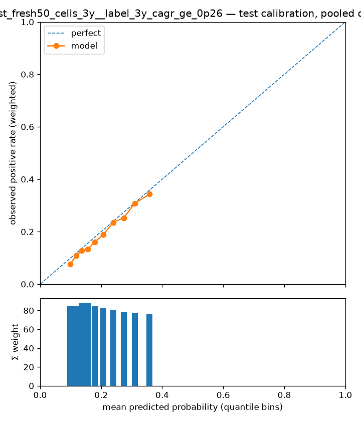

# Experiment report — forest_fresh50_cells_3y__label_3y_cagr_ge_0p26

- run id: `ab16a3885192`
- dataset version: `1.4.1` (pinned, immutable)
- dataset sha256: `be2b664c6739b93d5b5a7df1d085c09f09575071dd02d1f1426ed1586e052085` (dataset.parquet, from the manifest's provenance block)
- config hash: `c266729159026154`
- git SHA: `f24b95eda15ff2283e1ea10025a00b1f1aac57b0`
- seed: 23
- model: `random_forest` params `{"bootstrap": true, "class_weight": 1.0, "criterion": "entropy", "max_depth": 4, "max_features": 0.205191, "max_samples": 0.663781, "min_samples_leaf": 72, "n_estimators": 490, "n_jobs": 8}`
- label: `fwd_3y_cagr >= 0.26` — horizon 3y, scheme `walkforward`
- derived label `fwd_3y_cagr >= 0.26`: evaluated on the fly from the manifest's continuous outcome columns (harness.derived_labels); NULL wherever a referenced column is NULL
- **universe: `dist_52w_high <= -0.5 & dollar_volume_3m >= 100000`** — train and test rows outside it are left out (a row with a NULL in a filter column is outside). Every number below describes this universe: base rates, baselines and picks are not comparable with a run over all rows, and the run is counted in the universe's own ledger cell. The filter reads feature columns as of the snapshot; it builds no split (upstream tags decide train and test, the purge and embargo hold for the rows that remain) and derives no column. `sample_weight` is the upstream uniqueness weight, not recomputed for the rows left out.
- **configurations tried against this cell (dataset, scheme, horizon, label, universe): 1** (from the append-only results store; failed runs count); **55 against this label in any universe**
- saved model bundle: `experiments/models/forest_fresh50_cells_3y__label_3y_cagr_ge_0p26_ab16a3885192` (re-evaluate with `vml-eval`, no refitting)

## Era-sliced metrics (one row per test year)

Sliced on the calendar year of each test row's `snapshot_date` (one walk-forward fold per year); crash eras are tagged inline. `conf_at_K` is the mean score of the top-K picks; `base_rate_brier` is the no-skill Brier the model must beat. \*The pooled row picks per year — per-fold model scores are not comparable, so a global top-K would just take the hottest-scoring fold's picks; it is context for the era rows, never a stand-alone result. ROC-AUC and recall@K are logged in the results store, not shown here.

| era          | n_test | base_rate | mean_score | precision_at_20 | precision_at_50 | precision_at_thr_0.5 | precision_at_thr_0.6 | precision_at_thr_0.7 | conf_at_20 | conf_at_50 | n_at_prec_0.75 | n_at_prec_0.9 | recall_at_prec_0.75 | recall_at_prec_0.9 | recall_at_thr_0.5 | recall_at_thr_0.6 | recall_at_thr_0.7 | n_at_thr_0.5 | n_at_thr_0.6 | n_at_thr_0.7 | brier  | base_rate_brier | pr_auc |
| ------------ | ------ | --------- | ---------- | --------------- | --------------- | -------------------- | -------------------- | -------------------- | ---------- | ---------- | -------------- | ------------- | ------------------- | ------------------ | ----------------- | ----------------- | ----------------- | ------------ | ------------ | ------------ | ------ | --------------- | ------ |
| 2005         | 1322   | 0.1007    | 0.1458     | 0.1500          | 0.1600          | —                    | —                    | —                    | 0.2603     | 0.2444     | 0              | 0             | 0                   | 0                  | 0                 | 0                 | 0                 | 0            | 0            | 0            | 0.0921 | 0.0905          | 0.1258 |
| 2006         | 1031   | 0.0293    | 0.1863     | 0               | 0               | —                    | —                    | —                    | 0.3123     | 0.2983     | 0              | 0             | 0                   | 0                  | 0                 | 0                 | 0                 | 0            | 0            | 0            | 0.0552 | 0.0284          | 0.0349 |
| 2007         | 1141   | 0.0492    | 0.2307     | 0.1000          | 0.0800          | —                    | —                    | —                    | 0.4085     | 0.3963     | 0              | 0             | 0                   | 0                  | 0                 | 0                 | 0                 | 0            | 0            | 0            | 0.0844 | 0.0468          | 0.0650 |
| 2008 (GFC)   | 3759   | 0.2656    | 0.2641     | 0.2500          | 0.3600          | —                    | —                    | —                    | 0.4116     | 0.4072     | 0              | 0             | 0                   | 0                  | 0                 | 0                 | 0                 | 0            | 0            | 0            | 0.1954 | 0.1951          | 0.3030 |
| 2009 (GFC)   | 3279   | 0.4438    | 0.2665     | 0.6500          | 0.7000          | —                    | —                    | —                    | 0.3937     | 0.3884     | 1              | 1             | 0.0007              | 0.0007             | 0                 | 0                 | 0                 | 0            | 0            | 0            | 0.2697 | 0.2468          | 0.5337 |
| 2010         | 757    | 0.1315    | 0.1672     | 0.2500          | 0.2000          | —                    | —                    | —                    | 0.3051     | 0.2891     | 0              | 0             | 0                   | 0                  | 0                 | 0                 | 0                 | 0            | 0            | 0            | 0.1128 | 0.1142          | 0.2090 |
| 2011         | 1169   | 0.1854    | 0.1700     | 0.3500          | 0.3000          | —                    | —                    | —                    | 0.3129     | 0.2984     | 0              | 0             | 0                   | 0                  | 0                 | 0                 | 0                 | 0            | 0            | 0            | 0.1461 | 0.1510          | 0.2737 |
| 2012         | 1130   | 0.1794    | 0.1771     | 0.3000          | 0.2400          | —                    | —                    | —                    | 0.3099     | 0.2954     | 0              | 0             | 0                   | 0                  | 0                 | 0                 | 0                 | 0            | 0            | 0            | 0.1478 | 0.1472          | 0.2065 |
| 2013         | 606    | 0.1074    | 0.1654     | 0.0500          | 0.0600          | —                    | —                    | —                    | 0.3233     | 0.3048     | 0              | 0             | 0                   | 0                  | 0                 | 0                 | 0                 | 0            | 0            | 0            | 0.1047 | 0.0959          | 0.0975 |
| 2014         | 1012   | 0.0587    | 0.1628     | 0.1500          | 0.0600          | —                    | —                    | —                    | 0.3443     | 0.3275     | 0              | 0             | 0                   | 0                  | 0                 | 0                 | 0                 | 0            | 0            | 0            | 0.0698 | 0.0552          | 0.0669 |
| 2015         | 1748   | 0.0965    | 0.1981     | 0.3000          | 0.2400          | —                    | —                    | —                    | 0.3885     | 0.3746     | 0              | 0             | 0                   | 0                  | 0                 | 0                 | 0                 | 0            | 0            | 0            | 0.1011 | 0.0872          | 0.1260 |
| 2016         | 2032   | 0.1706    | 0.1974     | 0.1500          | 0.2600          | —                    | —                    | —                    | 0.4082     | 0.3938     | 0              | 0             | 0                   | 0                  | 0                 | 0                 | 0                 | 0            | 0            | 0            | 0.1455 | 0.1415          | 0.1948 |
| 2017         | 1318   | 0.0992    | 0.1735     | 0               | 0.0400          | —                    | —                    | —                    | 0.3654     | 0.3443     | 0              | 0             | 0                   | 0                  | 0                 | 0                 | 0                 | 0            | 0            | 0            | 0.1025 | 0.0894          | 0.0861 |
| 2018         | 1441   | 0.1485    | 0.1629     | 0.1000          | 0.1800          | —                    | —                    | —                    | 0.3460     | 0.3296     | 0              | 0             | 0                   | 0                  | 0                 | 0                 | 0                 | 0            | 0            | 0            | 0.1277 | 0.1265          | 0.1741 |
| 2019         | 2187   | 0.1401    | 0.1801     | 0.1500          | 0.1400          | —                    | —                    | —                    | 0.3691     | 0.3537     | 0              | 0             | 0                   | 0                  | 0                 | 0                 | 0                 | 0            | 0            | 0            | 0.1194 | 0.1204          | 0.1969 |
| 2020 (COVID) | 2620   | 0.2406    | 0.2035     | 0.2000          | 0.2800          | —                    | —                    | —                    | 0.4158     | 0.3996     | 0              | 0             | 0                   | 0                  | 0                 | 0                 | 0                 | 0            | 0            | 0            | 0.1679 | 0.1827          | 0.3817 |
| pooled*      | 26552  | 0.1897    | 0.2041     | 0.1969          | 0.2062          | —                    | —                    | —                    | 0.3547     | 0.3403     | 1              | 1             | 0.0002              | 0.0002             | 0                 | 0                 | 0                 | 0            | 0            | 0            | 0.1471 | 0.1537          | 0.2850 |

## High-confidence picks (pooled)

How many high-confidence calls the model made, how confident it was, and how precise they were — no pre-chosen score threshold needed. `top N/yr` rows pick per test year; `score >= p` rows (probabilistic models) count every name at or above that probability, pooled.

| selection    | n_picks | picks_per_year | mean_score | precision | hits |
| ------------ | ------- | -------------- | ---------- | --------- | ---- |
| top 5/yr     | 80      | 5              | 0.3689     | 0.1375    | 11   |
| top 10/yr    | 160     | 10             | 0.3625     | 0.1812    | 29   |
| top 20/yr    | 320     | 20             | 0.3547     | 0.1969    | 63   |
| top 50/yr    | 800     | 50             | 0.3403     | 0.2062    | 165  |
| score >= 0.9 | 0       | 0              | —          | —         | 0    |
| score >= 0.8 | 0       | 0              | —          | —         | 0    |
| score >= 0.7 | 0       | 0              | —          | —         | 0    |
| score >= 0.6 | 0       | 0              | —          | —         | 0    |
| score >= 0.5 | 0       | 0              | —          | —         | 0    |

## Pick outcomes (what the picks went on to do)

Report-only outcomes of the top-K picks of each test year (`pick_outcomes`: `label_3y_beat_spy`, `fwd_3y_excess_cagr`, `fwd_3y_cagr`, `fwd_3y_max_drawdown_from_entry`, `fwd_3y_cagr < 0.0`, `fwd_3y_cagr < -0.1`, `fwd_3y_max_drawdown_from_entry >= 0.4`, `fwd_3y_cagr >= 0.15`, `fwd_3y_cagr >= 0.26`, `fwd_3y_excess_cagr >= 0.05`, `fwd_3y_excess_cagr >= 0.1`), from the manifest's label columns; none is a model input or the training target, and the run is counted in its own label's cell. For a binary outcome the picks' hit rate, for a continuous one their mean and median, each beside the same statistic over **all** test rows of the era (unweighted, like the picks: one row, one pick). `stocks` is the number of distinct `permaticker`s among the picks (a stock has up to four test rows a year); in the pooled row it is the mean per year and the statistics run over every year's picks. NULL outcomes are left out, not counted as misses. This is a no-cost, equal-weight reading of the picks, a screen for `vml-backtest` and not a substitute.

### Top 20 per test year: `label_3y_beat_spy`

| era          | picks | stocks  | picks hit rate | all rows |
| ------------ | ----- | ------- | -------------- | -------- |
| 2005         | 20    | 17      | 0.3000         | 0.2632   |
| 2006         | 20    | 15      | 0.2000         | 0.2182   |
| 2007         | 20    | 20      | 0.5500         | 0.2559   |
| 2008 (GFC)   | 20    | 14      | 0.6500         | 0.5017   |
| 2009 (GFC)   | 20    | 18      | 0.8000         | 0.5618   |
| 2010         | 20    | 16      | 0.5500         | 0.2153   |
| 2011         | 20    | 18      | 0.4000         | 0.2387   |
| 2012         | 20    | 17      | 0.4000         | 0.2504   |
| 2013         | 20    | 17      | 0.2000         | 0.1997   |
| 2014         | 20    | 13      | 0.2000         | 0.1581   |
| 2015         | 20    | 17      | 0.5000         | 0.2077   |
| 2016         | 20    | 18      | 0.3500         | 0.2904   |
| 2017         | 20    | 17      | 0.1000         | 0.1775   |
| 2018         | 20    | 19      | 0.2000         | 0.2124   |
| 2019         | 20    | 18      | 0.2500         | 0.2204   |
| 2020 (COVID) | 20    | 19      | 0.7500         | 0.3660   |
| pooled*      | 320   | 17.0625 | 0.4000         | 0.3214   |

### Top 20 per test year: `fwd_3y_excess_cagr`

| era          | picks | stocks  | picks mean | picks median | all rows mean | all rows median |
| ------------ | ----- | ------- | ---------- | ------------ | ------------- | --------------- |
| 2005         | 20    | 17      | -0.1734    | -0.1297      | -0.2222       | -0.2078         |
| 2006         | 20    | 15      | -0.3282    | -0.2704      | -0.2592       | -0.2647         |
| 2007         | 20    | 20      | 0.0010     | 0.0720       | -0.2435       | -0.2202         |
| 2008 (GFC)   | 20    | 14      | 0.0442     | 0.0663       | -0.0257       | 0.0019          |
| 2009 (GFC)   | 20    | 18      | 0.1741     | 0.1504       | 0.0255        | 0.0477          |
| 2010         | 20    | 16      | -0.0727    | 0.0133       | -0.3192       | -0.3153         |
| 2011         | 20    | 18      | -0.0666    | -0.0395      | -0.2819       | -0.2703         |
| 2012         | 20    | 17      | -0.1479    | -0.0670      | -0.2626       | -0.2311         |
| 2013         | 20    | 17      | -0.3308    | -0.2362      | -0.3427       | -0.3500         |
| 2014         | 20    | 13      | -0.2496    | -0.1700      | -0.3837       | -0.3861         |
| 2015         | 20    | 17      | -0.0293    | 0.0142       | -0.3301       | -0.3017         |
| 2016         | 20    | 18      | -0.0733    | -0.0315      | -0.2425       | -0.2141         |
| 2017         | 20    | 17      | -0.4603    | -0.4638      | -0.3743       | -0.4454         |
| 2018         | 20    | 19      | -0.1390    | -0.0862      | -0.3303       | -0.3542         |
| 2019         | 20    | 18      | -0.1543    | -0.1786      | -0.2922       | -0.3090         |
| 2020 (COVID) | 20    | 19      | 0.0612     | 0.0503       | -0.1541       | -0.1518         |
| pooled*      | 320   | 17.0625 | -0.1215    | -0.0423      | -0.2033       | -0.1814         |

### Top 20 per test year: `fwd_3y_cagr`

| era          | picks | stocks  | picks mean | picks median | all rows mean | all rows median |
| ------------ | ----- | ------- | ---------- | ------------ | ------------- | --------------- |
| 2005         | 20    | 17      | -0.1530    | -0.0898      | -0.1890       | -0.1742         |
| 2006         | 20    | 15      | -0.4159    | -0.3515      | -0.3426       | -0.3411         |
| 2007         | 20    | 20      | -0.0539    | 0.0189       | -0.3034       | -0.2845         |
| 2008 (GFC)   | 20    | 14      | 0.1085     | 0.0815       | 0.0398        | 0.0650          |
| 2009 (GFC)   | 20    | 18      | 0.3609     | 0.3564       | 0.2019        | 0.2223          |
| 2010         | 20    | 16      | 0.0866     | 0.1894       | -0.1661       | -0.1575         |
| 2011         | 20    | 18      | 0.1300     | 0.1479       | -0.0977       | -0.0825         |
| 2012         | 20    | 17      | 0.0333     | 0.1076       | -0.0914       | -0.0668         |
| 2013         | 20    | 17      | -0.2244    | -0.1315      | -0.2373       | -0.2447         |
| 2014         | 20    | 13      | -0.1463    | -0.0686      | -0.2805       | -0.2819         |
| 2015         | 20    | 17      | 0.0938     | 0.1400       | -0.2071       | -0.1836         |
| 2016         | 20    | 18      | 0.0598     | 0.1031       | -0.1088       | -0.0846         |
| 2017         | 20    | 17      | -0.3432    | -0.3430      | -0.2610       | -0.3336         |
| 2018         | 20    | 19      | 0.0537     | 0.1261       | -0.1532       | -0.1691         |
| 2019         | 20    | 18      | -0.0195    | -0.0619      | -0.1475       | -0.1644         |
| 2020 (COVID) | 20    | 19      | 0.1976     | 0.1880       | -0.0403       | -0.0279         |
| pooled*      | 320   | 17.0625 | -0.0145    | 0.0568       | -0.0936       | -0.0807         |

### Top 20 per test year: `fwd_3y_max_drawdown_from_entry`

| era          | picks | stocks  | picks mean | picks median | all rows mean | all rows median |
| ------------ | ----- | ------- | ---------- | ------------ | ------------- | --------------- |
| 2005         | 20    | 17      | 0.4983     | 0.3707       | 0.5930        | 0.6324          |
| 2006         | 20    | 15      | 0.8253     | 0.9244       | 0.7718        | 0.8791          |
| 2007         | 20    | 20      | 0.7852     | 0.8756       | 0.8094        | 0.8901          |
| 2008 (GFC)   | 20    | 14      | 0.6504     | 0.7714       | 0.6213        | 0.6441          |
| 2009 (GFC)   | 20    | 18      | 0.2396     | 0.2536       | 0.3375        | 0.2533          |
| 2010         | 20    | 16      | 0.4264     | 0.3755       | 0.6396        | 0.7038          |
| 2011         | 20    | 18      | 0.3174     | 0.2659       | 0.5874        | 0.6044          |
| 2012         | 20    | 17      | 0.3786     | 0.3145       | 0.5372        | 0.5120          |
| 2013         | 20    | 17      | 0.5984     | 0.6986       | 0.6483        | 0.7420          |
| 2014         | 20    | 13      | 0.6182     | 0.8049       | 0.7096        | 0.8067          |
| 2015         | 20    | 17      | 0.4820     | 0.4630       | 0.6838        | 0.7522          |
| 2016         | 20    | 18      | 0.2943     | 0.2037       | 0.5551        | 0.5691          |
| 2017         | 20    | 17      | 0.7721     | 0.8743       | 0.7284        | 0.8549          |
| 2018         | 20    | 19      | 0.6297     | 0.6366       | 0.7359        | 0.8155          |
| 2019         | 20    | 18      | 0.6508     | 0.7052       | 0.7021        | 0.7690          |
| 2020 (COVID) | 20    | 19      | 0.1304     | 0.1148       | 0.5389        | 0.5451          |
| pooled*      | 320   | 17.0625 | 0.5186     | 0.4822       | 0.6073        | 0.6613          |

### Top 20 per test year: `label_3y_cagr_lt_0p0`

| era          | picks | stocks  | picks hit rate | all rows |
| ------------ | ----- | ------- | -------------- | -------- |
| 2005         | 20    | 17      | 0.7000         | 0.6959   |
| 2006         | 20    | 15      | 0.9000         | 0.8419   |
| 2007         | 20    | 20      | 0.4500         | 0.7958   |
| 2008 (GFC)   | 20    | 14      | 0.2500         | 0.4177   |
| 2009 (GFC)   | 20    | 18      | 0              | 0.2580   |
| 2010         | 20    | 16      | 0.3500         | 0.6671   |
| 2011         | 20    | 18      | 0.2500         | 0.5783   |
| 2012         | 20    | 17      | 0.3500         | 0.5717   |
| 2013         | 20    | 17      | 0.7000         | 0.7112   |
| 2014         | 20    | 13      | 0.5500         | 0.7530   |
| 2015         | 20    | 17      | 0.3000         | 0.6682   |
| 2016         | 20    | 18      | 0.3000         | 0.5714   |
| 2017         | 20    | 17      | 0.8500         | 0.7428   |
| 2018         | 20    | 19      | 0.2500         | 0.6343   |
| 2019         | 20    | 18      | 0.5500         | 0.6598   |
| 2020 (COVID) | 20    | 19      | 0.0500         | 0.5260   |
| pooled*      | 320   | 17.0625 | 0.4250         | 0.5715   |

### Top 20 per test year: `label_3y_cagr_lt_m0p1`

| era          | picks | stocks  | picks hit rate | all rows |
| ------------ | ----- | ------- | -------------- | -------- |
| 2005         | 20    | 17      | 0.5000         | 0.5832   |
| 2006         | 20    | 15      | 0.7500         | 0.7565   |
| 2007         | 20    | 20      | 0.3500         | 0.7099   |
| 2008 (GFC)   | 20    | 14      | 0.2500         | 0.3105   |
| 2009 (GFC)   | 20    | 18      | 0              | 0.1955   |
| 2010         | 20    | 16      | 0.3500         | 0.5535   |
| 2011         | 20    | 18      | 0.2000         | 0.4808   |
| 2012         | 20    | 17      | 0.2500         | 0.4646   |
| 2013         | 20    | 17      | 0.5000         | 0.6106   |
| 2014         | 20    | 13      | 0.4500         | 0.6532   |
| 2015         | 20    | 17      | 0.1500         | 0.5675   |
| 2016         | 20    | 18      | 0.2000         | 0.4857   |
| 2017         | 20    | 17      | 0.7000         | 0.6662   |
| 2018         | 20    | 19      | 0.2000         | 0.5607   |
| 2019         | 20    | 18      | 0.4000         | 0.5638   |
| 2020 (COVID) | 20    | 19      | 0              | 0.4592   |
| pooled*      | 320   | 17.0625 | 0.3281         | 0.4823   |

### Top 20 per test year: `label_3y_max_drawdown_from_entry_ge_0p4`

| era          | picks | stocks  | picks hit rate | all rows |
| ------------ | ----- | ------- | -------------- | -------- |
| 2005         | 20    | 17      | 0.4500         | 0.6838   |
| 2006         | 20    | 15      | 0.9500         | 0.8855   |
| 2007         | 20    | 20      | 0.9500         | 0.9308   |
| 2008 (GFC)   | 20    | 14      | 0.7500         | 0.7611   |
| 2009 (GFC)   | 20    | 18      | 0.1000         | 0.3105   |
| 2010         | 20    | 16      | 0.5000         | 0.7437   |
| 2011         | 20    | 18      | 0.2500         | 0.6878   |
| 2012         | 20    | 17      | 0.3500         | 0.6080   |
| 2013         | 20    | 17      | 0.6000         | 0.7277   |
| 2014         | 20    | 13      | 0.6500         | 0.8202   |
| 2015         | 20    | 17      | 0.6000         | 0.8066   |
| 2016         | 20    | 18      | 0.3000         | 0.6117   |
| 2017         | 20    | 17      | 0.9500         | 0.8209   |
| 2018         | 20    | 19      | 0.8500         | 0.8654   |
| 2019         | 20    | 18      | 0.9000         | 0.8564   |
| 2020 (COVID) | 20    | 19      | 0              | 0.5893   |
| pooled*      | 320   | 17.0625 | 0.5719         | 0.6961   |

### Top 20 per test year: `label_3y_cagr_ge_0p15`

| era          | picks | stocks  | picks hit rate | all rows |
| ------------ | ----- | ------- | -------------- | -------- |
| 2005         | 20    | 17      | 0.1500         | 0.1626   |
| 2006         | 20    | 15      | 0.0500         | 0.0630   |
| 2007         | 20    | 20      | 0.1500         | 0.0859   |
| 2008 (GFC)   | 20    | 14      | 0.3500         | 0.3879   |
| 2009 (GFC)   | 20    | 18      | 0.9000         | 0.5910   |
| 2010         | 20    | 16      | 0.6500         | 0.2219   |
| 2011         | 20    | 18      | 0.5000         | 0.2772   |
| 2012         | 20    | 17      | 0.4000         | 0.2690   |
| 2013         | 20    | 17      | 0.1000         | 0.1716   |
| 2014         | 20    | 13      | 0.1500         | 0.1186   |
| 2015         | 20    | 17      | 0.5000         | 0.1842   |
| 2016         | 20    | 18      | 0.3000         | 0.2697   |
| 2017         | 20    | 17      | 0.1000         | 0.1571   |
| 2018         | 20    | 19      | 0.4000         | 0.2380   |
| 2019         | 20    | 18      | 0.2500         | 0.2108   |
| 2020 (COVID) | 20    | 19      | 0.7000         | 0.3389   |
| pooled*      | 320   | 17.0625 | 0.3531         | 0.2848   |

### Top 20 per test year: `label_3y_cagr_ge_0p26`

| era          | picks | stocks  | picks hit rate | all rows |
| ------------ | ----- | ------- | -------------- | -------- |
| 2005         | 20    | 17      | 0.1500         | 0.1051   |
| 2006         | 20    | 15      | 0              | 0.0291   |
| 2007         | 20    | 20      | 0.1000         | 0.0500   |
| 2008 (GFC)   | 20    | 14      | 0.2500         | 0.2716   |
| 2009 (GFC)   | 20    | 18      | 0.6500         | 0.4553   |
| 2010         | 20    | 16      | 0.2500         | 0.1440   |
| 2011         | 20    | 18      | 0.3500         | 0.1993   |
| 2012         | 20    | 17      | 0.3000         | 0.1894   |
| 2013         | 20    | 17      | 0.0500         | 0.1122   |
| 2014         | 20    | 13      | 0.1500         | 0.0623   |
| 2015         | 20    | 17      | 0.3000         | 0.1024   |
| 2016         | 20    | 18      | 0.1500         | 0.1757   |
| 2017         | 20    | 17      | 0              | 0.1047   |
| 2018         | 20    | 19      | 0.1000         | 0.1596   |
| 2019         | 20    | 18      | 0.1500         | 0.1513   |
| 2020 (COVID) | 20    | 19      | 0.2000         | 0.2531   |
| pooled*      | 320   | 17.0625 | 0.1969         | 0.2005   |

### Top 20 per test year: `label_3y_excess_cagr_ge_0p05`

| era          | picks | stocks  | picks hit rate | all rows |
| ------------ | ----- | ------- | -------------- | -------- |
| 2005         | 20    | 17      | 0.2000         | 0.2156   |
| 2006         | 20    | 15      | 0.1000         | 0.1765   |
| 2007         | 20    | 20      | 0.5500         | 0.2095   |
| 2008 (GFC)   | 20    | 14      | 0.5500         | 0.4344   |
| 2009 (GFC)   | 20    | 18      | 0.7500         | 0.4965   |
| 2010         | 20    | 16      | 0.4000         | 0.1810   |
| 2011         | 20    | 18      | 0.3500         | 0.2087   |
| 2012         | 20    | 17      | 0.3000         | 0.2115   |
| 2013         | 20    | 17      | 0.1000         | 0.1683   |
| 2014         | 20    | 13      | 0.1500         | 0.1196   |
| 2015         | 20    | 17      | 0.4000         | 0.1590   |
| 2016         | 20    | 18      | 0.2000         | 0.2357   |
| 2017         | 20    | 17      | 0.0500         | 0.1464   |
| 2018         | 20    | 19      | 0.1500         | 0.1756   |
| 2019         | 20    | 18      | 0.2000         | 0.1870   |
| 2020 (COVID) | 20    | 19      | 0.5000         | 0.3244   |
| pooled*      | 320   | 17.0625 | 0.3094         | 0.2739   |

### Top 20 per test year: `label_3y_excess_cagr_ge_0p1`

| era          | picks | stocks  | picks hit rate | all rows |
| ------------ | ----- | ------- | -------------- | -------- |
| 2005         | 20    | 17      | 0.2000         | 0.1702   |
| 2006         | 20    | 15      | 0.1000         | 0.1406   |
| 2007         | 20    | 20      | 0.3000         | 0.1691   |
| 2008 (GFC)   | 20    | 14      | 0.3500         | 0.3647   |
| 2009 (GFC)   | 20    | 18      | 0.6500         | 0.4337   |
| 2010         | 20    | 16      | 0.3000         | 0.1493   |
| 2011         | 20    | 18      | 0.3000         | 0.1796   |
| 2012         | 20    | 17      | 0.3000         | 0.1867   |
| 2013         | 20    | 17      | 0.1000         | 0.1436   |
| 2014         | 20    | 13      | 0.1500         | 0.0889   |
| 2015         | 20    | 17      | 0.3500         | 0.1201   |
| 2016         | 20    | 18      | 0.1500         | 0.1959   |
| 2017         | 20    | 17      | 0              | 0.1237   |
| 2018         | 20    | 19      | 0.0500         | 0.1464   |
| 2019         | 20    | 18      | 0.1500         | 0.1587   |
| 2020 (COVID) | 20    | 19      | 0.2000         | 0.2821   |
| pooled*      | 320   | 17.0625 | 0.2281         | 0.2311   |

### Top 50 per test year: `label_3y_beat_spy`

| era          | picks | stocks  | picks hit rate | all rows |
| ------------ | ----- | ------- | -------------- | -------- |
| 2005         | 50    | 39      | 0.3200         | 0.2632   |
| 2006         | 50    | 39      | 0.3000         | 0.2182   |
| 2007         | 50    | 47      | 0.4400         | 0.2559   |
| 2008 (GFC)   | 50    | 39      | 0.6200         | 0.5017   |
| 2009 (GFC)   | 50    | 38      | 0.8200         | 0.5618   |
| 2010         | 50    | 35      | 0.4200         | 0.2153   |
| 2011         | 50    | 44      | 0.3800         | 0.2387   |
| 2012         | 50    | 36      | 0.3400         | 0.2504   |
| 2013         | 50    | 38      | 0.2200         | 0.1997   |
| 2014         | 50    | 37      | 0.1800         | 0.1581   |
| 2015         | 50    | 44      | 0.3800         | 0.2077   |
| 2016         | 50    | 41      | 0.5000         | 0.2904   |
| 2017         | 50    | 36      | 0.1600         | 0.1775   |
| 2018         | 50    | 42      | 0.3000         | 0.2124   |
| 2019         | 50    | 44      | 0.3200         | 0.2204   |
| 2020 (COVID) | 50    | 46      | 0.6600         | 0.3660   |
| pooled*      | 800   | 40.3125 | 0.3975         | 0.3214   |

### Top 50 per test year: `fwd_3y_excess_cagr`

| era          | picks | stocks  | picks mean | picks median | all rows mean | all rows median |
| ------------ | ----- | ------- | ---------- | ------------ | ------------- | --------------- |
| 2005         | 50    | 39      | -0.1231    | -0.1297      | -0.2222       | -0.2078         |
| 2006         | 50    | 39      | -0.2566    | -0.2261      | -0.2592       | -0.2647         |
| 2007         | 50    | 47      | -0.1061    | -0.0251      | -0.2435       | -0.2202         |
| 2008 (GFC)   | 50    | 39      | 0.0526     | 0.0814       | -0.0257       | 0.0019          |
| 2009 (GFC)   | 50    | 38      | 0.1754     | 0.1611       | 0.0255        | 0.0477          |
| 2010         | 50    | 35      | -0.1277    | -0.0689      | -0.3192       | -0.3153         |
| 2011         | 50    | 44      | -0.1089    | -0.0437      | -0.2819       | -0.2703         |
| 2012         | 50    | 36      | -0.1945    | -0.1078      | -0.2626       | -0.2311         |
| 2013         | 50    | 38      | -0.3556    | -0.3487      | -0.3427       | -0.3500         |
| 2014         | 50    | 37      | -0.3638    | -0.3192      | -0.3837       | -0.3861         |
| 2015         | 50    | 44      | -0.0860    | -0.0480      | -0.3301       | -0.3017         |
| 2016         | 50    | 41      | -0.0543    | -0.0002      | -0.2425       | -0.2141         |
| 2017         | 50    | 36      | -0.3909    | -0.3141      | -0.3743       | -0.4454         |
| 2018         | 50    | 42      | -0.1500    | -0.0794      | -0.3303       | -0.3542         |
| 2019         | 50    | 44      | -0.1140    | -0.1088      | -0.2922       | -0.3090         |
| 2020 (COVID) | 50    | 46      | 0.0584     | 0.0538       | -0.1541       | -0.1518         |
| pooled*      | 800   | 40.3125 | -0.1341    | -0.0664      | -0.2033       | -0.1814         |

### Top 50 per test year: `fwd_3y_cagr`

| era          | picks | stocks  | picks mean | picks median | all rows mean | all rows median |
| ------------ | ----- | ------- | ---------- | ------------ | ------------- | --------------- |
| 2005         | 50    | 39      | -0.0942    | -0.0831      | -0.1890       | -0.1742         |
| 2006         | 50    | 39      | -0.3368    | -0.3019      | -0.3426       | -0.3411         |
| 2007         | 50    | 47      | -0.1611    | -0.0874      | -0.3034       | -0.2845         |
| 2008 (GFC)   | 50    | 39      | 0.1346     | 0.1200       | 0.0398        | 0.0650          |
| 2009 (GFC)   | 50    | 38      | 0.3651     | 0.3536       | 0.2019        | 0.2223          |
| 2010         | 50    | 35      | 0.0282     | 0.0801       | -0.1661       | -0.1575         |
| 2011         | 50    | 44      | 0.0879     | 0.1559       | -0.0977       | -0.0825         |
| 2012         | 50    | 36      | -0.0176    | 0.0729       | -0.0914       | -0.0668         |
| 2013         | 50    | 38      | -0.2478    | -0.2476      | -0.2373       | -0.2447         |
| 2014         | 50    | 37      | -0.2603    | -0.2192      | -0.2805       | -0.2819         |
| 2015         | 50    | 44      | 0.0377     | 0.0737       | -0.2071       | -0.1836         |
| 2016         | 50    | 41      | 0.0776     | 0.1261       | -0.1088       | -0.0846         |
| 2017         | 50    | 36      | -0.2764    | -0.2159      | -0.2610       | -0.3336         |
| 2018         | 50    | 42      | 0.0325     | 0.1081       | -0.1532       | -0.1691         |
| 2019         | 50    | 44      | 0.0184     | 0.0427       | -0.1475       | -0.1644         |
| 2020 (COVID) | 50    | 46      | 0.1946     | 0.1869       | -0.0403       | -0.0279         |
| pooled*      | 800   | 40.3125 | -0.0261    | 0.0450       | -0.0936       | -0.0807         |

### Top 50 per test year: `fwd_3y_max_drawdown_from_entry`

| era          | picks | stocks  | picks mean | picks median | all rows mean | all rows median |
| ------------ | ----- | ------- | ---------- | ------------ | ------------- | --------------- |
| 2005         | 50    | 39      | 0.4739     | 0.3661       | 0.5930        | 0.6324          |
| 2006         | 50    | 39      | 0.7619     | 0.8852       | 0.7718        | 0.8791          |
| 2007         | 50    | 47      | 0.7704     | 0.8662       | 0.8094        | 0.8901          |
| 2008 (GFC)   | 50    | 39      | 0.5910     | 0.5676       | 0.6213        | 0.6441          |
| 2009 (GFC)   | 50    | 38      | 0.2404     | 0.1887       | 0.3375        | 0.2533          |
| 2010         | 50    | 35      | 0.4651     | 0.4252       | 0.6396        | 0.7038          |
| 2011         | 50    | 44      | 0.3723     | 0.2908       | 0.5874        | 0.6044          |
| 2012         | 50    | 36      | 0.4109     | 0.3490       | 0.5372        | 0.5120          |
| 2013         | 50    | 38      | 0.6244     | 0.7780       | 0.6483        | 0.7420          |
| 2014         | 50    | 37      | 0.7135     | 0.8413       | 0.7096        | 0.8067          |
| 2015         | 50    | 44      | 0.5001     | 0.5029       | 0.6838        | 0.7522          |
| 2016         | 50    | 41      | 0.3493     | 0.2305       | 0.5551        | 0.5691          |
| 2017         | 50    | 36      | 0.7095     | 0.8185       | 0.7284        | 0.8549          |
| 2018         | 50    | 42      | 0.6331     | 0.7075       | 0.7359        | 0.8155          |
| 2019         | 50    | 44      | 0.6204     | 0.6553       | 0.7021        | 0.7690          |
| 2020 (COVID) | 50    | 46      | 0.1746     | 0.1540       | 0.5389        | 0.5451          |
| pooled*      | 800   | 40.3125 | 0.5257     | 0.5064       | 0.6073        | 0.6613          |

### Top 50 per test year: `label_3y_cagr_lt_0p0`

| era          | picks | stocks  | picks hit rate | all rows |
| ------------ | ----- | ------- | -------------- | -------- |
| 2005         | 50    | 39      | 0.6400         | 0.6959   |
| 2006         | 50    | 39      | 0.7800         | 0.8419   |
| 2007         | 50    | 47      | 0.5800         | 0.7958   |
| 2008 (GFC)   | 50    | 39      | 0.2400         | 0.4177   |
| 2009 (GFC)   | 50    | 38      | 0.0400         | 0.2580   |
| 2010         | 50    | 35      | 0.4200         | 0.6671   |
| 2011         | 50    | 44      | 0.3000         | 0.5783   |
| 2012         | 50    | 36      | 0.4000         | 0.5717   |
| 2013         | 50    | 38      | 0.6600         | 0.7112   |
| 2014         | 50    | 37      | 0.7000         | 0.7530   |
| 2015         | 50    | 44      | 0.3600         | 0.6682   |
| 2016         | 50    | 41      | 0.3000         | 0.5714   |
| 2017         | 50    | 36      | 0.7800         | 0.7428   |
| 2018         | 50    | 42      | 0.3200         | 0.6343   |
| 2019         | 50    | 44      | 0.4600         | 0.6598   |
| 2020 (COVID) | 50    | 46      | 0.1600         | 0.5260   |
| pooled*      | 800   | 40.3125 | 0.4462         | 0.5715   |

### Top 50 per test year: `label_3y_cagr_lt_m0p1`

| era          | picks | stocks  | picks hit rate | all rows |
| ------------ | ----- | ------- | -------------- | -------- |
| 2005         | 50    | 39      | 0.4600         | 0.5832   |
| 2006         | 50    | 39      | 0.6600         | 0.7565   |
| 2007         | 50    | 47      | 0.4800         | 0.7099   |
| 2008 (GFC)   | 50    | 39      | 0.2200         | 0.3105   |
| 2009 (GFC)   | 50    | 38      | 0              | 0.1955   |
| 2010         | 50    | 35      | 0.3800         | 0.5535   |
| 2011         | 50    | 44      | 0.1800         | 0.4808   |
| 2012         | 50    | 36      | 0.3400         | 0.4646   |
| 2013         | 50    | 38      | 0.5200         | 0.6106   |
| 2014         | 50    | 37      | 0.6200         | 0.6532   |
| 2015         | 50    | 44      | 0.2800         | 0.5675   |
| 2016         | 50    | 41      | 0.2000         | 0.4857   |
| 2017         | 50    | 36      | 0.6200         | 0.6662   |
| 2018         | 50    | 42      | 0.2600         | 0.5607   |
| 2019         | 50    | 44      | 0.3400         | 0.5638   |
| 2020 (COVID) | 50    | 46      | 0.0200         | 0.4592   |
| pooled*      | 800   | 40.3125 | 0.3488         | 0.4823   |

### Top 50 per test year: `label_3y_max_drawdown_from_entry_ge_0p4`

| era          | picks | stocks  | picks hit rate | all rows |
| ------------ | ----- | ------- | -------------- | -------- |
| 2005         | 50    | 39      | 0.4600         | 0.6838   |
| 2006         | 50    | 39      | 0.8800         | 0.8855   |
| 2007         | 50    | 47      | 0.9400         | 0.9308   |
| 2008 (GFC)   | 50    | 39      | 0.7200         | 0.7611   |
| 2009 (GFC)   | 50    | 38      | 0.1800         | 0.3105   |
| 2010         | 50    | 35      | 0.5200         | 0.7437   |
| 2011         | 50    | 44      | 0.3000         | 0.6878   |
| 2012         | 50    | 36      | 0.3800         | 0.6080   |
| 2013         | 50    | 38      | 0.6200         | 0.7277   |
| 2014         | 50    | 37      | 0.8000         | 0.8202   |
| 2015         | 50    | 44      | 0.6400         | 0.8066   |
| 2016         | 50    | 41      | 0.3800         | 0.6117   |
| 2017         | 50    | 36      | 0.8200         | 0.8209   |
| 2018         | 50    | 42      | 0.7800         | 0.8654   |
| 2019         | 50    | 44      | 0.8200         | 0.8564   |
| 2020 (COVID) | 50    | 46      | 0.0600         | 0.5893   |
| pooled*      | 800   | 40.3125 | 0.5813         | 0.6961   |

### Top 50 per test year: `label_3y_cagr_ge_0p15`

| era          | picks | stocks  | picks hit rate | all rows |
| ------------ | ----- | ------- | -------------- | -------- |
| 2005         | 50    | 39      | 0.2000         | 0.1626   |
| 2006         | 50    | 39      | 0.0800         | 0.0630   |
| 2007         | 50    | 47      | 0.2000         | 0.0859   |
| 2008 (GFC)   | 50    | 39      | 0.4600         | 0.3879   |
| 2009 (GFC)   | 50    | 38      | 0.8600         | 0.5910   |
| 2010         | 50    | 35      | 0.4800         | 0.2219   |
| 2011         | 50    | 44      | 0.5200         | 0.2772   |
| 2012         | 50    | 36      | 0.4000         | 0.2690   |
| 2013         | 50    | 38      | 0.1600         | 0.1716   |
| 2014         | 50    | 37      | 0.0800         | 0.1186   |
| 2015         | 50    | 44      | 0.3800         | 0.1842   |
| 2016         | 50    | 41      | 0.4400         | 0.2697   |
| 2017         | 50    | 36      | 0.1200         | 0.1571   |
| 2018         | 50    | 42      | 0.4000         | 0.2380   |
| 2019         | 50    | 44      | 0.3200         | 0.2108   |
| 2020 (COVID) | 50    | 46      | 0.6200         | 0.3389   |
| pooled*      | 800   | 40.3125 | 0.3575         | 0.2848   |

### Top 50 per test year: `label_3y_cagr_ge_0p26`

| era          | picks | stocks  | picks hit rate | all rows |
| ------------ | ----- | ------- | -------------- | -------- |
| 2005         | 50    | 39      | 0.1600         | 0.1051   |
| 2006         | 50    | 39      | 0              | 0.0291   |
| 2007         | 50    | 47      | 0.0800         | 0.0500   |
| 2008 (GFC)   | 50    | 39      | 0.3600         | 0.2716   |
| 2009 (GFC)   | 50    | 38      | 0.7000         | 0.4553   |
| 2010         | 50    | 35      | 0.2000         | 0.1440   |
| 2011         | 50    | 44      | 0.3000         | 0.1993   |
| 2012         | 50    | 36      | 0.2400         | 0.1894   |
| 2013         | 50    | 38      | 0.0600         | 0.1122   |
| 2014         | 50    | 37      | 0.0600         | 0.0623   |
| 2015         | 50    | 44      | 0.2400         | 0.1024   |
| 2016         | 50    | 41      | 0.2600         | 0.1757   |
| 2017         | 50    | 36      | 0.0400         | 0.1047   |
| 2018         | 50    | 42      | 0.1800         | 0.1596   |
| 2019         | 50    | 44      | 0.1400         | 0.1513   |
| 2020 (COVID) | 50    | 46      | 0.2800         | 0.2531   |
| pooled*      | 800   | 40.3125 | 0.2062         | 0.2005   |

### Top 50 per test year: `label_3y_excess_cagr_ge_0p05`

| era          | picks | stocks  | picks hit rate | all rows |
| ------------ | ----- | ------- | -------------- | -------- |
| 2005         | 50    | 39      | 0.2600         | 0.2156   |
| 2006         | 50    | 39      | 0.2400         | 0.1765   |
| 2007         | 50    | 47      | 0.4200         | 0.2095   |
| 2008 (GFC)   | 50    | 39      | 0.5600         | 0.4344   |
| 2009 (GFC)   | 50    | 38      | 0.7800         | 0.4965   |
| 2010         | 50    | 35      | 0.2800         | 0.1810   |
| 2011         | 50    | 44      | 0.3200         | 0.2087   |
| 2012         | 50    | 36      | 0.2600         | 0.2115   |
| 2013         | 50    | 38      | 0.1600         | 0.1683   |
| 2014         | 50    | 37      | 0.0800         | 0.1196   |
| 2015         | 50    | 44      | 0.3000         | 0.1590   |
| 2016         | 50    | 41      | 0.3600         | 0.2357   |
| 2017         | 50    | 36      | 0.1000         | 0.1464   |
| 2018         | 50    | 42      | 0.2000         | 0.1756   |
| 2019         | 50    | 44      | 0.2400         | 0.1870   |
| 2020 (COVID) | 50    | 46      | 0.5000         | 0.3244   |
| pooled*      | 800   | 40.3125 | 0.3162         | 0.2739   |

### Top 50 per test year: `label_3y_excess_cagr_ge_0p1`

| era          | picks | stocks  | picks hit rate | all rows |
| ------------ | ----- | ------- | -------------- | -------- |
| 2005         | 50    | 39      | 0.2400         | 0.1702   |
| 2006         | 50    | 39      | 0.2000         | 0.1406   |
| 2007         | 50    | 47      | 0.3200         | 0.1691   |
| 2008 (GFC)   | 50    | 39      | 0.4600         | 0.3647   |
| 2009 (GFC)   | 50    | 38      | 0.7000         | 0.4337   |
| 2010         | 50    | 35      | 0.2400         | 0.1493   |
| 2011         | 50    | 44      | 0.2600         | 0.1796   |
| 2012         | 50    | 36      | 0.2400         | 0.1867   |
| 2013         | 50    | 38      | 0.1200         | 0.1436   |
| 2014         | 50    | 37      | 0.0600         | 0.0889   |
| 2015         | 50    | 44      | 0.2600         | 0.1201   |
| 2016         | 50    | 41      | 0.2600         | 0.1959   |
| 2017         | 50    | 36      | 0.0600         | 0.1237   |
| 2018         | 50    | 42      | 0.1400         | 0.1464   |
| 2019         | 50    | 44      | 0.1600         | 0.1587   |
| 2020 (COVID) | 50    | 46      | 0.2800         | 0.2821   |
| pooled*      | 800   | 40.3125 | 0.2500         | 0.2311   |

## Portfolio screen (capped, periodic picks)

`[pick_screen]`: top 10 per test quarter, at most 2 per `sector`; peers: the test rows of the same quarter in the same of 20 bands of `log_marketcap_rank`. The backtest template's selection rule applied to the test rows (a backtest buys from the latest completed quarter's median snapshots, which are these rows), read on the run's label (`precision`) and on the pick outcomes. Equal weights, no costs, entry at the snapshot, held to the horizon: closer to a portfolio than the top-K-per-year tables, and still a screen for `vml-backtest`, not a substitute. Report-only. The `peers` columns give the same statistic for the picks' peers: the test rows of the same quarter in the same band of `log_marketcap_rank` (20 bands), averaged over the picks. **Read a selection against its peers**: against a capitalization-weighted benchmark small stocks trail by a wide margin in every period, so the all-rows reference of the pick-outcome tables flatters any ranking that prefers large companies.

| era          | picks | stocks | largest group          | its share | precision | precision peers | label_3y_beat_spy hit rate | label_3y_beat_spy peers | fwd_3y_excess_cagr mean | fwd_3y_excess_cagr peers | fwd_3y_excess_cagr median | fwd_3y_cagr mean | fwd_3y_cagr peers | fwd_3y_cagr median | fwd_3y_max_drawdown_from_entry mean | fwd_3y_max_drawdown_from_entry peers | fwd_3y_max_drawdown_from_entry median | label_3y_cagr_lt_0p0 hit rate | label_3y_cagr_lt_0p0 peers | label_3y_cagr_lt_m0p1 hit rate | label_3y_cagr_lt_m0p1 peers | label_3y_max_drawdown_from_entry_ge_0p4 hit rate | label_3y_max_drawdown_from_entry_ge_0p4 peers | label_3y_cagr_ge_0p15 hit rate | label_3y_cagr_ge_0p15 peers | label_3y_cagr_ge_0p26 hit rate | label_3y_cagr_ge_0p26 peers | label_3y_excess_cagr_ge_0p05 hit rate | label_3y_excess_cagr_ge_0p05 peers | label_3y_excess_cagr_ge_0p1 hit rate | label_3y_excess_cagr_ge_0p1 peers |
| ------------ | ----- | ------ | ---------------------- | --------- | --------- | --------------- | -------------------------- | ----------------------- | ----------------------- | ------------------------ | ------------------------- | ---------------- | ----------------- | ------------------ | ----------------------------------- | ------------------------------------ | ------------------------------------- | ----------------------------- | -------------------------- | ------------------------------ | --------------------------- | ------------------------------------------------ | --------------------------------------------- | ------------------------------ | --------------------------- | ------------------------------ | --------------------------- | ------------------------------------- | ---------------------------------- | ------------------------------------ | --------------------------------- |
| 2005         | 40    | 33     | Technology             | 0.2000    | 0.1000    | 0.1147          | 0.3500                     | 0.2972                  | -0.1406                 | -0.1750                  | -0.1297                   | -0.1109          | -0.1469           | -0.0831            | 0.4797                              | 0.5520                               | 0.3661                                | 0.6250                        | 0.6574                     | 0.4500                         | 0.5500                      | 0.4750                                           | 0.6301                                        | 0.2000                         | 0.1709                      | 0.1000                         | 0.1147                      | 0.2500                                | 0.2397                             | 0.2250                               | 0.1846                            |
| 2006         | 40    | 33     | Communication Services | 0.2000    | 0         | 0.0249          | 0.2750                     | 0.2366                  | -0.2739                 | -0.2438                  | -0.2132                   | -0.3604          | -0.3305           | -0.2969            | 0.7566                              | 0.7549                               | 0.8538                                | 0.8250                        | 0.8289                     | 0.6750                         | 0.7261                      | 0.8750                                           | 0.8764                                        | 0.0750                         | 0.0614                      | 0                              | 0.0249                      | 0.2000                                | 0.1955                             | 0.1500                               | 0.1614                            |
| 2007         | 40    | 37     | Technology             | 0.2000    | 0.1000    | 0.0329          | 0.2750                     | 0.2611                  | -0.1980                 | -0.2578                  | -0.1232                   | -0.2583          | -0.3184           | -0.1987            | 0.8167                              | 0.7986                               | 0.8514                                | 0.7250                        | 0.7981                     | 0.6500                         | 0.6962                      | 0.9750                                           | 0.9115                                        | 0.1250                         | 0.0689                      | 0.1000                         | 0.0329                      | 0.2750                                | 0.2043                             | 0.2000                               | 0.1521                            |
| 2008 (GFC)   | 40    | 31     | Consumer Cyclical      | 0.2000    | 0.2000    | 0.2239          | 0.5500                     | 0.5156                  | 0.0076                  | -0.0177                  | 0.0307                    | 0.0491           | 0.0239            | 0.0586             | 0.6556                              | 0.6559                               | 0.7211                                | 0.3750                        | 0.4361                     | 0.3250                         | 0.3199                      | 0.8000                                           | 0.8177                                        | 0.2750                         | 0.3454                      | 0.2000                         | 0.2239                      | 0.4750                                | 0.4412                             | 0.3500                               | 0.3638                            |
| 2009 (GFC)   | 40    | 32     | Consumer Cyclical      | 0.2000    | 0.4750    | 0.3851          | 0.6500                     | 0.5186                  | 0.0436                  | -0.0225                  | 0.0938                    | 0.1958           | 0.1344            | 0.2493             | 0.2470                              | 0.3451                               | 0.1574                                | 0.1750                        | 0.2936                     | 0.1000                         | 0.2265                      | 0.2000                                           | 0.3284                                        | 0.6250                         | 0.5233                      | 0.4750                         | 0.3851                      | 0.6000                                | 0.4450                             | 0.5000                               | 0.3883                            |
| 2010         | 40    | 32     | Healthcare             | 0.2000    | 0.2250    | 0.1714          | 0.4000                     | 0.2697                  | -0.1346                 | -0.2706                  | -0.0978                   | 0.0125           | -0.1231           | 0.0421             | 0.4753                              | 0.6011                               | 0.4408                                | 0.4500                        | 0.6217                     | 0.4000                         | 0.5185                      | 0.5500                                           | 0.7216                                        | 0.4500                         | 0.2718                      | 0.2250                         | 0.1714                      | 0.3000                                | 0.2112                             | 0.2500                               | 0.1772                            |
| 2011         | 40    | 33     | Consumer Cyclical      | 0.2000    | 0.2250    | 0.2395          | 0.2750                     | 0.2988                  | -0.2161                 | -0.2157                  | -0.0989                   | -0.0460          | -0.0433           | 0.0912             | 0.5181                              | 0.5556                               | 0.4033                                | 0.4000                        | 0.5064                     | 0.3500                         | 0.4121                      | 0.5250                                           | 0.6721                                        | 0.3750                         | 0.3294                      | 0.2250                         | 0.2395                      | 0.2250                                | 0.2522                             | 0.2000                               | 0.2284                            |
| 2012         | 40    | 31     | Energy                 | 0.2000    | 0.2250    | 0.2083          | 0.3000                     | 0.2962                  | -0.1979                 | -0.2276                  | -0.1420                   | -0.0274          | -0.0586           | 0.0335             | 0.3989                              | 0.4911                               | 0.3414                                | 0.4500                        | 0.5276                     | 0.3500                         | 0.4134                      | 0.4000                                           | 0.5476                                        | 0.3500                         | 0.3167                      | 0.2250                         | 0.2083                      | 0.2500                                | 0.2310                             | 0.2500                               | 0.2012                            |
| 2013         | 40    | 28     | Technology             | 0.2000    | 0.0250    | 0.0582          | 0.2000                     | 0.1695                  | -0.3438                 | -0.3378                  | -0.2242                   | -0.2398          | -0.2341           | -0.1167            | 0.6213                              | 0.6222                               | 0.6986                                | 0.6750                        | 0.7257                     | 0.5250                         | 0.5503                      | 0.6500                                           | 0.7159                                        | 0.1500                         | 0.1137                      | 0.0250                         | 0.0582                      | 0.1500                                | 0.1187                             | 0.1000                               | 0.0975                            |
| 2014         | 40    | 27     | Consumer Cyclical      | 0.2000    | 0.1000    | 0.0722          | 0.1750                     | 0.2066                  | -0.2245                 | -0.2980                  | -0.1237                   | -0.1226          | -0.1960           | -0.0312            | 0.6128                              | 0.6463                               | 0.7170                                | 0.5250                        | 0.6616                     | 0.4250                         | 0.5202                      | 0.7000                                           | 0.7369                                        | 0.1000                         | 0.1300                      | 0.1000                         | 0.0722                      | 0.1000                                | 0.1341                             | 0.1000                               | 0.1097                            |
| 2015         | 40    | 36     | Energy                 | 0.2000    | 0.1750    | 0.1017          | 0.3250                     | 0.2509                  | -0.2341                 | -0.2478                  | -0.1836                   | -0.1142          | -0.1257           | -0.0719            | 0.6239                              | 0.6508                               | 0.6393                                | 0.5500                        | 0.5837                     | 0.5000                         | 0.4805                      | 0.7750                                           | 0.7887                                        | 0.3000                         | 0.2102                      | 0.1750                         | 0.1017                      | 0.3000                                | 0.1645                             | 0.2250                               | 0.1242                            |
| 2016         | 40    | 32     | Energy                 | 0.2000    | 0.2500    | 0.1866          | 0.4750                     | 0.3407                  | -0.0580                 | -0.1522                  | -0.0315                   | 0.0762           | -0.0179           | 0.1073             | 0.3238                              | 0.4567                               | 0.2213                                | 0.3250                        | 0.4907                     | 0.1750                         | 0.3616                      | 0.3500                                           | 0.4849                                        | 0.4500                         | 0.3107                      | 0.2500                         | 0.1866                      | 0.3500                                | 0.2563                             | 0.2750                               | 0.2109                            |
| 2017         | 40    | 31     | Consumer Cyclical      | 0.2000    | 0.0500    | 0.0796          | 0.2000                     | 0.2054                  | -0.3901                 | -0.3256                  | -0.4255                   | -0.2703          | -0.2095           | -0.3012            | 0.6972                              | 0.6812                               | 0.8471                                | 0.8000                        | 0.6735                     | 0.6750                         | 0.6050                      | 0.8250                                           | 0.7946                                        | 0.1500                         | 0.1726                      | 0.0500                         | 0.0796                      | 0.1250                                | 0.1472                             | 0.0750                               | 0.1035                            |
| 2018         | 40    | 34     | Consumer Defensive     | 0.2000    | 0.0500    | 0.1445          | 0.1750                     | 0.2249                  | -0.2614                 | -0.2562                  | -0.1290                   | -0.0882          | -0.0824           | 0.0500             | 0.6442                              | 0.6479                               | 0.7099                                | 0.3750                        | 0.4663                     | 0.3500                         | 0.4022                      | 0.8000                                           | 0.7677                                        | 0.2500                         | 0.2807                      | 0.0500                         | 0.1445                      | 0.0750                                | 0.1714                             | 0.0250                               | 0.1147                            |
| 2019         | 40    | 33     | Consumer Cyclical      | 0.2000    | 0.2250    | 0.1961          | 0.4000                     | 0.3016                  | -0.0784                 | -0.1858                  | -0.0567                   | 0.0675           | -0.0404           | 0.0611             | 0.6000                              | 0.6532                               | 0.6203                                | 0.4250                        | 0.5242                     | 0.3000                         | 0.3955                      | 0.7750                                           | 0.8183                                        | 0.4000                         | 0.3098                      | 0.2250                         | 0.1961                      | 0.3000                                | 0.2424                             | 0.2250                               | 0.2117                            |
| 2020 (COVID) | 40    | 37     | Consumer Cyclical      | 0.1750    | 0.1750    | 0.3118          | 0.6000                     | 0.5124                  | 0.0099                  | -0.0155                  | 0.0608                    | 0.1161           | 0.0916            | 0.1630             | 0.2805                              | 0.4201                               | 0.2471                                | 0.2750                        | 0.3602                     | 0.0750                         | 0.2747                      | 0.2250                                           | 0.4390                                        | 0.5500                         | 0.4491                      | 0.1750                         | 0.3118                      | 0.5500                                | 0.4422                             | 0.3250                               | 0.3551                            |
| pooled       | 640   | 416    | Consumer Cyclical      | 0.1688    | 0.1625    | 0.1595          | 0.3516                     | 0.3066                  | -0.1681                 | -0.2031                  | -0.1023                   | -0.0701          | -0.1048           | 0.0027             | 0.5470                              | 0.5958                               | 0.5593                                | 0.4984                        | 0.5722                     | 0.3953                         | 0.4658                      | 0.6188                                           | 0.6907                                        | 0.3016                         | 0.2540                      | 0.1625                         | 0.1595                      | 0.2828                                | 0.2436                             | 0.2172                               | 0.1990                            |

What the screen picked, by `sector` (pooled over test years):

| group                  | share of picks | share of test rows |
| ---------------------- | -------------- | ------------------ |
| Consumer Cyclical      | 0.1688         | 0.1139             |
| Industrials            | 0.1578         | 0.1090             |
| Technology             | 0.1391         | 0.1654             |
| Communication Services | 0.1125         | 0.0589             |
| Energy                 | 0.1047         | 0.1260             |
| Consumer Defensive     | 0.0938         | 0.0327             |
| Healthcare             | 0.0875         | 0.2993             |
| Basic Materials        | 0.0859         | 0.0510             |
| Real Estate            | 0.0234         | 0.0179             |
| Financial Services     | 0.0203         | 0.0178             |
| Utilities              | 0.0047         | 0.0076             |
| unknown                | 0.0016         | 0.0005             |

## Selection by score (every row at or above a threshold)

What every row with `score >= t` went on to do, per test year and pooled, with how many rows and distinct stocks that is. A year with no row at the bar is a year in cash and is shown. Scores of different folds come from different fits: read the picks per year before the pooled row, and read a threshold as a probability only on a calibrated run. Report-only, like the pick outcomes.

### `score >= 0.5`

| era          | picks | of rows | stocks | precision | label_3y_beat_spy hit rate | fwd_3y_excess_cagr mean | fwd_3y_excess_cagr median | fwd_3y_cagr mean | fwd_3y_cagr median | fwd_3y_max_drawdown_from_entry mean | fwd_3y_max_drawdown_from_entry median | label_3y_cagr_lt_0p0 hit rate | label_3y_cagr_lt_m0p1 hit rate | label_3y_max_drawdown_from_entry_ge_0p4 hit rate | label_3y_cagr_ge_0p15 hit rate | label_3y_cagr_ge_0p26 hit rate | label_3y_excess_cagr_ge_0p05 hit rate | label_3y_excess_cagr_ge_0p1 hit rate |
| ------------ | ----- | ------- | ------ | --------- | -------------------------- | ----------------------- | ------------------------- | ---------------- | ------------------ | ----------------------------------- | ------------------------------------- | ----------------------------- | ------------------------------ | ------------------------------------------------ | ------------------------------ | ------------------------------ | ------------------------------------- | ------------------------------------ |
| 2005         | 0     | 1322    | 0      | —         | —                          | —                       | —                         | —                | —                  | —                                   | —                                     | —                             | —                              | —                                                | —                              | —                              | —                                     | —                                    |
| 2006         | 0     | 1031    | 0      | —         | —                          | —                       | —                         | —                | —                  | —                                   | —                                     | —                             | —                              | —                                                | —                              | —                              | —                                     | —                                    |
| 2007         | 0     | 1141    | 0      | —         | —                          | —                       | —                         | —                | —                  | —                                   | —                                     | —                             | —                              | —                                                | —                              | —                              | —                                     | —                                    |
| 2008 (GFC)   | 0     | 3759    | 0      | —         | —                          | —                       | —                         | —                | —                  | —                                   | —                                     | —                             | —                              | —                                                | —                              | —                              | —                                     | —                                    |
| 2009 (GFC)   | 0     | 3279    | 0      | —         | —                          | —                       | —                         | —                | —                  | —                                   | —                                     | —                             | —                              | —                                                | —                              | —                              | —                                     | —                                    |
| 2010         | 0     | 757     | 0      | —         | —                          | —                       | —                         | —                | —                  | —                                   | —                                     | —                             | —                              | —                                                | —                              | —                              | —                                     | —                                    |
| 2011         | 0     | 1169    | 0      | —         | —                          | —                       | —                         | —                | —                  | —                                   | —                                     | —                             | —                              | —                                                | —                              | —                              | —                                     | —                                    |
| 2012         | 0     | 1130    | 0      | —         | —                          | —                       | —                         | —                | —                  | —                                   | —                                     | —                             | —                              | —                                                | —                              | —                              | —                                     | —                                    |
| 2013         | 0     | 606     | 0      | —         | —                          | —                       | —                         | —                | —                  | —                                   | —                                     | —                             | —                              | —                                                | —                              | —                              | —                                     | —                                    |
| 2014         | 0     | 1012    | 0      | —         | —                          | —                       | —                         | —                | —                  | —                                   | —                                     | —                             | —                              | —                                                | —                              | —                              | —                                     | —                                    |
| 2015         | 0     | 1748    | 0      | —         | —                          | —                       | —                         | —                | —                  | —                                   | —                                     | —                             | —                              | —                                                | —                              | —                              | —                                     | —                                    |
| 2016         | 0     | 2032    | 0      | —         | —                          | —                       | —                         | —                | —                  | —                                   | —                                     | —                             | —                              | —                                                | —                              | —                              | —                                     | —                                    |
| 2017         | 0     | 1318    | 0      | —         | —                          | —                       | —                         | —                | —                  | —                                   | —                                     | —                             | —                              | —                                                | —                              | —                              | —                                     | —                                    |
| 2018         | 0     | 1441    | 0      | —         | —                          | —                       | —                         | —                | —                  | —                                   | —                                     | —                             | —                              | —                                                | —                              | —                              | —                                     | —                                    |
| 2019         | 0     | 2187    | 0      | —         | —                          | —                       | —                         | —                | —                  | —                                   | —                                     | —                             | —                              | —                                                | —                              | —                              | —                                     | —                                    |
| 2020 (COVID) | 0     | 2620    | 0      | —         | —                          | —                       | —                         | —                | —                  | —                                   | —                                     | —                             | —                              | —                                                | —                              | —                              | —                                     | —                                    |
| pooled       | 0     | 26552   | 0      | —         | —                          | —                       | —                         | —                | —                  | —                                   | —                                     | —                             | —                              | —                                                | —                              | —                              | —                                     | —                                    |

### `score >= 0.6`

| era          | picks | of rows | stocks | precision | label_3y_beat_spy hit rate | fwd_3y_excess_cagr mean | fwd_3y_excess_cagr median | fwd_3y_cagr mean | fwd_3y_cagr median | fwd_3y_max_drawdown_from_entry mean | fwd_3y_max_drawdown_from_entry median | label_3y_cagr_lt_0p0 hit rate | label_3y_cagr_lt_m0p1 hit rate | label_3y_max_drawdown_from_entry_ge_0p4 hit rate | label_3y_cagr_ge_0p15 hit rate | label_3y_cagr_ge_0p26 hit rate | label_3y_excess_cagr_ge_0p05 hit rate | label_3y_excess_cagr_ge_0p1 hit rate |
| ------------ | ----- | ------- | ------ | --------- | -------------------------- | ----------------------- | ------------------------- | ---------------- | ------------------ | ----------------------------------- | ------------------------------------- | ----------------------------- | ------------------------------ | ------------------------------------------------ | ------------------------------ | ------------------------------ | ------------------------------------- | ------------------------------------ |
| 2005         | 0     | 1322    | 0      | —         | —                          | —                       | —                         | —                | —                  | —                                   | —                                     | —                             | —                              | —                                                | —                              | —                              | —                                     | —                                    |
| 2006         | 0     | 1031    | 0      | —         | —                          | —                       | —                         | —                | —                  | —                                   | —                                     | —                             | —                              | —                                                | —                              | —                              | —                                     | —                                    |
| 2007         | 0     | 1141    | 0      | —         | —                          | —                       | —                         | —                | —                  | —                                   | —                                     | —                             | —                              | —                                                | —                              | —                              | —                                     | —                                    |
| 2008 (GFC)   | 0     | 3759    | 0      | —         | —                          | —                       | —                         | —                | —                  | —                                   | —                                     | —                             | —                              | —                                                | —                              | —                              | —                                     | —                                    |
| 2009 (GFC)   | 0     | 3279    | 0      | —         | —                          | —                       | —                         | —                | —                  | —                                   | —                                     | —                             | —                              | —                                                | —                              | —                              | —                                     | —                                    |
| 2010         | 0     | 757     | 0      | —         | —                          | —                       | —                         | —                | —                  | —                                   | —                                     | —                             | —                              | —                                                | —                              | —                              | —                                     | —                                    |
| 2011         | 0     | 1169    | 0      | —         | —                          | —                       | —                         | —                | —                  | —                                   | —                                     | —                             | —                              | —                                                | —                              | —                              | —                                     | —                                    |
| 2012         | 0     | 1130    | 0      | —         | —                          | —                       | —                         | —                | —                  | —                                   | —                                     | —                             | —                              | —                                                | —                              | —                              | —                                     | —                                    |
| 2013         | 0     | 606     | 0      | —         | —                          | —                       | —                         | —                | —                  | —                                   | —                                     | —                             | —                              | —                                                | —                              | —                              | —                                     | —                                    |
| 2014         | 0     | 1012    | 0      | —         | —                          | —                       | —                         | —                | —                  | —                                   | —                                     | —                             | —                              | —                                                | —                              | —                              | —                                     | —                                    |
| 2015         | 0     | 1748    | 0      | —         | —                          | —                       | —                         | —                | —                  | —                                   | —                                     | —                             | —                              | —                                                | —                              | —                              | —                                     | —                                    |
| 2016         | 0     | 2032    | 0      | —         | —                          | —                       | —                         | —                | —                  | —                                   | —                                     | —                             | —                              | —                                                | —                              | —                              | —                                     | —                                    |
| 2017         | 0     | 1318    | 0      | —         | —                          | —                       | —                         | —                | —                  | —                                   | —                                     | —                             | —                              | —                                                | —                              | —                              | —                                     | —                                    |
| 2018         | 0     | 1441    | 0      | —         | —                          | —                       | —                         | —                | —                  | —                                   | —                                     | —                             | —                              | —                                                | —                              | —                              | —                                     | —                                    |
| 2019         | 0     | 2187    | 0      | —         | —                          | —                       | —                         | —                | —                  | —                                   | —                                     | —                             | —                              | —                                                | —                              | —                              | —                                     | —                                    |
| 2020 (COVID) | 0     | 2620    | 0      | —         | —                          | —                       | —                         | —                | —                  | —                                   | —                                     | —                             | —                              | —                                                | —                              | —                              | —                                     | —                                    |
| pooled       | 0     | 26552   | 0      | —         | —                          | —                       | —                         | —                | —                  | —                                   | —                                     | —                             | —                              | —                                                | —                              | —                              | —                                     | —                                    |

### `score >= 0.7`

| era          | picks | of rows | stocks | precision | label_3y_beat_spy hit rate | fwd_3y_excess_cagr mean | fwd_3y_excess_cagr median | fwd_3y_cagr mean | fwd_3y_cagr median | fwd_3y_max_drawdown_from_entry mean | fwd_3y_max_drawdown_from_entry median | label_3y_cagr_lt_0p0 hit rate | label_3y_cagr_lt_m0p1 hit rate | label_3y_max_drawdown_from_entry_ge_0p4 hit rate | label_3y_cagr_ge_0p15 hit rate | label_3y_cagr_ge_0p26 hit rate | label_3y_excess_cagr_ge_0p05 hit rate | label_3y_excess_cagr_ge_0p1 hit rate |
| ------------ | ----- | ------- | ------ | --------- | -------------------------- | ----------------------- | ------------------------- | ---------------- | ------------------ | ----------------------------------- | ------------------------------------- | ----------------------------- | ------------------------------ | ------------------------------------------------ | ------------------------------ | ------------------------------ | ------------------------------------- | ------------------------------------ |
| 2005         | 0     | 1322    | 0      | —         | —                          | —                       | —                         | —                | —                  | —                                   | —                                     | —                             | —                              | —                                                | —                              | —                              | —                                     | —                                    |
| 2006         | 0     | 1031    | 0      | —         | —                          | —                       | —                         | —                | —                  | —                                   | —                                     | —                             | —                              | —                                                | —                              | —                              | —                                     | —                                    |
| 2007         | 0     | 1141    | 0      | —         | —                          | —                       | —                         | —                | —                  | —                                   | —                                     | —                             | —                              | —                                                | —                              | —                              | —                                     | —                                    |
| 2008 (GFC)   | 0     | 3759    | 0      | —         | —                          | —                       | —                         | —                | —                  | —                                   | —                                     | —                             | —                              | —                                                | —                              | —                              | —                                     | —                                    |
| 2009 (GFC)   | 0     | 3279    | 0      | —         | —                          | —                       | —                         | —                | —                  | —                                   | —                                     | —                             | —                              | —                                                | —                              | —                              | —                                     | —                                    |
| 2010         | 0     | 757     | 0      | —         | —                          | —                       | —                         | —                | —                  | —                                   | —                                     | —                             | —                              | —                                                | —                              | —                              | —                                     | —                                    |
| 2011         | 0     | 1169    | 0      | —         | —                          | —                       | —                         | —                | —                  | —                                   | —                                     | —                             | —                              | —                                                | —                              | —                              | —                                     | —                                    |
| 2012         | 0     | 1130    | 0      | —         | —                          | —                       | —                         | —                | —                  | —                                   | —                                     | —                             | —                              | —                                                | —                              | —                              | —                                     | —                                    |
| 2013         | 0     | 606     | 0      | —         | —                          | —                       | —                         | —                | —                  | —                                   | —                                     | —                             | —                              | —                                                | —                              | —                              | —                                     | —                                    |
| 2014         | 0     | 1012    | 0      | —         | —                          | —                       | —                         | —                | —                  | —                                   | —                                     | —                             | —                              | —                                                | —                              | —                              | —                                     | —                                    |
| 2015         | 0     | 1748    | 0      | —         | —                          | —                       | —                         | —                | —                  | —                                   | —                                     | —                             | —                              | —                                                | —                              | —                              | —                                     | —                                    |
| 2016         | 0     | 2032    | 0      | —         | —                          | —                       | —                         | —                | —                  | —                                   | —                                     | —                             | —                              | —                                                | —                              | —                              | —                                     | —                                    |
| 2017         | 0     | 1318    | 0      | —         | —                          | —                       | —                         | —                | —                  | —                                   | —                                     | —                             | —                              | —                                                | —                              | —                              | —                                     | —                                    |
| 2018         | 0     | 1441    | 0      | —         | —                          | —                       | —                         | —                | —                  | —                                   | —                                     | —                             | —                              | —                                                | —                              | —                              | —                                     | —                                    |
| 2019         | 0     | 2187    | 0      | —         | —                          | —                       | —                         | —                | —                  | —                                   | —                                     | —                             | —                              | —                                                | —                              | —                              | —                                     | —                                    |
| 2020 (COVID) | 0     | 2620    | 0      | —         | —                          | —                       | —                         | —                | —                  | —                                   | —                                     | —                             | —                              | —                                                | —                              | —                              | —                                     | —                                    |
| pooled       | 0     | 26552   | 0      | —         | —                          | —                       | —                         | —                | —                  | —                                   | —                                     | —                             | —                              | —                                                | —                              | —                              | —                                     | —                                    |

## Calibration

Reliability curve on pooled test predictions (each fold's model is refit on its own expanding window). Downstream ranking trusts these probabilities; single trees are expected to calibrate poorly (known Phase-1 limitation, PLAN §2).

## Baseline comparison

**No baseline runs recorded for this cell.** Run `scripts/run_baselines.py` first; a result without its baselines is not reportable.

## Interpretability artifacts

- per-fold feature importances: [forest_fresh50_cells_3y__label_3y_cagr_ge_0p26_importances.csv](forest_fresh50_cells_3y__label_3y_cagr_ge_0p26_importances.csv) — impurity/gain-based, so a triage list for feature subsets (which count as configurations tried), not an explanation; the top of the ranking:

| feature                      | mean_importance |
| ---------------------------- | --------------- |
| dist_52w_high_rank           | 0.0496          |
| vol_36m_rank                 | 0.0398          |
| dist_5y_high_rank            | 0.0393          |
| vol_12m_rank                 | 0.0382          |
| tangible_book_to_market_rank | 0.0324          |
| tangibles_trend_4q_rank      | 0.0299          |
| ocf_yield_rank               | 0.0295          |
| ocf_yield_vs_5y_median_rank  | 0.0278          |
| price_vs_5y_avg_rank         | 0.0236          |
| ret_6m_rank                  | 0.0214          |

## Appendix — provenance & accounting

The material every report must carry (honest-evaluation checklist), kept out of the reading path.

### Configuration as run

[forest_fresh50_cells_3y__label_3y_cagr_ge_0p26_config.json](forest_fresh50_cells_3y__label_3y_cagr_ge_0p26_config.json) is this run's own copy of its full config and of the feature columns the feature spec resolved to on this dataset version. Compare two runs on those columns, not on their feature specs: one spec selects different columns on different dataset versions.

### Fold definition (cited from `split_folds.parquet`)

Frozen fold manifest for the folds evaluated above — boundaries and role counts as built upstream; this report is invalid if the folds are redefined.

| fold | test_start | test_end   | embargo_days | n_train | n_test | n_purged | n_embargoed |
| ---- | ---------- | ---------- | ------------ | ------- | ------ | -------- | ----------- |
| 2005 | 2005-01-01 | 2006-01-01 | 30           | 299923  | 18625  | 173637   | 4436        |
| 2006 | 2006-01-01 | 2007-01-01 | 30           | 360980  | 18339  | 169209   | 3682        |
| 2007 | 2007-01-01 | 2008-01-01 | 30           | 417589  | 18005  | 167154   | 4145        |
| 2008 | 2008-01-01 | 2009-01-01 | 30           | 473780  | 17376  | 164907   | 4216        |
| 2009 | 2009-01-01 | 2010-01-01 | 30           | 530064  | 16478  | 161160   | 3807        |
| 2010 | 2010-01-01 | 2011-01-01 | 30           | 585132  | 15940  | 155577   | 3756        |
| 2011 | 2011-01-01 | 2012-01-01 | 30           | 638907  | 15396  | 149382   | 3996        |
| 2012 | 2012-01-01 | 2013-01-01 | 30           | 692282  | 15043  | 143442   | 2749        |
| 2013 | 2013-01-01 | 2014-01-01 | 30           | 740964  | 14934  | 139137   | 3501        |
| 2014 | 2014-01-01 | 2015-01-01 | 30           | 788749  | 15282  | 136119   | 3536        |
| 2015 | 2015-01-01 | 2016-01-01 | 30           | 835554  | 15429  | 135777   | 2919        |
| 2016 | 2016-01-01 | 2017-01-01 | 30           | 880493  | 15025  | 136935   | 3109        |
| 2017 | 2017-01-01 | 2018-01-01 | 30           | 924955  | 14804  | 137208   | 3449        |
| 2018 | 2018-01-01 | 2019-01-01 | 30           | 970564  | 14785  | 135774   | 3686        |
| 2019 | 2019-01-01 | 2020-01-01 | 30           | 1017074 | 14692  | 133842   | 3463        |
| 2020 | 2020-01-01 | 2021-01-01 | 30           | 1062360 | 14889  | 132843   | 3252        |

### Effective sample size

Σ `sample_weight_{H}y` over the rows actually fitted — the honest sample size under overlapping label windows; raw row counts are shown only for reconciliation.

| fold | train_rows | effective_train_size | test_rows | train_rows_before_universe | test_rows_before_universe |
| ---- | ---------- | -------------------- | --------- | -------------------------- | ------------------------- |
| 2005 | 45473      | 1712.8519            | 1322      | 299923                     | 18625                     |
| 2006 | 54840      | 2005.3512            | 1031      | 360980                     | 18339                     |
| 2007 | 59917      | 2158.1868            | 1141      | 417589                     | 18005                     |
| 2008 | 63777      | 2276.2488            | 3759      | 473780                     | 17376                     |
| 2009 | 67889      | 2403.2220            | 3279      | 530064                     | 16478                     |
| 2010 | 71308      | 2509.2604            | 757       | 585132                     | 15940                     |
| 2011 | 74631      | 2614.2417            | 1169      | 638907                     | 15396                     |
| 2012 | 85625      | 2947.3307            | 1130      | 692282                     | 15043                     |
| 2013 | 96583      | 3271.1823            | 606       | 740964                     | 14934                     |
| 2014 | 99101      | 3350.5657            | 1012      | 788749                     | 15282                     |
| 2015 | 102743     | 3465.5522            | 1748      | 835554                     | 15429                     |
| 2016 | 106481     | 3581.7884            | 2032      | 880493                     | 15025                     |
| 2017 | 108456     | 3643.7172            | 1318      | 924955                     | 14804                     |
| 2018 | 111338     | 3738.4134            | 1441      | 970564                     | 14785                     |
| 2019 | 116666     | 3913.1459            | 2187      | 1017074                    | 14692                     |
| 2020 | 123173     | 4121.3434            | 2620      | 1062360                    | 14889                     |

Cross-check: `manifest.json["effective_rows"]` for 3y = 48281.0 (whole dataset; every per-fold effective size above must be ≤ this).

### Crash-era metrics (with intervals)

Drawdown eras broken out with uncertainty — the same years are tagged in the era table above. Intervals are Wilson 95% on precision@K treating the K picks as independent; they are not — same-year picks share sectors, factor bets and overlapping windows, so true uncertainty is wider than shown.

| era         | n_test | effective_n | base_rate | pr_auc | roc_auc | brier  | base_rate_brier | mean_score | year_calib_corr | year_calib_mae | precision_at_20 | conf_at_20 | recall_at_20 | precision_at_50 | conf_at_50 | recall_at_50 | precision_at_thr_0.5 | recall_at_thr_0.5 | n_at_thr_0.5 | precision_at_thr_0.6 | recall_at_thr_0.6 | n_at_thr_0.6 | precision_at_thr_0.7 | recall_at_thr_0.7 | n_at_thr_0.7 | recall_at_prec_0.75 | n_at_prec_0.75 | recall_at_prec_0.9 | n_at_prec_0.9 | precision_at_20_ci95 | precision_at_50_ci95 |
| ----------- | ------ | ----------- | --------- | ------ | ------- | ------ | --------------- | ---------- | --------------- | -------------- | --------------- | ---------- | ------------ | --------------- | ---------- | ------------ | -------------------- | ----------------- | ------------ | -------------------- | ----------------- | ------------ | -------------------- | ----------------- | ------------ | ------------------- | -------------- | ------------------ | ------------- | -------------------- | -------------------- |
| GFC 2008-09 | 7038   | 210.4440    | 0.3477    | 0.3959 | 0.5812  | 0.2296 | 0.2268          | 0.2652     | —               | —              | 0.4500          | 0.4027     | 0.0072       | 0.5300          | 0.3978     | 0.0211       | —                    | 0                 | 0            | —                    | 0                 | 0            | —                    | 0                 | 0            | 0.0004              | 1              | 0.0004             | 1             | [0.31, 0.60]         | [0.43, 0.62]         |
| COVID 2020  | 2620   | 81.1626     | 0.2406    | 0.3817 | 0.7353  | 0.1679 | 0.1827          | 0.2035     | —               | —              | 0.2000          | 0.4158     | 0.0060       | 0.2800          | 0.3996     | 0.0211       | —                    | 0                 | 0            | —                    | 0                 | 0            | —                    | 0                 | 0            | 0                   | 0              | 0                  | 0             | [0.08, 0.42]         | [0.17, 0.42]         |
