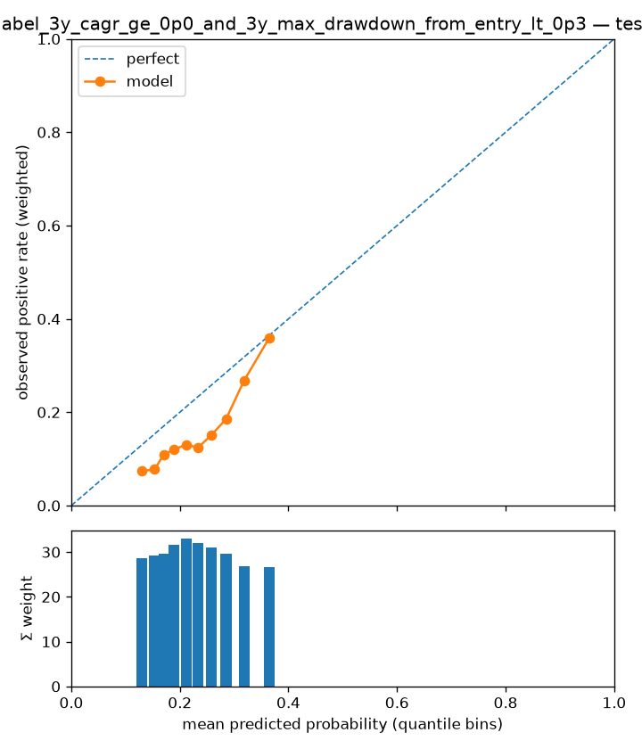

# Experiment report — forest_fresh70_cells_3y__label_3y_cagr_ge_0p0_and_3y_max_drawdown_from_entry_lt_0p3

- run id: `b4761e624f82`
- dataset version: `1.4.1` (pinned, immutable)
- dataset sha256: `be2b664c6739b93d5b5a7df1d085c09f09575071dd02d1f1426ed1586e052085` (dataset.parquet, from the manifest's provenance block)
- config hash: `dd4ddbd0a7ea4ffa`
- git SHA: `f24b95eda15ff2283e1ea10025a00b1f1aac57b0`
- seed: 23
- model: `random_forest` params `{"bootstrap": true, "class_weight": 1.0, "criterion": "entropy", "max_depth": 4, "max_features": 0.205191, "max_samples": 0.663781, "min_samples_leaf": 72, "n_estimators": 490, "n_jobs": 8}`
- label: `fwd_3y_cagr >= 0.0 & fwd_3y_max_drawdown_from_entry < 0.3` — horizon 3y, scheme `walkforward`
- derived label `fwd_3y_cagr >= 0.0 & fwd_3y_max_drawdown_from_entry < 0.3`: evaluated on the fly from the manifest's continuous outcome columns (harness.derived_labels); NULL wherever a referenced column is NULL
- **universe: `dist_52w_high <= -0.7 & dollar_volume_3m >= 100000`** — train and test rows outside it are left out (a row with a NULL in a filter column is outside). Every number below describes this universe: base rates, baselines and picks are not comparable with a run over all rows, and the run is counted in the universe's own ledger cell. The filter reads feature columns as of the snapshot; it builds no split (upstream tags decide train and test, the purge and embargo hold for the rows that remain) and derives no column. `sample_weight` is the upstream uniqueness weight, not recomputed for the rows left out.
- **configurations tried against this cell (dataset, scheme, horizon, label, universe): 1** (from the append-only results store; failed runs count); **67 against this label in any universe**
- saved model bundle: `experiments/models/forest_fresh70_cells_3y__label_3y_cagr_ge_0p0_and_3y_max_drawdown_from_entry_lt_0p3_b4761e624f82` (re-evaluate with `vml-eval`, no refitting)

## Era-sliced metrics (one row per test year)

Sliced on the calendar year of each test row's `snapshot_date` (one walk-forward fold per year); crash eras are tagged inline. `conf_at_K` is the mean score of the top-K picks; `base_rate_brier` is the no-skill Brier the model must beat. \*The pooled row picks per year — per-fold model scores are not comparable, so a global top-K would just take the hottest-scoring fold's picks; it is context for the era rows, never a stand-alone result. ROC-AUC and recall@K are logged in the results store, not shown here.

| era          | n_test | base_rate | mean_score | precision_at_20 | precision_at_50 | precision_at_thr_0.5 | precision_at_thr_0.6 | precision_at_thr_0.7 | conf_at_20 | conf_at_50 | n_at_prec_0.75 | n_at_prec_0.9 | recall_at_prec_0.75 | recall_at_prec_0.9 | recall_at_thr_0.5 | recall_at_thr_0.6 | recall_at_thr_0.7 | n_at_thr_0.5 | n_at_thr_0.6 | n_at_thr_0.7 | brier  | base_rate_brier | pr_auc |
| ------------ | ------ | --------- | ---------- | --------------- | --------------- | -------------------- | -------------------- | -------------------- | ---------- | ---------- | -------------- | ------------- | ------------------- | ------------------ | ----------------- | ----------------- | ----------------- | ------------ | ------------ | ------------ | ------ | --------------- | ------ |
| 2005         | 346    | 0.1316    | 0.1825     | 0.1500          | 0.1200          | —                    | —                    | —                    | 0.2581     | 0.2434     | 0              | 0             | 0                   | 0                  | 0                 | 0                 | 0                 | 0            | 0            | 0            | 0.1161 | 0.1143          | 0.1501 |
| 2006         | 228    | 0.0704    | 0.1975     | 0.1000          | 0.0600          | —                    | —                    | —                    | 0.2702     | 0.2541     | 0              | 0             | 0                   | 0                  | 0                 | 0                 | 0                 | 0            | 0            | 0            | 0.0817 | 0.0655          | 0.0997 |
| 2007         | 290    | 0.0273    | 0.2324     | 0               | 0.0200          | —                    | —                    | —                    | 0.3247     | 0.3046     | 0              | 0             | 0                   | 0                  | 0                 | 0                 | 0                 | 0            | 0            | 0            | 0.0712 | 0.0266          | 0.0320 |
| 2008 (GFC)   | 1327   | 0.1204    | 0.2793     | 0.1500          | 0.1200          | —                    | —                    | —                    | 0.3925     | 0.3840     | 2              | 2             | 0.0130              | 0.0130             | 0                 | 0                 | 0                 | 0            | 0            | 0            | 0.1330 | 0.1059          | 0.1554 |
| 2009 (GFC)   | 1295   | 0.4078    | 0.2959     | 0.5000          | 0.4800          | —                    | —                    | —                    | 0.3920     | 0.3863     | 0              | 0             | 0                   | 0                  | 0                 | 0                 | 0                 | 0            | 0            | 0            | 0.2453 | 0.2415          | 0.4891 |
| 2010         | 193    | 0.0924    | 0.2137     | 0.2000          | 0.1800          | —                    | —                    | —                    | 0.2917     | 0.2708     | 0              | 0             | 0                   | 0                  | 0                 | 0                 | 0                 | 0            | 0            | 0            | 0.0968 | 0.0838          | 0.2049 |
| 2011         | 296    | 0.1094    | 0.2101     | 0.1500          | 0.1000          | —                    | —                    | —                    | 0.3113     | 0.2921     | 0              | 0             | 0                   | 0                  | 0                 | 0                 | 0                 | 0            | 0            | 0            | 0.1080 | 0.0974          | 0.1331 |
| 2012         | 338    | 0.2295    | 0.2048     | 0.2000          | 0.2600          | —                    | —                    | —                    | 0.3076     | 0.2897     | 0              | 0             | 0                   | 0                  | 0                 | 0                 | 0                 | 0            | 0            | 0            | 0.1759 | 0.1768          | 0.2777 |
| 2013         | 187    | 0.1162    | 0.1942     | 0.1000          | 0.1000          | —                    | —                    | —                    | 0.2951     | 0.2624     | 0              | 0             | 0                   | 0                  | 0                 | 0                 | 0                 | 0            | 0            | 0            | 0.1135 | 0.1027          | 0.1136 |
| 2014         | 253    | 0.0453    | 0.1897     | 0.0500          | 0.0400          | —                    | —                    | —                    | 0.3201     | 0.2741     | 0              | 0             | 0                   | 0                  | 0                 | 0                 | 0                 | 0            | 0            | 0            | 0.0678 | 0.0433          | 0.0599 |
| 2015         | 623    | 0.0576    | 0.2256     | 0.0500          | 0.1000          | —                    | —                    | —                    | 0.3768     | 0.3570     | 0              | 0             | 0                   | 0                  | 0                 | 0                 | 0                 | 0            | 0            | 0            | 0.0876 | 0.0543          | 0.0607 |
| 2016         | 768    | 0.1960    | 0.2173     | 0.5000          | 0.5000          | —                    | —                    | —                    | 0.4144     | 0.3872     | 0              | 0             | 0                   | 0                  | 0                 | 0                 | 0                 | 0            | 0            | 0            | 0.1570 | 0.1576          | 0.2710 |
| 2017         | 515    | 0.0896    | 0.1940     | 0.0500          | 0.0600          | —                    | —                    | —                    | 0.3607     | 0.3239     | 0              | 0             | 0                   | 0                  | 0                 | 0                 | 0                 | 0            | 0            | 0            | 0.0972 | 0.0816          | 0.0802 |
| 2018         | 563    | 0.0587    | 0.1837     | 0.1000          | 0.1000          | —                    | —                    | —                    | 0.3263     | 0.2967     | 0              | 0             | 0                   | 0                  | 0                 | 0                 | 0                 | 0            | 0            | 0            | 0.0712 | 0.0552          | 0.0978 |
| 2019         | 938    | 0.0775    | 0.2012     | 0.1500          | 0.1000          | —                    | —                    | —                    | 0.3848     | 0.3552     | 0              | 0             | 0                   | 0                  | 0                 | 0                 | 0                 | 0            | 0            | 0            | 0.0896 | 0.0715          | 0.0876 |
| 2020 (COVID) | 998    | 0.2058    | 0.2265     | 0.7000          | 0.6800          | 0                    | —                    | —                    | 0.4666     | 0.4324     | 13             | 0             | 0.0463              | 0                  | 0                 | 0                 | 0                 | 1            | 0            | 0            | 0.1454 | 0.1635          | 0.4762 |
| pooled*      | 9158   | 0.1564    | 0.2293     | 0.1969          | 0.1888          | 0                    | —                    | —                    | 0.3433     | 0.3196     | 15             | 2             | 0.0084              | 0.0014             | 0                 | 0                 | 0                 | 1            | 0            | 0            | 0.1312 | 0.1319          | 0.2797 |

## High-confidence picks (pooled)

How many high-confidence calls the model made, how confident it was, and how precise they were — no pre-chosen score threshold needed. `top N/yr` rows pick per test year; `score >= p` rows (probabilistic models) count every name at or above that probability, pooled.

| selection    | n_picks | picks_per_year | mean_score | precision | hits |
| ------------ | ------- | -------------- | ---------- | --------- | ---- |
| top 5/yr     | 80      | 5              | 0.3666     | 0.1875    | 15   |
| top 10/yr    | 160     | 10             | 0.3560     | 0.2188    | 35   |
| top 20/yr    | 320     | 20             | 0.3433     | 0.1969    | 63   |
| top 50/yr    | 800     | 50             | 0.3196     | 0.1888    | 151  |
| score >= 0.9 | 0       | 0              | —          | —         | 0    |
| score >= 0.8 | 0       | 0              | —          | —         | 0    |
| score >= 0.7 | 0       | 0              | —          | —         | 0    |
| score >= 0.6 | 0       | 0              | —          | —         | 0    |
| score >= 0.5 | 1       | 0.1000         | 0.5011     | 0         | 0    |

## Pick outcomes (what the picks went on to do)

Report-only outcomes of the top-K picks of each test year (`pick_outcomes`: `label_3y_beat_spy`, `fwd_3y_excess_cagr`, `fwd_3y_cagr`, `fwd_3y_max_drawdown_from_entry`, `fwd_3y_cagr < 0.0`, `fwd_3y_cagr < -0.1`, `fwd_3y_max_drawdown_from_entry >= 0.4`, `fwd_3y_cagr >= 0.15`, `fwd_3y_cagr >= 0.26`, `fwd_3y_excess_cagr >= 0.05`, `fwd_3y_excess_cagr >= 0.1`), from the manifest's label columns; none is a model input or the training target, and the run is counted in its own label's cell. For a binary outcome the picks' hit rate, for a continuous one their mean and median, each beside the same statistic over **all** test rows of the era (unweighted, like the picks: one row, one pick). `stocks` is the number of distinct `permaticker`s among the picks (a stock has up to four test rows a year); in the pooled row it is the mean per year and the statistics run over every year's picks. NULL outcomes are left out, not counted as misses. This is a no-cost, equal-weight reading of the picks, a screen for `vml-backtest` and not a substitute.

### Top 20 per test year: `label_3y_beat_spy`

| era          | picks | stocks  | picks hit rate | all rows |
| ------------ | ----- | ------- | -------------- | -------- |
| 2005         | 20    | 17      | 0.4000         | 0.2052   |
| 2006         | 20    | 14      | 0.4000         | 0.1974   |
| 2007         | 20    | 18      | 0.1500         | 0.2241   |
| 2008 (GFC)   | 20    | 19      | 0.6500         | 0.4808   |
| 2009 (GFC)   | 20    | 20      | 0.8000         | 0.5784   |
| 2010         | 20    | 16      | 0.2500         | 0.1606   |
| 2011         | 20    | 17      | 0.2500         | 0.1622   |
| 2012         | 20    | 15      | 0.1000         | 0.2337   |
| 2013         | 20    | 17      | 0.2000         | 0.1818   |
| 2014         | 20    | 17      | 0.1500         | 0.0791   |
| 2015         | 20    | 19      | 0.2000         | 0.1364   |
| 2016         | 20    | 17      | 0.5000         | 0.2370   |
| 2017         | 20    | 13      | 0.1000         | 0.1495   |
| 2018         | 20    | 17      | 0.1500         | 0.1687   |
| 2019         | 20    | 17      | 0.2000         | 0.1748   |
| 2020 (COVID) | 20    | 20      | 0.3500         | 0.2936   |
| pooled*      | 320   | 17.0625 | 0.3031         | 0.2922   |

### Top 20 per test year: `fwd_3y_excess_cagr`

| era          | picks | stocks  | picks mean | picks median | all rows mean | all rows median |
| ------------ | ----- | ------- | ---------- | ------------ | ------------- | --------------- |
| 2005         | 20    | 17      | -0.1096    | -0.0500      | -0.3118       | -0.3383         |
| 2006         | 20    | 14      | -0.0819    | -0.0594      | -0.2951       | -0.3163         |
| 2007         | 20    | 18      | -0.3357    | -0.3401      | -0.3193       | -0.3547         |
| 2008 (GFC)   | 20    | 19      | 0.1250     | 0.1420       | -0.0446       | -0.0162         |
| 2009 (GFC)   | 20    | 20      | 0.2334     | 0.2089       | 0.0601        | 0.0822          |
| 2010         | 20    | 16      | -0.2035    | -0.1794      | -0.4165       | -0.4683         |
| 2011         | 20    | 17      | -0.2636    | -0.2635      | -0.4275       | -0.4326         |
| 2012         | 20    | 15      | -0.3161    | -0.2051      | -0.3136       | -0.2764         |
| 2013         | 20    | 17      | -0.4343    | -0.5190      | -0.3937       | -0.4777         |
| 2014         | 20    | 17      | -0.5237    | -0.5818      | -0.5271       | -0.6060         |
| 2015         | 20    | 19      | -0.2455    | -0.2008      | -0.4543       | -0.4805         |
| 2016         | 20    | 17      | -0.1009    | -0.0046      | -0.3430       | -0.4101         |
| 2017         | 20    | 13      | -0.4397    | -0.5465      | -0.4445       | -0.5297         |
| 2018         | 20    | 17      | -0.4071    | -0.3371      | -0.4277       | -0.5044         |
| 2019         | 20    | 17      | -0.1336    | -0.1757      | -0.3751       | -0.4615         |
| 2020 (COVID) | 20    | 20      | -0.0098    | -0.0398      | -0.2132       | -0.3123         |
| pooled*      | 320   | 17.0625 | -0.2029    | -0.1500      | -0.2566       | -0.3012         |

### Top 20 per test year: `fwd_3y_cagr`

| era          | picks | stocks  | picks mean | picks median | all rows mean | all rows median |
| ------------ | ----- | ------- | ---------- | ------------ | ------------- | --------------- |
| 2005         | 20    | 17      | -0.0649    | -0.0273      | -0.2784       | -0.3042         |
| 2006         | 20    | 14      | -0.1735    | -0.1734      | -0.3794       | -0.4033         |
| 2007         | 20    | 18      | -0.3893    | -0.3833      | -0.3804       | -0.4150         |
| 2008 (GFC)   | 20    | 19      | 0.2533     | 0.2914       | 0.0374        | 0.0719          |
| 2009 (GFC)   | 20    | 20      | 0.4360     | 0.4329       | 0.2398        | 0.2622          |
| 2010         | 20    | 16      | -0.0522    | -0.0161      | -0.2640       | -0.3167         |
| 2011         | 20    | 17      | -0.0748    | -0.0551      | -0.2445       | -0.2653         |
| 2012         | 20    | 15      | -0.1397    | -0.0468      | -0.1424       | -0.1139         |
| 2013         | 20    | 17      | -0.3199    | -0.3945      | -0.2879       | -0.3700         |
| 2014         | 20    | 17      | -0.4212    | -0.4799      | -0.4229       | -0.5056         |
| 2015         | 20    | 19      | -0.1243    | -0.0882      | -0.3317       | -0.3620         |
| 2016         | 20    | 17      | 0.0308     | 0.1273       | -0.2091       | -0.2746         |
| 2017         | 20    | 13      | -0.3238    | -0.4112      | -0.3317       | -0.4226         |
| 2018         | 20    | 17      | -0.2408    | -0.1524      | -0.2507       | -0.3267         |
| 2019         | 20    | 17      | 0.0017     | -0.0233      | -0.2330       | -0.3169         |
| 2020 (COVID) | 20    | 20      | 0.1301     | 0.0993       | -0.0984       | -0.2008         |
| pooled*      | 320   | 17.0625 | -0.0920    | -0.0303      | -0.1377       | -0.1873         |

### Top 20 per test year: `fwd_3y_max_drawdown_from_entry`

| era          | picks | stocks  | picks mean | picks median | all rows mean | all rows median |
| ------------ | ----- | ------- | ---------- | ------------ | ------------- | --------------- |
| 2005         | 20    | 17      | 0.5285     | 0.5462       | 0.6797        | 0.7663          |
| 2006         | 20    | 14      | 0.6797     | 0.7916       | 0.7882        | 0.9095          |
| 2007         | 20    | 18      | 0.8944     | 0.9531       | 0.8458        | 0.9383          |
| 2008 (GFC)   | 20    | 19      | 0.4450     | 0.3887       | 0.6488        | 0.6718          |
| 2009 (GFC)   | 20    | 20      | 0.3025     | 0.2677       | 0.4095        | 0.3432          |
| 2010         | 20    | 16      | 0.5394     | 0.4795       | 0.7173        | 0.8103          |
| 2011         | 20    | 17      | 0.5826     | 0.5817       | 0.7108        | 0.8047          |
| 2012         | 20    | 15      | 0.5496     | 0.4803       | 0.6024        | 0.6307          |
| 2013         | 20    | 17      | 0.7312     | 0.8534       | 0.7171        | 0.8145          |
| 2014         | 20    | 17      | 0.8180     | 0.9383       | 0.8121        | 0.9192          |
| 2015         | 20    | 19      | 0.6661     | 0.7211       | 0.7815        | 0.8631          |
| 2016         | 20    | 17      | 0.3701     | 0.2772       | 0.6619        | 0.7619          |
| 2017         | 20    | 13      | 0.7750     | 0.8728       | 0.7827        | 0.8945          |
| 2018         | 20    | 17      | 0.7810     | 0.8393       | 0.7899        | 0.8794          |
| 2019         | 20    | 17      | 0.5586     | 0.5843       | 0.7478        | 0.8346          |
| 2020 (COVID) | 20    | 20      | 0.2982     | 0.2295       | 0.6251        | 0.7127          |
| pooled*      | 320   | 17.0625 | 0.5950     | 0.6123       | 0.6674        | 0.7579          |

### Top 20 per test year: `label_3y_cagr_lt_0p0`

| era          | picks | stocks  | picks hit rate | all rows |
| ------------ | ----- | ------- | -------------- | -------- |
| 2005         | 20    | 17      | 0.6500         | 0.7601   |
| 2006         | 20    | 14      | 0.7000         | 0.8553   |
| 2007         | 20    | 18      | 0.9000         | 0.8207   |
| 2008 (GFC)   | 20    | 19      | 0.2500         | 0.4371   |
| 2009 (GFC)   | 20    | 20      | 0.0500         | 0.2834   |
| 2010         | 20    | 16      | 0.5500         | 0.7617   |
| 2011         | 20    | 17      | 0.5500         | 0.7331   |
| 2012         | 20    | 15      | 0.5500         | 0.6036   |
| 2013         | 20    | 17      | 0.7000         | 0.7701   |
| 2014         | 20    | 17      | 0.8000         | 0.8854   |
| 2015         | 20    | 19      | 0.5500         | 0.7865   |
| 2016         | 20    | 17      | 0.4000         | 0.6758   |
| 2017         | 20    | 13      | 0.8000         | 0.7961   |
| 2018         | 20    | 17      | 0.6000         | 0.7371   |
| 2019         | 20    | 17      | 0.5500         | 0.7484   |
| 2020 (COVID) | 20    | 20      | 0.2000         | 0.6222   |
| pooled*      | 320   | 17.0625 | 0.5500         | 0.6263   |

### Top 20 per test year: `label_3y_cagr_lt_m0p1`

| era          | picks | stocks  | picks hit rate | all rows |
| ------------ | ----- | ------- | -------------- | -------- |
| 2005         | 20    | 17      | 0.3500         | 0.6561   |
| 2006         | 20    | 14      | 0.6000         | 0.7895   |
| 2007         | 20    | 18      | 0.8500         | 0.7724   |
| 2008 (GFC)   | 20    | 19      | 0.1500         | 0.3572   |
| 2009 (GFC)   | 20    | 20      | 0              | 0.2394   |
| 2010         | 20    | 16      | 0.3000         | 0.6632   |
| 2011         | 20    | 17      | 0.4500         | 0.6520   |
| 2012         | 20    | 15      | 0.4000         | 0.5059   |
| 2013         | 20    | 17      | 0.7000         | 0.7273   |
| 2014         | 20    | 17      | 0.7500         | 0.7905   |
| 2015         | 20    | 19      | 0.5000         | 0.7063   |
| 2016         | 20    | 17      | 0.2500         | 0.6198   |
| 2017         | 20    | 13      | 0.7000         | 0.7437   |
| 2018         | 20    | 17      | 0.5000         | 0.6767   |
| 2019         | 20    | 17      | 0.4000         | 0.6674   |
| 2020 (COVID) | 20    | 20      | 0.2000         | 0.5671   |
| pooled*      | 320   | 17.0625 | 0.4437         | 0.5585   |

### Top 20 per test year: `label_3y_max_drawdown_from_entry_ge_0p4`

| era          | picks | stocks  | picks hit rate | all rows |
| ------------ | ----- | ------- | -------------- | -------- |
| 2005         | 20    | 17      | 0.7000         | 0.7746   |
| 2006         | 20    | 14      | 0.8000         | 0.8772   |
| 2007         | 20    | 18      | 1              | 0.9379   |
| 2008 (GFC)   | 20    | 19      | 0.4000         | 0.7958   |
| 2009 (GFC)   | 20    | 20      | 0.2500         | 0.4178   |
| 2010         | 20    | 16      | 0.5500         | 0.7979   |
| 2011         | 20    | 17      | 0.6000         | 0.8176   |
| 2012         | 20    | 15      | 0.7000         | 0.6598   |
| 2013         | 20    | 17      | 0.8000         | 0.7968   |
| 2014         | 20    | 17      | 0.9000         | 0.9130   |
| 2015         | 20    | 19      | 0.8500         | 0.9037   |
| 2016         | 20    | 17      | 0.3000         | 0.7409   |
| 2017         | 20    | 13      | 0.8500         | 0.8796   |
| 2018         | 20    | 17      | 0.9000         | 0.9147   |
| 2019         | 20    | 17      | 0.8500         | 0.8795   |
| 2020 (COVID) | 20    | 20      | 0.2000         | 0.6974   |
| pooled*      | 320   | 17.0625 | 0.6656         | 0.7597   |

### Top 20 per test year: `label_3y_cagr_ge_0p15`

| era          | picks | stocks  | picks hit rate | all rows |
| ------------ | ----- | ------- | -------------- | -------- |
| 2005         | 20    | 17      | 0.2500         | 0.1358   |
| 2006         | 20    | 14      | 0.2000         | 0.0702   |
| 2007         | 20    | 18      | 0.1000         | 0.0931   |
| 2008 (GFC)   | 20    | 19      | 0.6500         | 0.4220   |
| 2009 (GFC)   | 20    | 20      | 0.9500         | 0.6023   |
| 2010         | 20    | 16      | 0.2500         | 0.1606   |
| 2011         | 20    | 17      | 0.3500         | 0.1926   |
| 2012         | 20    | 15      | 0.1500         | 0.2396   |
| 2013         | 20    | 17      | 0.1500         | 0.1658   |
| 2014         | 20    | 17      | 0.1000         | 0.0672   |
| 2015         | 20    | 19      | 0.1500         | 0.1220   |
| 2016         | 20    | 17      | 0.4500         | 0.2214   |
| 2017         | 20    | 13      | 0.1000         | 0.1398   |
| 2018         | 20    | 17      | 0.1500         | 0.1812   |
| 2019         | 20    | 17      | 0.2000         | 0.1674   |
| 2020 (COVID) | 20    | 20      | 0.3000         | 0.2776   |
| pooled*      | 320   | 17.0625 | 0.2812         | 0.2731   |

### Top 20 per test year: `label_3y_cagr_ge_0p26`

| era          | picks | stocks  | picks hit rate | all rows |
| ------------ | ----- | ------- | -------------- | -------- |
| 2005         | 20    | 17      | 0.2000         | 0.0983   |
| 2006         | 20    | 14      | 0.1500         | 0.0439   |
| 2007         | 20    | 18      | 0.1000         | 0.0552   |
| 2008 (GFC)   | 20    | 19      | 0.5500         | 0.3286   |
| 2009 (GFC)   | 20    | 20      | 0.7500         | 0.5012   |
| 2010         | 20    | 16      | 0.1500         | 0.1192   |
| 2011         | 20    | 17      | 0.2500         | 0.1453   |
| 2012         | 20    | 15      | 0.1000         | 0.2041   |
| 2013         | 20    | 17      | 0.1000         | 0.1283   |
| 2014         | 20    | 17      | 0.1000         | 0.0474   |
| 2015         | 20    | 19      | 0              | 0.0754   |
| 2016         | 20    | 17      | 0.1000         | 0.1562   |
| 2017         | 20    | 13      | 0.1000         | 0.0893   |
| 2018         | 20    | 17      | 0.1500         | 0.1332   |
| 2019         | 20    | 17      | 0.2000         | 0.1301   |
| 2020 (COVID) | 20    | 20      | 0.3000         | 0.2265   |
| pooled*      | 320   | 17.0625 | 0.2062         | 0.2131   |

### Top 20 per test year: `label_3y_excess_cagr_ge_0p05`

| era          | picks | stocks  | picks hit rate | all rows |
| ------------ | ----- | ------- | -------------- | -------- |
| 2005         | 20    | 17      | 0.3000         | 0.1734   |
| 2006         | 20    | 14      | 0.3500         | 0.1711   |
| 2007         | 20    | 18      | 0.1000         | 0.1828   |
| 2008 (GFC)   | 20    | 19      | 0.6500         | 0.4371   |
| 2009 (GFC)   | 20    | 20      | 0.7500         | 0.5305   |
| 2010         | 20    | 16      | 0.2000         | 0.1554   |
| 2011         | 20    | 17      | 0.2500         | 0.1453   |
| 2012         | 20    | 15      | 0.1000         | 0.2101   |
| 2013         | 20    | 17      | 0.1500         | 0.1658   |
| 2014         | 20    | 17      | 0.1000         | 0.0711   |
| 2015         | 20    | 19      | 0.1000         | 0.1108   |
| 2016         | 20    | 17      | 0.4500         | 0.1966   |
| 2017         | 20    | 13      | 0.1000         | 0.1301   |
| 2018         | 20    | 17      | 0.1500         | 0.1456   |
| 2019         | 20    | 17      | 0.2000         | 0.1578   |
| 2020 (COVID) | 20    | 20      | 0.3000         | 0.2675   |
| pooled*      | 320   | 17.0625 | 0.2656         | 0.2616   |

### Top 20 per test year: `label_3y_excess_cagr_ge_0p1`

| era          | picks | stocks  | picks hit rate | all rows |
| ------------ | ----- | ------- | -------------- | -------- |
| 2005         | 20    | 17      | 0.3000         | 0.1416   |
| 2006         | 20    | 14      | 0.2500         | 0.1316   |
| 2007         | 20    | 18      | 0.1000         | 0.1655   |
| 2008 (GFC)   | 20    | 19      | 0.6500         | 0.3881   |
| 2009 (GFC)   | 20    | 20      | 0.7500         | 0.4826   |
| 2010         | 20    | 16      | 0.1500         | 0.1192   |
| 2011         | 20    | 17      | 0.2500         | 0.1419   |
| 2012         | 20    | 15      | 0.1000         | 0.2041   |
| 2013         | 20    | 17      | 0.1500         | 0.1497   |
| 2014         | 20    | 17      | 0.1000         | 0.0553   |
| 2015         | 20    | 19      | 0.0500         | 0.0803   |
| 2016         | 20    | 17      | 0.1500         | 0.1693   |
| 2017         | 20    | 13      | 0.1000         | 0.1068   |
| 2018         | 20    | 17      | 0.1500         | 0.1279   |
| 2019         | 20    | 17      | 0.2000         | 0.1365   |
| 2020 (COVID) | 20    | 20      | 0.3000         | 0.2465   |
| pooled*      | 320   | 17.0625 | 0.2344         | 0.2319   |

### Top 50 per test year: `label_3y_beat_spy`

| era          | picks | stocks  | picks hit rate | all rows |
| ------------ | ----- | ------- | -------------- | -------- |
| 2005         | 50    | 36      | 0.3000         | 0.2052   |
| 2006         | 50    | 32      | 0.2200         | 0.1974   |
| 2007         | 50    | 43      | 0.2600         | 0.2241   |
| 2008 (GFC)   | 50    | 47      | 0.6800         | 0.4808   |
| 2009 (GFC)   | 50    | 49      | 0.7800         | 0.5784   |
| 2010         | 50    | 35      | 0.2000         | 0.1606   |
| 2011         | 50    | 38      | 0.2200         | 0.1622   |
| 2012         | 50    | 33      | 0.2800         | 0.2337   |
| 2013         | 50    | 38      | 0.1400         | 0.1818   |
| 2014         | 50    | 38      | 0.0800         | 0.0791   |
| 2015         | 50    | 37      | 0.1800         | 0.1364   |
| 2016         | 50    | 41      | 0.4400         | 0.2370   |
| 2017         | 50    | 33      | 0.1000         | 0.1495   |
| 2018         | 50    | 36      | 0.2600         | 0.1687   |
| 2019         | 50    | 42      | 0.2200         | 0.1748   |
| 2020 (COVID) | 50    | 47      | 0.4600         | 0.2936   |
| pooled*      | 800   | 39.0625 | 0.3013         | 0.2922   |

### Top 50 per test year: `fwd_3y_excess_cagr`

| era          | picks | stocks  | picks mean | picks median | all rows mean | all rows median |
| ------------ | ----- | ------- | ---------- | ------------ | ------------- | --------------- |
| 2005         | 50    | 36      | -0.1982    | -0.1338      | -0.3118       | -0.3383         |
| 2006         | 50    | 32      | -0.2705    | -0.3366      | -0.2951       | -0.3163         |
| 2007         | 50    | 43      | -0.3309    | -0.3401      | -0.3193       | -0.3547         |
| 2008 (GFC)   | 50    | 47      | 0.1184     | 0.1377       | -0.0446       | -0.0162         |
| 2009 (GFC)   | 50    | 49      | 0.2504     | 0.2190       | 0.0601        | 0.0822          |
| 2010         | 50    | 35      | -0.3767    | -0.3004      | -0.4165       | -0.4683         |
| 2011         | 50    | 38      | -0.3269    | -0.3203      | -0.4275       | -0.4326         |
| 2012         | 50    | 33      | -0.2168    | -0.1340      | -0.3136       | -0.2764         |
| 2013         | 50    | 38      | -0.4751    | -0.5454      | -0.3937       | -0.4777         |
| 2014         | 50    | 38      | -0.5888    | -0.7231      | -0.5271       | -0.6060         |
| 2015         | 50    | 37      | -0.2872    | -0.1755      | -0.4543       | -0.4805         |
| 2016         | 50    | 41      | -0.1359    | -0.0510      | -0.3430       | -0.4101         |
| 2017         | 50    | 33      | -0.4606    | -0.4753      | -0.4445       | -0.5297         |
| 2018         | 50    | 36      | -0.2890    | -0.2508      | -0.4277       | -0.5044         |
| 2019         | 50    | 42      | -0.1851    | -0.1751      | -0.3751       | -0.4615         |
| 2020 (COVID) | 50    | 47      | 0.0636     | -0.0070      | -0.2132       | -0.3123         |
| pooled*      | 800   | 39.0625 | -0.2318    | -0.1911      | -0.2566       | -0.3012         |

### Top 50 per test year: `fwd_3y_cagr`

| era          | picks | stocks  | picks mean | picks median | all rows mean | all rows median |
| ------------ | ----- | ------- | ---------- | ------------ | ------------- | --------------- |
| 2005         | 50    | 36      | -0.1708    | -0.0906      | -0.2784       | -0.3042         |
| 2006         | 50    | 32      | -0.3559    | -0.4075      | -0.3794       | -0.4033         |
| 2007         | 50    | 43      | -0.3878    | -0.3833      | -0.3804       | -0.4150         |
| 2008 (GFC)   | 50    | 47      | 0.2314     | 0.2476       | 0.0374        | 0.0719          |
| 2009 (GFC)   | 50    | 49      | 0.4452     | 0.4467       | 0.2398        | 0.2622          |
| 2010         | 50    | 35      | -0.2202    | -0.1466      | -0.2640       | -0.3167         |
| 2011         | 50    | 38      | -0.1367    | -0.1521      | -0.2445       | -0.2653         |
| 2012         | 50    | 33      | -0.0434    | 0.0391       | -0.1424       | -0.1139         |
| 2013         | 50    | 38      | -0.3641    | -0.4188      | -0.2879       | -0.3700         |
| 2014         | 50    | 38      | -0.4857    | -0.6218      | -0.4229       | -0.5056         |
| 2015         | 50    | 37      | -0.1645    | -0.0696      | -0.3317       | -0.3620         |
| 2016         | 50    | 41      | -0.0038    | 0.0778       | -0.2091       | -0.2746         |
| 2017         | 50    | 33      | -0.3442    | -0.3622      | -0.3317       | -0.4226         |
| 2018         | 50    | 36      | -0.1134    | -0.0759      | -0.2507       | -0.3267         |
| 2019         | 50    | 42      | -0.0572    | -0.0538      | -0.2330       | -0.3169         |
| 2020 (COVID) | 50    | 47      | 0.2020     | 0.1349       | -0.0984       | -0.2008         |
| pooled*      | 800   | 39.0625 | -0.1231    | -0.0750      | -0.1377       | -0.1873         |

### Top 50 per test year: `fwd_3y_max_drawdown_from_entry`

| era          | picks | stocks  | picks mean | picks median | all rows mean | all rows median |
| ------------ | ----- | ------- | ---------- | ------------ | ------------- | --------------- |
| 2005         | 50    | 36      | 0.6063     | 0.6713       | 0.6797        | 0.7663          |
| 2006         | 50    | 32      | 0.7878     | 0.9028       | 0.7882        | 0.9095          |
| 2007         | 50    | 43      | 0.8293     | 0.9340       | 0.8458        | 0.9383          |
| 2008 (GFC)   | 50    | 47      | 0.5014     | 0.4620       | 0.6488        | 0.6718          |
| 2009 (GFC)   | 50    | 49      | 0.3040     | 0.2925       | 0.4095        | 0.3432          |
| 2010         | 50    | 35      | 0.6253     | 0.6931       | 0.7173        | 0.8103          |
| 2011         | 50    | 38      | 0.6467     | 0.7188       | 0.7108        | 0.8047          |
| 2012         | 50    | 33      | 0.4964     | 0.4098       | 0.6024        | 0.6307          |
| 2013         | 50    | 38      | 0.7533     | 0.8809       | 0.7171        | 0.8145          |
| 2014         | 50    | 38      | 0.8330     | 0.9633       | 0.8121        | 0.9192          |
| 2015         | 50    | 37      | 0.6541     | 0.7187       | 0.7815        | 0.8631          |
| 2016         | 50    | 41      | 0.3926     | 0.2572       | 0.6619        | 0.7619          |
| 2017         | 50    | 33      | 0.7818     | 0.8580       | 0.7827        | 0.8945          |
| 2018         | 50    | 36      | 0.7382     | 0.7763       | 0.7899        | 0.8794          |
| 2019         | 50    | 42      | 0.6554     | 0.6522       | 0.7478        | 0.8346          |
| 2020 (COVID) | 50    | 47      | 0.2963     | 0.2401       | 0.6251        | 0.7127          |
| pooled*      | 800   | 39.0625 | 0.6189     | 0.6559       | 0.6674        | 0.7579          |

### Top 50 per test year: `label_3y_cagr_lt_0p0`

| era          | picks | stocks  | picks hit rate | all rows |
| ------------ | ----- | ------- | -------------- | -------- |
| 2005         | 50    | 36      | 0.6600         | 0.7601   |
| 2006         | 50    | 32      | 0.8200         | 0.8553   |
| 2007         | 50    | 43      | 0.8200         | 0.8207   |
| 2008 (GFC)   | 50    | 47      | 0.2400         | 0.4371   |
| 2009 (GFC)   | 50    | 49      | 0.0200         | 0.2834   |
| 2010         | 50    | 35      | 0.6800         | 0.7617   |
| 2011         | 50    | 38      | 0.6400         | 0.7331   |
| 2012         | 50    | 33      | 0.4400         | 0.6036   |
| 2013         | 50    | 38      | 0.7800         | 0.7701   |
| 2014         | 50    | 38      | 0.8400         | 0.8854   |
| 2015         | 50    | 37      | 0.6000         | 0.7865   |
| 2016         | 50    | 41      | 0.4200         | 0.6758   |
| 2017         | 50    | 33      | 0.8000         | 0.7961   |
| 2018         | 50    | 36      | 0.5800         | 0.7371   |
| 2019         | 50    | 42      | 0.6000         | 0.7484   |
| 2020 (COVID) | 50    | 47      | 0.2400         | 0.6222   |
| pooled*      | 800   | 39.0625 | 0.5737         | 0.6263   |

### Top 50 per test year: `label_3y_cagr_lt_m0p1`

| era          | picks | stocks  | picks hit rate | all rows |
| ------------ | ----- | ------- | -------------- | -------- |
| 2005         | 50    | 36      | 0.5000         | 0.6561   |
| 2006         | 50    | 32      | 0.7800         | 0.7895   |
| 2007         | 50    | 43      | 0.7400         | 0.7724   |
| 2008 (GFC)   | 50    | 47      | 0.1200         | 0.3572   |
| 2009 (GFC)   | 50    | 49      | 0              | 0.2394   |
| 2010         | 50    | 35      | 0.5400         | 0.6632   |
| 2011         | 50    | 38      | 0.5600         | 0.6520   |
| 2012         | 50    | 33      | 0.3400         | 0.5059   |
| 2013         | 50    | 38      | 0.7200         | 0.7273   |
| 2014         | 50    | 38      | 0.8000         | 0.7905   |
| 2015         | 50    | 37      | 0.4800         | 0.7063   |
| 2016         | 50    | 41      | 0.2800         | 0.6198   |
| 2017         | 50    | 33      | 0.7200         | 0.7437   |
| 2018         | 50    | 36      | 0.4400         | 0.6767   |
| 2019         | 50    | 42      | 0.3800         | 0.6674   |
| 2020 (COVID) | 50    | 47      | 0.1600         | 0.5671   |
| pooled*      | 800   | 39.0625 | 0.4725         | 0.5585   |

### Top 50 per test year: `label_3y_max_drawdown_from_entry_ge_0p4`

| era          | picks | stocks  | picks hit rate | all rows |
| ------------ | ----- | ------- | -------------- | -------- |
| 2005         | 50    | 36      | 0.7600         | 0.7746   |
| 2006         | 50    | 32      | 0.9000         | 0.8772   |
| 2007         | 50    | 43      | 0.9200         | 0.9379   |
| 2008 (GFC)   | 50    | 47      | 0.6200         | 0.7958   |
| 2009 (GFC)   | 50    | 49      | 0.2200         | 0.4178   |
| 2010         | 50    | 35      | 0.6600         | 0.7979   |
| 2011         | 50    | 38      | 0.7400         | 0.8176   |
| 2012         | 50    | 33      | 0.5000         | 0.6598   |
| 2013         | 50    | 38      | 0.8000         | 0.7968   |
| 2014         | 50    | 38      | 0.9200         | 0.9130   |
| 2015         | 50    | 37      | 0.7800         | 0.9037   |
| 2016         | 50    | 41      | 0.3600         | 0.7409   |
| 2017         | 50    | 33      | 0.9000         | 0.8796   |
| 2018         | 50    | 36      | 0.8800         | 0.9147   |
| 2019         | 50    | 42      | 0.8600         | 0.8795   |
| 2020 (COVID) | 50    | 47      | 0.1600         | 0.6974   |
| pooled*      | 800   | 39.0625 | 0.6863         | 0.7597   |

### Top 50 per test year: `label_3y_cagr_ge_0p15`

| era          | picks | stocks  | picks hit rate | all rows |
| ------------ | ----- | ------- | -------------- | -------- |
| 2005         | 50    | 36      | 0.2200         | 0.1358   |
| 2006         | 50    | 32      | 0.1200         | 0.0702   |
| 2007         | 50    | 43      | 0.0800         | 0.0931   |
| 2008 (GFC)   | 50    | 47      | 0.6200         | 0.4220   |
| 2009 (GFC)   | 50    | 49      | 0.8400         | 0.6023   |
| 2010         | 50    | 35      | 0.2000         | 0.1606   |
| 2011         | 50    | 38      | 0.2800         | 0.1926   |
| 2012         | 50    | 33      | 0.3000         | 0.2396   |
| 2013         | 50    | 38      | 0.1200         | 0.1658   |
| 2014         | 50    | 38      | 0.0600         | 0.0672   |
| 2015         | 50    | 37      | 0.1600         | 0.1220   |
| 2016         | 50    | 41      | 0.4000         | 0.2214   |
| 2017         | 50    | 33      | 0.0800         | 0.1398   |
| 2018         | 50    | 36      | 0.2600         | 0.1812   |
| 2019         | 50    | 42      | 0.2400         | 0.1674   |
| 2020 (COVID) | 50    | 47      | 0.4400         | 0.2776   |
| pooled*      | 800   | 39.0625 | 0.2762         | 0.2731   |

### Top 50 per test year: `label_3y_cagr_ge_0p26`

| era          | picks | stocks  | picks hit rate | all rows |
| ------------ | ----- | ------- | -------------- | -------- |
| 2005         | 50    | 36      | 0.1800         | 0.0983   |
| 2006         | 50    | 32      | 0.1000         | 0.0439   |
| 2007         | 50    | 43      | 0.0800         | 0.0552   |
| 2008 (GFC)   | 50    | 47      | 0.4800         | 0.3286   |
| 2009 (GFC)   | 50    | 49      | 0.7600         | 0.5012   |
| 2010         | 50    | 35      | 0.1000         | 0.1192   |
| 2011         | 50    | 38      | 0.2000         | 0.1453   |
| 2012         | 50    | 33      | 0.2400         | 0.2041   |
| 2013         | 50    | 38      | 0.1000         | 0.1283   |
| 2014         | 50    | 38      | 0.0600         | 0.0474   |
| 2015         | 50    | 37      | 0.0200         | 0.0754   |
| 2016         | 50    | 41      | 0.1600         | 0.1562   |
| 2017         | 50    | 33      | 0.0600         | 0.0893   |
| 2018         | 50    | 36      | 0.2000         | 0.1332   |
| 2019         | 50    | 42      | 0.1800         | 0.1301   |
| 2020 (COVID) | 50    | 47      | 0.3800         | 0.2265   |
| pooled*      | 800   | 39.0625 | 0.2062         | 0.2131   |

### Top 50 per test year: `label_3y_excess_cagr_ge_0p05`

| era          | picks | stocks  | picks hit rate | all rows |
| ------------ | ----- | ------- | -------------- | -------- |
| 2005         | 50    | 36      | 0.2600         | 0.1734   |
| 2006         | 50    | 32      | 0.2000         | 0.1711   |
| 2007         | 50    | 43      | 0.2000         | 0.1828   |
| 2008 (GFC)   | 50    | 47      | 0.6000         | 0.4371   |
| 2009 (GFC)   | 50    | 49      | 0.7600         | 0.5305   |
| 2010         | 50    | 35      | 0.1800         | 0.1554   |
| 2011         | 50    | 38      | 0.2000         | 0.1453   |
| 2012         | 50    | 33      | 0.2400         | 0.2101   |
| 2013         | 50    | 38      | 0.1200         | 0.1658   |
| 2014         | 50    | 38      | 0.0600         | 0.0711   |
| 2015         | 50    | 37      | 0.1000         | 0.1108   |
| 2016         | 50    | 41      | 0.3800         | 0.1966   |
| 2017         | 50    | 33      | 0.0600         | 0.1301   |
| 2018         | 50    | 36      | 0.2400         | 0.1456   |
| 2019         | 50    | 42      | 0.2200         | 0.1578   |
| 2020 (COVID) | 50    | 47      | 0.4200         | 0.2675   |
| pooled*      | 800   | 39.0625 | 0.2650         | 0.2616   |

### Top 50 per test year: `label_3y_excess_cagr_ge_0p1`

| era          | picks | stocks  | picks hit rate | all rows |
| ------------ | ----- | ------- | -------------- | -------- |
| 2005         | 50    | 36      | 0.2400         | 0.1416   |
| 2006         | 50    | 32      | 0.1400         | 0.1316   |
| 2007         | 50    | 43      | 0.1600         | 0.1655   |
| 2008 (GFC)   | 50    | 47      | 0.5600         | 0.3881   |
| 2009 (GFC)   | 50    | 49      | 0.7400         | 0.4826   |
| 2010         | 50    | 35      | 0.1000         | 0.1192   |
| 2011         | 50    | 38      | 0.2000         | 0.1419   |
| 2012         | 50    | 33      | 0.2400         | 0.2041   |
| 2013         | 50    | 38      | 0.1200         | 0.1497   |
| 2014         | 50    | 38      | 0.0600         | 0.0553   |
| 2015         | 50    | 37      | 0.0400         | 0.0803   |
| 2016         | 50    | 41      | 0.2000         | 0.1693   |
| 2017         | 50    | 33      | 0.0600         | 0.1068   |
| 2018         | 50    | 36      | 0.2000         | 0.1279   |
| 2019         | 50    | 42      | 0.1800         | 0.1365   |
| 2020 (COVID) | 50    | 47      | 0.3800         | 0.2465   |
| pooled*      | 800   | 39.0625 | 0.2263         | 0.2319   |

## Portfolio screen (capped, periodic picks)

`[pick_screen]`: top 10 per test quarter, at most 2 per `sector`; peers: the test rows of the same quarter in the same of 20 bands of `log_marketcap_rank`. The backtest template's selection rule applied to the test rows (a backtest buys from the latest completed quarter's median snapshots, which are these rows), read on the run's label (`precision`) and on the pick outcomes. Equal weights, no costs, entry at the snapshot, held to the horizon: closer to a portfolio than the top-K-per-year tables, and still a screen for `vml-backtest`, not a substitute. Report-only. The `peers` columns give the same statistic for the picks' peers: the test rows of the same quarter in the same band of `log_marketcap_rank` (20 bands), averaged over the picks. **Read a selection against its peers**: against a capitalization-weighted benchmark small stocks trail by a wide margin in every period, so the all-rows reference of the pick-outcome tables flatters any ranking that prefers large companies.

| era          | picks | stocks | largest group      | its share | precision | precision peers | label_3y_beat_spy hit rate | label_3y_beat_spy peers | fwd_3y_excess_cagr mean | fwd_3y_excess_cagr peers | fwd_3y_excess_cagr median | fwd_3y_cagr mean | fwd_3y_cagr peers | fwd_3y_cagr median | fwd_3y_max_drawdown_from_entry mean | fwd_3y_max_drawdown_from_entry peers | fwd_3y_max_drawdown_from_entry median | label_3y_cagr_lt_0p0 hit rate | label_3y_cagr_lt_0p0 peers | label_3y_cagr_lt_m0p1 hit rate | label_3y_cagr_lt_m0p1 peers | label_3y_max_drawdown_from_entry_ge_0p4 hit rate | label_3y_max_drawdown_from_entry_ge_0p4 peers | label_3y_cagr_ge_0p15 hit rate | label_3y_cagr_ge_0p15 peers | label_3y_cagr_ge_0p26 hit rate | label_3y_cagr_ge_0p26 peers | label_3y_excess_cagr_ge_0p05 hit rate | label_3y_excess_cagr_ge_0p05 peers | label_3y_excess_cagr_ge_0p1 hit rate | label_3y_excess_cagr_ge_0p1 peers |
| ------------ | ----- | ------ | ------------------ | --------- | --------- | --------------- | -------------------------- | ----------------------- | ----------------------- | ------------------------ | ------------------------- | ---------------- | ----------------- | ------------------ | ----------------------------------- | ------------------------------------ | ------------------------------------- | ----------------------------- | -------------------------- | ------------------------------ | --------------------------- | ------------------------------------------------ | --------------------------------------------- | ------------------------------ | --------------------------- | ------------------------------ | --------------------------- | ------------------------------------- | ---------------------------------- | ------------------------------------ | --------------------------------- |
| 2005         | 40    | 27     | Technology         | 0.2000    | 0.1500    | 0.1468          | 0.3500                     | 0.2309                  | -0.2054                 | -0.2540                  | -0.0973                   | -0.1751          | -0.2234           | -0.0555            | 0.6181                              | 0.6480                               | 0.6841                                | 0.6250                        | 0.7196                     | 0.4750                         | 0.6252                      | 0.7500                                           | 0.7637                                        | 0.2750                         | 0.1642                      | 0.2250                         | 0.1276                      | 0.3250                                | 0.2007                             | 0.3000                               | 0.1818                            |
| 2006         | 40    | 25     | Industrials        | 0.1750    | 0.0750    | 0.0684          | 0.2500                     | 0.2159                  | -0.2584                 | -0.2824                  | -0.3157                   | -0.3456          | -0.3703           | -0.3813            | 0.7819                              | 0.7928                               | 0.8996                                | 0.8000                        | 0.8287                     | 0.7500                         | 0.7810                      | 0.8750                                           | 0.8932                                        | 0.1250                         | 0.0853                      | 0.1000                         | 0.0498                      | 0.2250                                | 0.1880                             | 0.1500                               | 0.1515                            |
| 2007         | 40    | 34     | Consumer Cyclical  | 0.2000    | 0         | 0.0185          | 0.1750                     | 0.1625                  | -0.3397                 | -0.3779                  | -0.3856                   | -0.4013          | -0.4416           | -0.4417            | 0.8518                              | 0.8681                               | 0.9393                                | 0.8250                        | 0.8518                     | 0.8250                         | 0.8375                      | 0.9250                                           | 0.9394                                        | 0.0750                         | 0.0693                      | 0.0500                         | 0.0404                      | 0.1750                                | 0.1504                             | 0.1500                               | 0.1372                            |
| 2008 (GFC)   | 40    | 32     | Consumer Cyclical  | 0.2000    | 0.0500    | 0.0544          | 0.5250                     | 0.4730                  | -0.0053                 | -0.0701                  | 0.0293                    | 0.0387           | -0.0275           | 0.0869             | 0.6798                              | 0.7174                               | 0.7491                                | 0.4250                        | 0.4878                     | 0.2500                         | 0.4045                      | 0.7750                                           | 0.8763                                        | 0.3750                         | 0.3661                      | 0.2500                         | 0.2835                      | 0.4750                                | 0.4265                             | 0.4000                               | 0.3821                            |
| 2009 (GFC)   | 40    | 35     | Industrials        | 0.2000    | 0.5000    | 0.4022          | 0.5000                     | 0.4769                  | 0.0499                  | -0.0610                  | 0.0194                    | 0.2069           | 0.0981            | 0.2066             | 0.3250                              | 0.4404                               | 0.2551                                | 0.2500                        | 0.3814                     | 0.1500                         | 0.3119                      | 0.2750                                           | 0.4257                                        | 0.5500                         | 0.4867                      | 0.4500                         | 0.3860                      | 0.4750                                | 0.4275                             | 0.4750                               | 0.3846                            |
| 2010         | 40    | 28     | Industrials        | 0.1750    | 0.1500    | 0.0971          | 0.2000                     | 0.1955                  | -0.3441                 | -0.3958                  | -0.2700                   | -0.1935          | -0.2472           | -0.1254            | 0.6123                              | 0.7002                               | 0.6346                                | 0.6750                        | 0.7317                     | 0.5000                         | 0.6294                      | 0.6500                                           | 0.7672                                        | 0.2000                         | 0.1755                      | 0.1000                         | 0.1259                      | 0.1750                                | 0.1705                             | 0.1000                               | 0.1259                            |
| 2011         | 40    | 33     | Consumer Cyclical  | 0.1750    | 0.1000    | 0.0686          | 0.1250                     | 0.1522                  | -0.3326                 | -0.3907                  | -0.3203                   | -0.1644          | -0.2209           | -0.1521            | 0.6797                              | 0.7383                               | 0.7312                                | 0.7000                        | 0.7563                     | 0.6250                         | 0.6530                      | 0.8250                                           | 0.8600                                        | 0.2000                         | 0.1694                      | 0.1250                         | 0.1439                      | 0.1250                                | 0.1439                             | 0.1250                               | 0.1414                            |
| 2012         | 40    | 30     | Technology         | 0.2000    | 0.2500    | 0.2367          | 0.2000                     | 0.2164                  | -0.3338                 | -0.3355                  | -0.2051                   | -0.1641          | -0.1669           | -0.0526            | 0.5623                              | 0.6073                               | 0.4803                                | 0.5750                        | 0.6179                     | 0.4500                         | 0.5267                      | 0.5750                                           | 0.6325                                        | 0.2250                         | 0.2215                      | 0.1750                         | 0.1803                      | 0.1750                                | 0.1803                             | 0.1750                               | 0.1788                            |
| 2013         | 40    | 32     | Energy             | 0.1500    | 0.1000    | 0.0869          | 0.1750                     | 0.1507                  | -0.4863                 | -0.4522                  | -0.5609                   | -0.3782          | -0.3450           | -0.4404            | 0.7707                              | 0.7578                               | 0.8969                                | 0.7500                        | 0.7825                     | 0.7250                         | 0.7616                      | 0.8250                                           | 0.8242                                        | 0.1500                         | 0.1351                      | 0.0750                         | 0.0881                      | 0.1500                                | 0.1351                             | 0.1250                               | 0.1182                            |
| 2014         | 40    | 31     | Consumer Cyclical  | 0.1750    | 0.0500    | 0.0546          | 0.0750                     | 0.0893                  | -0.5599                 | -0.5329                  | -0.6278                   | -0.4588          | -0.4301           | -0.5254            | 0.8062                              | 0.8118                               | 0.9224                                | 0.8750                        | 0.8881                     | 0.7750                         | 0.7843                      | 0.8750                                           | 0.9012                                        | 0.0500                         | 0.0793                      | 0.0500                         | 0.0535                      | 0.0500                                | 0.0793                             | 0.0500                               | 0.0606                            |
| 2015         | 40    | 31     | Industrials        | 0.2000    | 0.1250    | 0.0360          | 0.2250                     | 0.1777                  | -0.1954                 | -0.3899                  | -0.1274                   | -0.0763          | -0.2680           | -0.0227            | 0.5773                              | 0.7656                               | 0.5793                                | 0.5250                        | 0.7090                     | 0.4000                         | 0.6227                      | 0.6750                                           | 0.8988                                        | 0.1500                         | 0.1548                      | 0.0500                         | 0.0781                      | 0.1250                                | 0.1247                             | 0.0750                               | 0.0969                            |
| 2016         | 40    | 30     | Healthcare         | 0.2000    | 0.3000    | 0.2489          | 0.2750                     | 0.2896                  | -0.3189                 | -0.2336                  | -0.3911                   | -0.1854          | -0.0994           | -0.2542            | 0.5999                              | 0.5918                               | 0.7347                                | 0.6750                        | 0.6063                     | 0.5750                         | 0.5138                      | 0.6500                                           | 0.6838                                        | 0.2500                         | 0.2764                      | 0.1000                         | 0.1687                      | 0.2500                                | 0.2483                             | 0.1250                               | 0.2044                            |
| 2017         | 40    | 30     | Consumer Defensive | 0.1750    | 0.0250    | 0.0415          | 0.1250                     | 0.1634                  | -0.4421                 | -0.4355                  | -0.4753                   | -0.3275          | -0.3208           | -0.3622            | 0.7533                              | 0.7790                               | 0.8524                                | 0.7500                        | 0.7747                     | 0.6750                         | 0.7212                      | 0.8250                                           | 0.8783                                        | 0.0750                         | 0.1342                      | 0.0750                         | 0.0849                      | 0.0750                                | 0.1220                             | 0.0750                               | 0.1144                            |
| 2018         | 40    | 33     | Consumer Cyclical  | 0.1750    | 0.0750    | 0.0554          | 0.2250                     | 0.2323                  | -0.3470                 | -0.3635                  | -0.3005                   | -0.1749          | -0.1906           | -0.1216            | 0.7546                              | 0.7719                               | 0.8229                                | 0.6250                        | 0.6678                     | 0.5000                         | 0.6084                      | 0.9000                                           | 0.9213                                        | 0.2250                         | 0.2398                      | 0.1750                         | 0.1987                      | 0.2000                                | 0.2204                             | 0.1750                               | 0.1974                            |
| 2019         | 40    | 35     | Consumer Cyclical  | 0.1750    | 0.1500    | 0.0924          | 0.2750                     | 0.2358                  | -0.1213                 | -0.2727                  | -0.1517                   | 0.0217           | -0.1283           | -0.0036            | 0.5958                              | 0.7043                               | 0.6162                                | 0.5250                        | 0.6675                     | 0.3500                         | 0.5452                      | 0.8250                                           | 0.8462                                        | 0.3000                         | 0.2315                      | 0.2500                         | 0.1782                      | 0.2500                                | 0.2115                             | 0.2500                               | 0.1885                            |
| 2020 (COVID) | 40    | 34     | Energy             | 0.1750    | 0.4000    | 0.2809          | 0.4000                     | 0.4018                  | -0.0619                 | -0.0800                  | -0.0289                   | 0.0451           | 0.0298            | 0.0972             | 0.4418                              | 0.5713                               | 0.3320                                | 0.3500                        | 0.5005                     | 0.3000                         | 0.4486                      | 0.4250                                           | 0.6287                                        | 0.3500                         | 0.3805                      | 0.2750                         | 0.3052                      | 0.3500                                | 0.3721                             | 0.3250                               | 0.3418                            |
| pooled       | 640   | 403    | Consumer Cyclical  | 0.1516    | 0.1562    | 0.1243          | 0.2562                     | 0.2415                  | -0.2689                 | -0.3080                  | -0.2411                   | -0.1708          | -0.2095           | -0.1415            | 0.6507                              | 0.7041                               | 0.7295                                | 0.6219                        | 0.6857                     | 0.5203                         | 0.6109                      | 0.7281                                           | 0.7963                                        | 0.2234                         | 0.2106                      | 0.1578                         | 0.1558                      | 0.2250                                | 0.2126                             | 0.1922                               | 0.1878                            |

What the screen picked, by `sector` (pooled over test years):

| group                  | share of picks | share of test rows |
| ---------------------- | -------------- | ------------------ |
| Consumer Cyclical      | 0.1516         | 0.1030             |
| Industrials            | 0.1500         | 0.0936             |
| Energy                 | 0.1375         | 0.1554             |
| Technology             | 0.1297         | 0.1308             |
| Communication Services | 0.1172         | 0.0606             |
| Healthcare             | 0.1109         | 0.3322             |
| Basic Materials        | 0.0781         | 0.0500             |
| Consumer Defensive     | 0.0703         | 0.0288             |
| Financial Services     | 0.0203         | 0.0183             |
| Real Estate            | 0.0187         | 0.0183             |
| Utilities              | 0.0156         | 0.0083             |
| unknown                | 0              | 0.0007             |

## Selection by score (every row at or above a threshold)

What every row with `score >= t` went on to do, per test year and pooled, with how many rows and distinct stocks that is. A year with no row at the bar is a year in cash and is shown. Scores of different folds come from different fits: read the picks per year before the pooled row, and read a threshold as a probability only on a calibrated run. Report-only, like the pick outcomes.

### `score >= 0.5`

| era          | picks | of rows | stocks | precision | label_3y_beat_spy hit rate | fwd_3y_excess_cagr mean | fwd_3y_excess_cagr median | fwd_3y_cagr mean | fwd_3y_cagr median | fwd_3y_max_drawdown_from_entry mean | fwd_3y_max_drawdown_from_entry median | label_3y_cagr_lt_0p0 hit rate | label_3y_cagr_lt_m0p1 hit rate | label_3y_max_drawdown_from_entry_ge_0p4 hit rate | label_3y_cagr_ge_0p15 hit rate | label_3y_cagr_ge_0p26 hit rate | label_3y_excess_cagr_ge_0p05 hit rate | label_3y_excess_cagr_ge_0p1 hit rate |
| ------------ | ----- | ------- | ------ | --------- | -------------------------- | ----------------------- | ------------------------- | ---------------- | ------------------ | ----------------------------------- | ------------------------------------- | ----------------------------- | ------------------------------ | ------------------------------------------------ | ------------------------------ | ------------------------------ | ------------------------------------- | ------------------------------------ |
| 2005         | 0     | 346     | 0      | —         | —                          | —                       | —                         | —                | —                  | —                                   | —                                     | —                             | —                              | —                                                | —                              | —                              | —                                     | —                                    |
| 2006         | 0     | 228     | 0      | —         | —                          | —                       | —                         | —                | —                  | —                                   | —                                     | —                             | —                              | —                                                | —                              | —                              | —                                     | —                                    |
| 2007         | 0     | 290     | 0      | —         | —                          | —                       | —                         | —                | —                  | —                                   | —                                     | —                             | —                              | —                                                | —                              | —                              | —                                     | —                                    |
| 2008 (GFC)   | 0     | 1327    | 0      | —         | —                          | —                       | —                         | —                | —                  | —                                   | —                                     | —                             | —                              | —                                                | —                              | —                              | —                                     | —                                    |
| 2009 (GFC)   | 0     | 1295    | 0      | —         | —                          | —                       | —                         | —                | —                  | —                                   | —                                     | —                             | —                              | —                                                | —                              | —                              | —                                     | —                                    |
| 2010         | 0     | 193     | 0      | —         | —                          | —                       | —                         | —                | —                  | —                                   | —                                     | —                             | —                              | —                                                | —                              | —                              | —                                     | —                                    |
| 2011         | 0     | 296     | 0      | —         | —                          | —                       | —                         | —                | —                  | —                                   | —                                     | —                             | —                              | —                                                | —                              | —                              | —                                     | —                                    |
| 2012         | 0     | 338     | 0      | —         | —                          | —                       | —                         | —                | —                  | —                                   | —                                     | —                             | —                              | —                                                | —                              | —                              | —                                     | —                                    |
| 2013         | 0     | 187     | 0      | —         | —                          | —                       | —                         | —                | —                  | —                                   | —                                     | —                             | —                              | —                                                | —                              | —                              | —                                     | —                                    |
| 2014         | 0     | 253     | 0      | —         | —                          | —                       | —                         | —                | —                  | —                                   | —                                     | —                             | —                              | —                                                | —                              | —                              | —                                     | —                                    |
| 2015         | 0     | 623     | 0      | —         | —                          | —                       | —                         | —                | —                  | —                                   | —                                     | —                             | —                              | —                                                | —                              | —                              | —                                     | —                                    |
| 2016         | 0     | 768     | 0      | —         | —                          | —                       | —                         | —                | —                  | —                                   | —                                     | —                             | —                              | —                                                | —                              | —                              | —                                     | —                                    |
| 2017         | 0     | 515     | 0      | —         | —                          | —                       | —                         | —                | —                  | —                                   | —                                     | —                             | —                              | —                                                | —                              | —                              | —                                     | —                                    |
| 2018         | 0     | 563     | 0      | —         | —                          | —                       | —                         | —                | —                  | —                                   | —                                     | —                             | —                              | —                                                | —                              | —                              | —                                     | —                                    |
| 2019         | 0     | 938     | 0      | —         | —                          | —                       | —                         | —                | —                  | —                                   | —                                     | —                             | —                              | —                                                | —                              | —                              | —                                     | —                                    |
| 2020 (COVID) | 1     | 998     | 1      | 0         | 0                          | -0.1330                 | -0.1330                   | 0.0108           | 0.0108             | 0.3843                              | 0.3843                                | 0                             | 0                              | 0                                                | 0                              | 0                              | 0                                     | 0                                    |
| pooled       | 1     | 9158    | 1      | 0         | 0                          | -0.1330                 | -0.1330                   | 0.0108           | 0.0108             | 0.3843                              | 0.3843                                | 0                             | 0                              | 0                                                | 0                              | 0                              | 0                                     | 0                                    |

### `score >= 0.6`

| era          | picks | of rows | stocks | precision | label_3y_beat_spy hit rate | fwd_3y_excess_cagr mean | fwd_3y_excess_cagr median | fwd_3y_cagr mean | fwd_3y_cagr median | fwd_3y_max_drawdown_from_entry mean | fwd_3y_max_drawdown_from_entry median | label_3y_cagr_lt_0p0 hit rate | label_3y_cagr_lt_m0p1 hit rate | label_3y_max_drawdown_from_entry_ge_0p4 hit rate | label_3y_cagr_ge_0p15 hit rate | label_3y_cagr_ge_0p26 hit rate | label_3y_excess_cagr_ge_0p05 hit rate | label_3y_excess_cagr_ge_0p1 hit rate |
| ------------ | ----- | ------- | ------ | --------- | -------------------------- | ----------------------- | ------------------------- | ---------------- | ------------------ | ----------------------------------- | ------------------------------------- | ----------------------------- | ------------------------------ | ------------------------------------------------ | ------------------------------ | ------------------------------ | ------------------------------------- | ------------------------------------ |
| 2005         | 0     | 346     | 0      | —         | —                          | —                       | —                         | —                | —                  | —                                   | —                                     | —                             | —                              | —                                                | —                              | —                              | —                                     | —                                    |
| 2006         | 0     | 228     | 0      | —         | —                          | —                       | —                         | —                | —                  | —                                   | —                                     | —                             | —                              | —                                                | —                              | —                              | —                                     | —                                    |
| 2007         | 0     | 290     | 0      | —         | —                          | —                       | —                         | —                | —                  | —                                   | —                                     | —                             | —                              | —                                                | —                              | —                              | —                                     | —                                    |
| 2008 (GFC)   | 0     | 1327    | 0      | —         | —                          | —                       | —                         | —                | —                  | —                                   | —                                     | —                             | —                              | —                                                | —                              | —                              | —                                     | —                                    |
| 2009 (GFC)   | 0     | 1295    | 0      | —         | —                          | —                       | —                         | —                | —                  | —                                   | —                                     | —                             | —                              | —                                                | —                              | —                              | —                                     | —                                    |
| 2010         | 0     | 193     | 0      | —         | —                          | —                       | —                         | —                | —                  | —                                   | —                                     | —                             | —                              | —                                                | —                              | —                              | —                                     | —                                    |
| 2011         | 0     | 296     | 0      | —         | —                          | —                       | —                         | —                | —                  | —                                   | —                                     | —                             | —                              | —                                                | —                              | —                              | —                                     | —                                    |
| 2012         | 0     | 338     | 0      | —         | —                          | —                       | —                         | —                | —                  | —                                   | —                                     | —                             | —                              | —                                                | —                              | —                              | —                                     | —                                    |
| 2013         | 0     | 187     | 0      | —         | —                          | —                       | —                         | —                | —                  | —                                   | —                                     | —                             | —                              | —                                                | —                              | —                              | —                                     | —                                    |
| 2014         | 0     | 253     | 0      | —         | —                          | —                       | —                         | —                | —                  | —                                   | —                                     | —                             | —                              | —                                                | —                              | —                              | —                                     | —                                    |
| 2015         | 0     | 623     | 0      | —         | —                          | —                       | —                         | —                | —                  | —                                   | —                                     | —                             | —                              | —                                                | —                              | —                              | —                                     | —                                    |
| 2016         | 0     | 768     | 0      | —         | —                          | —                       | —                         | —                | —                  | —                                   | —                                     | —                             | —                              | —                                                | —                              | —                              | —                                     | —                                    |
| 2017         | 0     | 515     | 0      | —         | —                          | —                       | —                         | —                | —                  | —                                   | —                                     | —                             | —                              | —                                                | —                              | —                              | —                                     | —                                    |
| 2018         | 0     | 563     | 0      | —         | —                          | —                       | —                         | —                | —                  | —                                   | —                                     | —                             | —                              | —                                                | —                              | —                              | —                                     | —                                    |
| 2019         | 0     | 938     | 0      | —         | —                          | —                       | —                         | —                | —                  | —                                   | —                                     | —                             | —                              | —                                                | —                              | —                              | —                                     | —                                    |
| 2020 (COVID) | 0     | 998     | 0      | —         | —                          | —                       | —                         | —                | —                  | —                                   | —                                     | —                             | —                              | —                                                | —                              | —                              | —                                     | —                                    |
| pooled       | 0     | 9158    | 0      | —         | —                          | —                       | —                         | —                | —                  | —                                   | —                                     | —                             | —                              | —                                                | —                              | —                              | —                                     | —                                    |

### `score >= 0.7`

| era          | picks | of rows | stocks | precision | label_3y_beat_spy hit rate | fwd_3y_excess_cagr mean | fwd_3y_excess_cagr median | fwd_3y_cagr mean | fwd_3y_cagr median | fwd_3y_max_drawdown_from_entry mean | fwd_3y_max_drawdown_from_entry median | label_3y_cagr_lt_0p0 hit rate | label_3y_cagr_lt_m0p1 hit rate | label_3y_max_drawdown_from_entry_ge_0p4 hit rate | label_3y_cagr_ge_0p15 hit rate | label_3y_cagr_ge_0p26 hit rate | label_3y_excess_cagr_ge_0p05 hit rate | label_3y_excess_cagr_ge_0p1 hit rate |
| ------------ | ----- | ------- | ------ | --------- | -------------------------- | ----------------------- | ------------------------- | ---------------- | ------------------ | ----------------------------------- | ------------------------------------- | ----------------------------- | ------------------------------ | ------------------------------------------------ | ------------------------------ | ------------------------------ | ------------------------------------- | ------------------------------------ |
| 2005         | 0     | 346     | 0      | —         | —                          | —                       | —                         | —                | —                  | —                                   | —                                     | —                             | —                              | —                                                | —                              | —                              | —                                     | —                                    |
| 2006         | 0     | 228     | 0      | —         | —                          | —                       | —                         | —                | —                  | —                                   | —                                     | —                             | —                              | —                                                | —                              | —                              | —                                     | —                                    |
| 2007         | 0     | 290     | 0      | —         | —                          | —                       | —                         | —                | —                  | —                                   | —                                     | —                             | —                              | —                                                | —                              | —                              | —                                     | —                                    |
| 2008 (GFC)   | 0     | 1327    | 0      | —         | —                          | —                       | —                         | —                | —                  | —                                   | —                                     | —                             | —                              | —                                                | —                              | —                              | —                                     | —                                    |
| 2009 (GFC)   | 0     | 1295    | 0      | —         | —                          | —                       | —                         | —                | —                  | —                                   | —                                     | —                             | —                              | —                                                | —                              | —                              | —                                     | —                                    |
| 2010         | 0     | 193     | 0      | —         | —                          | —                       | —                         | —                | —                  | —                                   | —                                     | —                             | —                              | —                                                | —                              | —                              | —                                     | —                                    |
| 2011         | 0     | 296     | 0      | —         | —                          | —                       | —                         | —                | —                  | —                                   | —                                     | —                             | —                              | —                                                | —                              | —                              | —                                     | —                                    |
| 2012         | 0     | 338     | 0      | —         | —                          | —                       | —                         | —                | —                  | —                                   | —                                     | —                             | —                              | —                                                | —                              | —                              | —                                     | —                                    |
| 2013         | 0     | 187     | 0      | —         | —                          | —                       | —                         | —                | —                  | —                                   | —                                     | —                             | —                              | —                                                | —                              | —                              | —                                     | —                                    |
| 2014         | 0     | 253     | 0      | —         | —                          | —                       | —                         | —                | —                  | —                                   | —                                     | —                             | —                              | —                                                | —                              | —                              | —                                     | —                                    |
| 2015         | 0     | 623     | 0      | —         | —                          | —                       | —                         | —                | —                  | —                                   | —                                     | —                             | —                              | —                                                | —                              | —                              | —                                     | —                                    |
| 2016         | 0     | 768     | 0      | —         | —                          | —                       | —                         | —                | —                  | —                                   | —                                     | —                             | —                              | —                                                | —                              | —                              | —                                     | —                                    |
| 2017         | 0     | 515     | 0      | —         | —                          | —                       | —                         | —                | —                  | —                                   | —                                     | —                             | —                              | —                                                | —                              | —                              | —                                     | —                                    |
| 2018         | 0     | 563     | 0      | —         | —                          | —                       | —                         | —                | —                  | —                                   | —                                     | —                             | —                              | —                                                | —                              | —                              | —                                     | —                                    |
| 2019         | 0     | 938     | 0      | —         | —                          | —                       | —                         | —                | —                  | —                                   | —                                     | —                             | —                              | —                                                | —                              | —                              | —                                     | —                                    |
| 2020 (COVID) | 0     | 998     | 0      | —         | —                          | —                       | —                         | —                | —                  | —                                   | —                                     | —                             | —                              | —                                                | —                              | —                              | —                                     | —                                    |
| pooled       | 0     | 9158    | 0      | —         | —                          | —                       | —                         | —                | —                  | —                                   | —                                     | —                             | —                              | —                                                | —                              | —                              | —                                     | —                                    |

## Calibration

Reliability curve on pooled test predictions (each fold's model is refit on its own expanding window). Downstream ranking trusts these probabilities; single trees are expected to calibrate poorly (known Phase-1 limitation, PLAN §2).

## Baseline comparison

**No baseline runs recorded for this cell.** Run `scripts/run_baselines.py` first; a result without its baselines is not reportable.

## Interpretability artifacts

- per-fold feature importances: [forest_fresh70_cells_3y__label_3y_cagr_ge_0p0_and_3y_max_drawdown_from_entry_lt_0p3_importances.csv](forest_fresh70_cells_3y__label_3y_cagr_ge_0p0_and_3y_max_drawdown_from_entry_lt_0p3_importances.csv) — impurity/gain-based, so a triage list for feature subsets (which count as configurations tried), not an explanation; the top of the ranking:

| feature                      | mean_importance |
| ---------------------------- | --------------- |
| tangibles_trend_4q_rank      | 0.0518          |
| dist_52w_high_rank           | 0.0490          |
| dist_5y_high_rank            | 0.0480          |
| price_vs_5y_avg_rank         | 0.0471          |
| ret_6m_rank                  | 0.0330          |
| tangible_book_to_market_rank | 0.0314          |
| vol_12m_rank                 | 0.0274          |
| sales_yield_rank             | 0.0219          |
| ffo_to_liabilities_rank      | 0.0216          |
| retearn_to_assets_rank       | 0.0197          |

## Appendix — provenance & accounting

The material every report must carry (honest-evaluation checklist), kept out of the reading path.

### Configuration as run

[forest_fresh70_cells_3y__label_3y_cagr_ge_0p0_and_3y_max_drawdown_from_entry_lt_0p3_config.json](forest_fresh70_cells_3y__label_3y_cagr_ge_0p0_and_3y_max_drawdown_from_entry_lt_0p3_config.json) is this run's own copy of its full config and of the feature columns the feature spec resolved to on this dataset version. Compare two runs on those columns, not on their feature specs: one spec selects different columns on different dataset versions.

### Fold definition (cited from `split_folds.parquet`)

Frozen fold manifest for the folds evaluated above — boundaries and role counts as built upstream; this report is invalid if the folds are redefined.

| fold | test_start | test_end   | embargo_days | n_train | n_test | n_purged | n_embargoed |
| ---- | ---------- | ---------- | ------------ | ------- | ------ | -------- | ----------- |
| 2005 | 2005-01-01 | 2006-01-01 | 30           | 299923  | 18625  | 173637   | 4436        |
| 2006 | 2006-01-01 | 2007-01-01 | 30           | 360980  | 18339  | 169209   | 3682        |
| 2007 | 2007-01-01 | 2008-01-01 | 30           | 417589  | 18005  | 167154   | 4145        |
| 2008 | 2008-01-01 | 2009-01-01 | 30           | 473780  | 17376  | 164907   | 4216        |
| 2009 | 2009-01-01 | 2010-01-01 | 30           | 530064  | 16478  | 161160   | 3807        |
| 2010 | 2010-01-01 | 2011-01-01 | 30           | 585132  | 15940  | 155577   | 3756        |
| 2011 | 2011-01-01 | 2012-01-01 | 30           | 638907  | 15396  | 149382   | 3996        |
| 2012 | 2012-01-01 | 2013-01-01 | 30           | 692282  | 15043  | 143442   | 2749        |
| 2013 | 2013-01-01 | 2014-01-01 | 30           | 740964  | 14934  | 139137   | 3501        |
| 2014 | 2014-01-01 | 2015-01-01 | 30           | 788749  | 15282  | 136119   | 3536        |
| 2015 | 2015-01-01 | 2016-01-01 | 30           | 835554  | 15429  | 135777   | 2919        |
| 2016 | 2016-01-01 | 2017-01-01 | 30           | 880493  | 15025  | 136935   | 3109        |
| 2017 | 2017-01-01 | 2018-01-01 | 30           | 924955  | 14804  | 137208   | 3449        |
| 2018 | 2018-01-01 | 2019-01-01 | 30           | 970564  | 14785  | 135774   | 3686        |
| 2019 | 2019-01-01 | 2020-01-01 | 30           | 1017074 | 14692  | 133842   | 3463        |
| 2020 | 2020-01-01 | 2021-01-01 | 30           | 1062360 | 14889  | 132843   | 3252        |

### Effective sample size

Σ `sample_weight_{H}y` over the rows actually fitted — the honest sample size under overlapping label windows; raw row counts are shown only for reconciliation.

| fold | train_rows | effective_train_size | test_rows | train_rows_before_universe | test_rows_before_universe |
| ---- | ---------- | -------------------- | --------- | -------------------------- | ------------------------- |
| 2005 | 20679      | 799.4034             | 346       | 299923                     | 18625                     |
| 2006 | 25105      | 943.5342             | 228       | 360980                     | 18339                     |
| 2007 | 26929      | 1000.4637            | 290       | 417589                     | 18005                     |
| 2008 | 27865      | 1030.2823            | 1327      | 473780                     | 17376                     |
| 2009 | 28940      | 1065.4957            | 1295      | 530064                     | 16478                     |
| 2010 | 29710      | 1091.0084            | 193       | 585132                     | 15940                     |
| 2011 | 30591      | 1120.3995            | 296       | 638907                     | 15396                     |
| 2012 | 34490      | 1241.8548            | 338       | 692282                     | 15043                     |
| 2013 | 39171      | 1383.2220            | 187       | 740964                     | 14934                     |
| 2014 | 39814      | 1404.9789            | 253       | 788749                     | 15282                     |
| 2015 | 40759      | 1437.4871            | 623       | 835554                     | 15429                     |
| 2016 | 41919      | 1475.1124            | 768       | 880493                     | 15025                     |
| 2017 | 42497      | 1494.9380            | 515       | 924955                     | 14804                     |
| 2018 | 43248      | 1521.0093            | 563       | 970564                     | 14785                     |
| 2019 | 45205      | 1587.4224            | 938       | 1017074                    | 14692                     |
| 2020 | 47723      | 1670.8306            | 998       | 1062360                    | 14889                     |

Cross-check: `manifest.json["effective_rows"]` for 3y = 48281.0 (whole dataset; every per-fold effective size above must be ≤ this).

### Crash-era metrics (with intervals)

Drawdown eras broken out with uncertainty — the same years are tagged in the era table above. Intervals are Wilson 95% on precision@K treating the K picks as independent; they are not — same-year picks share sectors, factor bets and overlapping windows, so true uncertainty is wider than shown.

| era         | n_test | effective_n | base_rate | pr_auc | roc_auc | brier  | base_rate_brier | mean_score | year_calib_corr | year_calib_mae | precision_at_20 | conf_at_20 | recall_at_20 | precision_at_50 | conf_at_50 | recall_at_50 | precision_at_thr_0.5 | recall_at_thr_0.5 | n_at_thr_0.5 | precision_at_thr_0.6 | recall_at_thr_0.6 | n_at_thr_0.6 | precision_at_thr_0.7 | recall_at_thr_0.7 | n_at_thr_0.7 | recall_at_prec_0.75 | n_at_prec_0.75 | recall_at_prec_0.9 | n_at_prec_0.9 | precision_at_20_ci95 | precision_at_50_ci95 |
| ----------- | ------ | ----------- | --------- | ------ | ------- | ------ | --------------- | ---------- | --------------- | -------------- | --------------- | ---------- | ------------ | --------------- | ---------- | ------------ | -------------------- | ----------------- | ------------ | -------------------- | ----------------- | ------------ | -------------------- | ----------------- | ------------ | ------------------- | -------------- | ------------------ | ------------- | -------------------- | -------------------- |
| GFC 2008-09 | 2622   | 80.6689     | 0.2606    | 0.3379 | 0.6207  | 0.1878 | 0.1927          | 0.2874     | —               | —              | 0.3250          | 0.3922     | 0.0189       | 0.3000          | 0.3852     | 0.0437       | —                    | 0                 | 0            | —                    | 0                 | 0            | —                    | 0                 | 0            | 0.0029              | 2              | 0.0029             | 2             | [0.20, 0.48]         | [0.22, 0.40]         |
| COVID 2020  | 998    | 32.6545     | 0.2058    | 0.4762 | 0.7661  | 0.1454 | 0.1635          | 0.2265     | —               | —              | 0.7000          | 0.4666     | 0.0648       | 0.6800          | 0.4324     | 0.1574       | 0                    | 0                 | 1            | —                    | 0                 | 0            | —                    | 0                 | 0            | 0.0463              | 13             | 0                  | 0             | [0.48, 0.85]         | [0.54, 0.79]         |
