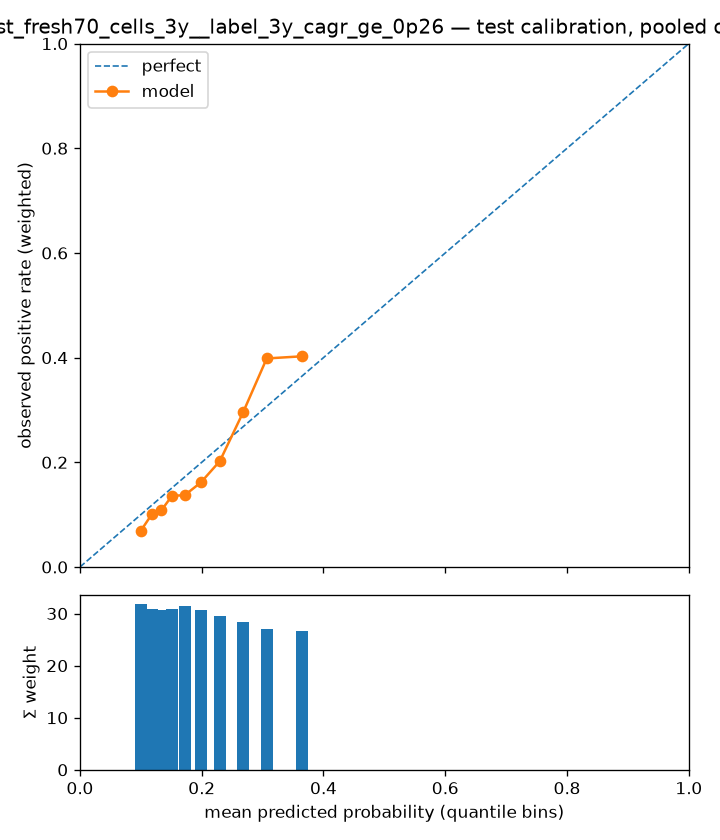

# Experiment report — forest_fresh70_cells_3y__label_3y_cagr_ge_0p26

- run id: `fc2d34c9933e`
- dataset version: `1.4.1` (pinned, immutable)
- dataset sha256: `be2b664c6739b93d5b5a7df1d085c09f09575071dd02d1f1426ed1586e052085` (dataset.parquet, from the manifest's provenance block)
- config hash: `72ec498c857118fd`
- git SHA: `f24b95eda15ff2283e1ea10025a00b1f1aac57b0`
- seed: 23
- model: `random_forest` params `{"bootstrap": true, "class_weight": 1.0, "criterion": "entropy", "max_depth": 4, "max_features": 0.205191, "max_samples": 0.663781, "min_samples_leaf": 72, "n_estimators": 490, "n_jobs": 8}`
- label: `fwd_3y_cagr >= 0.26` — horizon 3y, scheme `walkforward`
- derived label `fwd_3y_cagr >= 0.26`: evaluated on the fly from the manifest's continuous outcome columns (harness.derived_labels); NULL wherever a referenced column is NULL
- **universe: `dist_52w_high <= -0.7 & dollar_volume_3m >= 100000`** — train and test rows outside it are left out (a row with a NULL in a filter column is outside). Every number below describes this universe: base rates, baselines and picks are not comparable with a run over all rows, and the run is counted in the universe's own ledger cell. The filter reads feature columns as of the snapshot; it builds no split (upstream tags decide train and test, the purge and embargo hold for the rows that remain) and derives no column. `sample_weight` is the upstream uniqueness weight, not recomputed for the rows left out.
- **configurations tried against this cell (dataset, scheme, horizon, label, universe): 1** (from the append-only results store; failed runs count); **56 against this label in any universe**
- saved model bundle: `experiments/models/forest_fresh70_cells_3y__label_3y_cagr_ge_0p26_fc2d34c9933e` (re-evaluate with `vml-eval`, no refitting)

## Era-sliced metrics (one row per test year)

Sliced on the calendar year of each test row's `snapshot_date` (one walk-forward fold per year); crash eras are tagged inline. `conf_at_K` is the mean score of the top-K picks; `base_rate_brier` is the no-skill Brier the model must beat. \*The pooled row picks per year — per-fold model scores are not comparable, so a global top-K would just take the hottest-scoring fold's picks; it is context for the era rows, never a stand-alone result. ROC-AUC and recall@K are logged in the results store, not shown here.

| era          | n_test | base_rate | mean_score | precision_at_20 | precision_at_50 | precision_at_thr_0.5 | precision_at_thr_0.6 | precision_at_thr_0.7 | conf_at_20 | conf_at_50 | n_at_prec_0.75 | n_at_prec_0.9 | recall_at_prec_0.75 | recall_at_prec_0.9 | recall_at_thr_0.5 | recall_at_thr_0.6 | recall_at_thr_0.7 | n_at_thr_0.5 | n_at_thr_0.6 | n_at_thr_0.7 | brier  | base_rate_brier | pr_auc |
| ------------ | ------ | --------- | ---------- | --------------- | --------------- | -------------------- | -------------------- | -------------------- | ---------- | ---------- | -------------- | ------------- | ------------------- | ------------------ | ----------------- | ----------------- | ----------------- | ------------ | ------------ | ------------ | ------ | --------------- | ------ |
| 2005         | 346    | 0.0885    | 0.1306     | 0.0500          | 0.1400          | —                    | —                    | —                    | 0.1941     | 0.1794     | 0              | 0             | 0                   | 0                  | 0                 | 0                 | 0                 | 0            | 0            | 0            | 0.0811 | 0.0806          | 0.1317 |
| 2006         | 228    | 0.0416    | 0.1562     | 0.1500          | 0.1000          | —                    | —                    | —                    | 0.2208     | 0.2055     | 0              | 0             | 0                   | 0                  | 0                 | 0                 | 0                 | 0            | 0            | 0            | 0.0521 | 0.0399          | 0.1803 |
| 2007         | 290    | 0.0573    | 0.1963     | 0.1000          | 0.0600          | —                    | —                    | —                    | 0.3058     | 0.2799     | 0              | 0             | 0                   | 0                  | 0                 | 0                 | 0                 | 0            | 0            | 0            | 0.0762 | 0.0540          | 0.0851 |
| 2008 (GFC)   | 1327   | 0.3148    | 0.2492     | 0.5000          | 0.6200          | —                    | —                    | —                    | 0.3674     | 0.3612     | 1              | 1             | 0.0023              | 0.0023             | 0                 | 0                 | 0                 | 0            | 0            | 0            | 0.2149 | 0.2157          | 0.4323 |
| 2009 (GFC)   | 1295   | 0.4775    | 0.2614     | 0.6500          | 0.7400          | —                    | —                    | —                    | 0.3670     | 0.3617     | 154            | 10            | 0.1787              | 0.0139             | 0                 | 0                 | 0                 | 0            | 0            | 0            | 0.2805 | 0.2495          | 0.6393 |
| 2010         | 193    | 0.1060    | 0.1572     | 0.1000          | 0.1000          | —                    | —                    | —                    | 0.2558     | 0.2224     | 0              | 0             | 0                   | 0                  | 0                 | 0                 | 0                 | 0            | 0            | 0            | 0.1009 | 0.0948          | 0.1054 |
| 2011         | 296    | 0.1281    | 0.1609     | 0.1500          | 0.1800          | —                    | —                    | —                    | 0.2881     | 0.2626     | 0              | 0             | 0                   | 0                  | 0                 | 0                 | 0                 | 0            | 0            | 0            | 0.1149 | 0.1117          | 0.1508 |
| 2012         | 338    | 0.1841    | 0.1874     | 0.1500          | 0.1800          | —                    | —                    | —                    | 0.3418     | 0.3148     | 0              | 0             | 0                   | 0                  | 0                 | 0                 | 0                 | 0            | 0            | 0            | 0.1521 | 0.1502          | 0.2015 |
| 2013         | 187    | 0.1173    | 0.1662     | 0.1000          | 0.1000          | —                    | —                    | —                    | 0.3199     | 0.2613     | 0              | 0             | 0                   | 0                  | 0                 | 0                 | 0                 | 0            | 0            | 0            | 0.1086 | 0.1035          | 0.1397 |
| 2014         | 253    | 0.0397    | 0.1625     | 0.1000          | 0.0600          | —                    | —                    | —                    | 0.3501     | 0.2788     | 0              | 0             | 0                   | 0                  | 0                 | 0                 | 0                 | 0            | 0            | 0            | 0.0559 | 0.0381          | 0.0914 |
| 2015         | 623    | 0.0670    | 0.2126     | 0.1000          | 0.0600          | —                    | —                    | —                    | 0.4358     | 0.4143     | 0              | 0             | 0                   | 0                  | 0                 | 0                 | 0                 | 0            | 0            | 0            | 0.0926 | 0.0625          | 0.0684 |
| 2016         | 768    | 0.1488    | 0.1973     | 0.1500          | 0.2200          | —                    | —                    | —                    | 0.4592     | 0.4340     | 0              | 0             | 0                   | 0                  | 0                 | 0                 | 0                 | 0            | 0            | 0            | 0.1333 | 0.1266          | 0.1711 |
| 2017         | 515    | 0.0832    | 0.1623     | 0.1000          | 0.0600          | —                    | —                    | —                    | 0.4064     | 0.3499     | 0              | 0             | 0                   | 0                  | 0                 | 0                 | 0                 | 0            | 0            | 0            | 0.0900 | 0.0763          | 0.0752 |
| 2018         | 563    | 0.1212    | 0.1551     | 0.2000          | 0.2200          | —                    | —                    | —                    | 0.3601     | 0.3179     | 0              | 0             | 0                   | 0                  | 0                 | 0                 | 0                 | 0            | 0            | 0            | 0.1083 | 0.1065          | 0.1541 |
| 2019         | 938    | 0.1167    | 0.1786     | 0.2000          | 0.2600          | —                    | —                    | —                    | 0.4087     | 0.3833     | 0              | 0             | 0                   | 0                  | 0                 | 0                 | 0                 | 0            | 0            | 0            | 0.1042 | 0.1031          | 0.1892 |
| 2020 (COVID) | 998    | 0.2054    | 0.1979     | 0.3000          | 0.3400          | —                    | —                    | —                    | 0.4653     | 0.4366     | 0              | 0             | 0                   | 0                  | 0                 | 0                 | 0                 | 0            | 0            | 0            | 0.1459 | 0.1632          | 0.3871 |
| pooled*      | 9158   | 0.1945    | 0.1997     | 0.1938          | 0.2150          | —                    | —                    | —                    | 0.3466     | 0.3165     | 155            | 11            | 0.0599              | 0.0051             | 0                 | 0                 | 0                 | 0            | 0            | 0            | 0.1461 | 0.1567          | 0.3240 |

## High-confidence picks (pooled)

How many high-confidence calls the model made, how confident it was, and how precise they were — no pre-chosen score threshold needed. `top N/yr` rows pick per test year; `score >= p` rows (probabilistic models) count every name at or above that probability, pooled.

| selection    | n_picks | picks_per_year | mean_score | precision | hits |
| ------------ | ------- | -------------- | ---------- | --------- | ---- |
| top 5/yr     | 80      | 5              | 0.3721     | 0.1750    | 14   |
| top 10/yr    | 160     | 10             | 0.3614     | 0.2062    | 33   |
| top 20/yr    | 320     | 20             | 0.3466     | 0.1938    | 62   |
| top 50/yr    | 800     | 50             | 0.3165     | 0.2150    | 172  |
| score >= 0.9 | 0       | 0              | —          | —         | 0    |
| score >= 0.8 | 0       | 0              | —          | —         | 0    |
| score >= 0.7 | 0       | 0              | —          | —         | 0    |
| score >= 0.6 | 0       | 0              | —          | —         | 0    |
| score >= 0.5 | 0       | 0              | —          | —         | 0    |

## Pick outcomes (what the picks went on to do)

Report-only outcomes of the top-K picks of each test year (`pick_outcomes`: `label_3y_beat_spy`, `fwd_3y_excess_cagr`, `fwd_3y_cagr`, `fwd_3y_max_drawdown_from_entry`, `fwd_3y_cagr < 0.0`, `fwd_3y_cagr < -0.1`, `fwd_3y_max_drawdown_from_entry >= 0.4`, `fwd_3y_cagr >= 0.15`, `fwd_3y_cagr >= 0.26`, `fwd_3y_excess_cagr >= 0.05`, `fwd_3y_excess_cagr >= 0.1`), from the manifest's label columns; none is a model input or the training target, and the run is counted in its own label's cell. For a binary outcome the picks' hit rate, for a continuous one their mean and median, each beside the same statistic over **all** test rows of the era (unweighted, like the picks: one row, one pick). `stocks` is the number of distinct `permaticker`s among the picks (a stock has up to four test rows a year); in the pooled row it is the mean per year and the statistics run over every year's picks. NULL outcomes are left out, not counted as misses. This is a no-cost, equal-weight reading of the picks, a screen for `vml-backtest` and not a substitute.

### Top 20 per test year: `label_3y_beat_spy`

| era          | picks | stocks  | picks hit rate | all rows |
| ------------ | ----- | ------- | -------------- | -------- |
| 2005         | 20    | 16      | 0.2000         | 0.2052   |
| 2006         | 20    | 16      | 0.3000         | 0.1974   |
| 2007         | 20    | 18      | 0.2500         | 0.2241   |
| 2008 (GFC)   | 20    | 19      | 0.6000         | 0.4808   |
| 2009 (GFC)   | 20    | 19      | 0.6500         | 0.5784   |
| 2010         | 20    | 16      | 0.3000         | 0.1606   |
| 2011         | 20    | 16      | 0.1500         | 0.1622   |
| 2012         | 20    | 14      | 0.1500         | 0.2337   |
| 2013         | 20    | 17      | 0.1500         | 0.1818   |
| 2014         | 20    | 17      | 0.1500         | 0.0791   |
| 2015         | 20    | 17      | 0.2500         | 0.1364   |
| 2016         | 20    | 16      | 0.4500         | 0.2370   |
| 2017         | 20    | 13      | 0.1000         | 0.1495   |
| 2018         | 20    | 16      | 0.2000         | 0.1687   |
| 2019         | 20    | 17      | 0.2500         | 0.1748   |
| 2020 (COVID) | 20    | 20      | 0.3000         | 0.2936   |
| pooled*      | 320   | 16.6875 | 0.2781         | 0.2922   |

### Top 20 per test year: `fwd_3y_excess_cagr`

| era          | picks | stocks  | picks mean | picks median | all rows mean | all rows median |
| ------------ | ----- | ------- | ---------- | ------------ | ------------- | --------------- |
| 2005         | 20    | 16      | -0.2540    | -0.2181      | -0.3118       | -0.3383         |
| 2006         | 20    | 16      | -0.1108    | -0.1389      | -0.2951       | -0.3163         |
| 2007         | 20    | 18      | -0.2589    | -0.2524      | -0.3193       | -0.3547         |
| 2008 (GFC)   | 20    | 19      | 0.1136     | 0.1024       | -0.0446       | -0.0162         |
| 2009 (GFC)   | 20    | 19      | 0.2057     | 0.1989       | 0.0601        | 0.0822          |
| 2010         | 20    | 16      | -0.2620    | -0.1848      | -0.4165       | -0.4683         |
| 2011         | 20    | 16      | -0.3465    | -0.2967      | -0.4275       | -0.4326         |
| 2012         | 20    | 14      | -0.3096    | -0.1814      | -0.3136       | -0.2764         |
| 2013         | 20    | 17      | -0.4946    | -0.5496      | -0.3937       | -0.4777         |
| 2014         | 20    | 17      | -0.5538    | -0.7231      | -0.5271       | -0.6060         |
| 2015         | 20    | 17      | -0.2330    | -0.2717      | -0.4543       | -0.4805         |
| 2016         | 20    | 16      | -0.1211    | -0.0749      | -0.3430       | -0.4101         |
| 2017         | 20    | 13      | -0.4975    | -0.6098      | -0.4445       | -0.5297         |
| 2018         | 20    | 16      | -0.3856    | -0.2767      | -0.4277       | -0.5044         |
| 2019         | 20    | 17      | -0.0173    | -0.1475      | -0.3751       | -0.4615         |
| 2020 (COVID) | 20    | 20      | 0.0180     | -0.0532      | -0.2132       | -0.3123         |
| pooled*      | 320   | 16.6875 | -0.2192    | -0.1825      | -0.2566       | -0.3012         |

### Top 20 per test year: `fwd_3y_cagr`

| era          | picks | stocks  | picks mean | picks median | all rows mean | all rows median |
| ------------ | ----- | ------- | ---------- | ------------ | ------------- | --------------- |
| 2005         | 20    | 16      | -0.2249    | -0.1536      | -0.2784       | -0.3042         |
| 2006         | 20    | 16      | -0.2026    | -0.2194      | -0.3794       | -0.4033         |
| 2007         | 20    | 18      | -0.3152    | -0.3080      | -0.3804       | -0.4150         |
| 2008 (GFC)   | 20    | 19      | 0.2372     | 0.2509       | 0.0374        | 0.0719          |
| 2009 (GFC)   | 20    | 19      | 0.4059     | 0.4288       | 0.2398        | 0.2622          |
| 2010         | 20    | 16      | -0.0969    | -0.0161      | -0.2640       | -0.3167         |
| 2011         | 20    | 16      | -0.1556    | -0.0968      | -0.2445       | -0.2653         |
| 2012         | 20    | 14      | -0.1376    | -0.0269      | -0.1424       | -0.1139         |
| 2013         | 20    | 17      | -0.3814    | -0.4340      | -0.2879       | -0.3700         |
| 2014         | 20    | 17      | -0.4509    | -0.6218      | -0.4229       | -0.5056         |
| 2015         | 20    | 17      | -0.1129    | -0.1475      | -0.3317       | -0.3620         |
| 2016         | 20    | 16      | 0.0104     | 0.0617       | -0.2091       | -0.2746         |
| 2017         | 20    | 13      | -0.3851    | -0.4914      | -0.3317       | -0.4226         |
| 2018         | 20    | 16      | -0.2163    | -0.0901      | -0.2507       | -0.3267         |
| 2019         | 20    | 17      | 0.1081     | -0.0096      | -0.2330       | -0.3169         |
| 2020 (COVID) | 20    | 20      | 0.1600     | 0.0775       | -0.0984       | -0.2008         |
| pooled*      | 320   | 16.6875 | -0.1099    | -0.0574      | -0.1377       | -0.1873         |

### Top 20 per test year: `fwd_3y_max_drawdown_from_entry`

| era          | picks | stocks  | picks mean | picks median | all rows mean | all rows median |
| ------------ | ----- | ------- | ---------- | ------------ | ------------- | --------------- |
| 2005         | 20    | 16      | 0.6235     | 0.6301       | 0.6797        | 0.7663          |
| 2006         | 20    | 16      | 0.6435     | 0.7339       | 0.7882        | 0.9095          |
| 2007         | 20    | 18      | 0.8459     | 0.9339       | 0.8458        | 0.9383          |
| 2008 (GFC)   | 20    | 19      | 0.5135     | 0.4283       | 0.6488        | 0.6718          |
| 2009 (GFC)   | 20    | 19      | 0.3503     | 0.3845       | 0.4095        | 0.3432          |
| 2010         | 20    | 16      | 0.4789     | 0.3746       | 0.7173        | 0.8103          |
| 2011         | 20    | 16      | 0.6078     | 0.6934       | 0.7108        | 0.8047          |
| 2012         | 20    | 14      | 0.5628     | 0.4803       | 0.6024        | 0.6307          |
| 2013         | 20    | 17      | 0.7483     | 0.8954       | 0.7171        | 0.8145          |
| 2014         | 20    | 17      | 0.8218     | 0.9633       | 0.8121        | 0.9192          |
| 2015         | 20    | 17      | 0.6948     | 0.7260       | 0.7815        | 0.8631          |
| 2016         | 20    | 16      | 0.4119     | 0.3081       | 0.6619        | 0.7619          |
| 2017         | 20    | 13      | 0.8079     | 0.9066       | 0.7827        | 0.8945          |
| 2018         | 20    | 16      | 0.7706     | 0.8101       | 0.7899        | 0.8794          |
| 2019         | 20    | 17      | 0.6367     | 0.6551       | 0.7478        | 0.8346          |
| 2020 (COVID) | 20    | 20      | 0.2632     | 0.2295       | 0.6251        | 0.7127          |
| pooled*      | 320   | 16.6875 | 0.6113     | 0.6423       | 0.6674        | 0.7579          |

### Top 20 per test year: `label_3y_cagr_lt_0p0`

| era          | picks | stocks  | picks hit rate | all rows |
| ------------ | ----- | ------- | -------------- | -------- |
| 2005         | 20    | 16      | 0.7500         | 0.7601   |
| 2006         | 20    | 16      | 0.8000         | 0.8553   |
| 2007         | 20    | 18      | 0.8500         | 0.8207   |
| 2008 (GFC)   | 20    | 19      | 0.3000         | 0.4371   |
| 2009 (GFC)   | 20    | 19      | 0.1000         | 0.2834   |
| 2010         | 20    | 16      | 0.5500         | 0.7617   |
| 2011         | 20    | 16      | 0.6000         | 0.7331   |
| 2012         | 20    | 14      | 0.5000         | 0.6036   |
| 2013         | 20    | 17      | 0.7000         | 0.7701   |
| 2014         | 20    | 17      | 0.8000         | 0.8854   |
| 2015         | 20    | 17      | 0.6000         | 0.7865   |
| 2016         | 20    | 16      | 0.5000         | 0.6758   |
| 2017         | 20    | 13      | 0.8000         | 0.7961   |
| 2018         | 20    | 16      | 0.6000         | 0.7371   |
| 2019         | 20    | 17      | 0.5500         | 0.7484   |
| 2020 (COVID) | 20    | 20      | 0.2000         | 0.6222   |
| pooled*      | 320   | 16.6875 | 0.5750         | 0.6263   |

### Top 20 per test year: `label_3y_cagr_lt_m0p1`

| era          | picks | stocks  | picks hit rate | all rows |
| ------------ | ----- | ------- | -------------- | -------- |
| 2005         | 20    | 16      | 0.6000         | 0.6561   |
| 2006         | 20    | 16      | 0.7000         | 0.7895   |
| 2007         | 20    | 18      | 0.7500         | 0.7724   |
| 2008 (GFC)   | 20    | 19      | 0.1500         | 0.3572   |
| 2009 (GFC)   | 20    | 19      | 0.0500         | 0.2394   |
| 2010         | 20    | 16      | 0.3000         | 0.6632   |
| 2011         | 20    | 16      | 0.5000         | 0.6520   |
| 2012         | 20    | 14      | 0.4000         | 0.5059   |
| 2013         | 20    | 17      | 0.7000         | 0.7273   |
| 2014         | 20    | 17      | 0.7500         | 0.7905   |
| 2015         | 20    | 17      | 0.5500         | 0.7063   |
| 2016         | 20    | 16      | 0.2500         | 0.6198   |
| 2017         | 20    | 13      | 0.8000         | 0.7437   |
| 2018         | 20    | 16      | 0.4500         | 0.6767   |
| 2019         | 20    | 17      | 0.3000         | 0.6674   |
| 2020 (COVID) | 20    | 20      | 0.1000         | 0.5671   |
| pooled*      | 320   | 16.6875 | 0.4594         | 0.5585   |

### Top 20 per test year: `label_3y_max_drawdown_from_entry_ge_0p4`

| era          | picks | stocks  | picks hit rate | all rows |
| ------------ | ----- | ------- | -------------- | -------- |
| 2005         | 20    | 16      | 0.8500         | 0.7746   |
| 2006         | 20    | 16      | 0.7500         | 0.8772   |
| 2007         | 20    | 18      | 1              | 0.9379   |
| 2008 (GFC)   | 20    | 19      | 0.6000         | 0.7958   |
| 2009 (GFC)   | 20    | 19      | 0.3500         | 0.4178   |
| 2010         | 20    | 16      | 0.4500         | 0.7979   |
| 2011         | 20    | 16      | 0.7500         | 0.8176   |
| 2012         | 20    | 14      | 0.7000         | 0.6598   |
| 2013         | 20    | 17      | 0.7500         | 0.7968   |
| 2014         | 20    | 17      | 0.9000         | 0.9130   |
| 2015         | 20    | 17      | 0.9000         | 0.9037   |
| 2016         | 20    | 16      | 0.3500         | 0.7409   |
| 2017         | 20    | 13      | 0.8500         | 0.8796   |
| 2018         | 20    | 16      | 0.9000         | 0.9147   |
| 2019         | 20    | 17      | 0.8500         | 0.8795   |
| 2020 (COVID) | 20    | 20      | 0.1000         | 0.6974   |
| pooled*      | 320   | 16.6875 | 0.6906         | 0.7597   |

### Top 20 per test year: `label_3y_cagr_ge_0p15`

| era          | picks | stocks  | picks hit rate | all rows |
| ------------ | ----- | ------- | -------------- | -------- |
| 2005         | 20    | 16      | 0.1000         | 0.1358   |
| 2006         | 20    | 16      | 0.2000         | 0.0702   |
| 2007         | 20    | 18      | 0.1000         | 0.0931   |
| 2008 (GFC)   | 20    | 19      | 0.6000         | 0.4220   |
| 2009 (GFC)   | 20    | 19      | 0.7500         | 0.6023   |
| 2010         | 20    | 16      | 0.3500         | 0.1606   |
| 2011         | 20    | 16      | 0.2500         | 0.1926   |
| 2012         | 20    | 14      | 0.2000         | 0.2396   |
| 2013         | 20    | 17      | 0.1000         | 0.1658   |
| 2014         | 20    | 17      | 0.1000         | 0.0672   |
| 2015         | 20    | 17      | 0.2500         | 0.1220   |
| 2016         | 20    | 16      | 0.4000         | 0.2214   |
| 2017         | 20    | 13      | 0.1000         | 0.1398   |
| 2018         | 20    | 16      | 0.2000         | 0.1812   |
| 2019         | 20    | 17      | 0.2500         | 0.1674   |
| 2020 (COVID) | 20    | 20      | 0.3000         | 0.2776   |
| pooled*      | 320   | 16.6875 | 0.2656         | 0.2731   |

### Top 20 per test year: `label_3y_cagr_ge_0p26`

| era          | picks | stocks  | picks hit rate | all rows |
| ------------ | ----- | ------- | -------------- | -------- |
| 2005         | 20    | 16      | 0.0500         | 0.0983   |
| 2006         | 20    | 16      | 0.1500         | 0.0439   |
| 2007         | 20    | 18      | 0.1000         | 0.0552   |
| 2008 (GFC)   | 20    | 19      | 0.5000         | 0.3286   |
| 2009 (GFC)   | 20    | 19      | 0.6500         | 0.5012   |
| 2010         | 20    | 16      | 0.1000         | 0.1192   |
| 2011         | 20    | 16      | 0.1500         | 0.1453   |
| 2012         | 20    | 14      | 0.1500         | 0.2041   |
| 2013         | 20    | 17      | 0.1000         | 0.1283   |
| 2014         | 20    | 17      | 0.1000         | 0.0474   |
| 2015         | 20    | 17      | 0.1000         | 0.0754   |
| 2016         | 20    | 16      | 0.1500         | 0.1562   |
| 2017         | 20    | 13      | 0.1000         | 0.0893   |
| 2018         | 20    | 16      | 0.2000         | 0.1332   |
| 2019         | 20    | 17      | 0.2000         | 0.1301   |
| 2020 (COVID) | 20    | 20      | 0.3000         | 0.2265   |
| pooled*      | 320   | 16.6875 | 0.1938         | 0.2131   |

### Top 20 per test year: `label_3y_excess_cagr_ge_0p05`

| era          | picks | stocks  | picks hit rate | all rows |
| ------------ | ----- | ------- | -------------- | -------- |
| 2005         | 20    | 16      | 0.1500         | 0.1734   |
| 2006         | 20    | 16      | 0.2000         | 0.1711   |
| 2007         | 20    | 18      | 0.1500         | 0.1828   |
| 2008 (GFC)   | 20    | 19      | 0.6000         | 0.4371   |
| 2009 (GFC)   | 20    | 19      | 0.6500         | 0.5305   |
| 2010         | 20    | 16      | 0.3000         | 0.1554   |
| 2011         | 20    | 16      | 0.1500         | 0.1453   |
| 2012         | 20    | 14      | 0.1500         | 0.2101   |
| 2013         | 20    | 17      | 0.1000         | 0.1658   |
| 2014         | 20    | 17      | 0.1000         | 0.0711   |
| 2015         | 20    | 17      | 0.2500         | 0.1108   |
| 2016         | 20    | 16      | 0.4000         | 0.1966   |
| 2017         | 20    | 13      | 0.1000         | 0.1301   |
| 2018         | 20    | 16      | 0.2000         | 0.1456   |
| 2019         | 20    | 17      | 0.2500         | 0.1578   |
| 2020 (COVID) | 20    | 20      | 0.3000         | 0.2675   |
| pooled*      | 320   | 16.6875 | 0.2531         | 0.2616   |

### Top 20 per test year: `label_3y_excess_cagr_ge_0p1`

| era          | picks | stocks  | picks hit rate | all rows |
| ------------ | ----- | ------- | -------------- | -------- |
| 2005         | 20    | 16      | 0.1000         | 0.1416   |
| 2006         | 20    | 16      | 0.2000         | 0.1316   |
| 2007         | 20    | 18      | 0.1500         | 0.1655   |
| 2008 (GFC)   | 20    | 19      | 0.5000         | 0.3881   |
| 2009 (GFC)   | 20    | 19      | 0.6500         | 0.4826   |
| 2010         | 20    | 16      | 0.1000         | 0.1192   |
| 2011         | 20    | 16      | 0.1500         | 0.1419   |
| 2012         | 20    | 14      | 0.1500         | 0.2041   |
| 2013         | 20    | 17      | 0.1000         | 0.1497   |
| 2014         | 20    | 17      | 0.1000         | 0.0553   |
| 2015         | 20    | 17      | 0.1500         | 0.0803   |
| 2016         | 20    | 16      | 0.2000         | 0.1693   |
| 2017         | 20    | 13      | 0.1000         | 0.1068   |
| 2018         | 20    | 16      | 0.2000         | 0.1279   |
| 2019         | 20    | 17      | 0.2000         | 0.1365   |
| 2020 (COVID) | 20    | 20      | 0.3000         | 0.2465   |
| pooled*      | 320   | 16.6875 | 0.2094         | 0.2319   |

### Top 50 per test year: `label_3y_beat_spy`

| era          | picks | stocks  | picks hit rate | all rows |
| ------------ | ----- | ------- | -------------- | -------- |
| 2005         | 50    | 40      | 0.2800         | 0.2052   |
| 2006         | 50    | 36      | 0.2800         | 0.1974   |
| 2007         | 50    | 45      | 0.2600         | 0.2241   |
| 2008 (GFC)   | 50    | 45      | 0.7200         | 0.4808   |
| 2009 (GFC)   | 50    | 47      | 0.7800         | 0.5784   |
| 2010         | 50    | 35      | 0.2000         | 0.1606   |
| 2011         | 50    | 41      | 0.2000         | 0.1622   |
| 2012         | 50    | 33      | 0.2200         | 0.2337   |
| 2013         | 50    | 35      | 0.2000         | 0.1818   |
| 2014         | 50    | 40      | 0.0800         | 0.0791   |
| 2015         | 50    | 35      | 0.2000         | 0.1364   |
| 2016         | 50    | 40      | 0.5000         | 0.2370   |
| 2017         | 50    | 33      | 0.1000         | 0.1495   |
| 2018         | 50    | 36      | 0.2600         | 0.1687   |
| 2019         | 50    | 35      | 0.2800         | 0.1748   |
| 2020 (COVID) | 50    | 47      | 0.4800         | 0.2936   |
| pooled*      | 800   | 38.9375 | 0.3150         | 0.2922   |

### Top 50 per test year: `fwd_3y_excess_cagr`

| era          | picks | stocks  | picks mean | picks median | all rows mean | all rows median |
| ------------ | ----- | ------- | ---------- | ------------ | ------------- | --------------- |
| 2005         | 50    | 40      | -0.2043    | -0.1644      | -0.3118       | -0.3383         |
| 2006         | 50    | 36      | -0.1800    | -0.2181      | -0.2951       | -0.3163         |
| 2007         | 50    | 45      | -0.2633    | -0.2472      | -0.3193       | -0.3547         |
| 2008 (GFC)   | 50    | 45      | 0.1661     | 0.2006       | -0.0446       | -0.0162         |
| 2009 (GFC)   | 50    | 47      | 0.2965     | 0.2911       | 0.0601        | 0.0822          |
| 2010         | 50    | 35      | -0.3645    | -0.2488      | -0.4165       | -0.4683         |
| 2011         | 50    | 41      | -0.3193    | -0.3408      | -0.4275       | -0.4326         |
| 2012         | 50    | 33      | -0.2523    | -0.1695      | -0.3136       | -0.2764         |
| 2013         | 50    | 35      | -0.4310    | -0.5190      | -0.3937       | -0.4777         |
| 2014         | 50    | 40      | -0.5752    | -0.6716      | -0.5271       | -0.6060         |
| 2015         | 50    | 35      | -0.2754    | -0.2379      | -0.4543       | -0.4805         |
| 2016         | 50    | 40      | -0.1241    | -0.0046      | -0.3430       | -0.4101         |
| 2017         | 50    | 33      | -0.4781    | -0.4915      | -0.4445       | -0.5297         |
| 2018         | 50    | 36      | -0.3316    | -0.2588      | -0.4277       | -0.5044         |
| 2019         | 50    | 35      | -0.1179    | -0.1618      | -0.3751       | -0.4615         |
| 2020 (COVID) | 50    | 47      | 0.0617     | -0.0033      | -0.2132       | -0.3123         |
| pooled*      | 800   | 38.9375 | -0.2120    | -0.1776      | -0.2566       | -0.3012         |

### Top 50 per test year: `fwd_3y_cagr`

| era          | picks | stocks  | picks mean | picks median | all rows mean | all rows median |
| ------------ | ----- | ------- | ---------- | ------------ | ------------- | --------------- |
| 2005         | 50    | 40      | -0.1761    | -0.1184      | -0.2784       | -0.3042         |
| 2006         | 50    | 36      | -0.2629    | -0.3043      | -0.3794       | -0.4033         |
| 2007         | 50    | 45      | -0.3208    | -0.3080      | -0.3804       | -0.4150         |
| 2008 (GFC)   | 50    | 45      | 0.2789     | 0.3074       | 0.0374        | 0.0719          |
| 2009 (GFC)   | 50    | 47      | 0.4893     | 0.4811       | 0.2398        | 0.2622          |
| 2010         | 50    | 35      | -0.2116    | -0.0758      | -0.2640       | -0.3167         |
| 2011         | 50    | 41      | -0.1279    | -0.1692      | -0.2445       | -0.2653         |
| 2012         | 50    | 33      | -0.0804    | -0.0110      | -0.1424       | -0.1139         |
| 2013         | 50    | 35      | -0.3225    | -0.3945      | -0.2879       | -0.3700         |
| 2014         | 50    | 40      | -0.4732    | -0.5702      | -0.4229       | -0.5056         |
| 2015         | 50    | 35      | -0.1508    | -0.1009      | -0.3317       | -0.3620         |
| 2016         | 50    | 40      | 0.0058     | 0.1273       | -0.2091       | -0.2746         |
| 2017         | 50    | 33      | -0.3611    | -0.3668      | -0.3317       | -0.4226         |
| 2018         | 50    | 36      | -0.1542    | -0.0795      | -0.2507       | -0.3267         |
| 2019         | 50    | 35      | 0.0114     | -0.0278      | -0.2330       | -0.3169         |
| 2020 (COVID) | 50    | 47      | 0.2003     | 0.1401       | -0.0984       | -0.2008         |
| pooled*      | 800   | 38.9375 | -0.1035    | -0.0637      | -0.1377       | -0.1873         |

### Top 50 per test year: `fwd_3y_max_drawdown_from_entry`

| era          | picks | stocks  | picks mean | picks median | all rows mean | all rows median |
| ------------ | ----- | ------- | ---------- | ------------ | ------------- | --------------- |
| 2005         | 50    | 40      | 0.6094     | 0.6887       | 0.6797        | 0.7663          |
| 2006         | 50    | 36      | 0.7351     | 0.8555       | 0.7882        | 0.9095          |
| 2007         | 50    | 45      | 0.8171     | 0.8736       | 0.8458        | 0.9383          |
| 2008 (GFC)   | 50    | 45      | 0.5107     | 0.4576       | 0.6488        | 0.6718          |
| 2009 (GFC)   | 50    | 47      | 0.3363     | 0.3304       | 0.4095        | 0.3432          |
| 2010         | 50    | 35      | 0.6203     | 0.6642       | 0.7173        | 0.8103          |
| 2011         | 50    | 41      | 0.6166     | 0.6346       | 0.7108        | 0.8047          |
| 2012         | 50    | 33      | 0.5340     | 0.4431       | 0.6024        | 0.6307          |
| 2013         | 50    | 35      | 0.7017     | 0.8414       | 0.7171        | 0.8145          |
| 2014         | 50    | 40      | 0.8165     | 0.9495       | 0.8121        | 0.9192          |
| 2015         | 50    | 35      | 0.7026     | 0.7406       | 0.7815        | 0.8631          |
| 2016         | 50    | 40      | 0.4185     | 0.3213       | 0.6619        | 0.7619          |
| 2017         | 50    | 33      | 0.7888     | 0.8755       | 0.7827        | 0.8945          |
| 2018         | 50    | 36      | 0.7452     | 0.7946       | 0.7899        | 0.8794          |
| 2019         | 50    | 35      | 0.7037     | 0.7105       | 0.7478        | 0.8346          |
| 2020 (COVID) | 50    | 47      | 0.2874     | 0.2295       | 0.6251        | 0.7127          |
| pooled*      | 800   | 38.9375 | 0.6215     | 0.6718       | 0.6674        | 0.7579          |

### Top 50 per test year: `label_3y_cagr_lt_0p0`

| era          | picks | stocks  | picks hit rate | all rows |
| ------------ | ----- | ------- | -------------- | -------- |
| 2005         | 50    | 40      | 0.7000         | 0.7601   |
| 2006         | 50    | 36      | 0.7800         | 0.8553   |
| 2007         | 50    | 45      | 0.8000         | 0.8207   |
| 2008 (GFC)   | 50    | 45      | 0.1800         | 0.4371   |
| 2009 (GFC)   | 50    | 47      | 0.0400         | 0.2834   |
| 2010         | 50    | 35      | 0.6200         | 0.7617   |
| 2011         | 50    | 41      | 0.6200         | 0.7331   |
| 2012         | 50    | 33      | 0.5200         | 0.6036   |
| 2013         | 50    | 35      | 0.7200         | 0.7701   |
| 2014         | 50    | 40      | 0.8400         | 0.8854   |
| 2015         | 50    | 35      | 0.6400         | 0.7865   |
| 2016         | 50    | 40      | 0.4400         | 0.6758   |
| 2017         | 50    | 33      | 0.8000         | 0.7961   |
| 2018         | 50    | 36      | 0.5600         | 0.7371   |
| 2019         | 50    | 35      | 0.5600         | 0.7484   |
| 2020 (COVID) | 50    | 47      | 0.2200         | 0.6222   |
| pooled*      | 800   | 38.9375 | 0.5650         | 0.6263   |

### Top 50 per test year: `label_3y_cagr_lt_m0p1`

| era          | picks | stocks  | picks hit rate | all rows |
| ------------ | ----- | ------- | -------------- | -------- |
| 2005         | 50    | 40      | 0.5400         | 0.6561   |
| 2006         | 50    | 36      | 0.7200         | 0.7895   |
| 2007         | 50    | 45      | 0.7400         | 0.7724   |
| 2008 (GFC)   | 50    | 45      | 0.0800         | 0.3572   |
| 2009 (GFC)   | 50    | 47      | 0.0200         | 0.2394   |
| 2010         | 50    | 35      | 0.4800         | 0.6632   |
| 2011         | 50    | 41      | 0.5400         | 0.6520   |
| 2012         | 50    | 33      | 0.3600         | 0.5059   |
| 2013         | 50    | 35      | 0.6600         | 0.7273   |
| 2014         | 50    | 40      | 0.7800         | 0.7905   |
| 2015         | 50    | 35      | 0.5000         | 0.7063   |
| 2016         | 50    | 40      | 0.3200         | 0.6198   |
| 2017         | 50    | 33      | 0.7200         | 0.7437   |
| 2018         | 50    | 36      | 0.4600         | 0.6767   |
| 2019         | 50    | 35      | 0.3600         | 0.6674   |
| 2020 (COVID) | 50    | 47      | 0.1400         | 0.5671   |
| pooled*      | 800   | 38.9375 | 0.4637         | 0.5585   |

### Top 50 per test year: `label_3y_max_drawdown_from_entry_ge_0p4`

| era          | picks | stocks  | picks hit rate | all rows |
| ------------ | ----- | ------- | -------------- | -------- |
| 2005         | 50    | 40      | 0.7600         | 0.7746   |
| 2006         | 50    | 36      | 0.8200         | 0.8772   |
| 2007         | 50    | 45      | 0.9200         | 0.9379   |
| 2008 (GFC)   | 50    | 45      | 0.6000         | 0.7958   |
| 2009 (GFC)   | 50    | 47      | 0.2800         | 0.4178   |
| 2010         | 50    | 35      | 0.6200         | 0.7979   |
| 2011         | 50    | 41      | 0.6800         | 0.8176   |
| 2012         | 50    | 33      | 0.5400         | 0.6598   |
| 2013         | 50    | 35      | 0.7400         | 0.7968   |
| 2014         | 50    | 40      | 0.8800         | 0.9130   |
| 2015         | 50    | 35      | 0.8800         | 0.9037   |
| 2016         | 50    | 40      | 0.4200         | 0.7409   |
| 2017         | 50    | 33      | 0.9000         | 0.8796   |
| 2018         | 50    | 36      | 0.8800         | 0.9147   |
| 2019         | 50    | 35      | 0.9200         | 0.8795   |
| 2020 (COVID) | 50    | 47      | 0.1400         | 0.6974   |
| pooled*      | 800   | 38.9375 | 0.6863         | 0.7597   |

### Top 50 per test year: `label_3y_cagr_ge_0p15`

| era          | picks | stocks  | picks hit rate | all rows |
| ------------ | ----- | ------- | -------------- | -------- |
| 2005         | 50    | 40      | 0.2000         | 0.1358   |
| 2006         | 50    | 36      | 0.1600         | 0.0702   |
| 2007         | 50    | 45      | 0.0800         | 0.0931   |
| 2008 (GFC)   | 50    | 45      | 0.7000         | 0.4220   |
| 2009 (GFC)   | 50    | 47      | 0.8200         | 0.6023   |
| 2010         | 50    | 35      | 0.2000         | 0.1606   |
| 2011         | 50    | 41      | 0.2800         | 0.1926   |
| 2012         | 50    | 33      | 0.2400         | 0.2396   |
| 2013         | 50    | 35      | 0.1600         | 0.1658   |
| 2014         | 50    | 40      | 0.0600         | 0.0672   |
| 2015         | 50    | 35      | 0.2000         | 0.1220   |
| 2016         | 50    | 40      | 0.4600         | 0.2214   |
| 2017         | 50    | 33      | 0.0800         | 0.1398   |
| 2018         | 50    | 36      | 0.2600         | 0.1812   |
| 2019         | 50    | 35      | 0.2800         | 0.1674   |
| 2020 (COVID) | 50    | 47      | 0.4400         | 0.2776   |
| pooled*      | 800   | 38.9375 | 0.2888         | 0.2731   |

### Top 50 per test year: `label_3y_cagr_ge_0p26`

| era          | picks | stocks  | picks hit rate | all rows |
| ------------ | ----- | ------- | -------------- | -------- |
| 2005         | 50    | 40      | 0.1400         | 0.0983   |
| 2006         | 50    | 36      | 0.1000         | 0.0439   |
| 2007         | 50    | 45      | 0.0600         | 0.0552   |
| 2008 (GFC)   | 50    | 45      | 0.6200         | 0.3286   |
| 2009 (GFC)   | 50    | 47      | 0.7400         | 0.5012   |
| 2010         | 50    | 35      | 0.1000         | 0.1192   |
| 2011         | 50    | 41      | 0.1800         | 0.1453   |
| 2012         | 50    | 33      | 0.1800         | 0.2041   |
| 2013         | 50    | 35      | 0.1000         | 0.1283   |
| 2014         | 50    | 40      | 0.0600         | 0.0474   |
| 2015         | 50    | 35      | 0.0600         | 0.0754   |
| 2016         | 50    | 40      | 0.2200         | 0.1562   |
| 2017         | 50    | 33      | 0.0600         | 0.0893   |
| 2018         | 50    | 36      | 0.2200         | 0.1332   |
| 2019         | 50    | 35      | 0.2600         | 0.1301   |
| 2020 (COVID) | 50    | 47      | 0.3400         | 0.2265   |
| pooled*      | 800   | 38.9375 | 0.2150         | 0.2131   |

### Top 50 per test year: `label_3y_excess_cagr_ge_0p05`

| era          | picks | stocks  | picks hit rate | all rows |
| ------------ | ----- | ------- | -------------- | -------- |
| 2005         | 50    | 40      | 0.2400         | 0.1734   |
| 2006         | 50    | 36      | 0.2400         | 0.1711   |
| 2007         | 50    | 45      | 0.2000         | 0.1828   |
| 2008 (GFC)   | 50    | 45      | 0.7200         | 0.4371   |
| 2009 (GFC)   | 50    | 47      | 0.7600         | 0.5305   |
| 2010         | 50    | 35      | 0.1800         | 0.1554   |
| 2011         | 50    | 41      | 0.1800         | 0.1453   |
| 2012         | 50    | 33      | 0.1800         | 0.2101   |
| 2013         | 50    | 35      | 0.1600         | 0.1658   |
| 2014         | 50    | 40      | 0.0600         | 0.0711   |
| 2015         | 50    | 35      | 0.1200         | 0.1108   |
| 2016         | 50    | 40      | 0.4400         | 0.1966   |
| 2017         | 50    | 33      | 0.0600         | 0.1301   |
| 2018         | 50    | 36      | 0.2600         | 0.1456   |
| 2019         | 50    | 35      | 0.2800         | 0.1578   |
| 2020 (COVID) | 50    | 47      | 0.4200         | 0.2675   |
| pooled*      | 800   | 38.9375 | 0.2812         | 0.2616   |

### Top 50 per test year: `label_3y_excess_cagr_ge_0p1`

| era          | picks | stocks  | picks hit rate | all rows |
| ------------ | ----- | ------- | -------------- | -------- |
| 2005         | 50    | 40      | 0.2000         | 0.1416   |
| 2006         | 50    | 36      | 0.1800         | 0.1316   |
| 2007         | 50    | 45      | 0.2000         | 0.1655   |
| 2008 (GFC)   | 50    | 45      | 0.6800         | 0.3881   |
| 2009 (GFC)   | 50    | 47      | 0.7400         | 0.4826   |
| 2010         | 50    | 35      | 0.1000         | 0.1192   |
| 2011         | 50    | 41      | 0.1800         | 0.1419   |
| 2012         | 50    | 33      | 0.1800         | 0.2041   |
| 2013         | 50    | 35      | 0.1400         | 0.1497   |
| 2014         | 50    | 40      | 0.0600         | 0.0553   |
| 2015         | 50    | 35      | 0.0800         | 0.0803   |
| 2016         | 50    | 40      | 0.2600         | 0.1693   |
| 2017         | 50    | 33      | 0.0600         | 0.1068   |
| 2018         | 50    | 36      | 0.2200         | 0.1279   |
| 2019         | 50    | 35      | 0.2600         | 0.1365   |
| 2020 (COVID) | 50    | 47      | 0.3800         | 0.2465   |
| pooled*      | 800   | 38.9375 | 0.2450         | 0.2319   |

## Portfolio screen (capped, periodic picks)

`[pick_screen]`: top 10 per test quarter, at most 2 per `sector`; peers: the test rows of the same quarter in the same of 20 bands of `log_marketcap_rank`. The backtest template's selection rule applied to the test rows (a backtest buys from the latest completed quarter's median snapshots, which are these rows), read on the run's label (`precision`) and on the pick outcomes. Equal weights, no costs, entry at the snapshot, held to the horizon: closer to a portfolio than the top-K-per-year tables, and still a screen for `vml-backtest`, not a substitute. Report-only. The `peers` columns give the same statistic for the picks' peers: the test rows of the same quarter in the same band of `log_marketcap_rank` (20 bands), averaged over the picks. **Read a selection against its peers**: against a capitalization-weighted benchmark small stocks trail by a wide margin in every period, so the all-rows reference of the pick-outcome tables flatters any ranking that prefers large companies.

| era          | picks | stocks | largest group          | its share | precision | precision peers | label_3y_beat_spy hit rate | label_3y_beat_spy peers | fwd_3y_excess_cagr mean | fwd_3y_excess_cagr peers | fwd_3y_excess_cagr median | fwd_3y_cagr mean | fwd_3y_cagr peers | fwd_3y_cagr median | fwd_3y_max_drawdown_from_entry mean | fwd_3y_max_drawdown_from_entry peers | fwd_3y_max_drawdown_from_entry median | label_3y_cagr_lt_0p0 hit rate | label_3y_cagr_lt_0p0 peers | label_3y_cagr_lt_m0p1 hit rate | label_3y_cagr_lt_m0p1 peers | label_3y_max_drawdown_from_entry_ge_0p4 hit rate | label_3y_max_drawdown_from_entry_ge_0p4 peers | label_3y_cagr_ge_0p15 hit rate | label_3y_cagr_ge_0p15 peers | label_3y_cagr_ge_0p26 hit rate | label_3y_cagr_ge_0p26 peers | label_3y_excess_cagr_ge_0p05 hit rate | label_3y_excess_cagr_ge_0p05 peers | label_3y_excess_cagr_ge_0p1 hit rate | label_3y_excess_cagr_ge_0p1 peers |
| ------------ | ----- | ------ | ---------------------- | --------- | --------- | --------------- | -------------------------- | ----------------------- | ----------------------- | ------------------------ | ------------------------- | ---------------- | ----------------- | ------------------ | ----------------------------------- | ------------------------------------ | ------------------------------------- | ----------------------------- | -------------------------- | ------------------------------ | --------------------------- | ------------------------------------------------ | --------------------------------------------- | ------------------------------ | --------------------------- | ------------------------------ | --------------------------- | ------------------------------------- | ---------------------------------- | ------------------------------------ | --------------------------------- |
| 2005         | 40    | 31     | Technology             | 0.2000    | 0.2500    | 0.1275          | 0.4000                     | 0.2358                  | -0.1577                 | -0.2640                  | -0.0676                   | -0.1275          | -0.2334           | -0.0273            | 0.5718                              | 0.6464                               | 0.5865                                | 0.5500                        | 0.7166                     | 0.4500                         | 0.6339                      | 0.7250                                           | 0.7614                                        | 0.3250                         | 0.1573                      | 0.2500                         | 0.1275                      | 0.3750                                | 0.1954                             | 0.3250                               | 0.1709                            |
| 2006         | 40    | 29     | Technology             | 0.2000    | 0.1500    | 0.0559          | 0.2750                     | 0.2009                  | -0.1623                 | -0.2874                  | -0.2253                   | -0.2502          | -0.3752           | -0.3350            | 0.7279                              | 0.8016                               | 0.8324                                | 0.7750                        | 0.8364                     | 0.7250                         | 0.7937                      | 0.8250                                           | 0.8958                                        | 0.1750                         | 0.0896                      | 0.1500                         | 0.0559                      | 0.2500                                | 0.1808                             | 0.2000                               | 0.1521                            |
| 2007         | 40    | 34     | Consumer Cyclical      | 0.2000    | 0.0750    | 0.0401          | 0.2250                     | 0.1844                  | -0.2685                 | -0.3587                  | -0.2680                   | -0.3318          | -0.4220           | -0.3276            | 0.8147                              | 0.8602                               | 0.9197                                | 0.8000                        | 0.8233                     | 0.7750                         | 0.8156                      | 0.9250                                           | 0.9385                                        | 0.1000                         | 0.0760                      | 0.0750                         | 0.0401                      | 0.2000                                | 0.1764                             | 0.1750                               | 0.1634                            |
| 2008 (GFC)   | 40    | 31     | Consumer Cyclical      | 0.2000    | 0.3500    | 0.2508          | 0.5750                     | 0.4575                  | 0.0699                  | -0.0870                  | 0.0923                    | 0.1120           | -0.0449           | 0.1213             | 0.6487                              | 0.7195                               | 0.7591                                | 0.4250                        | 0.4988                     | 0.2250                         | 0.4083                      | 0.7500                                           | 0.8809                                        | 0.4500                         | 0.3344                      | 0.3500                         | 0.2508                      | 0.5500                                | 0.4153                             | 0.4750                               | 0.3625                            |
| 2009 (GFC)   | 40    | 37     | Industrials            | 0.2000    | 0.4250    | 0.3773          | 0.5250                     | 0.4693                  | 0.1020                  | -0.0561                  | 0.0045                    | 0.2603           | 0.1029            | 0.1954             | 0.3027                              | 0.4553                               | 0.2607                                | 0.1500                        | 0.3830                     | 0.1000                         | 0.3262                      | 0.2750                                           | 0.4606                                        | 0.5500                         | 0.4786                      | 0.4250                         | 0.3773                      | 0.4750                                | 0.4182                             | 0.4500                               | 0.3715                            |
| 2010         | 40    | 33     | Industrials            | 0.2000    | 0.1250    | 0.1358          | 0.2250                     | 0.2071                  | -0.3292                 | -0.3922                  | -0.2060                   | -0.1815          | -0.2456           | -0.0397            | 0.5960                              | 0.6971                               | 0.5811                                | 0.6000                        | 0.7212                     | 0.4500                         | 0.6146                      | 0.6250                                           | 0.7558                                        | 0.2250                         | 0.1846                      | 0.1250                         | 0.1358                      | 0.2000                                | 0.1821                             | 0.1250                               | 0.1358                            |
| 2011         | 40    | 32     | Healthcare             | 0.2000    | 0.1250    | 0.1542          | 0.1250                     | 0.1625                  | -0.3810                 | -0.3956                  | -0.4390                   | -0.2123          | -0.2256           | -0.2985            | 0.7046                              | 0.7256                               | 0.7733                                | 0.7000                        | 0.7284                     | 0.6500                         | 0.6366                      | 0.8500                                           | 0.8437                                        | 0.2000                         | 0.1909                      | 0.1250                         | 0.1542                      | 0.1250                                | 0.1542                             | 0.1250                               | 0.1542                            |
| 2012         | 40    | 27     | Technology             | 0.2000    | 0.1250    | 0.1677          | 0.1500                     | 0.2066                  | -0.3507                 | -0.3414                  | -0.2035                   | -0.1843          | -0.1743           | -0.0711            | 0.5621                              | 0.6084                               | 0.4668                                | 0.5750                        | 0.6023                     | 0.4250                         | 0.5231                      | 0.5750                                           | 0.6291                                        | 0.1750                         | 0.2101                      | 0.1250                         | 0.1677                      | 0.1250                                | 0.1677                             | 0.1250                               | 0.1677                            |
| 2013         | 40    | 32     | Healthcare             | 0.1750    | 0.1000    | 0.1124          | 0.1750                     | 0.1802                  | -0.4913                 | -0.4161                  | -0.5773                   | -0.3858          | -0.3102           | -0.4685            | 0.7510                              | 0.7144                               | 0.9021                                | 0.7500                        | 0.7391                     | 0.7000                         | 0.7092                      | 0.7750                                           | 0.7759                                        | 0.1500                         | 0.1556                      | 0.1000                         | 0.1124                      | 0.1500                                | 0.1556                             | 0.1250                               | 0.1387                            |
| 2014         | 40    | 33     | Consumer Cyclical      | 0.1500    | 0.0750    | 0.0837          | 0.1000                     | 0.1140                  | -0.5665                 | -0.5159                  | -0.6199                   | -0.4654          | -0.4132           | -0.5170            | 0.8130                              | 0.8015                               | 0.9277                                | 0.8500                        | 0.8634                     | 0.8000                         | 0.7790                      | 0.8500                                           | 0.8678                                        | 0.0750                         | 0.1040                      | 0.0750                         | 0.0837                      | 0.0750                                | 0.1040                             | 0.0750                               | 0.0908                            |
| 2015         | 40    | 33     | Energy                 | 0.2000    | 0.0500    | 0.0792          | 0.2000                     | 0.1852                  | -0.2468                 | -0.3824                  | -0.1705                   | -0.1271          | -0.2608           | -0.0598            | 0.6073                              | 0.7620                               | 0.6278                                | 0.5750                        | 0.7032                     | 0.4500                         | 0.6235                      | 0.7250                                           | 0.8991                                        | 0.1250                         | 0.1624                      | 0.0500                         | 0.0792                      | 0.1250                                | 0.1326                             | 0.0750                               | 0.0981                            |
| 2016         | 40    | 27     | Healthcare             | 0.2000    | 0.1250    | 0.1886          | 0.2750                     | 0.2917                  | -0.2949                 | -0.2245                  | -0.3737                   | -0.1613          | -0.0906           | -0.2321            | 0.5995                              | 0.5881                               | 0.7180                                | 0.7000                        | 0.6171                     | 0.5750                         | 0.5476                      | 0.6250                                           | 0.6699                                        | 0.2500                         | 0.2753                      | 0.1250                         | 0.1886                      | 0.2500                                | 0.2375                             | 0.1250                               | 0.1948                            |
| 2017         | 40    | 30     | Consumer Defensive     | 0.1750    | 0.0750    | 0.0856          | 0.1000                     | 0.1367                  | -0.4792                 | -0.4572                  | -0.4915                   | -0.3629          | -0.3414           | -0.3747            | 0.7794                              | 0.7972                               | 0.8580                                | 0.7750                        | 0.8076                     | 0.7500                         | 0.7603                      | 0.8250                                           | 0.8786                                        | 0.0750                         | 0.1309                      | 0.0750                         | 0.0856                      | 0.0750                                | 0.1231                             | 0.0750                               | 0.1118                            |
| 2018         | 40    | 30     | Communication Services | 0.2000    | 0.1750    | 0.2147          | 0.2000                     | 0.2567                  | -0.3968                 | -0.3522                  | -0.3664                   | -0.2262          | -0.1789           | -0.2060            | 0.7674                              | 0.7689                               | 0.8404                                | 0.6750                        | 0.6594                     | 0.5500                         | 0.5887                      | 0.9250                                           | 0.9257                                        | 0.2000                         | 0.2639                      | 0.1750                         | 0.2147                      | 0.2000                                | 0.2392                             | 0.1750                               | 0.2132                            |
| 2019         | 40    | 32     | Consumer Cyclical      | 0.2000    | 0.3250    | 0.1896          | 0.3500                     | 0.2508                  | -0.1076                 | -0.2847                  | -0.1344                   | 0.0380           | -0.1408           | -0.0005            | 0.6240                              | 0.7121                               | 0.6471                                | 0.5000                        | 0.6693                     | 0.3250                         | 0.5498                      | 0.8250                                           | 0.8521                                        | 0.3750                         | 0.2436                      | 0.3250                         | 0.1896                      | 0.3500                                | 0.2259                             | 0.3250                               | 0.1989                            |
| 2020 (COVID) | 40    | 33     | Industrials            | 0.2000    | 0.3750    | 0.3199          | 0.5250                     | 0.4339                  | 0.0810                  | -0.0705                  | 0.0240                    | 0.1881           | 0.0393            | 0.1269             | 0.3550                              | 0.5475                               | 0.2599                                | 0.2000                        | 0.4510                     | 0.1750                         | 0.4077                      | 0.3000                                           | 0.5833                                        | 0.4750                         | 0.4065                      | 0.3750                         | 0.3199                      | 0.4750                                | 0.3987                             | 0.4500                               | 0.3624                            |
| pooled       | 640   | 414    | Consumer Cyclical      | 0.1469    | 0.1828    | 0.1614          | 0.2766                     | 0.2483                  | -0.2487                 | -0.3054                  | -0.2122                   | -0.1511          | -0.2072           | -0.1141            | 0.6391                              | 0.7004                               | 0.7132                                | 0.6000                        | 0.6763                     | 0.5078                         | 0.6074                      | 0.7125                                           | 0.7886                                        | 0.2453                         | 0.2165                      | 0.1828                         | 0.1614                      | 0.2500                                | 0.2192                             | 0.2141                               | 0.1929                            |

What the screen picked, by `sector` (pooled over test years):

| group                  | share of picks | share of test rows |
| ---------------------- | -------------- | ------------------ |
| Consumer Cyclical      | 0.1469         | 0.1030             |
| Industrials            | 0.1422         | 0.0936             |
| Healthcare             | 0.1313         | 0.3322             |
| Technology             | 0.1313         | 0.1308             |
| Energy                 | 0.1250         | 0.1554             |
| Communication Services | 0.1109         | 0.0606             |
| Basic Materials        | 0.0766         | 0.0500             |
| Consumer Defensive     | 0.0734         | 0.0288             |
| Financial Services     | 0.0234         | 0.0183             |
| Real Estate            | 0.0203         | 0.0183             |
| Utilities              | 0.0187         | 0.0083             |
| unknown                | 0              | 0.0007             |

## Selection by score (every row at or above a threshold)

What every row with `score >= t` went on to do, per test year and pooled, with how many rows and distinct stocks that is. A year with no row at the bar is a year in cash and is shown. Scores of different folds come from different fits: read the picks per year before the pooled row, and read a threshold as a probability only on a calibrated run. Report-only, like the pick outcomes.

### `score >= 0.5`

| era          | picks | of rows | stocks | precision | label_3y_beat_spy hit rate | fwd_3y_excess_cagr mean | fwd_3y_excess_cagr median | fwd_3y_cagr mean | fwd_3y_cagr median | fwd_3y_max_drawdown_from_entry mean | fwd_3y_max_drawdown_from_entry median | label_3y_cagr_lt_0p0 hit rate | label_3y_cagr_lt_m0p1 hit rate | label_3y_max_drawdown_from_entry_ge_0p4 hit rate | label_3y_cagr_ge_0p15 hit rate | label_3y_cagr_ge_0p26 hit rate | label_3y_excess_cagr_ge_0p05 hit rate | label_3y_excess_cagr_ge_0p1 hit rate |
| ------------ | ----- | ------- | ------ | --------- | -------------------------- | ----------------------- | ------------------------- | ---------------- | ------------------ | ----------------------------------- | ------------------------------------- | ----------------------------- | ------------------------------ | ------------------------------------------------ | ------------------------------ | ------------------------------ | ------------------------------------- | ------------------------------------ |
| 2005         | 0     | 346     | 0      | —         | —                          | —                       | —                         | —                | —                  | —                                   | —                                     | —                             | —                              | —                                                | —                              | —                              | —                                     | —                                    |
| 2006         | 0     | 228     | 0      | —         | —                          | —                       | —                         | —                | —                  | —                                   | —                                     | —                             | —                              | —                                                | —                              | —                              | —                                     | —                                    |
| 2007         | 0     | 290     | 0      | —         | —                          | —                       | —                         | —                | —                  | —                                   | —                                     | —                             | —                              | —                                                | —                              | —                              | —                                     | —                                    |
| 2008 (GFC)   | 0     | 1327    | 0      | —         | —                          | —                       | —                         | —                | —                  | —                                   | —                                     | —                             | —                              | —                                                | —                              | —                              | —                                     | —                                    |
| 2009 (GFC)   | 0     | 1295    | 0      | —         | —                          | —                       | —                         | —                | —                  | —                                   | —                                     | —                             | —                              | —                                                | —                              | —                              | —                                     | —                                    |
| 2010         | 0     | 193     | 0      | —         | —                          | —                       | —                         | —                | —                  | —                                   | —                                     | —                             | —                              | —                                                | —                              | —                              | —                                     | —                                    |
| 2011         | 0     | 296     | 0      | —         | —                          | —                       | —                         | —                | —                  | —                                   | —                                     | —                             | —                              | —                                                | —                              | —                              | —                                     | —                                    |
| 2012         | 0     | 338     | 0      | —         | —                          | —                       | —                         | —                | —                  | —                                   | —                                     | —                             | —                              | —                                                | —                              | —                              | —                                     | —                                    |
| 2013         | 0     | 187     | 0      | —         | —                          | —                       | —                         | —                | —                  | —                                   | —                                     | —                             | —                              | —                                                | —                              | —                              | —                                     | —                                    |
| 2014         | 0     | 253     | 0      | —         | —                          | —                       | —                         | —                | —                  | —                                   | —                                     | —                             | —                              | —                                                | —                              | —                              | —                                     | —                                    |
| 2015         | 0     | 623     | 0      | —         | —                          | —                       | —                         | —                | —                  | —                                   | —                                     | —                             | —                              | —                                                | —                              | —                              | —                                     | —                                    |
| 2016         | 0     | 768     | 0      | —         | —                          | —                       | —                         | —                | —                  | —                                   | —                                     | —                             | —                              | —                                                | —                              | —                              | —                                     | —                                    |
| 2017         | 0     | 515     | 0      | —         | —                          | —                       | —                         | —                | —                  | —                                   | —                                     | —                             | —                              | —                                                | —                              | —                              | —                                     | —                                    |
| 2018         | 0     | 563     | 0      | —         | —                          | —                       | —                         | —                | —                  | —                                   | —                                     | —                             | —                              | —                                                | —                              | —                              | —                                     | —                                    |
| 2019         | 0     | 938     | 0      | —         | —                          | —                       | —                         | —                | —                  | —                                   | —                                     | —                             | —                              | —                                                | —                              | —                              | —                                     | —                                    |
| 2020 (COVID) | 0     | 998     | 0      | —         | —                          | —                       | —                         | —                | —                  | —                                   | —                                     | —                             | —                              | —                                                | —                              | —                              | —                                     | —                                    |
| pooled       | 0     | 9158    | 0      | —         | —                          | —                       | —                         | —                | —                  | —                                   | —                                     | —                             | —                              | —                                                | —                              | —                              | —                                     | —                                    |

### `score >= 0.6`

| era          | picks | of rows | stocks | precision | label_3y_beat_spy hit rate | fwd_3y_excess_cagr mean | fwd_3y_excess_cagr median | fwd_3y_cagr mean | fwd_3y_cagr median | fwd_3y_max_drawdown_from_entry mean | fwd_3y_max_drawdown_from_entry median | label_3y_cagr_lt_0p0 hit rate | label_3y_cagr_lt_m0p1 hit rate | label_3y_max_drawdown_from_entry_ge_0p4 hit rate | label_3y_cagr_ge_0p15 hit rate | label_3y_cagr_ge_0p26 hit rate | label_3y_excess_cagr_ge_0p05 hit rate | label_3y_excess_cagr_ge_0p1 hit rate |
| ------------ | ----- | ------- | ------ | --------- | -------------------------- | ----------------------- | ------------------------- | ---------------- | ------------------ | ----------------------------------- | ------------------------------------- | ----------------------------- | ------------------------------ | ------------------------------------------------ | ------------------------------ | ------------------------------ | ------------------------------------- | ------------------------------------ |
| 2005         | 0     | 346     | 0      | —         | —                          | —                       | —                         | —                | —                  | —                                   | —                                     | —                             | —                              | —                                                | —                              | —                              | —                                     | —                                    |
| 2006         | 0     | 228     | 0      | —         | —                          | —                       | —                         | —                | —                  | —                                   | —                                     | —                             | —                              | —                                                | —                              | —                              | —                                     | —                                    |
| 2007         | 0     | 290     | 0      | —         | —                          | —                       | —                         | —                | —                  | —                                   | —                                     | —                             | —                              | —                                                | —                              | —                              | —                                     | —                                    |
| 2008 (GFC)   | 0     | 1327    | 0      | —         | —                          | —                       | —                         | —                | —                  | —                                   | —                                     | —                             | —                              | —                                                | —                              | —                              | —                                     | —                                    |
| 2009 (GFC)   | 0     | 1295    | 0      | —         | —                          | —                       | —                         | —                | —                  | —                                   | —                                     | —                             | —                              | —                                                | —                              | —                              | —                                     | —                                    |
| 2010         | 0     | 193     | 0      | —         | —                          | —                       | —                         | —                | —                  | —                                   | —                                     | —                             | —                              | —                                                | —                              | —                              | —                                     | —                                    |
| 2011         | 0     | 296     | 0      | —         | —                          | —                       | —                         | —                | —                  | —                                   | —                                     | —                             | —                              | —                                                | —                              | —                              | —                                     | —                                    |
| 2012         | 0     | 338     | 0      | —         | —                          | —                       | —                         | —                | —                  | —                                   | —                                     | —                             | —                              | —                                                | —                              | —                              | —                                     | —                                    |
| 2013         | 0     | 187     | 0      | —         | —                          | —                       | —                         | —                | —                  | —                                   | —                                     | —                             | —                              | —                                                | —                              | —                              | —                                     | —                                    |
| 2014         | 0     | 253     | 0      | —         | —                          | —                       | —                         | —                | —                  | —                                   | —                                     | —                             | —                              | —                                                | —                              | —                              | —                                     | —                                    |
| 2015         | 0     | 623     | 0      | —         | —                          | —                       | —                         | —                | —                  | —                                   | —                                     | —                             | —                              | —                                                | —                              | —                              | —                                     | —                                    |
| 2016         | 0     | 768     | 0      | —         | —                          | —                       | —                         | —                | —                  | —                                   | —                                     | —                             | —                              | —                                                | —                              | —                              | —                                     | —                                    |
| 2017         | 0     | 515     | 0      | —         | —                          | —                       | —                         | —                | —                  | —                                   | —                                     | —                             | —                              | —                                                | —                              | —                              | —                                     | —                                    |
| 2018         | 0     | 563     | 0      | —         | —                          | —                       | —                         | —                | —                  | —                                   | —                                     | —                             | —                              | —                                                | —                              | —                              | —                                     | —                                    |
| 2019         | 0     | 938     | 0      | —         | —                          | —                       | —                         | —                | —                  | —                                   | —                                     | —                             | —                              | —                                                | —                              | —                              | —                                     | —                                    |
| 2020 (COVID) | 0     | 998     | 0      | —         | —                          | —                       | —                         | —                | —                  | —                                   | —                                     | —                             | —                              | —                                                | —                              | —                              | —                                     | —                                    |
| pooled       | 0     | 9158    | 0      | —         | —                          | —                       | —                         | —                | —                  | —                                   | —                                     | —                             | —                              | —                                                | —                              | —                              | —                                     | —                                    |

### `score >= 0.7`

| era          | picks | of rows | stocks | precision | label_3y_beat_spy hit rate | fwd_3y_excess_cagr mean | fwd_3y_excess_cagr median | fwd_3y_cagr mean | fwd_3y_cagr median | fwd_3y_max_drawdown_from_entry mean | fwd_3y_max_drawdown_from_entry median | label_3y_cagr_lt_0p0 hit rate | label_3y_cagr_lt_m0p1 hit rate | label_3y_max_drawdown_from_entry_ge_0p4 hit rate | label_3y_cagr_ge_0p15 hit rate | label_3y_cagr_ge_0p26 hit rate | label_3y_excess_cagr_ge_0p05 hit rate | label_3y_excess_cagr_ge_0p1 hit rate |
| ------------ | ----- | ------- | ------ | --------- | -------------------------- | ----------------------- | ------------------------- | ---------------- | ------------------ | ----------------------------------- | ------------------------------------- | ----------------------------- | ------------------------------ | ------------------------------------------------ | ------------------------------ | ------------------------------ | ------------------------------------- | ------------------------------------ |
| 2005         | 0     | 346     | 0      | —         | —                          | —                       | —                         | —                | —                  | —                                   | —                                     | —                             | —                              | —                                                | —                              | —                              | —                                     | —                                    |
| 2006         | 0     | 228     | 0      | —         | —                          | —                       | —                         | —                | —                  | —                                   | —                                     | —                             | —                              | —                                                | —                              | —                              | —                                     | —                                    |
| 2007         | 0     | 290     | 0      | —         | —                          | —                       | —                         | —                | —                  | —                                   | —                                     | —                             | —                              | —                                                | —                              | —                              | —                                     | —                                    |
| 2008 (GFC)   | 0     | 1327    | 0      | —         | —                          | —                       | —                         | —                | —                  | —                                   | —                                     | —                             | —                              | —                                                | —                              | —                              | —                                     | —                                    |
| 2009 (GFC)   | 0     | 1295    | 0      | —         | —                          | —                       | —                         | —                | —                  | —                                   | —                                     | —                             | —                              | —                                                | —                              | —                              | —                                     | —                                    |
| 2010         | 0     | 193     | 0      | —         | —                          | —                       | —                         | —                | —                  | —                                   | —                                     | —                             | —                              | —                                                | —                              | —                              | —                                     | —                                    |
| 2011         | 0     | 296     | 0      | —         | —                          | —                       | —                         | —                | —                  | —                                   | —                                     | —                             | —                              | —                                                | —                              | —                              | —                                     | —                                    |
| 2012         | 0     | 338     | 0      | —         | —                          | —                       | —                         | —                | —                  | —                                   | —                                     | —                             | —                              | —                                                | —                              | —                              | —                                     | —                                    |
| 2013         | 0     | 187     | 0      | —         | —                          | —                       | —                         | —                | —                  | —                                   | —                                     | —                             | —                              | —                                                | —                              | —                              | —                                     | —                                    |
| 2014         | 0     | 253     | 0      | —         | —                          | —                       | —                         | —                | —                  | —                                   | —                                     | —                             | —                              | —                                                | —                              | —                              | —                                     | —                                    |
| 2015         | 0     | 623     | 0      | —         | —                          | —                       | —                         | —                | —                  | —                                   | —                                     | —                             | —                              | —                                                | —                              | —                              | —                                     | —                                    |
| 2016         | 0     | 768     | 0      | —         | —                          | —                       | —                         | —                | —                  | —                                   | —                                     | —                             | —                              | —                                                | —                              | —                              | —                                     | —                                    |
| 2017         | 0     | 515     | 0      | —         | —                          | —                       | —                         | —                | —                  | —                                   | —                                     | —                             | —                              | —                                                | —                              | —                              | —                                     | —                                    |
| 2018         | 0     | 563     | 0      | —         | —                          | —                       | —                         | —                | —                  | —                                   | —                                     | —                             | —                              | —                                                | —                              | —                              | —                                     | —                                    |
| 2019         | 0     | 938     | 0      | —         | —                          | —                       | —                         | —                | —                  | —                                   | —                                     | —                             | —                              | —                                                | —                              | —                              | —                                     | —                                    |
| 2020 (COVID) | 0     | 998     | 0      | —         | —                          | —                       | —                         | —                | —                  | —                                   | —                                     | —                             | —                              | —                                                | —                              | —                              | —                                     | —                                    |
| pooled       | 0     | 9158    | 0      | —         | —                          | —                       | —                         | —                | —                  | —                                   | —                                     | —                             | —                              | —                                                | —                              | —                              | —                                     | —                                    |

## Calibration

Reliability curve on pooled test predictions (each fold's model is refit on its own expanding window). Downstream ranking trusts these probabilities; single trees are expected to calibrate poorly (known Phase-1 limitation, PLAN §2).

## Baseline comparison

**No baseline runs recorded for this cell.** Run `scripts/run_baselines.py` first; a result without its baselines is not reportable.

## Interpretability artifacts

- per-fold feature importances: [forest_fresh70_cells_3y__label_3y_cagr_ge_0p26_importances.csv](forest_fresh70_cells_3y__label_3y_cagr_ge_0p26_importances.csv) — impurity/gain-based, so a triage list for feature subsets (which count as configurations tried), not an explanation; the top of the ranking:

| feature                      | mean_importance |
| ---------------------------- | --------------- |
| dist_5y_high_rank            | 0.0509          |
| price_vs_5y_avg_rank         | 0.0455          |
| dist_52w_high_rank           | 0.0447          |
| vol_12m_rank                 | 0.0405          |
| vol_36m_rank                 | 0.0374          |
| tangibles_trend_4q_rank      | 0.0300          |
| tangible_book_to_market_rank | 0.0299          |
| ret_6m_rank                  | 0.0270          |
| ocf_yield_vs_5y_median_rank  | 0.0213          |
| book_to_market_rank          | 0.0204          |

## Appendix — provenance & accounting

The material every report must carry (honest-evaluation checklist), kept out of the reading path.

### Configuration as run

[forest_fresh70_cells_3y__label_3y_cagr_ge_0p26_config.json](forest_fresh70_cells_3y__label_3y_cagr_ge_0p26_config.json) is this run's own copy of its full config and of the feature columns the feature spec resolved to on this dataset version. Compare two runs on those columns, not on their feature specs: one spec selects different columns on different dataset versions.

### Fold definition (cited from `split_folds.parquet`)

Frozen fold manifest for the folds evaluated above — boundaries and role counts as built upstream; this report is invalid if the folds are redefined.

| fold | test_start | test_end   | embargo_days | n_train | n_test | n_purged | n_embargoed |
| ---- | ---------- | ---------- | ------------ | ------- | ------ | -------- | ----------- |
| 2005 | 2005-01-01 | 2006-01-01 | 30           | 299923  | 18625  | 173637   | 4436        |
| 2006 | 2006-01-01 | 2007-01-01 | 30           | 360980  | 18339  | 169209   | 3682        |
| 2007 | 2007-01-01 | 2008-01-01 | 30           | 417589  | 18005  | 167154   | 4145        |
| 2008 | 2008-01-01 | 2009-01-01 | 30           | 473780  | 17376  | 164907   | 4216        |
| 2009 | 2009-01-01 | 2010-01-01 | 30           | 530064  | 16478  | 161160   | 3807        |
| 2010 | 2010-01-01 | 2011-01-01 | 30           | 585132  | 15940  | 155577   | 3756        |
| 2011 | 2011-01-01 | 2012-01-01 | 30           | 638907  | 15396  | 149382   | 3996        |
| 2012 | 2012-01-01 | 2013-01-01 | 30           | 692282  | 15043  | 143442   | 2749        |
| 2013 | 2013-01-01 | 2014-01-01 | 30           | 740964  | 14934  | 139137   | 3501        |
| 2014 | 2014-01-01 | 2015-01-01 | 30           | 788749  | 15282  | 136119   | 3536        |
| 2015 | 2015-01-01 | 2016-01-01 | 30           | 835554  | 15429  | 135777   | 2919        |
| 2016 | 2016-01-01 | 2017-01-01 | 30           | 880493  | 15025  | 136935   | 3109        |
| 2017 | 2017-01-01 | 2018-01-01 | 30           | 924955  | 14804  | 137208   | 3449        |
| 2018 | 2018-01-01 | 2019-01-01 | 30           | 970564  | 14785  | 135774   | 3686        |
| 2019 | 2019-01-01 | 2020-01-01 | 30           | 1017074 | 14692  | 133842   | 3463        |
| 2020 | 2020-01-01 | 2021-01-01 | 30           | 1062360 | 14889  | 132843   | 3252        |

### Effective sample size

Σ `sample_weight_{H}y` over the rows actually fitted — the honest sample size under overlapping label windows; raw row counts are shown only for reconciliation.

| fold | train_rows | effective_train_size | test_rows | train_rows_before_universe | test_rows_before_universe |
| ---- | ---------- | -------------------- | --------- | -------------------------- | ------------------------- |
| 2005 | 20679      | 799.4034             | 346       | 299923                     | 18625                     |
| 2006 | 25105      | 943.5342             | 228       | 360980                     | 18339                     |
| 2007 | 26929      | 1000.4637            | 290       | 417589                     | 18005                     |
| 2008 | 27865      | 1030.2823            | 1327      | 473780                     | 17376                     |
| 2009 | 28940      | 1065.4957            | 1295      | 530064                     | 16478                     |
| 2010 | 29710      | 1091.0084            | 193       | 585132                     | 15940                     |
| 2011 | 30591      | 1120.3995            | 296       | 638907                     | 15396                     |
| 2012 | 34490      | 1241.8548            | 338       | 692282                     | 15043                     |
| 2013 | 39171      | 1383.2220            | 187       | 740964                     | 14934                     |
| 2014 | 39814      | 1404.9789            | 253       | 788749                     | 15282                     |
| 2015 | 40759      | 1437.4871            | 623       | 835554                     | 15429                     |
| 2016 | 41919      | 1475.1124            | 768       | 880493                     | 15025                     |
| 2017 | 42497      | 1494.9380            | 515       | 924955                     | 14804                     |
| 2018 | 43248      | 1521.0093            | 563       | 970564                     | 14785                     |
| 2019 | 45205      | 1587.4224            | 938       | 1017074                    | 14692                     |
| 2020 | 47723      | 1670.8306            | 998       | 1062360                    | 14889                     |

Cross-check: `manifest.json["effective_rows"]` for 3y = 48281.0 (whole dataset; every per-fold effective size above must be ≤ this).

### Crash-era metrics (with intervals)

Drawdown eras broken out with uncertainty — the same years are tagged in the era table above. Intervals are Wilson 95% on precision@K treating the K picks as independent; they are not — same-year picks share sectors, factor bets and overlapping windows, so true uncertainty is wider than shown.

| era         | n_test | effective_n | base_rate | pr_auc | roc_auc | brier  | base_rate_brier | mean_score | year_calib_corr | year_calib_mae | precision_at_20 | conf_at_20 | recall_at_20 | precision_at_50 | conf_at_50 | recall_at_50 | precision_at_thr_0.5 | recall_at_thr_0.5 | n_at_thr_0.5 | precision_at_thr_0.6 | recall_at_thr_0.6 | n_at_thr_0.6 | precision_at_thr_0.7 | recall_at_thr_0.7 | n_at_thr_0.7 | recall_at_prec_0.75 | n_at_prec_0.75 | recall_at_prec_0.9 | n_at_prec_0.9 | precision_at_20_ci95 | precision_at_50_ci95 |
| ----------- | ------ | ----------- | --------- | ------ | ------- | ------ | --------------- | ---------- | --------------- | -------------- | --------------- | ---------- | ------------ | --------------- | ---------- | ------------ | -------------------- | ----------------- | ------------ | -------------------- | ----------------- | ------------ | -------------------- | ----------------- | ------------ | ------------------- | -------------- | ------------------ | ------------- | -------------------- | -------------------- |
| GFC 2008-09 | 2622   | 80.6689     | 0.3941    | 0.5408 | 0.6494  | 0.2469 | 0.2388          | 0.2551     | —               | —              | 0.5750          | 0.3672     | 0.0212       | 0.6800          | 0.3615     | 0.0627       | —                    | 0                 | 0            | —                    | 0                 | 0            | —                    | 0                 | 0            | 0.1078              | 155            | 0.0092             | 11            | [0.42, 0.71]         | [0.58, 0.76]         |
| COVID 2020  | 998    | 32.6545     | 0.2054    | 0.3871 | 0.7749  | 0.1459 | 0.1632          | 0.1979     | —               | —              | 0.3000          | 0.4653     | 0.0265       | 0.3400          | 0.4366     | 0.0752       | —                    | 0                 | 0            | —                    | 0                 | 0            | —                    | 0                 | 0            | 0                   | 0              | 0                  | 0             | [0.15, 0.52]         | [0.22, 0.48]         |
